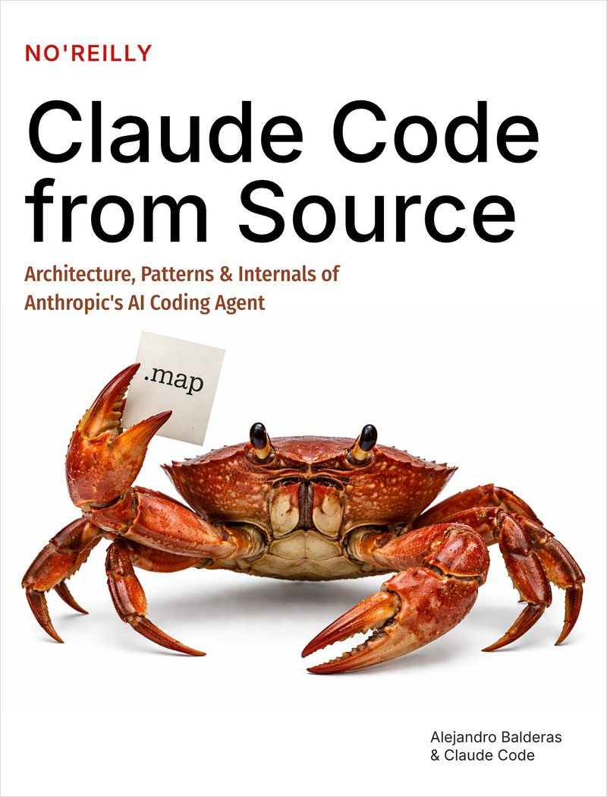

# Claude Code from Source (النسخة العربية)

**الـ Architecture والـ Patterns والتفاصيل الداخلية للـ AI Coding Agent الخاص بـ Anthropic**

> النسخة العربية من كتاب [Claude Code from Source](https://github.com/alejandrobalderas/claude-code-from-source) للمؤلف [Alejandro Balderas](https://github.com/alejandrobalderas). صُممت هذه النسخة لتوفير مرجع هندسي احترافي باللغة العربية للمطورين والمهندسين.

<p align="center">
  
  <br/><br/>
  <a href="https://claude-code-from-source.com"><strong>اقرأ الكتاب الأصلي على الإنترنت من claude-code-from-source.com</strong></a>
</p>

---

> **الـ repository ده تعليمي بالكامل.** مفيهوش أي source code من Claude Code، ولا حتى سطر واحد. كل code block فيه عبارة عن pseudocode أصلي مكتوب عشان يوضّح الـ architectural patterns. الهدف إننا نساعد المهندسين يفهموا الـ AI agents اللي شغالة في الـ production بتتبني إزاي، مش إننا نعيد إنتاج برمجيات محمية بحقوق ملكية أو نعيد توزيعها.

---

لما Anthropic نشرت Claude Code على npm، ملفات الـ source maps اللي امتدادها `.js.map` كان فيها field اسمه `sourcesContent` بيحتوي على كود TypeScript الأصلي بالكامل. الكتاب ده نتيجة دراسة الـ architecture دي؛ استخلصنا منها أهم أنماط التصميم (Patterns)، والمفاضلات الهندسية (Trade-offs)، وقرارات البنية المعمارية، وصغناها في سرد تقني يقدر أي مهندس يتعلم منه ويستفيد من خبراته العملية.

**18 فصل موزعين على 7 أجزاء.** ما يعادل ~400 صفحة مطبوعة.

كل فصل مكتوب على أكثر من مستوى من العمق: سرد متسلسل للقادة التقنيين، وأقسام متعمقة للمهندسين اللي بينفذوا بنفسهم، وخاتمة بعنوان **"طبّق ده"** بتستخلص patterns عملية تقدر تاخدها وتستخدمها في أنظمتك ومشاريعك. الرسومات التوضيحية مكتوبة بـ [Mermaid](https://mermaid.js.org/) وبتظهر على GitHub مباشرة.

---

## قراءة الكتاب عبر الويب والنشر على Cloudflare Pages

المستودع ده مجهّز بتطبيق ويب كامل مبني بـ [Astro](https://astro.build/) لقراءة الكتاب إلكترونياً باللغة العربية مع دعم كامل للـ RTL، ورسومات توضيحية تفاعلية، ومخططات Mermaid، وجاهز للنشر المباشر على **Cloudflare Pages**:

```bash
# تثبيت الحزم وتشغيل الموقع محلياً
npm run dev

# بناء الموقع الثابت (Static Site)
npm run build
```

لمعرفة خطوات ربط المستودع بـ Cloudflare Pages والنشر التلقائي، راجع [دليل النشر على Cloudflare Pages](./CLOUDFLARE_DEPLOYMENT.md).

---

## الكتاب ده لمين

- **مهندسين Senior بيبنوا أنظمة ذكية ذاتية التصرف (Agentic Systems)** — تقدر تاخد الـ patterns دي وتستخدمها في مشاريعك، وتفهم الـ trade-offs وراء كل قرار، وتنفذها في الـ tech stack بتاعك.
- **القادة التقنيين ومدراء الهندسة (Tech Leads & Engineering Managers)** — تقدر تتابع السرد المعماري والقرارات الهندسية من غير ما تحتاج تقرأ كل سطر كود.
- **أي مهندس برمجيات حابب يعرف أدوات الـ AI في الـ production بتشتغل إزاي من جوه وبكفاءة عالية.**

---

## فهرس المحتويات

### الجزء I: الأساسيات
*قبل ما الـ agent يقدر يفكر، لازم الـ process تكون قايمة وجاهزة للشغل أصلاً.*

| # | الفصل | هتتعلم إيه |
|---|---------|-------------------|
| 1 | [الـ Architecture الخاصة بالـ AI Agent](./book/ch01-architecture.md) | المفاهيم الأساسية الـ 6، ومسار البيانات (Data Flow)، ونظام الصلاحيات، وآلية الـ Build |
| 2 | [بداية سريعة — الـ Bootstrap Pipeline](./book/ch02-bootstrap.md) | التهيئة على 5 مراحل، والـ Parallel I/O، وحدود الثقة والأمان (Trust Boundary) |
| 3 | [الـ State — الـ Two-Tier Architecture](./book/ch03-state.md) | الـ Bootstrap Singleton، والـ AppState Store، والـ Sticky Latches، وتتبّع التكلفة |
| 4 | [الكلام مع Claude — الـ API Layer](./book/ch04-api-layer.md) | عميل الـ Multi-Provider، والـ Prompt Cache، والـ Streaming، والتعافي من الأخطاء |

### الجزء II: الـ Core Loop
*القلب النابض للـ agent: اعمل Stream، نفّذ، راقب النتيجة، وكرّر.*

| # | الفصل | هتتعلم إيه |
|---|---------|-------------------|
| 5 | [الـ Agent Loop](./book/ch05-agent-loop.md) | نظرة متعمقة في ملف query.ts، وضغط السياق على 4 طبقات، ومعالجة الأخطاء، وحصص الـ Tokens |
| 6 | [الـ Tools — من التعريف للتنفيذ](./book/ch06-tools.md) | واجهة الـ Tool Interface، ومسار التنفيذ المكوّن من 14 خطوة، ونظام فحص الصلاحيات |
| 7 | [تنفيذ الـ Tools بشكل Concurrent](./book/ch07-concurrency.md) | خوارزمية التقسيم (Partitioning)، والـ Streaming Executor، والتنفيذ التوقعي (Speculative Execution) |

### الجزء III: الـ Multi-Agent Orchestration
*الـ agent الواحد قوي، لكن تناغم عدة وكلاء ذكاء اصطناعي مع بعض بيعمل نقلة نوعية.*

| # | الفصل | هتتعلم إيه |
|---|---------|-------------------|
| 8 | [عمل Spawn للـ Sub-Agents](./book/ch08-sub-agents.md) | أداة AgentTool، ودورة حياة runAgent المكونة من 15 خطوة، وأنواع الـ Agents المدمجة |
| 9 | [الـ Fork Agents والـ Prompt Cache](./book/ch09-fork-agents.md) | حيلة الـ Byte-identical Prefix، ومشاركة الـ Cache، وتوفير التكلفة |
| 10 | [الـ Tasks والتنسيق والـ Swarms](./book/ch10-coordination.md) | آلة الحالات (State Machine) للـ Tasks، ووضع التنسيق، ورسائل الـ Swarm |

### الجزء IV: الحفظ الدائم والذاكرة الذكية
*الـ agent اللي من غير memory هيفضل يكرر نفس الأخطاء كل مرة.*

| # | الفصل | هتتعلم إيه |
|---|---------|-------------------|
| 11 | [الـ Memory — التعلّم من محادثة للتانية](./book/ch11-memory.md) | الذاكرة المعتمدة على الملفات، وتصنيف الأنواع الـ 4، والـ LLM Recall، والتعامل مع تقادم البيانات |
| 12 | [قابلية التوسعة — الـ Skills والـ Hooks](./book/ch12-extensibility.md) | تحميل الـ Skills على مرحلتين، ونقاط الاعتراض (Lifecycle Hooks)، وأمان الـ Snapshots |

### الجزء V: واجهة المستخدم (The Interface)
*كل حاجة بيشوفها المطور بتعدّي من الطبقة دي.*

| # | الفصل | هتتعلم إيه |
|---|---------|-------------------|
| 13 | [الـ Terminal UI](./book/ch13-terminal-ui.md) | نسخة Fork مخصصة وسريعة من Ink، ومسار الـ Rendering، والـ Double-buffer |
| 14 | [الـ Input والتفاعل](./book/ch14-input-interaction.md) | معالجة ضغطات المفاتيح (Key Parsing)، والـ Keybindings، ودعم الـ Chords، ووضع Vim |

### الجزء VI: الاتصال بالعالم الخارجي
*الـ agent بيوصل لأبعد من حدود جهازك وlocalhost.*

| # | الفصل | هتتعلم إيه |
|---|---------|-------------------|
| 15 | [MCP — البروتوكول الموحّد للـ Tools](./book/ch15-mcp.md) | بروتوكول Model Context Protocol، وأنواع الـ Transports الـ 8، وتغليف الأدوات |
| 16 | [التحكم عن بُعد والتنفيذ على الـ Cloud](./book/ch16-remote.md) | الـ Bridge v1/v2، والـ CCR، والـ Upstream Proxy |

### الجزء VII: هندسة الأداء العالي
*نخلّي كل المنظومة سريعة لدرجة إن المطور يحس بالاستجابة الفورية من غير أي تأخير.*

| # | الفصل | هتتعلم إيه |
|---|---------|-------------------|
| 17 | [الأداء — كل ملي ثانية وكل Token بيفرقوا](./book/ch17-performance.md) | تحسين زمن بدء التشغيل، وإدارة الـ Context Window، وتسريع الـ Rendering والبحث |
| 18 | [الخاتمة — اتعلمنا إيه للمستقبل](./book/ch18-epilogue.md) | الرهانات المعمارية الـ 5، والأنماط القابلة للنقل لمشاريعك، ومستقبل الـ Coding Agents |

---

## أهم 10 أنماط معمارية (Patterns) بتخلّي النظام يشتغل بكفاءة

لو عايز تطلع بأهم الخلاصة العملية المركزة:

1. **الـ AsyncGenerator كـ Agent Loop** — بيعمل yield لـ Messages، وبيرجّع Terminal كـ typed return، وإدارة الضغط العكسي (Backpressure) والإلغاء النظيف بتشتغل معاه تلقائيًا.
2. **التنفيذ التوقعي للأدوات (Speculative Tool Execution)** — ابدأ تشغيل الأدوات الآمنة للقراءة (Read-only) بالتوازي أثناء الـ streaming الخاص بالـ model قبل ما الـ response يكتمل بالكامل.
3. **تقسيم الأدوات والتنفيذ المتوازي الآمن (Concurrent-Safe Batching)** — افصل الـ tools حسب مستوى الأمان؛ شغّل عمليات القراءة (Reads) بالتوازي، ونفّذ التعديلات (Writes) بالتتابع.
4. **الـ Fork Agents لمشاركة الـ Cache** — الوكلاء الفرعيين اللي شغالين بالتوازي بيشتركوا في نفس الـ prompt prefix بدقة البايت (Byte-identical)، وده بيوفّر حوالي ~95% من تكلفة الـ input tokens.
5. **ضغط السياق على 4 مستويات متدرجة** — مسار ضغط ذكي يبدأ بـ snip، ثم microcompact، ثم collapse، وينتهي بـ autocompact حسب الحاجة؛ وكل طبقة أخف وأسرع من اللي بعدها.
6. **الذاكرة المعتمدة على الملفات مع الـ LLM Recall** — استدعاء ذكي خفيف وسريع (Side-query على Sonnet) لاختيار الذكريات والملاحظات المرتبطة بالسياق الحالي، بدل الاعتماد على مطابقة الكلمات المفتاحية العادية.
7. **تحميل الـ Skills على مرحلتين (Two-Phase Loading)** — قراءة الـ Frontmatter فقط لحظة بدء التشغيل، وتحميل المحتوى والتعليمات الكاملة عند الاستدعاء الفعلي.
8. **الـ Sticky Latches لضمان ثبات الـ Cache** — بمجرد إرسال Beta Header معين، بيفضل ثابت طول الـ session ومستحيل يتلغي، وده بيضمن بقاء الـ cache شغال بدون تكسير.
9. **حجز مساحات الـ Tokens بذكاء (Slot Reservation)** — الحد الأقصى الافتراضي لمخرجات الـ tokens بيكون 8K، ومش بيترفع لـ 64K إلا لو الـ response وصل فعلاً للحد الأقصى (وده بيوفّر context كبير في 99% من الطلبات).
10. **تجميد إعدادات الـ Hooks في Snapshot** — احتفظ بنسخة مجمّدة وغير قابلة للتعديل عند الإقلاع، علشان تمنع أي محاولات حقن أو تعديل غير مصرح به وقت التشغيل (Runtime Injection Attacks).

---

## الكتاب ده اتعمل إزاي

تم استخراج الكود من ملفات الـ source maps المرفقة بحزمة npm. وقام 36 وكيل ذكاء اصطناعي (AI Agents) بدراسة وتحليل حوالي 2,000 ملف TypeScript عبر 4 مراحل هندسية:

1. **الاستكشاف**: 6 وكلاء شغالين بالتوازي فحصوا كل ملف في شجرة المشروع (Source Tree).
2. **التحليل المعماري**: 12 وكيلاً كتبوا ما يزيد عن 494KB من التوثيق التقني الخام.
3. **الصياغة والتأليف**: 15 وكيلاً صاغوا الفصول في سرد تقني متماسك وممتع.
4. **المراجعة والتدقيق التحريري**: مراجعون تقنيون سجلوا ملاحظات دقيقة وتم تطبيق التصحيحات لضمان دقة كل فكرة ومعمارية.

العملية كلها، من تحليل الـ source وحتى إخراج الكتاب بشكله النهائي المنقح، استغرقت حوالي 6 ساعات.

---

## إخلاء مسؤولية

**المستودع ده تعليمي 100% ولا يحتوي على أي كود مقتبس أو منقول بحقوق ملكية من Claude Code.** جميع كتل الأكواد (Code Blocks) المعروضة عبارة عن كود افتراضي وشبه كود (Pseudocode) أصلي مكتوب بأسماء وهياكل مستقلة تماماً لغرض توضيح الأنماط المعمارية والمفاهيم الهندسية فقط. لا يحتوي المستودع على أي نصوص Prompts سرية أو ثوابت داخلية محمية أو كود تنفيذي لأي دالة تجارية. الهدف الوحيد هو مساعدة المطورين على استيعاب هندسة برمجيات وكلاء الذكاء الاصطناعي العاملة في البيئات الإنتاجية.

غلاف "NO'REILLY" هو مجرد محاكاة ساخرة وتعبيرية (Parody/Meme) لغرض التوضيح؛ والمشروع غير مرتبط بدار نشر O'Reilly Media بأي شكل، والسلطعون هو مجرد سلطعون.

هذا تحليل هندسي مستقل؛ وClaude Code هو منتج لشركة Anthropic، وهذا الكتاب غير تابع للشركة ولا معتمد منها رسمياً ولا برعايتها.

---

## الإسناد وحقوق الملكية الفكرية (Attribution & License)

- **العمل الأصلي**: كتاب *"Claude Code from Source — Architecture, Patterns & Internals of Anthropic's AI Coding Agent"* تأليف **[Alejandro Balderas](https://github.com/alejandrobalderas)** ([المستودع الأصلي](https://github.com/alejandrobalderas/claude-code-from-source) | [الموقع الرسمي](https://claude-code-from-source.com)).
- **الترجمة العربية**: تمت الترجمة والإعداد بواسطة **[مصطفى زاهر (Mostafa Zaher)](https://github.com/mostafazh)** ومساهمي المجتمع، بناءً على إذن صريح للمشاريع غير التجارية مع حفظ الإسناد في [Issue #3](https://github.com/alejandrobalderas/claude-code-from-source/issues/3).
- **الترخيص (License)**: هذا العمل مترجم ومنشور بموجب رخصة المشاع الإبداعي: نسب المصنف - غير تجاري - الترخيص بالمثل 4.0 دولي ([CC BY-NC-SA 4.0](./LICENSE)).
- **الاستخدام غير التجاري**: هذا المحتوى متاح مجاناً 100% للأغراض التعليمية وتطوير المجتمع الهندسي العربي دون أي أغراض تجارية.
- **ترجمات شقيقة (Sister Translations)**:
  - [الترجمة الصينية (Chinese Translation)](https://github.com/simplex86/claude-code-from-source) بواسطة [@simplex86](https://github.com/simplex86).

