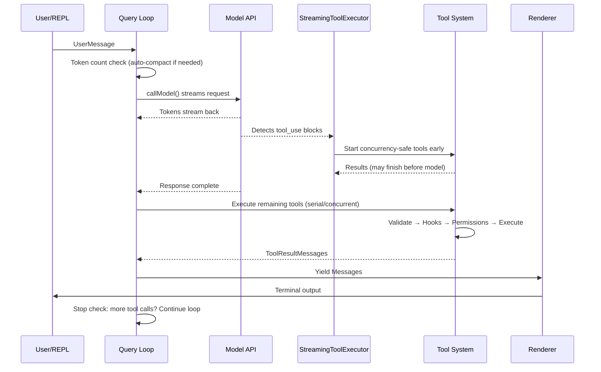
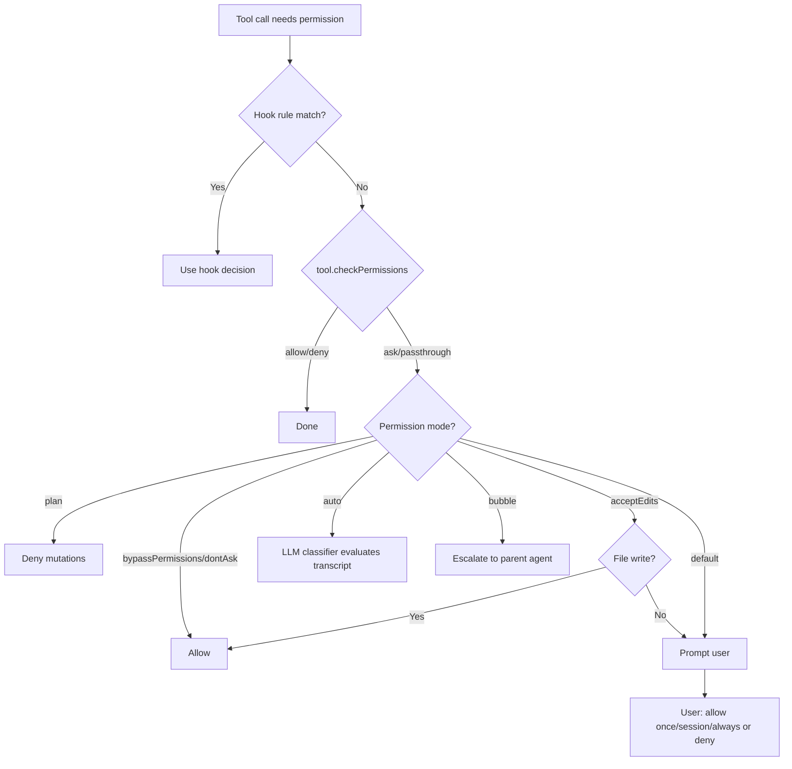
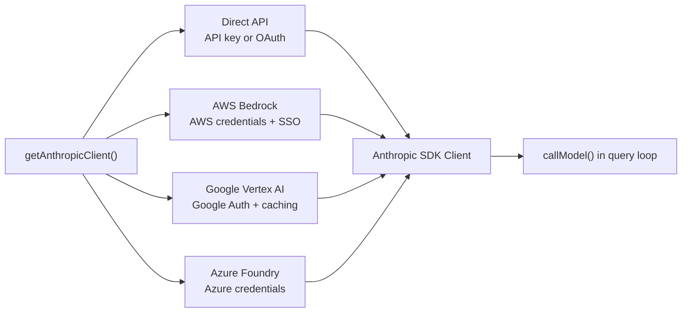
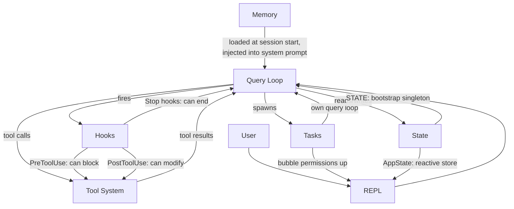

# الفصل 1: الـ Architecture الخاصة بالـ AI Agent

## إيه اللي قدامك

الـ CLI التقليدي عبارة عن function عادية: بتاخد arguments، بتنفذ شغلها، وبتخرج فوراً. الأمر `grep` مش بيقرر من نفسه إنه يشغّل `sed` معاه، والأمر `curl` مش بيفتح ملف ويعدّل فيه بناءً على اللي نزّله. الاتفاق هنا بسيط جداً: أمر واحد، بينفذ فعل واحد، وبيرجّع مخرجات ثابتة ومتوقعة (Deterministic Output).

أما الـ Agentic CLI (يعني الأنظمة اللي فيها الـ Model هو اللي بيقرر الخطوات وقت التشغيل) فبيكسر كل بند في الاتفاق ده. بياخد prompt بلغة طبيعية، ويقرر بنفسه هيستخدم أنهي tools، وينفذها بالترتيب اللي الموقف محتاجه، ويقيّم النتائج، ويكرر الدورة دي لحد ما الـ task تخلص أو يوقفه المستخدم. "البرنامج" هنا مش تسلسل ثابت ومكتوب مسبقاً من التعليمات؛ ده عبارة عن loop حوالين Language Model بيولّد تسلسل تعليماته الخاصة وقت التشغيل (Runtime). استدعاءات الأدوات (Tool Calls) بتمثل الآثار الجانبية (Side Effects)، والـ Reasoning بتاع الـ Model هو نفسه مسار التحكم في البرنامج (Control Flow).

برنامج Claude Code بيعتبر الـ Production Implementation اللي بنته Anthropic لتطبيق الفكرة دي على أرض الواقع: Monolith ضخم مكتوب بـ TypeScript في حوالي 2,000 ملف، بيحوّل الـ Terminal لبيئة تطوير متكاملة مدعومة بـ Claude. الأداة دي بتخدم مئات الآلاف من المطورين يومياً، وده معناه إن كل قرار في الـ Architecture وراه حسابات دقيقة وتأثيرات حقيقية في الأداء والاعتمادية. الفصل ده بيديك التصور الذهني والمعماري (Mental Model) للنظام كله؛ فالمنظومة بالكامل مبنية على 6 مفاهيم أساسية (Abstractions)، وبيربط بينها مسار تدفق بيانات واحد (Data Flow). لما تستوعب المسار الأساسي (The Golden Path) من أول ضغطة زر للمستخدم وحتى خروج النتيجة النهائية، هتلاقي إن كل فصل جاي بيفكك جزء من المسار ده بالتفصيل.

اللي هنشوفه هنا هو تفكيك للنظام بأثر رجعي: الـ 6 Abstractions دي متصممتش في البداية على سبورة بيضاء بنقاء نظري، بل ظهرت وتطورت تحت ضغط بناء Agent شغال في بيئة Production لقاعدة مستخدمين ضخمة. ولما تفهمها بطبيعتها الواقعية دي، هتدخل باقي فصول الكتاب برؤية هندسية واضحة.

---

## الـ 6 Abstractions الأساسية

برنامج Claude Code مبني على 6 مفاهيم أساسية (Abstractions). وكل جزء تاني في الكود معمول عشان يخدم الـ 6 دول: سواء الـ 400+ Utility Files، أو الـ Terminal Renderer المخصص، أو محاكي Vim، أو متتبع التكلفة (Cost Tracker).


تعالوا نشوف وظيفة كل مكون وسبب وجوده في المعمارية:

**1. الـ Query Loop** (ملف `query.ts`، حوالي 1,700 سطر): هو عبارة عن Async Generator بيمثل القلب النابض للنظام كله. بيعمل Stream للـ response بتاع الـ Model، ويجمع طلبات استدعاء الأدوات (Tool Calls)، وينفذها، ويضيف نتائجها لسجل المحادثة، ويكرر اللفة دي من تاني. كل تفاعل في التطبيق بيعدّي من الـ function دي تحديداً: سواء كان REPL، أو SDK، أو Sub-agent فرعي، أو حتى وضع الـ Headless (عبر الـ flag `--print`). الـ loop بيعمل yield لكائنات من نوع `Message` بتستهلكها واجهة المستخدم (UI)، والـ Return Type بتاعه عبارة عن Discriminated Union اسمه `Terminal`، وده بيسجّل بالظبط سبب انتهاء الـ loop: هل انتهى بشكل طبيعي، ولا المستخدم وقفه، ولا الـ Token Budget خلصت، ولا Stop Hook اعترضه، ولا وصل للحد الأقصى للّفات (Max Turns)، ولا حصل خطأ غير قابل للإصلاح. اختيار الـ Generator Pattern بدل الـ Callbacks أو الـ Event Emitters بيوفر إدارة طبيعية للضغط العكسي (Backpressure)، وإلغاء نظيف، وتحكم كامل بالأنواع (Typed Terminal States). الفصل 5 بيشرح تفاصيل الـ loop ده بالكامل من الداخل.

**2. الـ Tool System** (الملفات `Tool.ts`، `tools.ts`، والمجلد `services/tools/`): الأداة (Tool) هي أي حاجة الـ Agent بيقدر يعملها في العالم الخارجي: يقرأ ملف، يشغّل أمر shell، يعدّل كود، أو يبحث على الويب. البساطة دي في التعريف وراها منظومة معقدة جداً؛ فكل أداة بتطبّق Interface غنية بتغطي: هويتها، والـ Schema بتاعتها، والتنفيذ، والصلاحيات، وطريقة الـ Rendering في الواجهة. الأدوات مش مجرد دوال برمجية، بل شايلة معاها منطق الأمان والصلاحيات الخاص بيها، وتصريحها بمدى أمان تشغيلها بالتوازي (Concurrency Safety)، وتقارير التقدم. النظام بيقسّم الـ Tool Calls لحزم (Batches): جزء منها بيشتغل بالتوازي، وجزء بالتتابع. وفيه Streaming Executor بيبدأ فوراً يشغّل الأدوات الآمنة للعمل المتوازي قبل حتى ما الـ Model يكمّل توليد الـ Response! الفصل 6 بيشرح الـ Tool Interface ومسار التنفيذ بالتفصيل.

**3. الـ Tasks** (الملفات `Task.ts`، والمجلد `tasks/`): وحدات عمل بتشتغل في الخلفية، وأغلبها بيكون عبارة عن Sub-agents. بتتحرك عبر آلة حالات (State Machine): `pending -> running -> completed | failed | killed`. الأداة `AgentTool` بتعمل Spawn لـ Generator جديد من دالة `query()` ليه سجل رسائل مستقل، ومجموعة أدواته الخاصة، ووضع صلاحياته الخاص. الـ Tasks دي هي اللي بتدي Claude Code قدرة التكرار الذاتي والتفويض (Recursion): فالـ Agent بيقدر يفوّض مهام لـ Sub-agents، ودي بدورها ممكن تفرّع مهام تانية لو احتاجت.

**4. طبقتي الـ State (الـ Two-Tier State)**: النظام بيحتفظ بالحالة على مستويين منفصلين تماماً:
- **المستوى الأول:** كائن وحيد Singleton على مستوى الـ Process كلها اسمه `STATE`، وهو Mutable. شايل حوالي 80 حقل من إعدادات الـ Infrastructure الأساسية: مسار العمل (Working Directory)، وإعدادات الـ Model، وتتبع التكلفة واستهلاك الـ Tokens، والـ Telemetry، ورقم الجلسة (Session ID). بيتحدد عند الإقلاع وبيتعدّل مباشرة بدون Reactivity.
- **المستوى التاني:** Reactive Store صغير جداً (34 سطر كود شبيه بـ Zustand)، وده مخصص فقط لتحريك الـ UI: الرسائل، ووضع الإدخال، وموافقات الأدوات، ومؤشرات التقدم.
هذا الفصل المعماري مقصود وذكي: بيانات الـ Infrastructure نادراً ما بتتغير ومش محتاجة تعمل Re-renders في الشاشة، بينما حالة الـ UI بتتغير باستمرار ولازم تعمل تحديثات بصرية فورية. الفصل 3 بيشرح المعمارية دي بالتفصيل.

**5. الـ Memory** (المجلد `memdir/`): هو السياق الدائم (Persistent Context) اللي الـ Agent بيحتفظ بيه عبر الجلسات المختلفة. مبني على 3 مستويات: على مستوى المشروع (ملفات `CLAUDE.md` داخل الـ Repo)، وعلى مستوى المستخدم (`~/.claude/MEMORY.md`)، وعلى مستوى الفريق (مشاركة الذاكرة عبر Symlinks). في بداية كل جلسة، النظام بيفحص ملفات الـ Memory دي، ويعمل Parse للـ Frontmatter، وبعدها بيشغّل استدعاء LLM سريع لاختيار الذكريات اللي ليها صلة مباشرة بالمحادثة الحالية. وبفضل الـ Memory، بيقدر Claude Code يتذكر قواعد الـ Codebase بتاعك، وقرارات المعمارية السابقة، وتاريخ إصلاح المشاكل (Debugging).

**6. الـ Hooks** (المجلد `hooks/` و `utils/hooks/`): نقاط اعتراض برمجية (Lifecycle Interceptors) بيقدر المستخدم يعرفها للتدخل في دورة حياة النظام. بتشتغل عند 27 حدث (Event) مختلف، وتدعم 4 أنماط للتنفيذ: أوامر Shell، أو استدعاءات Prompt فردية (Single-shot)، أو محادثات Agent متعددة اللفات (Multi-turn)، أو HTTP Webhooks. الـ Hooks تقدر تمنع تشغيل أي Tool، أو تعدل الـ Inputs بتاعتها، أو تحقن سياق إضافي في البرومبت، أو حتى تعمل Short-circuit للـ Query Loop بالكامل. ونظام الصلاحيات نفسه جزء منه مبني عبر الـ Hooks: فخطافات `PreToolUse` تقدر ترفض طلب تشغيل الأداة قبل حتى ما يظهر للمستخدم سؤال الموافقة على الشاشة!

---

## الـ Golden Path: من ضغطة المفتاح للـ Output

تعالوا نتتبع مسار طلب واحد (Request) داخل المنظومة: المستخدم كتب "add error handling to the login function" (أضف معالجة الأخطاء لدالة تسجيل الدخول) وضغط Enter.



فيه 3 نقاط جوهرية لازم تاخد بالك منها في الـ Flow ده:

**أولاً:** الـ Query Loop عبارة عن Generator مش Callback Chain. الـ REPL بيسحب منه الرسائل بالتدريج عن طريق `for await`، وده بيخلي إدارة الضغط العكسي (Backpressure) تتم بشكل طبيعي وتلقائي: لو الـ UI اتأخر في معالجة العرض، الـ Generator بيهدي وينتظر. وده اختيار هندسي مقصود بدلاً من الـ Event Emitters أو الـ Observable Streams.

**ثانياً:** تنفيذ الأدوات بيتداخل زمنياً مع الـ Streaming الخاص بالـ Model. الكلاس `StreamingToolExecutor` مش بيستنى الـ Model لحد ما يخلّص كلامه علشان يبدأ يشغّل الأدوات الآمنة بالتوازي؛ فممكن تلاقي استدعاء قراءة ملف `Read` خلص ورجّع نتيجته بينما الـ Model لسه بيولّد باقي الـ Response! ده بيعتبر تنفيذ توقعي استباقي (Speculative Execution): فلو حصل والـ Output النهائي بتاع الـ Model ألغى الحاجة للأداة (وده نادر)، النتيجة بتُهمل ببساطة، لكن في أغلب الحالات ده بيوفر ثواني ثمينة جداً.

**ثالثاً:** الـ Loop بالكامل مصمم ليكون Re-entrant. لما الـ Model يطلب أدوات، النتائج بتتجمع وتتضاف لسجل الرسائل، والـ Loop بيستدعي الـ Model من تاني بالسياق المحدّث. مفيش مرحلة منفصلة لمعالجة النتائج خارج الـ Loop؛ كل شيء ماشي في حلقة واحدة متصلة، والـ Model هو اللي بيقرر متى ينتهي لما يبطل يطلب أدوات تانية.

---

## نظام الصلاحيات والأمان (Permissions)

الـ Claude Code بيقدر ينفذ أي أمر shell على جهازك، ويعدّل في ملفاتك، ويعمل spawn لـ sub-processes، ويبعت network requests، ويعدّل في الـ git history بتاعك كمان. فلو مفيش نظام صلاحيات محكم، الموضوع ده هيكون ثغرة أمنية وكارثة حقيقية (Attack Vector).

النظام بيعرّف 7 أوضاع للصلاحيات (Permission Modes)، مرتبة من الأكثر تساهلاً للأكثر تشدداً:

| الـ Mode | السلوك البرمجي |
|---|---|
| `bypassPermissions` | كل شيء مسموح به بدون أي فحص (مخصص للاختبارات الداخلية فقط). |
| `dontAsk` | كل شيء مسموح به، لكن بيتم تسجيله في الـ Log بدون مقاطعة المستخدم بأسئلة. |
| `auto` | بيستخدم Transcript Classifier (وهو نموذج ذكاء اصطناعي خفيف) لتقييم الطلب تلقائياً. |
| `acceptEdits` | تعديلات الملفات بتتقبل تلقائياً، وأي تعديل تاني (Mutation) بيطلب موافقة المستخدم. |
| `default` | الوضع التفاعلي المعتاد: المستخدم بيوافق يدوياً على كل فعل خارجي. |
| `plan` | وضع القراءة فقط (Read-only): ممنوع تنفيذ أي تعديلات على الملفات أو البيئة. |
| `bubble` | بيصعّد قرار الموافقة للأعلى إلى الـ Parent Agent (وده الوضع الافتراضي للـ Sub-agents). |

ولما أداة تحتاج صلاحية تنفيذ، القرار بيتحسم عبر شجرة منطقية صارمة:



الوضع `auto` يستحق اهتماماً خاصاً؛ لأنه بيشغّل استدعاء LLM سريع ومنفصل، بيفحص سجل المحادثة (Transcript) وملخص مدخلات الأداة ليحدد: هل الفعل ده ماشي مع اللي المستخدم طلبه فعلاً ولا فيه تصرف مريب؟ ده الوضع اللي بيخلي Claude Code يقدر يشتغل بشكل شبه مستقل: يوافق على الخطوات العادية الآمنة، ويوقف ويسأل عند أي خطوة غير متوقعة.

أما الـ Sub-agents فبتشتغل تلقائياً بوضع `bubble`، وده بيعني إنها متقدرش توافق من نفسها على أفعال حساسة؛ بل بتصعد طلب الصلاحية للأعلى وصولاً للمستخدم البشري، وده بيحمي النظام من أن يقوم وكيل فرعي بتنفيذ أوامر تدميرية في الخفاء بدون دراية المستخدم.

---

## المعمارية متعددة المزودين (Multi-Provider Architecture)

بيتواصل Claude Code مع نموذج Claude عبر 4 مسارات مختلفة للبنية التحتية، وباقي النظام مش بيحس بأي فرق بينها:



الفكرة المعمارية هنا إن الـ Anthropic SDK بيوفر Wrapper Classes موحدة لكل مزود سحابي، وكلها بتقدم نفس الـ Interface القياسية. دالة `getAnthropicClient()` شغالة بنمط Factory: بتقرأ متغيرات البيئة والإعدادات لتحدد المزود، وتبني الـ Client المناسب وترجعه. ومن اللحظة دي، دالة `callModel()` وباقي أجزاء النظام بيتعاملوا معاه على إنه مجرد عميل Anthropic عادي تماماً.

تحديد المزود بيتم مرة واحدة عند بدء التشغيل وبيتحفظ في كائن `STATE`. وبكده الـ Query Loop والـ Tools ونظام الصلاحيات شغالين بأسلوب Provider-agnostic بالكامل؛ فالتبديل من Direct API إلى AWS Bedrock مجرد تغيير في الإعدادات ولا يتطلب تعديل سطر كود واحد في منطق الـ Agent.

---

## نظام الـ Build والـ Packaging

بيتم توزيع Claude Code بشكلين: أداة داخلية لمهندسي Anthropic، وحزمة عامة على npm. نفس الـ Codebase بتخدم النسختين معاً، والاعتماد كله على الـ Feature Flags وقت الـ Compile:

```typescript
// Conditional imports guarded by feature flags
const reactiveCompact = feature('REACTIVE_COMPACT')
  ? require('./services/compact/reactiveCompact.js')
  : null
```

دالة `feature()` معتمدة على `bun:bundle` في محرك Bun. وقت الـ Build، كل Feature Flag بيتحول لقيمة Boolean مباشرة (`true` أو `false`). وهنا بيجي دور الـ Dead Code Elimination في الـ Bundler، اللي بيحذف استدعاء `require()` بالكامل من الحزمة لو كان الـ Flag غير مفعل؛ فالموديول مش بيتحمل في الذاكرة ومش بينزل في ملف الحزمة النهائي أصلاً.

استخدام `require()` هنا مقصود مقارنة بـ `import`؛ فالـ Bundler يقدر يحذف الـ Dynamic Require الميت بالكامل، بينما الـ Dynamic Import بيرجع Promise بيجبر الـ Bundler على الاحتفاظ بالملف تحسباً لاستدعائه وقت التشغيل.

والمفارقة الطريفة هنا هي أن ملفات الـ Source Maps اللي اتنشرت في أول إصدارات npm احتوت على حقل `sourcesContent`، اللي كان شايل كود TypeScript الأصلي كاملاً بما فيه أجزاء الميزات الداخلية الخاصة بـ Anthropic! فالـ Feature Flags أزالت الكود التنفيذي من الـ Bundle، لكنها تركت الكود المصدري مقروءاً داخل الـ Source Maps، وده اللي سمح للمطورين بتحليله هندسياً في هذا الكتاب.

---

## ترابط الأجزاء (Dependency Graph)

المفاهيم الـ 6 الأساسية بتشكل مع بعضها شبكة اعتماديات مترابطة:



- الـ **Memory** بتتحقن في الـ Query Loop كجزء أساسي من الـ System Prompt عند البداية.
- الـ **Query Loop** هو المحرك اللي بيدير تشغيل الأدوات.
- نتائج الأدوات بترجع كرسائل للـ Query Loop.
- الـ **Tasks** هي عبارة عن Query Loops فرعية متداخلة (Recursive).
- الـ **Hooks** بتعترض التدفق في نقاط محددة في دورة الحياة.
- الـ **State** بيقرأ منها ويكتب فيها الجميع، مع تخصيص الـ Reactive Store لتحديث الـ UI.

الاعتمادية الدائرية (Circular Dependency) بين الـ Query Loop ونظام الأدوات هي السمة المعمارية الأبرز: الـ Model يولد طلب أداة، الأداة تتنفذ وترجع نتيجة، النتيجة تنزل في سجل الرسائل، الـ Model يقرأ النتيجة ويقرر الخطوة الجاية، وهكذا. وتستمر الحلقة دي لحد ما الـ Model يقرر إنه انتهى، أو يتدخل قيد خارجي مثل نفاد الـ Tokens أو تدخل المستخدم.

المسار السعيد ده (Golden Path) من إدخال المستخدم وحتى خروج الناتج هو الخيط الناظم للكتاب كله: الفصل 2 هيوريك إزاي النظام بيقلع ويوصل للنقطة دي في 300ms، والفصل 3 هيكشف معمارية الـ State، والفصل 4 هيشرح طبقة الـ API، وتتوالى الفصول في سبر أغوار كل مكون خطوة بخطوة.

---

## طبّق ده في مشاريعك (Takeaways)

لو بتصمم أو بتبني نظام ذكي ذاتي التصرف (Agentic System)، فدي أهم الأنماط المعمارية اللي تقدر تاخدها مباشرة من Claude Code وتطبقها في مشروعك:

**1. نمط الـ Generator في الـ Agent Loop:**
استخدم Async Generator ليكون هو حلقة الـ Loop الأساسية، وتجنب الاعتماد على الـ Callbacks أو الـ Event Emitters. الـ Generator بيديك تحكماً ممتازاً في إدارة الضغط العكسي (Backpressure)، وإلغاءً نظيفاً بنقرة واحدة عبر `.return()`، وحالات خروج منضبطة ومعرّفة بأنواع محددة في الـ Type System، مما يجنبك حيرة تتبع متى ولماذا انتهى الـ Loop.

**2. واجهات الأدوات ذاتية الوصف (Self-describing Tools):**
خلّي كل أداة هي المسؤولة عن إعلان متطلبات صلاحياتها، وما إذا كانت آمنة للتشغيل المتوازي، وكيفية عرضها في الـ UI. بلاش تجمع كل المنطق ده في Orchestrator مركزي ضخم (God Object) تضطر تعدل فيه كل ما تضيف أداة جديدة. الأداة ذاتية الوصف بتخلي نظامك ينمو بسهولة ويقبل أدوات جديدة بدون المساس بالكود القديم.

**3. افصل حالة البنية التحتية عن حالة واجهة المستخدم:**
مش كل متغير في النظام محتاج اشتراك وتحديث بصرية (Reactive Updates). إعدادات الجلسة، وتتبع التكلفة، والـ Telemetry مكانها كائن عادي سريع في الذاكرة (Mutable Singleton). أما الرسائل ومؤشرات التقدم وموافقات المستخدم فمكانها Reactive Store مخصص. الفصل ده بيمنع إعادة رسم الشاشة (Re-renders) بدون داعٍ ويحافظ على سرعة فائقة.

**4. صمم أوضاع صلاحيات (Permission Modes) بدل شروط فحص متفرقة:**
حدد مجموعة أوضاع واضحة ومعرّفة (زي `plan` للقراءة فقط، و `default` للموافقة اليدوية، و `auto` للتقييم التلقائي)، واجعل كل أداة تمر عبر محرك الأوضاع ده. تجنب نثر شروط `if (isAllowed)` في كل ملف، وده هيضمن لك اتساقاً أمنياً ووضوحاً تاماً في تدقيق صلاحيات نظامك.

**5. المعمارية التكرارية عبر الـ Tasks:**
الوكلاء الفرعيون (Sub-agents) لازم يكونوا عبارة عن نسخ جديدة من نفس حلقة الـ Agent Loop الأساسية، بسجلات محادثة مستقلة، مع تصعيد الصلاحيات للأعلى عبر وضع `bubble`. المعمارية دي بتضمن إن الوكلاء الفرعيين يورثوا نفس آليات معالجة الأخطاء والأمان بدون الحاجة لكتابة كود استثنائي لكل وكيل فرعي.
