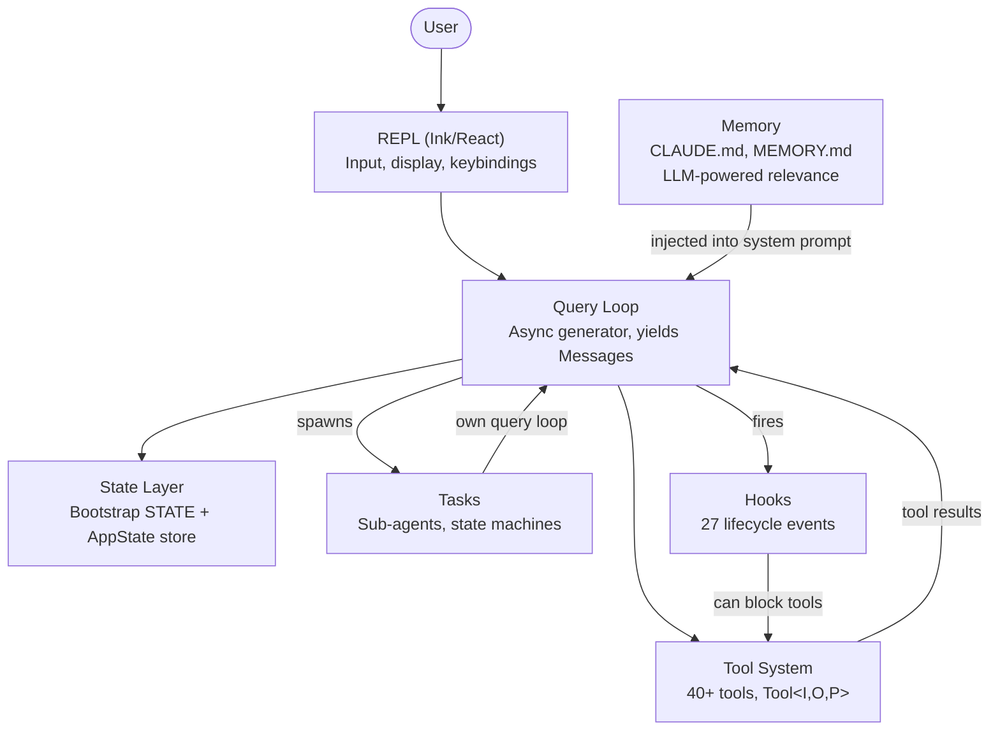
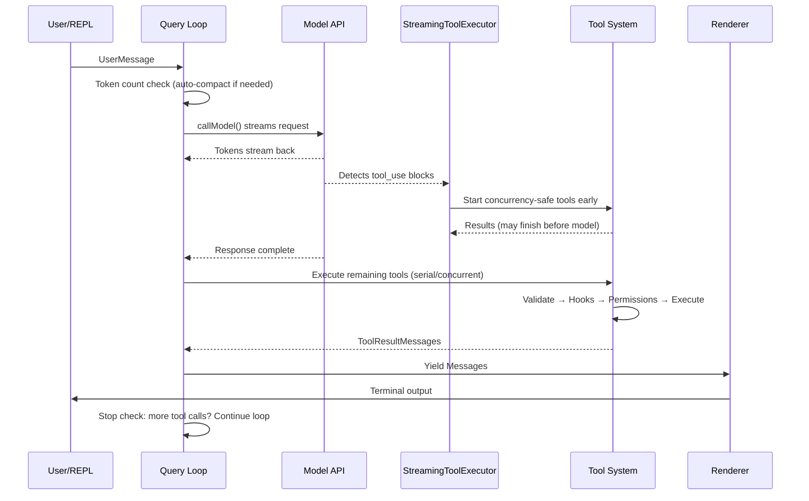
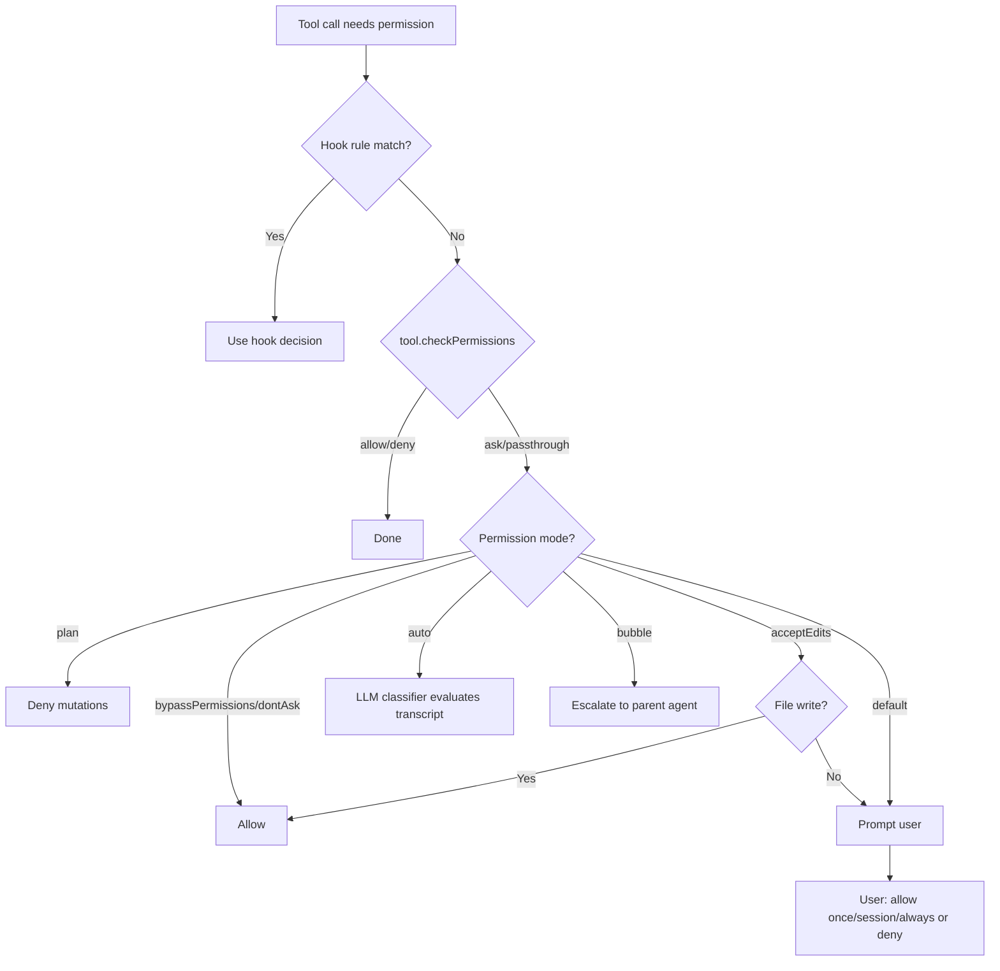
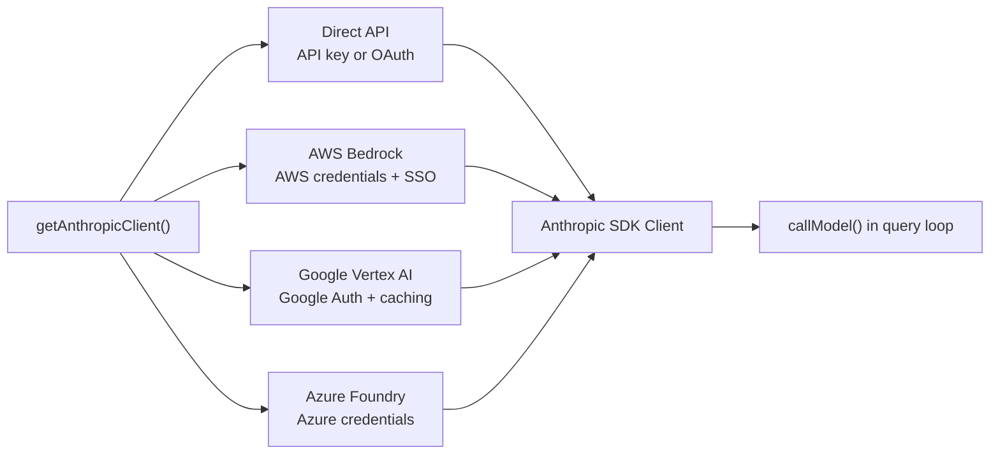
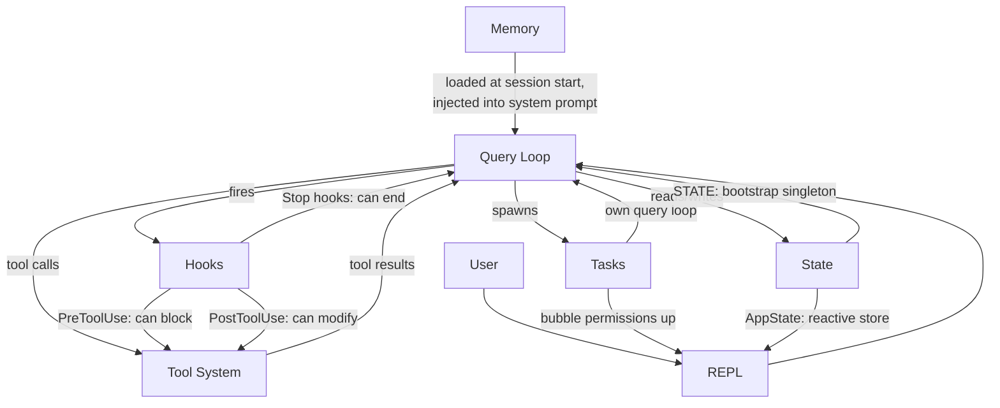

# الفصل 1: الـ Architecture الخاصة بالـ AI Agent

## إيه اللي قدامك

الـ CLI التقليدي عبارة عن function. بياخد arguments، بينفذ شغله، ويخرج. الأمر `grep` مش بيقرر من نفسه إنه يشغّل `sed` كمان. والأمر `curl` مش بيفتح ملف ويعدّل فيه بناءً على اللي نزّله. الاتفاق بسيط: أمر واحد، فعل واحد، و output من نوع deterministic (نفس المدخلات بتدّي نفس المخرجات كل مرة).

أما الـ agentic CLI (يعني الـ model هو اللي بيقرر الخطوات وقت التشغيل) فبيكسر كل بند في الاتفاق ده. بياخد prompt بلغة طبيعية، ويقرر هيستخدم أي tools، وينفذها بالترتيب اللي الموقف محتاجه، ويقيّم النتائج، ويكرر الدورة دي لحد ما الـ task تخلص أو المستخدم يوقفه. "البرنامج" هنا مش تسلسل ثابت من التعليمات. هو loop حوالين language model بيولّد تسلسل التعليمات الخاص بيه وقت التشغيل. الـ tool calls هي الـ side effects (آثار جانبية خارج الـ function نفسها). والـ reasoning الخاص بالـ model هو نفسه الـ control flow.

يعتبر Claude Code هو الـ production implementation اللي عملته Anthropic للفكرة دي: monolith مكتوب بـ TypeScript من حوالي 2,000 ملف، بيحوّل الـ terminal لبيئة تطوير كاملة شغالة بـ Claude. وصل لمئات الآلاف من المطوّرين، وده معناه إن كل قرار في الـ architecture ليه عواقب حقيقية على أرض الواقع. الفصل ده بيديك الـ mental model (التصور الذهني). النظام كله بيتحدد بـ 6 abstractions (مفاهيم أساسية بتخبّي التفاصيل وراها). وبيربط بينها data flow (مسار انتقال البيانات) واحد. لما تستوعب الـ golden path (المسار الأساسي للـ request من أوله لآخره) من أول ضغطة مفتاح لحد الـ output النهائي، هتلاقي إن كل فصل بعد كده بيقرّب على جزء واحد من المسار ده.

اللي جاي ده تفكيك للنظام بأثر رجعي: الـ 6 abstractions دي مش متصممة مقدمًا على سبورة. هي ظهرت تحت ضغط تسليم agent شغال في الـ production لقاعدة مستخدمين كبيرة. ولما تفهمها زي ما هي فعليًا، مش زي ما كان مخطط لها، هتدخل باقي الكتاب بتوقعات صحيحة.

---

## الـ 6 Abstractions الأساسية

برنامج Claude Code مبني على 6 abstractions أساسية. وكل حاجة تانية موجودة عشان تخدم الـ 6 دي: الـ 400+ utility files، والـ terminal renderer اللي معموله fork، ومحاكاة vim، والـ cost tracker.



ودي وظيفة كل واحد منها وسبب وجوده.

**1. الـ Query Loop** (ملف `query.ts`، ~1,700 سطر). عبارة عن async generator (function بترجّع قيمها واحدة واحدة بشكل asynchronous)، وهو القلب النابض للنظام كله. بيعمل stream للـ response الخاص بالـ model، ويجمع الـ tool calls، وينفذها، ويضيف النتائج لسجل الرسائل، ويعيد الدورة. كل تفاعل بيعدّي من الـ function الواحدة دي: الـ REPL، والـ SDK، والـ sub-agent، ووضع الـ headless (من غير UI) بالـ flag `--print`. بيعمل yield لـ objects من الـ type `Message` والـ UI بيستهلكها. والـ return type الخاص بيه discriminated union (type بيجمع كذا حالة، وكل حالة ليها علامة بتميزها) اسمه `Terminal`. وده بيسجّل بالضبط الـ loop وقف ليه: انتهاء طبيعي، أو إيقاف من المستخدم، أو نفاد الـ token budget، أو تدخل stop hook، أو الوصول للـ max turns، أو خطأ مش ممكن التعافي منه. الـ generator pattern، بدل الـ callbacks أو الـ event emitters، بيدّيك backpressure (إن المستهلك هو اللي بيتحكم في سرعة المنتج) طبيعي، وإلغاء نظيف، و typed terminal states. الفصل 5 بيشرح تفاصيل الـ loop من الداخل بالكامل.

**2. الـ Tool System** (`Tool.ts`، `tools.ts`، `services/tools/`). الـ tool هي أي حاجة الـ agent يقدر يعملها في العالم الخارجي: يقرأ ملف، يشغّل أمر shell، يعدّل كود، يبحث على الـ web. لكن بساطة الهدف دي مخبّية وراها آليات كثيرة. كل tool بتعمل implement لـ interface غنية بتغطي: الهوية، والـ schema، والتنفيذ، والصلاحيات، والـ rendering. الـ tools مش مجرد functions. كل واحدة شايلة معاها منطق الصلاحيات الخاص بيها، وإعلانها عن الـ concurrency، وتقارير التقدم، والـ UI rendering. النظام بيقسّم الـ tool calls على batches: منها concurrent ومنها بالتتابع. وفيه streaming executor بيبدأ يشغّل الـ tools اللي هي concurrency-safe قبل حتى ما الـ model يخلّص الـ response. الفصل 6 بيشرح الـ tool interface كاملة والـ execution pipeline.

**3. الـ Tasks** (`Task.ts`، `tasks/`). الـ tasks هي وحدات شغل بتشتغل في الخلفية، وأغلبها sub-agents. بتمشي على state machine: `pending -> running -> completed | failed | killed`. الـ tool `AgentTool` بتعمل spawn لـ generator جديد من `query()` ليه سجل الرسائل الخاص بيه، ومجموعة الـ tools الخاصة بيه، والـ permission mode الخاص بيه. الـ tasks هي اللي بتدّي Claude Code قدرته على الـ recursion: الـ agent يقدر يفوّض شغل لـ sub-agents، ودي كمان تقدر تفوّض لغيرها.

**4. الـ State** (طبقتين). النظام بيحتفظ بالـ state على مستويين. المستوى الأول singleton (object واحد بس على مستوى الـ process كله) اسمه `STATE`، وهو mutable (قابل للتعديل المباشر). شايل ~80 field من الـ infrastructure الخاصة بالـ session: الـ working directory، وإعدادات الـ model، وتتبّع التكلفة، وعدادات الـ telemetry، والـ session ID. بيتحدد مرة واحدة عند بدء التشغيل، وبيتعدّل بشكل مباشر، من غير أي reactivity. المستوى التاني reactive store (أي تغيير فيه بيبلّغ الـ UI تلقائيًا) صغير جدًا (34 سطر، على شكل Zustand)، وهو اللي بيحرّك الـ UI: الرسائل، والـ input mode، وموافقات الـ tools، ومؤشرات التقدم. التقسيم ده مقصود. الـ infrastructure state نادرًا ما بيتغير ومش محتاج يسبب re-renders. أما الـ UI state فبيتغير طول الوقت ولازم يسببها. الفصل 3 بيشرح الـ architecture من مستويين (two-tier) بالتفصيل.

**5. الـ Memory** (`memdir/`). هو الـ context الدائم اللي الـ agent بيحتفظ بيه بين الـ sessions. ليه 3 مستويات: مستوى المشروع (ملفات `CLAUDE.md` داخل الـ repo)، ومستوى المستخدم (`~/.claude/MEMORY.md`)، ومستوى الفريق (بيتشارك عن طريق symlinks). في بداية الـ session، النظام بيدوّر على كل ملفات الـ memory، وبيعمل parse للـ frontmatter، وبعدها LLM بيختار أي memories ليها علاقة بالمحادثة الحالية. وعن طريق الـ Memory، بيقدر Claude Code "يفتكر" الـ conventions الخاصة بالـ codebase عندك، وقرارات الـ architecture، وتاريخ الـ debugging.

**6. الـ Hooks** (`hooks/`، `utils/hooks/`). عبارة عن interceptors (نقاط اعتراض) بيعرّفها المستخدم على الـ lifecycle (دورة حياة التنفيذ). بتشتغل عند 27 events مختلفة، وليها 4 أنواع تنفيذ: أوامر shell، و LLM prompts من نوع single-shot، ومحادثات agent من نوع multi-turn، و HTTP webhooks. الـ hooks تقدر تمنع تنفيذ tool، أو تعدّل الـ inputs، أو تضيف context زيادة، أو تعمل short-circuit للـ query loop كله. جزء من نظام الصلاحيات نفسه متنفّذ عن طريق الـ hooks: الـ hooks من نوع `PreToolUse` تقدر ترفض tool calls قبل ما الـ permission prompt التفاعلي يظهر أصلًا.

---

## الـ Golden Path: من ضغطة المفتاح للـ Output

تعالى نتتبع request واحد داخل النظام. المستخدم بيكتب "add error handling to the login function" (أضف error handling للـ function الخاصة بالـ login) ويضغط Enter.



فيه 3 حاجات لازم تلاحظها في الـ flow ده.

أولًا، الـ query loop عبارة عن generator، مش callback chain. الـ REPL بيسحب منه الرسائل عن طريق `for await`، وده معناه إن الـ backpressure بيحصل بشكل طبيعي: لو الـ UI مش قادر يلاحق، الـ generator بيقف مؤقتًا. وده اختيار مقصود بدل الـ event emitters أو الـ observable streams.

ثانيًا، تنفيذ الـ tools بيتداخل مع الـ streaming الخاص بالـ model. الـ class `StreamingToolExecutor` مش بيستنى الـ model يخلّص عشان يبدأ يشغّل الـ tools اللي هي concurrency-safe. ممكن call لـ `Read` يخلص ويرجّع نتيجته والـ model ما زال بيولّد باقي الـ response. وده اسمه speculative execution (تنفيذ مبكر على أمل إن النتيجة هتتحتاج): لو الـ output النهائي للـ model خلّى الـ tool call غير صالح (وده نادر لكنه ممكن)، النتيجة بتترمي.

ثالثًا، الـ loop كله re-entrant (بيرجع يدخل نفسه تاني بالـ context المحدّث). لما الـ model يعمل tool calls، النتائج بتتضاف لسجل الرسائل، والـ loop بيستدعي الـ model مرة تانية بالـ context المحدّث. مفيش مرحلة منفصلة اسمها "معالجة الـ tool results": كله loop واحد. والـ model هو اللي بيقرر إنه خلّص، ببساطة لما يبطّل يعمل tool calls.

---

## نظام الصلاحيات

بيشغّل Claude Code أي أوامر shell على جهازك. وبيعدّل ملفاتك. ويقدر يعمل spawn لـ sub-processes، ويعمل network requests، ويعدّل الـ git history الخاص بيك. من غير نظام صلاحيات، ده يبقى كارثة أمنية.

النظام بيعرّف 7 permission modes، مرتبة من الأكثر تساهلًا للأقل:

| الـ Mode | السلوك |
|------|----------|
| `bypassPermissions` | كل حاجة مسموحة. من غير أي فحص. للاستخدام الداخلي والاختبار بس. |
| `dontAsk` | كله مسموح، لكن بيتسجّل في الـ log. من غير أي prompts للمستخدم. |
| `auto` | الـ transcript classifier (وهو LLM) بيقرر يسمح ولا يرفض. |
| `acceptEdits` | تعديلات الملفات بتتوافق عليها تلقائيًا، وأي mutation تاني بيسأل المستخدم. |
| `default` | الـ mode التفاعلي العادي. المستخدم بيوافق على كل فعل. |
| `plan` | قراءة فقط. كل الـ mutations ممنوعة. |
| `bubble` | بيصعّد القرار للـ parent agent (ده mode الـ sub-agents). |

لما tool call يحتاج صلاحية، القرار بيتحسم عن طريق سلسلة صارمة:



الـ mode `auto` يستاهل اهتمام خاص. بيشغّل LLM call منفصل وخفيف، بيصنّف الـ tool invocation في ضوء الـ conversation transcript (سجل المحادثة). الـ classifier (model صغير بيصنّف الطلب: مسموح ولا لأ) بيشوف صورة مختصرة من الـ tool input، ويقرر هل الفعل ده متسق مع اللي المستخدم طلبه ولا لأ. وده الـ mode اللي بيخلّي Claude Code يشتغل بشكل شبه مستقل: بيوافق على العمليات الروتينية، وبينبّه على أي حاجة شكلها خارج عن قصد المستخدم.

الـ sub-agents بتشتغل افتراضيًا بالـ mode `bubble`، وده معناه إنها مش بتقدر توافق بنفسها على أفعالها الخطيرة. طلبات الصلاحية بتطلع لفوق للـ parent agent، أو في الآخر للمستخدم نفسه. وده بيمنع أي sub-agent من إنه يشغّل في صمت أوامر مدمّرة المستخدم ماشافهاش أصلًا.

---

## الـ Multi-Provider Architecture

بيتكلم Claude Code مع Claude عن طريق 4 مسارات infrastructure مختلفة، وباقي النظام مش بيحس بالفرق بينها.



الفكرة الأساسية إن الـ Anthropic SDK بيوفّر wrapper classes لكل cloud provider، وكلها بتقدّم نفس الـ interface اللي بيقدّمها الـ direct API client. الـ function `getAnthropicClient()` عبارة عن factory (function وظيفتها تنشئ الـ object المناسب وترجّعه). بتقرأ الـ environment variables والإعدادات عشان تحدد أي provider هتستخدمه، وتبني الـ client المناسب، وترجّعه. ومن اللحظة دي، الـ function `callModel()` وأي مستهلك تاني بيتعاملوا معاه على إنه مجرد Anthropic client عادي.

اختيار الـ provider بيتحدد عند بدء التشغيل وبيتخزن في `STATE`. الـ query loop مش بيتحقق أبدًا من الـ provider الشغال. وده معناه إن التحويل من Direct API لـ Bedrock تغيير في الإعدادات، مش تغيير في الكود. الـ agent loop والـ tool system ونظام الصلاحيات كلها provider-agnostic تمامًا.

---

## نظام الـ Build

بيتوزّع Claude Code بشكلين: tool داخلية في Anthropic، و npm package عامة. نفس الـ codebase بتخدم الاتنين، والـ compile-time feature flags (مفاتيح بتشغّل أو تقفل ميزات) هي اللي بتتحكم في إيه اللي يدخل في كل نسخة.

```typescript
// Conditional imports guarded by feature flags
const reactiveCompact = feature('REACTIVE_COMPACT')
  ? require('./services/compact/reactiveCompact.js')
  : null
```

الـ function `feature()` جاية من `bun:bundle`، وهو الـ bundler API المدمج في Bun. وقت الـ build، كل feature flag بيتحوّل لـ boolean literal. بعد كده الـ dead code elimination (حذف الكود اللي مستحيل يتنفذ) الخاص بالـ bundler بيشيل الـ call `require()` بالكامل لما الـ flag يكون false. يعني الـ module مش بيتحمّل، ومش بيدخل الـ bundle، ومش بيوصل للمستخدم أصلًا.

الـ pattern ثابت: guard من `feature()` على الـ top level، بيغلّف call لـ `require()`. واستخدام `require()` بدل `import` مقصود تحديدًا: الـ bundler يقدر يحذف الـ dynamic `require()` بالكامل لما الـ guard يكون false، لكن مش بيقدر يعمل كده مع الـ dynamic `import()` (لأنه بيرجّع Promise والـ bundler لازم يحافظ عليه).

فيه مفارقة تستاهل الذكر. الـ source maps اللي اتنشرت مع إصدارات npm الأولى كان فيها `sourcesContent`: يعني الـ TypeScript source الأصلي كامل، بما فيه الـ code paths المخصصة للاستخدام الداخلي فقط. الـ feature flags نجحت في إنها تشيل الـ runtime code، لكنها سابت الـ source موجود في الـ maps. وبالطريقة دي بقى الـ source code الخاص بـ Claude Code متاح لأي حد يقرأه.

---

## إزاي الأجزاء بتتوصل ببعض

الـ 6 abstractions بتكوّن مع بعض dependency graph:



الـ Memory بيدخل للـ query loop كجزء من الـ system prompt. الـ query loop هو اللي بيحرّك تنفيذ الـ tools. الـ tool results بترجع للـ query loop في شكل رسائل. الـ tasks عبارة عن recursive query loops ليها سجلات رسائل معزولة. الـ hooks بتعترض الـ query loop عند نقاط محددة. والـ state الكل بيقرأ منه ويكتب فيه، والـ reactive store هو الجسر للـ UI.

الـ circular dependency (A محتاج B و B محتاج A) بين الـ query loop والـ tool system هي أهم سمة بتميّز النظام. الـ model بيولّد tool calls. الـ tools بتتنفذ وتطلّع نتائج. النتائج بتتضاف لسجل الرسائل. الـ model بيشوف النتائج ويقرر الخطوة الجاية. والدورة دي بتستمر لحد ما الـ model يبطّل يولّد tool calls، أو لحد ما قيد خارجي (الـ token budget، أو الـ max turns، أو إيقاف من المستخدم) ينهيها.

وده ربطها بالفصول الجاية: الـ golden path من الـ input للـ output هو الخيط اللي ماشي في الكتاب كله. الفصل 2 بيتتبع إزاي النظام بيبدأ التشغيل لحد النقطة اللي المسار ده يقدر يشتغل عندها. الفصل 3 بيشرح الـ state architecture من مستويين (two-tier) اللي المسار بيقرأ منها ويكتب فيها. الفصل 4 بيغطي الـ API layer اللي الـ query loop بيستدعيه. وكل فصل بعد كده بيقرّب على جزء واحد من المسار اللي شفته حالًا من أوله لآخره.

---

## طبّق ده

لو بتبني نظام agentic، يعني أي نظام فيه LLM هو اللي بيقرر ياخد أي أفعال وقت التشغيل، فدي الـ patterns من الـ architecture الخاصة بـ Claude Code اللي تقدر تنقلها عندك.

**الـ generator loop pattern.** استخدم async generator كـ agent loop عندك، مش callbacks ولا event emitters. الـ generator بيدّيك backpressure طبيعي (المستهلكين بيسحبوا بالسرعة اللي تناسبهم)، وإلغاء نظيف (`.return()` على الـ generator)، و return value ليها type محدد للـ terminal states. المشكلة اللي بيحلها: في الـ agent loops المبنية على callbacks، صعب تعرف الـ loop "خلّص" إمتى وليه. الـ generators بتخلّي الإنهاء جزء أصيل من الـ type system.

**الـ tool interface اللي بتوصف نفسها.** كل tool لازم تعلن بنفسها عن الـ concurrency safety الخاصة بيها، ومتطلبات الصلاحيات، وسلوك الـ rendering. ماتحطش الـ logic ده في orchestrator مركزي "عارف" كل tool. المشكلة اللي بيحلها: الـ orchestrator المركزي بيتحول لـ god object لازم يتعدّل كل مرة تضيف فيها tool. أما الـ tools اللي بتوصف نفسها فبتكبر بشكل خطي: إضافة الـ tool رقم N+1 مش محتاجة أي تغيير في الكود الموجود.

**افصل الـ infrastructure state عن الـ reactive state.** مش كل الـ state محتاج يسبب تحديثات في الـ UI. إعدادات الـ session، وتتبّع التكلفة، والـ telemetry مكانها object عادي mutable. أما سجل الرسائل، ومؤشرات التقدم، وطوابير الموافقات فمكانها reactive store. المشكلة اللي بيحلها: لما تخلّي كل حاجة reactive، بتضيف subscription overhead وتعقيد على state بيتغير مرة واحدة عند بدء التشغيل وبيتقري ألف مرة. مستويين لأن فيه access patterns اتنين مختلفين.

**الـ permission modes، مش الـ permission checks.** عرّف مجموعة صغيرة من الـ modes ليها أسماء (plan، default، auto، bypass)، وخلّي كل قرار صلاحية يتحسم عن طريق الـ mode. ماتوزّعش checks زي `if (isAllowed)` في الـ implementations الخاصة بالـ tools. المشكلة اللي بيحلها: تطبيق الصلاحيات بشكل غير متسق. لما كل tool تعدّي على نفس سلسلة الحسم المبنية على الـ mode، تقدر تحكم على الوضع الأمني للنظام بمجرد ما تعرف أي mode هو الشغال.

**الـ recursive agent architecture عن طريق الـ tasks.** الـ sub-agents لازم تكون instances جديدة من نفس الـ agent loop، وكل واحد ليه سجل الرسائل الخاص بيه، مش code paths معمولة كحالة خاصة. وتصعيد الصلاحيات بيمشي لفوق عن طريق الـ mode `bubble`. المشكلة اللي بيحلها: sub-agent logic بيبعد عن الـ main agent loop، وده بيؤدي لفروق خفية في السلوك وفي الـ error handling. لو الـ sub-agent هو نفس الـ loop، هيورث كل الضمانات نفسها.
