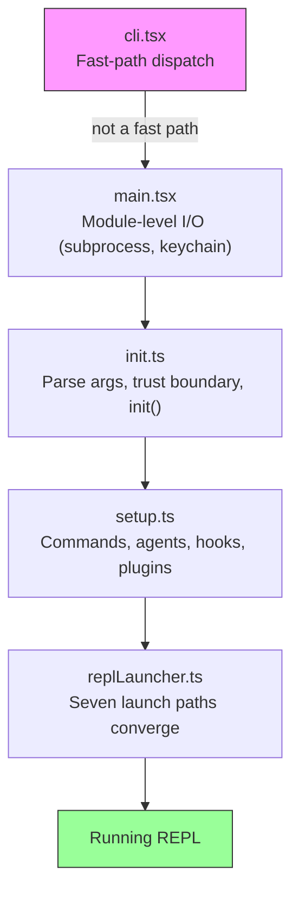
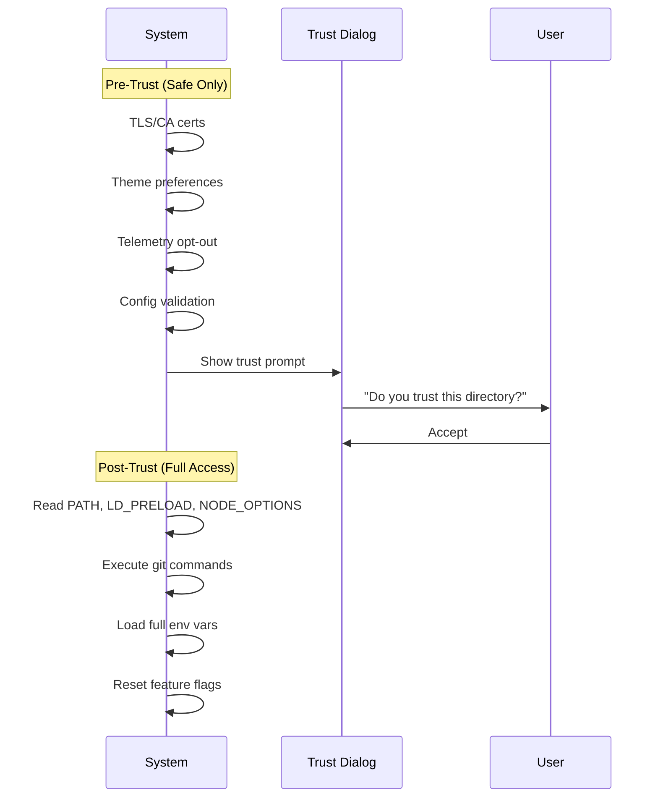

```mermaid
gantt
    title Phase 3: Parallel Setup
    dateFormat X
    axisFormat %Lms

    section Sequential
    Commands registration   :0, 5
    section Parallel
    Agent definitions      :5, 15
    Hook registration      :5, 12
    Plugin initialization  :5, 20
    MCP server connections :5, 25
```

# الفصل 2: بداية سريعة -- الـ Bootstrap Pipeline

لو الفصل 1 إداك خريطة الـ Architecture الشاملة لـ Claude Code، فالفصل ده بياخدك في رحلة تتبع المسار اللي بيمشيه النظام من لحظة كتابة الأمر وحتى يصبح جاهزاً تماماً للعمل. كل مكون من المفاهيم الـ 6 الأساسية (Abstractions) — الـ Query Loop، ونظام الـ Tools، وطبقات الـ State، والـ Hooks، والـ Memory — لازم يتهيأ ويستقر قبل ما يظهر الـ Cursor للمستخدم على الشاشة. والميزانية الزمنية المتاحة لكل العملية دي هي: **300 ملي ثانية فقط**.

الـ 300 ملي ثانية دي هي الحد الفاصل في علم تجربة المستخدم اللي بيحس عنده الإنسان إن الأداة سريعة وبتستجيب فوراً. لو اتأخرت عن الرقم ده، أداة الـ CLI هتبان تقيلة وبطيئة، ولو زادت بفرق ملحوظ، المطورين هيهربوا منها ومش هيستخدموها. كل قرار هندسي في الفصل ده معمول عشان يضمن بقاء زمن الإقلاع تحت الخط ده بكل ثبات.

مسار بدء التشغيل (Bootstrap Pipeline) لازم ينجز 4 مهام أساسية: يتحقق من سلامة البيئة، ويرسم حدود الثقة والأمان، ويضبط إعدادات طبقة الاتصال، ويعمل أول Render للواجهة. وكل ده في أقل من 300ms! الفكرة الهندسية العبقرية هنا هي إن المهام دي بتتداخل بالتوازي (Parallelism)، وبتترتب بدقة، مع استبعاد فوري لأي موديول مش ضروري لحظة الإقلاع، وده اللي بيخلي المنظومة تلتزم بميزانية تبان شبه مستحيلة لنظام بهذا التعقيد.

> **ملاحظة عن المنهجية:** التوقيتات المذكورة في هذا الفصل تقريبية ومستخرجة من نقاط الفحص (Profiling Checkpoints) المدمجة داخل كود التطبيق، وتمثل أداء التشغيل الدافئ (Warm Start) على أجهزة حديثة؛ بينما التشغيل البارد (Cold Start) بيكون أبطأ قليلاً. الأرقام المطلقة تهمنا كنسب توضيحية لفهم أي العمليات بتشتغل بالتوازي، وأيها بيتأجل لبعد العرض.

---

## شكل الـ Pipeline ومسار الملفات

الـ Pipeline الخاص ببدء التشغيل بيمر عبر 5 ملفات رئيسية بتتنفذ بتسلسل متدرج، وكل ملف بيضيّق نطاق العمل اللي بعده:



كل ملف بينفذ أقل قدر ممكن من الشغل قبل ما يسلم الراية للي بعده:
- ملف `cli.tsx` بيحاول ينهي الشغل ويخرج فوراً قبل ما يعمل import لأي موديول ثقيل.
- ملف `main.tsx` بيطلق العمليات البطيئة كآثار جانبية متزامنة (Side Effects) أثناء مرحلة الـ Import Evaluation.
- ملف `init.ts` بيحسم الإعدادات ويرسم حدود الثقة والأمان (Trust Boundary).
- ملف `setup.ts` بيسجل الإمكانيات والـ Tools والـ Hooks.
- ملف `replLauncher.ts` بيحدد نقطة الدخول المناسبة ويشغل واجهة الـ UI.

فيه 3 استراتيجيات للتوازي بتخلي الإقلاع سريع جداً:

1. **إطلاق الـ Subprocesses على مستوى الموديول (Module-level Dispatch):** قراءة الـ Keychain وفحص الـ MDM بينطلقوا كعمليات خلفية فوراً *أثناء تقييم الـ Imports* في الذاكرة، فبيشتغلوا بالتوازي مع تحميل باقي الموديولات، وده بيكسب النظام حوالي ~135ms.
2. **التوازي عبر الـ Promises في مرحلة الـ Setup:** ربط الـ Socket، وأخذ لقطة مجمّدة (Snapshot) للـ Hooks، وتحميل الأوامر وتعريفات الـ Agents، كل ده شغال بشكل Concurrent.
3. **التأجيل الذكي لما بعد الـ Render (Deferred Prefetches):** أي بيانات مش مطلوبة في الثواني الأولى قبل ما المستخدم يكتب أول رسالة بيتم تأجيلها لبعد ظهور الشاشة، زي: فحص حالة الـ Git، وقدرات الـ Model، وبيانات اعتماد AWS.

وفوق كل ده، فيه استراتيجية رابعة غاية في الأهمية: **الاعتماد على الـ Dynamic Imports لتأجيل تحميل الموديولات (Deferred Module Evaluation)**. الكود بيستخدم `await import('./module.js')` في أكثر من 12 مكاناً حيوياً؛ فمكتبة OpenTelemetry الضخمة (400KB كود + 700KB لـ gRPC) مش بتتحمل إلا وقت تفعيل الـ Telemetry فعلياً، ومكونات React مش بتتحمل إلا لحظة الرسم. صحيح إن كل Dynamic Import بيضيف Latency طفيف عند أول استدعاء في الـ Cold Path، لكنه في المقابل بيخلي الـ Hot Path فائق السرعة لأن التشغيل مش بيدفع ضريبة موديولات ممكن المستخدم ميحتاجهاش نهائياً في جلسته.

---

## المرحلة 0: الـ Fast-Path Dispatch (ملف cli.tsx)

أول ملف يدخله محرك التشغيل هو `cli.tsx`، وله مهمة واحدة محددة: يقرر هل المستخدم محتاج تشغيل كامل للـ Bootstrap Pipeline ولا لأ؟ فيه أوامر بسيطة جداً بتطلب إجابة سريعة ومباشرة، زي: `claude --version` أو `claude --help` أو `claude mcp list`. في الحالات دي، تحميل مكتبات زي React، وتهيئة الـ Telemetry، وقراءة الـ Keychain بالكامل يعتبر هدراً غير مبرر للوقت والموارد.

النمط المعماري هنا بسيط وذكي: افحص مصفوفة الأوامر `argv`، واعمل Dynamic Import لـ Handler الأداة المطلوبة فقط، واخرج فوراً:

```typescript
// Pseudocode for the fast-path pattern
if (args.length === 1 && args[0] === '--version') {
  const { printVersion } = await import('./commands/version.js')
  await printVersion()
  process.exit(0)
}
```

فيه حوالي 12 مساراً سريعاً (Fast Paths) بتغطي أرقام الإصدارات، والمساعدة، وإدارة خوادم MCP، وفحص التحديثات. كل مسار بيعمل Import لموديول واحد بالظبط، بينفذ دالة واحدة، ويقفل الـ Process. وباقي ملفات الـ Codebase مش بتلمس الذاكرة أصلاً.

وده أول تطبيق لقاعدة ذهبية في هندسة الأداء: **كل ما نيتك تتضح بدري، اشتغل أقل**. لو مفيش مسار سريع مطابق، ملف `cli.tsx` بيكمل ويكمل استيراد `main.tsx` ليبدأ الإقلاع الفعلي الكامل.

---

## المرحلة 1: الـ Module-Level I/O (ملف main.tsx)

لما محرك الجافاسكريبت يعمل Import لملف `main.tsx`، بتبدأ الـ Side Effects على مستوى الموديول في العمل فوراً أثناء الـ Evaluation وقبل استدعاء أي دالة داخل الملف:

```typescript
// These run at import time, not at call time
const mdmPromise = startMDMSubprocess()
const keychainPromise = readKeychainCredentials()
```

وأثناء ما الـ Engine بيفحص ويحمّل بقية الاستيرادات المترابطة (Transitive Imports) وده بياخد حوالي ~138ms، بتكون الـ Promises دي شغالة في الخلفية في نفس الوقت. عملية الـ MDM بتتحقق من سياسات الأمان في الشركات، واستدعاء الـ Keychain بيسترجع بيانات الدخول المحفوظة. الاتنين عمليات إدخال وإخراج (I/O-bound) بطيئة، ولولا تشغيلهم بالتوازي كان زمانهم ضافوا ثواني إضافية على المسار الحرج (Critical Path).

الدرس المعماري هنا: وقت الـ Module Evaluation مش وقت ضائع في انتظار المحرك، ده وقت ذهبي تقدر تشغّل فيه مهام I/O متوازية. ولما الكود يحتاج البيانات دي لاحقاً، بتكون الـ Promises عملت Resolve وانتهت بالفعل.

---

## المرحلة 2: التحليل وتحديد حدود الأمان (ملف init.ts)

الدالة `init()` معمولة بنمط Memoized لتخزين نتيجتها في الذاكرة؛ يعني استدعاؤها أكثر من مرة آمن تماماً وبيرجّع نفس الناتج بدون إعادة تشغيل. وده مهم لأن فيه كذا نقطة دخول للنظام (الـ REPL، أو وضع الطباعة `--print`، أو وضع الـ SDK)، وكل نقطة ممكن تنادي `init()`. والـ Memoization بيضمن إن التهيئة متتكررش أبداً.

الدالة دي بتعمل Parse لمدخلات سطر الأوامر عبر مكتبة Commander، وبتحمل الإعدادات من مصادرها المختلفة، ثم تصل لأخطر وأهم حد فاصل في النظام: **حدود الثقة والأمان (The Trust Boundary)**.

### حدود الثقة والأمان (Trust Boundary)

قبل خط الأمان ده، النظام شغال في وضع مقيد ومشدد؛ وبعده، كل قدرات النظام بتتفتح بالكامل. الحد ده اتعمل لأن Claude Code بيقرأ متغيرات البيئة (Environment Variables)، ومتغيرات البيئة دي ممكن يتم تلويثها أو تسميمها (Poisoned).



حد الأمان (Trust Boundary) مش معمول عشان المستخدم يثق في Claude Code، بل معمول عشان Claude Code يتأكد إنه يقدر يثق في **البيئة والمجلد** اللي شغال فيه! فملف `.bashrc` خبيث مثلاً ممكن يحقن متغيرات زي `LD_PRELOAD` لاختراق الـ Subprocesses. والـ Trust Dialog بيضمن موافقة المستخدم الصريحة قبل قراءة أي متغيرات بيئة حساسة أو تشغيل أوامر git في مجلد غير موثوق.

### الخطاف التمهيدي: preAction Hook

خطاف `preAction` في مكتبة Commander بيعتبر حجر زاوية مهم في المعمارية؛ فالمكتبة بتحلل بناء الأمر والـ Flags من غير ما تنفذ الفعل نفسه، وبيتدخل `preAction` لتشغيل التهيئة بالظبط قبل تنفيذ الـ Handler المطابق:

```typescript
program.hook('preAction', async (thisCommand) => {
  await init(thisCommand)
})
```

الفصل ده بيضمن إن الأوامر البسيطة والسريعة مش بتدفع تكلفة `init()` أبداً، والتهيئة الكاملة بتشتغل فقط للأوامر اللي محتاجة المنظومة كلها.

---

## المرحلة 3: التهيئة وتسجيل القدرات (ملف setup.ts)

بمجرد اكتمال `init()`، بتبدأ دالة `setup()` بتسجيل كل القدرات والإمكانيات اللي محتاجها النظام:



تسجيل الأوامر والـ Agents والـ Hooks وخوادم MCP بيتم بالتوازي بأقصى قدر ممكن. هنا بينتقل النظام من مجرد "عارف إعداداتي" إلى مرحلة "جاهز بكل أدواتي ومستعد للعمل".

وهنا بيحصل إجراء أمني حاسم: **تجميد لقطة إعدادات الـ Hooks في Snapshot**. إعدادات الخطافات بتتقرأ من القرص مرة واحدة وتتجمد في كائن Immutable يفضل ثابت طول الـ Session، وأي محاولة لتعديل ملف الإعدادات على القرص بعد بدء التشغيل بيتم تجاهلها تماماً، وده بيمنع أي مهاجم من التلاعب بالصلاحيات وقت التشغيل. اللقطة دي هي المصدر المعتمد الوحيد (Source of Truth) لكل قرارات الأمان اللاحقة.

---

## المرحلة 4: الإطلاق والعرض (ملف replLauncher.ts)

فيه 7 مسارات تشغيل مختلفة بتتلاقى في ملف `replLauncher.ts`: الـ Interactive REPL، ووضع الطباعة السريعة `--print`، ووضع الـ SDK، واستئناف الجلسات السابقة عبر `--resume` و `--continue`، ووضع الـ Pipe، والـ Headless Mode. المحرك بيفحص المود المطلوب ويوجه التنفيذ للنهاية المناسبة.

أهم مسارين:
- **الـ Interactive REPL (الوضع التفاعلي المعتاد):** بيقوم بتركيب (Mount) شجرة مكونات React/Ink، ويشغل الـ Terminal Renderer، ويدخل في الـ Event Loop ليظهر الـ Prompt للمستخدم ويبدأ الكتابة.
- **وضع الطباعة `--print` (Single-shot Execution):** بينشئ Query Loop خفيف بدون واجهة React، وينفذ المطلوب، ويبعت الـ Output كـ Stream على `stdout` ويخرج فوراً.

الميزة المعمارية الرائعة هنا: الـ 7 مسارات دي في النهاية بتستدعي نفس دالة `query()` الموحدة؛ فمسار الإطلاق بيحدد فقط **كيف تُعرض النتيجة للمستخدم**، مش **ماذا يفعل الـ Agent**، وده اللي بيخلي المنظومة مضمونة ومتسقة وقابلة للاختبار في مختلف بيئات التشغيل.

---

## الخط الزمني وميزانية الـ 300ms

ده الشكل التوضيحي للـ Pipeline كاملاً على محور الزمن (~240ms):

```mermaid
gantt
    title Bootstrap Timeline (~240ms)
    dateFormat X
    axisFormat %Lms

    section Phase 0
    Fast-path check          :0, 5

    section Phase 1
    Module evaluation        :5, 143
    MDM subprocess (parallel) :8, 60
    Keychain read (parallel)  :8, 50

    section Phase 2
    Commander parse          :143, 146
    init()                   :146, 160
    Trust boundary           :160, 175

    section Phase 3
    setup() + parallel registration :175, 210

    section Phase 4
    Launch path selection    :210, 215
    First render             :215, 240
```



### ميزانية الأداء الفعلية:

| المرحلة | الزمن المستغرق | ماذا يحدث خلف الكواليس؟ |
|---|---|---|
| فحص الـ Fast Path | ~5ms | فحص مدخلات argv والخروج السريع إن أمكن |
| تقييم الموديولات (Module Evaluation) | ~138ms | قراءة شجرة الـ Imports وإطلاق الـ I/O بالتوازي في الخلفية |
| تحليل أوامر Commander | ~3ms | تحليل الـ Flags والـ Subcommands |
| دالة التهيئة init() | ~14ms | حسم الإعدادات، وإجراء فحص الـ Trust Boundary |
| دالة الإعداد setup() | ~35ms | تسجيل الأدوات والوكلاء والـ Hooks وخوادم MCP |
| اختيار مسار الإطلاق وأول Render | ~25ms | تجهيز مسار العرض وتركيب مكونات الواجهة وأول رسم على الشاشة |
| **الإجمالي** | **~240ms** | **تحت ميزانية الـ 300ms بنجاح بهامش أمان 60ms** |

---

## نظام الترقية وهجرة البيانات (Migrations)

نظام فرعي خفيف بيشتغل لحظة الإقلاع: ترقية هيكل البيانات المحفوظة (Schema Migrations). Claude Code بيحفظ الإعدادات والجلسات في ملفات محلية على جهازك، ولما يحصل تغيير في البنية بين التحديثات، دوال ترقية سريعة و Idempotent (تكرار تشغيلها آمن تماماً) بتشتغل وتخلص في أقل من 5ms، مع إعطاء الأولوية القصوى لتوافر النظام (Availability) حتى لا يتعطل المطور بسبب خطأ بسيط في ملف محلي.

---

## دروس مستفادة في تصميم وبناء الأنظمة (Takeaways)

**1. شغّل مهام الـ I/O بالتوازي مع تحميل الكود:**
استغل الوقت اللي محرك اللغة بيقضيه في تحليل الـ Imports وشغّل معاه قراءات الـ I/O والـ Subprocesses في الخلفية؛ لما تحتاج النتيجة هتلاقيها جاهزة وموفرة عليك مئات الملي ثواني.

**2. ضيّق نطاق الشغل في أبكر لحظة ممكنة:**
صمم نظام الإقلاع كقمع (Funnel) متدرج؛ لو الأمر المطلوب بسيط ومحدد (زي طلب المساعدة أو فحص الإصدار)، اخرج فوراً بالمسار السريع (Fast Path) قبل ما تحمّل مكتبات الواجهة الثقيلة أو تشغّل تهيئة معقدة.

**3. ارسم حدود الأمان والثقة (Trust Boundaries) بصرامة:**
إذا كان تطبيقك بيتعامل مع بيئة خارجية أو يقرأ متغيرات بيئة من النظام، حدد بوضوح ما هو آمن للقراءة مسبقاً، واشترط موافقة المستخدم الصريحة قبل الوصول للموارد الحساسة لتمنع هجمات الحقن وتسميم البيئة.

**4. احفظ نتائج التهيئة في الذاكرة (Memoize Init Functions):**
اجعل دوال الإقلاع Idempotent بحيث ترجع نفس النتيجة وتتنفذ مرة واحدة فقط حتى لو استدعيت من عدة أماكن، وده بيلغي تماماً مشاكل الترتيب والـ Double-initialization Bugs.

**5. احفظ مدخلات المستخدم المبكرة فوراً:**
في الأنظمة المعتمدة على الأحداث، التقط مدخلات المستخدم من سطر الأوامر (argv) في أول سطر في البرنامج وخزنها بأمان قبل البدء في أي شغل غير متزامن (Async)، لتضمن عدم ضياع أي أمر حتى لو استغرقت التهيئة وقتاً أطول على الأجهزة البطيئة.
