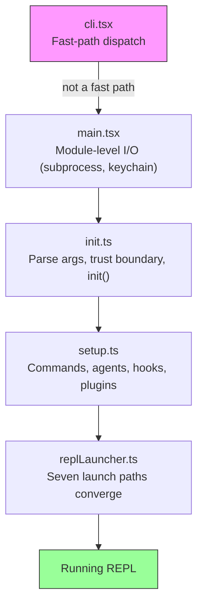
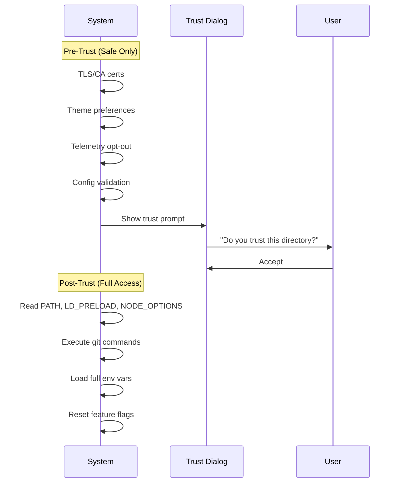

```mermaid
gantt
    title Bootstrap Timeline (~240ms)
    dateFormat X
    axisFormat %Lms

    section Phase 0
    Fast-path check          :0, 5

    section Phase 1
    Module evaluation        :5, 143
    MDM subprocess (parallel) :8, 60
    Keychain read (parallel)  :8, 50

    section Phase 2
    Commander parse          :143, 146
    init()                   :146, 160
    Trust boundary           :160, 175

    section Phase 3
    setup() + parallel registration :175, 210

    section Phase 4
    Launch path selection    :210, 215
    First render             :215, 240
```

# الفصل 2: بداية سريعة -- الـ Bootstrap Pipeline

لو الفصل 1 إداك خريطة الـ architecture الخاصة بـ Claude Code، فالفصل ده بيديك الطريق اللي النظام بيمشيه لحد ما يوصل لحالة جاهزة للشغل. كل component من الـ 6 abstractions (مفاهيم أساسية بتخبّي التفاصيل وراها)، يعني الـ query loop والـ tool system والـ state layers والـ hooks والـ memory، لازم يتهيّأ قبل ما المستخدم يشوف الـ cursor. والميزانية المتاحة لكل ده: 300 ملي ثانية.

الـ 300 ملي ثانية دي هي الحد اللي الإنسان بيحس عنده إن الأداة بتستجيب فورًا. لو عدّيت الحد ده، الـ CLI هيبان بطيء. ولو عدّيته بفرق كبير، المطوّرين هيبطلوا يستخدموه. كل حاجة في الفصل ده موجودة عشان نفضل تحت الخط ده.

الـ bootstrap (خطوات تجهيز البرنامج من أول تشغيل الـ process لحد ما يبقى جاهز) لازم يحقق 4 حاجات: يتحقق من البيئة، ويرسم حدود الأمان، ويضبط إعدادات طبقة الاتصال، ويعمل render للـ UI. ولازم يخلّص الأربعة في أقل من 300ms. الفكرة الأساسية في الـ architecture هنا إن الـ 4 مهام دي ممكن تتداخل جزئيًا، وتترتب بعناية، ونشيل منها من غير تردد كل اللي مش ضروري. وبكده تدخل في ميزانية تبان مستحيلة لنظام بالتعقيد ده.

ملاحظة عن المنهجية: التوقيتات في الفصل ده تقريبية، ومأخوذة من الـ profiling checkpoints الموجودة في الـ codebase نفسها. وهي بتمثل توقيتات warm start عادية على أجهزة حديثة. الـ cold starts أبطأ. الأرقام المطلقة أقل أهمية من البنية النسبية: أي عمليات بتتداخل، وأيها بتوقّف اللي بعدها لحد ما تخلص، وأيها بتتأجل.

---

## شكل الـ Pipeline

الـ pipeline الخاص ببدء التشغيل موجود في 5 ملفات بتتنفذ بالترتيب. كل ملف بيضيّق نطاق اللي النظام محتاج يعمله بعد كده:



كل ملف بينفذ أقل شغل ممكن قبل ما يسلّم التحكم للملف اللي بعده. ملف `cli.tsx` بيحاول يخرج قبل ما يعمل import لأي حاجة تقيلة. ملف `main.tsx` بيطلق العمليات البطيئة كـ side effects (آثار جانبية خارج الـ function نفسها) أثناء الـ import evaluation. ملف `init.ts` بيحسم الإعدادات وبيرسم الـ trust boundary (الخط الفاصل بين ما قبل موافقة المستخدم وما بعدها). ملف `setup.ts` بيسجّل الإمكانيات. وملف `replLauncher.ts` بيختار الـ entry point المناسب ويشغّل الـ UI.

فيه 3 استراتيجيات parallelism بتخلي ده سريع:

1. **الـ Module-level subprocess dispatch.** أطلق قراءات الـ keychain والـ MDM كـ side effects *أثناء الـ import evaluation*. الـ subprocesses بتشتغل في نفس الوقت اللي بيتحمّل فيه باقي الـ static imports، وده بياخد ~135ms.
2. **الـ Promise parallelism في الـ setup.** ربط الـ socket، وأخذ snapshot (نسخة مجمّدة في لحظة معينة) للـ hooks، وتحميل الأوامر، وتحميل الـ agent definitions، كل ده بيشتغل بشكل concurrent.
3. **الـ Deferred prefetches بعد الـ render.** كل اللي المستخدم مش محتاجه قبل ما يكتب أول رسالة بيشتغل بعد ما الـ prompt يظهر: git status، وقدرات الـ model، والـ AWS credentials (بيانات الدخول).

فيه استراتيجية رابعة أقل ظهورًا لكنها بنفس الأهمية: **dynamic imports عشان نأجّل الـ module evaluation** (تنفيذ كود الـ module لحظة الـ import). الـ codebase بتستخدم `await import('./module.js')` في 12 مكان على الأقل، عشان تأجّل تحميل الكود لحد ما تحتاجه. مكتبة OpenTelemetry (400KB + 700KB gRPC) بتتحمّل بس لما الـ telemetry يتهيّأ. والـ React components بتتحمّل بس وقت الـ rendering. كل dynamic import بيدفع latency (زمن الاستجابة) في الـ cold path، لأن أول استخدام هو اللي بيشغّل الـ module evaluation. وفي المقابل بيكسب سرعة في الـ hot path، لأن بدء التشغيل مش بيدفع ثمن modules ممكن ما يستخدمهاش أبدًا.

---

## المرحلة 0: الـ Fast-Path Dispatch (cli.tsx)

أول ملف الـ process بتدخله هو `cli.tsx`، وعنده وظيفة واحدة: يحدد هل الـ bootstrap pipeline الكامل مطلوب أصلًا ولا لأ. فيه استدعاءات كثيرة محتاجة إجابة محددة ومش أكثر، زي `claude --version` و `claude --help` و `claude mcp list`. في الحالات دي، تحميل React وتهيئة الـ telemetry وقراءة الـ keychain وتجهيز الـ tool system كله إهدار تام.

الـ pattern هو: افحص `argv`، واعمل dynamic import للـ handler اللي محتاجه بس، واخرج قبل ما باقي النظام يتحمّل.

```typescript
// Pseudocode for the fast-path pattern
if (args.length === 1 && args[0] === '--version') {
  const { printVersion } = await import('./commands/version.js')
  await printVersion()
  process.exit(0)
}
```

فيه حوالي 12 fast path (طريق مختصر للحالات البسيطة) بتغطي الإصدار، والمساعدة، والإعدادات، وإدارة الـ MCP servers، وفحص التحديثات. التفاصيل مش مهمة، المهم هو الـ pattern. كل path بيعمل dynamic import لـ module واحد بالضبط، وبيستدعي function واحدة، ويخرج. وباقي الـ codebase مش بتتحمّل أصلًا.

ده أول ظهور لمبدأ هيتكرر في الـ bootstrap كله: **اعمل شغل أقل لما تعرف أكثر عن النية**. الـ argv array بيكشف نية المستخدم. لو النية ضيقة، مسار التنفيذ لازم يبقى ضيق هو كمان.

لو مفيش fast path مطابق، ملف `cli.tsx` بيكمل لحد الـ import الكامل لملف `main.tsx`، وساعتها بيبدأ التشغيل الحقيقي.

---

## المرحلة 1: الـ Module-Level I/O (main.tsx)

لما ملف `main.tsx` بيتعمله import، الـ side effects اللي على مستوى الـ module بتنطلق أثناء الـ evaluation، يعني قبل ما أي function في الملف تتنادى. ودي أكثر تقنية مؤثرة على الأداء في الـ bootstrap كله:

```typescript
// These run at import time, not at call time
const mdmPromise = startMDMSubprocess()
const keychainPromise = readKeychainCredentials()
```

أثناء ما الـ JavaScript engine بيعمل evaluate لباقي `main.tsx` والـ transitive imports الخاصة بيه (~138ms من الـ module evaluation)، الـ promises الاتنين دي بتكون شغالة فعلًا. الـ MDM (Mobile Device Management) subprocess بتفحص سياسات الأمان الخاصة بالمؤسسة. وقراءة الـ keychain بتجيب الـ credentials المحفوظة. الاتنين عمليات I/O-bound، ولولا كده كانوا هيتنفذوا بالتتابع على الـ critical path (سلسلة الخطوات اللي بتحدد الزمن الكلي).

الفكرة الأساسية: وقت الـ module evaluation مش وقت فاضي، ده وقت تقدر تشغّل فيه I/O بالتوازي. ولما الـ functions اللي ملف `main.tsx` بيعملها export تتنادى لأول مرة، الـ promises دي غالبًا بتكون عملت resolve فعلًا.

التقنية دي محتاجة تعطيل قواعد ESLint الخاصة بـ top-level-await و side-effect-in-module-scope في الملفات المعنية. والـ codebase فيها ESLint rule مخصص لأنماط الوصول لـ `process.env` تحديدًا. الـ rule ده بيسمح بـ side effects محكومة في الـ module scope، وبيمنع غير المحكومة في أي مكان تاني.

---

## المرحلة 2: الـ Parse والـ Trust (init.ts)

الـ function `init()` هي memoized (بتحسب النتيجة مرة واحدة وتحتفظ بيها)، يعني استدعاءها أكثر من مرة آمن وبيرجّع نفس النتيجة. وده مهم لأن فيه أكثر من entry point (الـ REPL، والـ print mode، والـ SDK mode)، وكل واحد منها ممكن يستدعي `init()`. والـ memoization بتضمن إنها تتنفذ مرة واحدة بالضبط.

الـ function دي بتعمل parse للـ command-line arguments عن طريق Commander، وبتحمّل الإعدادات من أكثر من مصدر (الإعدادات العامة، وإعدادات المشروع، والـ environment variables). وبعد كده بتوصل لأهم حد فاصل في الـ pipeline.

### الـ Trust Boundary

قبل الـ trust boundary، النظام بيشتغل في وضع مقيّد. وبعده، كل الإمكانيات بتبقى متاحة. الحد ده موجود لأن Claude Code بيقرأ environment variables، والـ environment variables ممكن تتسمّم.



الـ trust boundary مش معناه إن المستخدم يثق في Claude Code. معناه إن Claude Code نفسه يثق في *البيئة* اللي شغال فيها. ملف `.bashrc` خبيث ممكن يضبط `LD_PRELOAD` عشان يحقن كود في كل subprocess. والـ trust dialog بيضمن إن المستخدم يوافق بشكل صريح على الشغل في مجلد ممكن يكون حد تاني هو اللي جهّز إعداداته.

النظام فيه 10 عمليات مختلفة حساسة للـ trust. قبل ما المستخدم يقبل الـ trust dialog، العمليات الآمنة بس هي اللي بتشتغل: إعداد شهادات الـ TLS، وتفضيلات الـ theme، والـ telemetry opt-out. وبعد الـ trust، النظام بيقرأ environment variables ممكن تكون خطيرة (PATH، LD_PRELOAD، NODE_OPTIONS)، وبينفذ أوامر git، وبيطبّق إعدادات البيئة كاملة.

### الـ preAction Hook

الـ hook `preAction` الخاص بـ Commander هو حجر الأساس في الـ architecture. مكتبة Commander بتعمل parse لبنية الأمر (الـ flags، والـ subcommands، والـ positional arguments) *من غير* ما تنفذ أي حاجة. والـ hook `preAction` بيشتغل بعد الـ parsing، لكن قبل ما الـ handler الخاص بالأمر المطابق يشتغل:

```typescript
program.hook('preAction', async (thisCommand) => {
  await init(thisCommand)
})
```

الفصل بين الخطوتين بالشكل ده معناه إن أوامر الـ fast path (اللي بتتعالج في `cli.tsx` قبل ما Commander يتحمّل) مش بتدفع تكلفة `init()` أبدًا. الأوامر اللي محتاجة البيئة كاملة هي بس اللي بتشغّل التهيئة.

---

## المرحلة 3: الـ Setup (setup.ts)

بعد ما `init()` تخلّص، الـ function `setup()` بتسجّل كل الإمكانيات اللي النظام محتاجها:

```mermaid
gantt
    title Phase 3: Parallel Setup
    dateFormat X
    axisFormat %Lms

    section Sequential
    Commands registration   :0, 5
    section Parallel
    Agent definitions      :5, 15
    Hook registration      :5, 12
    Plugin initialization  :5, 20
    MCP server connections :5, 25
```



الأوامر والـ agents والـ hooks والـ plugins كلها بتتسجّل بالتوازي كل ما كان ده ممكن. مرحلة الـ setup هي اللي النظام بينتقل فيها من "أنا عارف إعداداتي" لـ "أنا عندي كل إمكانياتي". بعد الـ setup، كل tool بتبقى متسجّلة، وكل hook بيبقى متوصّل، والنظام جاهز يتعامل مع الـ input الخاص بالمستخدم.

الـ setup كمان مسؤول عن الـ security hook snapshot. إعدادات الـ hooks بتتقرأ من الـ disk مرة واحدة، وبتتجمّد في snapshot يكون immutable، وبتفضل هي المستخدمة لباقي الـ session. وأي تعديلات بعد كده على ملف إعدادات الـ hooks على الـ disk النظام بيتجاهلها. وده بيمنع أي مهاجم من إنه يعدّل قواعد الـ hooks بعد ما الـ session تبدأ. الـ snapshot المجمّد هو الـ source of truth (المرجع الوحيد المعتمد) في قرارات الصلاحيات.

---

## المرحلة 4: الـ Launch (replLauncher.ts)

فيه 7 code paths مختلفة بتتجمع عند ملف `replLauncher.ts`: الـ interactive REPL، والـ print mode (`--print`)، والـ SDK mode، والـ resume (`--resume`)، والـ continue (`--continue`)، والـ pipe mode، والـ headless (من غير UI). الـ launcher بيفحص الإعدادات اللي `init()` طلّعتها، وبيوجّه التنفيذ للـ entry point المناسب.

مثالين بيوضحوا مدى التنوع:

**الـ Interactive REPL** -- الحالة العادية. الـ launcher بيعمل mount للـ React/Ink component tree، وبيشغّل الـ terminal renderer، وبيدخل الـ event loop. المستخدم بيشوف prompt ويقدر يبدأ يكتب.

**الـ Print mode** (`--print`) -- prompt واحد جاي من argv. الـ launcher بينشئ query loop يكون headless ومن غير React tree، وبيشغّله لحد ما يخلّص، وبيعمل stream للـ output على stdout، ويخرج. نفس الـ agent loop، لكن بطريقة عرض مختلفة.

التفصيلة المهمة: الـ 7 paths كلها في الآخر بتستدعي `query()`، وهو نفس الـ agent loop اللي في الفصل 1. الـ launch path بيحدد الـ loop هيتعرض *إزاي* (interactive terminal، أو single-shot، أو SDK protocol)، مش هو بيعمل *إيه*. والتجمّع ده هو اللي بيخلي الـ architecture قابلة للاختبار وسلوكها متوقّع: مهما كانت الطريقة اللي المستخدم شغّل بيها Claude Code، السلوك الأساسي واحد.

---

## الخط الزمني لبدء التشغيل

ده شكل الـ pipeline الكامل على محور الزمن:



الـ critical path بيعدّي على الـ module evaluation (أطول مرحلة منفردة، بـ ~138ms)، وبعدها Commander parse، ثم init، ثم setup. عمليات الـ I/O المتوازية (MDM، والـ keychain) بتتداخل مع الـ module evaluation، وفي العادة بتكون خلصت قبل ما نحتاجها.

### ميزانية الأداء

| المرحلة | الزمن | اللي بيحصل |
|-------|------|-------------|
| فحص الـ fast path | ~5ms | فحص argv، والخروج مبكرًا لو ممكن |
| الـ module evaluation | ~138ms | الـ import tree، وإطلاق الـ I/O المتوازي |
| Commander parse | ~3ms | عمل parse للـ flags والـ subcommands |
| init() | ~14ms | حسم الإعدادات، والـ trust boundary |
| setup() | ~35ms | الأوامر، والـ agents، والـ hooks، والـ plugins |
| الـ launch + أول render | ~25ms | اختيار الـ path، وعمل mount لـ React، والـ first paint |
| **الإجمالي** | **~240ms** | أقل من ميزانية الـ 300ms |

الإجمالي حوالي 240ms على جهاز حديث، يعني فيه 60ms هامش تحت ميزانية الـ 300ms. الـ cold starts (أول تشغيل بعد الـ reboot، والـ OS cache فاضي) ممكن توصّل الـ module evaluation لـ 200ms+، وده بيقرّب الإجمالي من الحد.

---

## نظام الـ Migration

ملاحظة سريعة عن subsystem واحد بيشتغل أثناء التهيئة: الـ schema migrations. بيخزّن Claude Code الإعدادات وبيانات الـ sessions في ملفات ومجلدات محلية. ولما الـ format بيتغير بين الإصدارات، الـ migrations بتشتغل تلقائيًا عند بدء التشغيل.

كل migration عبارة عن function ليها رقم إصدار. النظام بيقارن إصدار الـ schema الحالي بأعلى إصدار migration، وبيشغّل الـ migrations المعلّقة بالترتيب، وبيحدّث الإصدار. الـ migrations دي idempotent (تكرار تنفيذها بيدّي نفس النتيجة) وسريعة (بتشتغل على ملفات محلية صغيرة، مش على databases). ودورة الـ migration كلها في العادة بتخلص في أقل من 5ms. ولو migration فشل، النظام بيسجّل الخطأ ويكمل. في الإعدادات المحلية، الـ availability أهم من الـ consistency الصارمة.

---

## بدء التشغيل بيعلّمنا إيه عن تصميم الأنظمة

الـ bootstrap pipeline درس في تضييق النطاق. كل مرحلة بتقلّل مساحة الاحتمالات:

- المرحلة 0 بتضيّق من "أي استدعاء للـ CLI" لـ "محتاج bootstrap كامل"
- المرحلة 1 بتضيّق من "كل حاجة لازم تتحمّل" لـ "حمّل بالتوازي مع الـ I/O"
- المرحلة 2 بتضيّق من "بيئة مجهولة" لـ "بيئة موثوقة وإعداداتها محسومة"
- المرحلة 3 بتضيّق من "من غير إمكانيات" لـ "كل حاجة متسجّلة"
- المرحلة 4 بتضيّق من "7 modes محتملة" لـ "launch path واحد محدد"

لما الـ REPL يعمل render، كل القرارات بتكون اتاخدت. الـ query loop بيستلم بيئة إعداداتها محسومة بالكامل، من غير أي غموض عن الـ mode اللي هو فيه، أو الـ tools المتاحة، أو الصلاحيات المطبّقة. ميزانية الـ 300ms مش مجرد هدف أداء. هي قيد بيفرض الانضباط، وبيمنع الـ bootstrap من إنه يتحول لنظام lazy initialization القرارات فيه بتتأجل وتتشتت في كل أنحاء الـ codebase.

---

## طبّق ده

**شغّل الـ I/O بالتوازي مع التهيئة.** أطلق العمليات البطيئة (عمل spawn لـ subprocesses، وقراءة credentials، وفحوصات الشبكة) وقت الـ module evaluation، قبل ما تحتاجها. الـ JavaScript engine كده كده مشغول بشغل synchronous، فاستغل الوقت ده في I/O متوازي. الـ pattern: `const promise = startSlowThing()` في أول الملف، و `await promise` عند نقطة الاستخدام.

**ضيّق النطاق في أبكر وقت ممكن.** الـ 5 ملفات الخاصة بالـ bootstrap pipeline بتكوّن قمع: كل مرحلة بتشيل شغل المراحل اللي بعدها مش محتاجة تعمله. الـ fast-path dispatch هو أقوى مثال على ده، لكن المبدأ ينطبق في كل مكان. لو تقدر تحدد وقت الـ parse إن code path معيّن مش لازم، اتخطّاه.

**ارسم الـ trust boundaries بشكل صريح.** لو تطبيقك بيقرأ من بيئة مش تحت سيطرته (environment variables، أو ملفات إعدادات، أو إعدادات الـ shell)، ارسم خط واضح بين "آمن نقرأه قبل موافقة المستخدم" و"نقرأه بعد الموافقة بس". الـ trust boundary بيمنع نوع كامل من الهجمات، فيه بيئة خبيثة بتسمّم التطبيق قبل ما المستخدم ياخد فرصة يقيّمها.

**اعمل memoize للـ init function الخاصة بيك.** خلّي التهيئة idempotent، يعني استدعاءها مرتين بيدّي نفس النتيجة. وده بيلغي bugs الترتيب اللي بتظهر لما يكون فيه أكثر من entry point وكل واحد منها ممكن يشغّل التهيئة. الـ memoization pattern بسيط جدًا، لكنه بيلغي نوع كامل من bugs الـ double-initialization.

**احفظ الـ input المبكر قبل ما تسيب التحكم.** في نظام event-driven، الـ input اللي المستخدم بيبعته أثناء التهيئة ممكن يضيع. بيلتقط Claude Code الـ prompt الأولي من argv قبل ما يبدأ أي شغل async. وده بيضمن إن `claude "fix the bug"` مش هيضيّع الـ prompt لو التهيئة أخدت وقت أطول من المتوقع.
