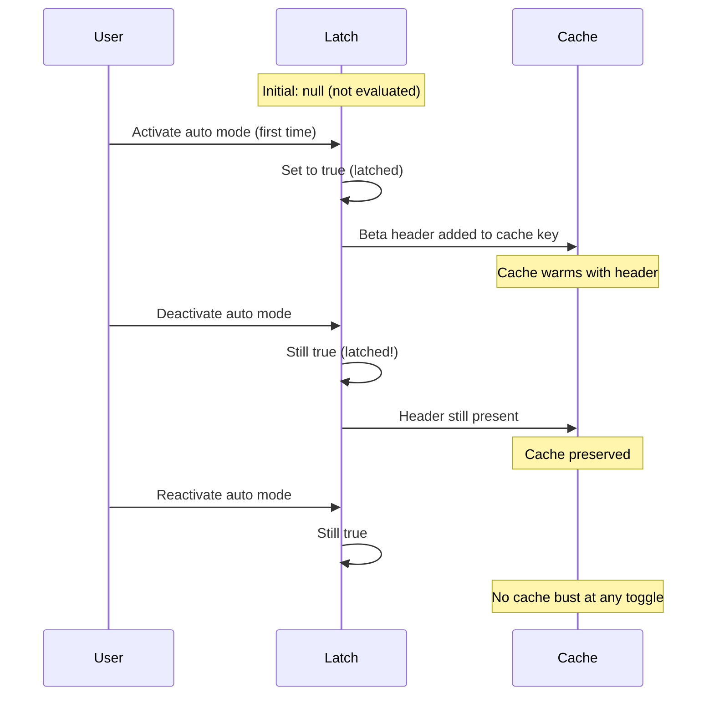
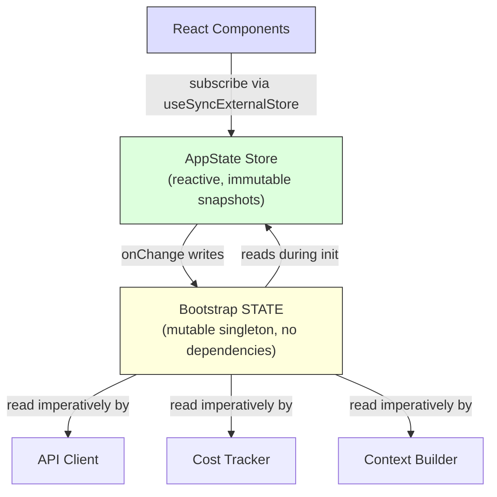

# الفصل 3: الـ State -- الـ Two-Tier Architecture

الفصل 2 تتبّع الـ bootstrap pipeline من لحظة بدء الـ process لحد أول render. وفي نهايته كان عند النظام بيئة متجهزة بالكامل. لكن متجهزة *بإيه*؟ الـ session ID موجود فين؟ والـ model الحالي؟ وسجل الرسائل؟ والـ cost tracker؟ والـ permission mode؟ الـ state موجود فين، وليه موجود هناك؟

أي تطبيق بيشتغل لفترات طويلة لازم يواجه السؤال ده في وقت من الأوقات. في CLI tool بسيطة الإجابة سهلة: متغيرات قليلة في `main()`. لكن Claude Code مش CLI tool بسيطة. هو تطبيق React بيتعمله render عن طريق Ink، وعمر الـ process فيه بيمتد لساعات. عنده plugin system بيتحمّل في أي وقت، وكمان API layer لازم يبني الـ prompts من context معمول له cache، وكمان cost tracker بياناته بتفضل موجودة بعد إعادة تشغيل الـ process. وعنده عشرات الـ infrastructure modules اللي محتاجة تقرأ وتكتب بيانات مشتركة من غير ما أي واحد فيها يعمل import للتاني.

الحل الساذج هو global store واحد، وده بيفشل فورًا. لو الـ cost tracker بيحدّث نفس الـ store اللي بيحرّك الـ re-renders في React، كل API call هيسبب reconciliation كاملة للـ component tree. والـ infrastructure modules (الـ bootstrap، وبناء الـ context، والـ cost tracking، والـ telemetry) ماينفعش تعمل import لـ React. هي بتشتغل قبل ما React يعمل mount. وبتشتغل بعد ما React يعمل unmount. وبتشتغل في حالات مفيهاش component tree أصلًا. ولو حطينا كل حاجة في store مرتبط بـ React، هيظهر عندنا circular dependencies (A محتاج B و B محتاج A) في الـ import graph كله.

بيحل Claude Code المشكلة دي بـ architecture من مستويين (two-tier). المستوى الأول mutable singleton على مستوى الـ process للـ infrastructure state. والمستوى التاني reactive store (أي تغيير فيه بيبلّغ الـ UI تلقائيًا) صغير جدًا للـ UI state. الفصل ده بيشرح المستويين، ونظام الـ side effects (آثار جانبية خارج الـ function نفسها) اللي بيربط بينهم، والأنظمة الفرعية المساعدة اللي بتعتمد على الأساس ده. كل الفصول الجاية بتفترض إنك فاهم الـ state موجود فين وليه موجود هناك.

---

## 3.1 الـ Bootstrap State -- الـ Process Singleton

### ليه Mutable Singleton

الـ bootstrap state module (`bootstrap/state.ts`) عبارة عن object واحد mutable (قابل للتعديل المباشر) بيتنشأ مرة واحدة عند بدء الـ process:

```typescript
const STATE: State = getInitialState()
```

الـ comment اللي فوق السطر ده مكتوب فيه: `AND ESPECIALLY HERE` (وخصوصًا هنا). وقبل تعريف الـ type بسطرين: `DO NOT ADD MORE STATE HERE - BE JUDICIOUS WITH GLOBAL STATE` (ماتضيفش state تاني هنا، وخليك حريص مع الـ global state). نبرة الـ comments دي نبرة مهندسين اتعلموا بالتجربة المُرّة ثمن إن يكون عندك global object من غير ضوابط.

الـ mutable singleton (object واحد بس على مستوى الـ process كله) هو الاختيار الصح هنا لـ 3 أسباب. الأول: الـ bootstrap state لازم يكون متاح قبل تهيئة أي framework، يعني قبل ما React يعمل mount، وقبل ما الـ store يتنشأ، وقبل ما الـ plugins تتحمّل. والتهيئة على مستوى الـ module scope هي الآلية الوحيدة اللي بتضمن إنه متاح وقت الـ import. التاني: البيانات بطبيعتها مرتبطة بالـ process نفسه: الـ session IDs، والـ telemetry counters، والـ cost accumulators، والـ paths اللي معمول لها cache. مفيش "state سابق" له معنى تعمل diff معاه، ولا subscribers تبلّغهم، ولا undo history. التالت: الـ module لازم يكون leaf في الـ import dependency graph. لو عمل import لـ React، أو للـ store، أو لأي service module، هيعمل cycles تكسر تسلسل الـ bootstrap اللي اتشرح في الفصل 2. ولأنه مش بيعتمد غير على utility types و `node:crypto`، بيفضل ينفع يتعمله import من أي مكان.

### الـ ~80 Fields

الـ type `State` فيه حوالي 80 field. عيّنة منها بتوضح مدى تنوعها:

**الهوية والـ paths** -- `originalCwd`، `projectRoot`، `cwd`، `sessionId`، `parentSessionId`. الـ field `originalCwd` بيتحدد عن طريق `realpathSync` وبيتعمله NFC normalization عند بدء الـ process. ومش بيتغير أبدًا.

**التكلفة والـ metrics** -- `totalCostUSD`، `totalAPIDuration`، `totalLinesAdded`، `totalLinesRemoved`. القيم دي بتتراكم طول الـ session ومش بتنقص أبدًا، وبتتحفظ على الـ disk عند الخروج.

**الـ Telemetry** -- `meter`، `sessionCounter`، `costCounter`، `tokenCounter`. دي OpenTelemetry handles، وكلها nullable (قيمتها null لحد ما الـ telemetry يتهيّأ).

**إعدادات الـ model** -- `mainLoopModelOverride`، `initialMainLoopModel`. الـ override بيتحدد لما المستخدم يغيّر الـ model أثناء الـ session.

**الـ Session flags** -- `isInteractive`، `kairosActive`، `sessionTrustAccepted`، `hasExitedPlanMode`. دي booleans بتتحكم في السلوك طول مدة الـ session.

**تحسين الـ cache** -- `promptCache1hAllowlist`، `promptCache1hEligible`، `systemPromptSectionCache`، `cachedClaudeMdContent`. دي موجودة عشان تمنع تكرار الحسابات من غير داعي وتمنع كسر الـ prompt cache (cache bust).

### الـ Getter/Setter Pattern

الـ object `STATE` مش بيتعمله export أبدًا. كل الوصول ليه بيحصل عن طريق حوالي 100 function منفصلة من نوع getter و setter:

```typescript
// Pseudocode — illustrates the pattern
export function getProjectRoot(): string {
  return STATE.projectRoot
}

export function setProjectRoot(dir: string): void {
  STATE.projectRoot = dir.normalize('NFC')  // NFC normalization on every path setter
}
```

الـ pattern ده بيفرض encapsulation، و NFC normalization في كل path setter (وده بيمنع مشاكل عدم تطابق الـ Unicode على macOS)، و type narrowing، وعزل للـ bootstrap. الـ trade-off (مفاضلة: بتكسب حاجة وبتدفع ثمنها في حاجة تانية) هنا هو كثرة الكود: 100 function عشان 80 field. لكن في codebase ممكن أي mutation شارد فيها يكسر prompt cache حجمه 50,000 token، الوضوح الصريح بيكسب.

### الـ Signal Pattern

الـ bootstrap ماينفعش يعمل import لـ listeners لأنه DAG leaf (module مش بيعمل import لأي module تاني في المشروع). عشان كده بيستخدم primitive صغير جدًا للـ pub/sub (نشر واشتراك) اسمه `createSignal`. الـ signal `sessionSwitched` له consumer واحد بالضبط: ملف `concurrentSessions.ts`، اللي بيحافظ على تزامن الـ PID files. والـ signal متاح للخارج بالشكل `onSessionSwitch = sessionSwitched.subscribe`، وده بيسمح للـ callers يسجّلوا نفسهم من غير ما الـ bootstrap يعرف هم مين.

### الـ 5 Sticky Latches

أدق الـ fields في الـ bootstrap state هي 5 boolean latches ماشية على نفس الـ pattern: أول ما ميزة تتفعّل لأول مرة أثناء الـ session، الـ flag المقابل ليها بيفضل `true` لباقي الـ session. وكلها موجودة لسبب واحد: الحفاظ على الـ prompt cache.



الـ API الخاص بـ Claude بيدعم prompt caching من ناحية الـ server. لما الـ requests المتتالية بتشترك في نفس الـ system prompt prefix، الـ server بيعيد استخدام الحسابات اللي معمول لها cache. لكن الـ cache key (المفتاح اللي الـ server بيقارن بيه عشان يعرف الـ cache ينفع ولا لأ) بيشمل الـ HTTP headers و fields من الـ request body. لو فيه beta header ظهر في الـ request رقم N وماظهرش في الـ request رقم N+1، الـ cache بيتكسر. وده بيحصل حتى لو محتوى الـ prompt متطابق. ومع system prompt أكبر من 50,000 token، الـ cache miss مكلف.

الـ 5 latches:

| الـ Latch | بيمنع إيه |
|-------|-----------------|
| `afkModeHeaderLatched` | تشغيل وقفل الـ auto mode بـ Shift+Tab بيخلّي الـ AFK beta header يظهر ويختفي |
| `fastModeHeaderLatched` | الدخول في الـ cooldown الخاص بالـ fast mode والخروج منه بيخلّي الـ fast mode header يظهر ويختفي |
| `cacheEditingHeaderLatched` | تغييرات الـ remote feature flag بتكسر الـ cache عند كل مستخدم نشط |
| `thinkingClearLatched` | بيتفعّل لما يتأكد حصول cache miss (>1h من غير نشاط). بيمنع إن إعادة تفعيل الـ thinking blocks تكسر cache سخن من قريب |
| `pendingPostCompaction` | الـ flag ده بيتستهلك مرة واحدة (consume-once) لصالح الـ telemetry: بيفرّق بين الـ cache misses اللي سببها الـ compaction واللي سببها انتهاء الـ TTL |

الـ 5 latches كلها بتستخدم type من 3 حالات: `boolean | null`. القيمة الابتدائية `null` معناها "ما اتقيّمش بعد". والقيمة `true` معناها "اتثبّت على التشغيل". ومش بترجع أبدًا لـ `null` أو `false` بعد ما تبقى `true`. ودي الخاصية اللي بتعرّف الـ latch.

شكل الـ implementation:

```typescript
function shouldSendBetaHeader(featureCurrentlyActive: boolean): boolean {
  const latched = getAfkModeHeaderLatched()
  if (latched === true) return true       // Already latched -- always send
  if (featureCurrentlyActive) {
    setAfkModeHeaderLatched(true)          // First activation -- latch it
    return true
  }
  return false                             // Never activated -- don't send
}
```

ليه مش بنبعت كل الـ beta headers على طول؟ لأن الـ headers جزء من الـ cache key. لو بعتّ header مش معروف، ده بيعمل cache namespace مختلف. الـ latch بيضمن إنك تدخل cache namespace بس لما تكون محتاجه فعلًا، وبعدها تفضل فيه.

---

## 3.2 AppState -- الـ Reactive Store

### الـ Implementation في 34 سطر

الـ store الخاص بالـ UI state موجود في `state/store.ts`:

الـ implementation الخاص بالـ store حوالي 30 سطر: closure على متغير اسمه `state`، وفحص مساواة بـ `Object.is` عشان يمنع التحديثات اللي من غير داعي، وتبليغ synchronous للـ listeners، و callback اسمه `onChange` للـ side effects. والهيكل شكله كده:

```typescript
// Pseudocode — illustrates the pattern
function makeStore(initial, onTransition) {
  let current = initial
  const subs = new Set()
  return {
    read:      () => current,
    update:    (fn) => { /* Object.is guard, then notify */ },
    subscribe: (cb) => { subs.add(cb); return () => subs.delete(cb) },
  }
}
```

34 سطر. من غير middleware، ولا devtools، ولا time-travel debugging، ولا action types. مجرد closure على متغير mutable، و Set من الـ listeners، وفحص مساواة بـ `Object.is`. ده Zustand من غير المكتبة.

قرارات التصميم اللي تستاهل نقف عندها:

**الـ Updater function pattern.** مفيش `setState(newValue)`، فيه بس `setState((prev) => next)`. كل mutation بيستقبل الـ state الحالي ولازم يطلّع الـ state اللي بعده. وده بيقضي على الـ stale-state bugs اللي بتيجي من mutations بتحصل بشكل concurrent.

**فحص المساواة بـ `Object.is`.** لو الـ updater رجّع نفس الـ reference، الـ mutation مش بيعمل حاجة (no-op). مفيش listeners بتتنادى. ومفيش side effects بتتنفذ. وده مهم جدًا للأداء: الـ components اللي بتعمل spread-and-set من غير ما تغيّر قيم مش بتسبب أي re-renders.

**الـ callback `onChange` بيتنفذ قبل الـ listeners.** الـ callback الاختياري `onChange` بيستقبل الـ state القديم والجديد، وبيتنفذ بشكل synchronous قبل ما أي subscriber يتبلّغ. وده بنستخدمه للـ side effects (القسم 3.4) اللي لازم تخلص قبل ما الـ UI يعمل re-render.

**من غير middleware، ولا devtools.** وده مش سهو. لما الـ store الخاص بيك محتاج 3 عمليات بالضبط (get، set، subscribe)، وفحص مساواة بـ `Object.is`، و hook اسمه `onChange` بيشتغل synchronous، يبقى 34 سطر كود أنت مالكهم أحسن من dependency. أنت اللي بتتحكم في الـ semantics بالضبط. وتقدر تقرأ الـ implementation كله في 30 ثانية.

### الـ AppState Type

الـ type `AppState` (~452 سطر) هو شكل كل حاجة الـ UI محتاجها عشان يعمل render. معظم الـ fields ملفوفة في `DeepImmutable<>`، مع استثناءات صريحة للـ fields اللي فيها function types:

```typescript
export type AppState = DeepImmutable<{
  settings: SettingsJson
  verbose: boolean
  // ... ~150 more fields
}> & {
  tasks: { [taskId: string]: TaskState }  // Contains abort controllers
  agentNameRegistry: Map<string, AgentId>
}
```

الـ intersection type بيخلّي معظم الـ fields تبقى immutable بعمق، وفي نفس الوقت بيستثني الـ fields اللي فيها functions و Maps و mutable refs. الـ immutability الكاملة هي الوضع الافتراضي، مع escape hatches (مخرج استثنائي من القاعدة) محسوبة بدقة في الأماكن اللي الـ type system فيها هيتعارض مع الـ runtime semantics.

### التكامل مع React

الـ store بيتكامل مع React عن طريق `useSyncExternalStore`:

```typescript
// Standard React pattern — useSyncExternalStore with a selector
export function useAppState<T>(selector: (state: AppState) => T): T {
  const store = useContext(AppStoreContext)
  return useSyncExternalStore(
    store.subscribe,
    () => selector(store.getState()),
  )
}
```

الـ selector لازم يرجّع reference لـ sub-object موجود فعلًا (مش object جديد متبني حالًا)، عشان مقارنة `Object.is` تقدر تمنع الـ re-renders اللي من غير داعي. لو كتبت `useAppState(s => ({ a: s.a, b: s.b }))`، كل render هيطلّع object reference جديد، والـ component هيعمل re-render مع كل تغيير في الـ state. وده نفس القيد اللي بيواجهه مستخدمين Zustand: المقارنات أرخص، لكن اللي بيكتب الـ selector لازم يكون فاهم الـ reference identity.

---

## 3.3 العلاقة بين المستويين

المستويين بيتواصلوا عن طريق interfaces صريحة وضيقة.



الـ bootstrap state بينتقل لـ AppState أثناء التهيئة: الـ function `getDefaultAppState()` بتقرأ الإعدادات من الـ disk (والـ bootstrap هو اللي ساعد في تحديد مكانها)، وبتتحقق من الـ feature flags (مفاتيح بتشغّل أو تقفل ميزات) اللي الـ bootstrap قيّمها، وبتحدد الـ model الابتدائي اللي الـ bootstrap استخرجه من الـ CLI args والإعدادات.

وفي الاتجاه العكسي، AppState بيرجع للـ bootstrap state عن طريق الـ side effects: لما المستخدم يغيّر الـ model، الـ function `onChangeAppState` بتستدعي `setMainLoopModelOverride()` في الـ bootstrap. ولما الإعدادات تتغير، الـ caches الخاصة بالـ credentials (بيانات الدخول) في الـ bootstrap بتتمسح.

لكن المستويين مش بيشتركوا في أي reference أبدًا. الـ module اللي بيعمل import للـ bootstrap state مش محتاج يعرف حاجة عن React. والـ component اللي بيقرأ AppState مش محتاج يعرف حاجة عن الـ process singleton.

مثال عملي بيوضح الـ data flow (مسار انتقال البيانات). لما المستخدم يكتب `/model claude-sonnet-4`:

1. الـ command handler بيستدعي `store.setState(prev => ({ ...prev, mainLoopModel: 'claude-sonnet-4' }))`
2. فحص `Object.is` الخاص بالـ store بيكتشف إن فيه تغيير
3. الـ function `onChangeAppState` بتتنفذ، وبتكتشف إن الـ model اتغير، فبتستدعي `setMainLoopModelOverride()` (بتحدّث الـ bootstrap) و `updateSettingsForSource()` (بتحفظ على الـ disk)
4. كل الـ subscribers الخاصة بالـ store بتتنادى: الـ React components بتعمل re-render عشان تعرض اسم الـ model الجديد
5. الـ API call اللي بعده بيقرأ الـ model من `getMainLoopModelOverride()` في الـ bootstrap state

الخطوات 1-4 كلها synchronous. الـ API client في الخطوة 5 ممكن يشتغل بعدها بثواني. لكنه بيقرأ من الـ bootstrap state (اللي اتحدّث في الخطوة 3)، مش من AppState. وده هو التسليم بين المستويين: الـ UI store هو الـ source of truth (المرجع الوحيد المعتمد) للي المستخدم اختاره، لكن الـ bootstrap state هو الـ source of truth للي الـ API client بيستخدمه.

خاصية الـ DAG هنا: الـ bootstrap مش بيعتمد على حاجة، و AppState بيعتمد على الـ bootstrap في التهيئة، و React بيعتمد على AppState. والخاصية دي بتفرضها ESLint rule بتمنع ملف `bootstrap/state.ts` من إنه يعمل import لـ modules خارج المجموعة المسموح بيها.

---

## 3.4 الـ Side Effects: onChangeAppState

الـ callback `onChange` هو المكان اللي المستويين بيتزامنوا فيه. كل استدعاء لـ `setState` بيشغّل `onChangeAppState`، ودي بتستقبل الـ state السابق والجديد وبتقرر إيه الـ effects الخارجية اللي لازم تتنفذ.

**مزامنة الـ permission mode** هي الاستخدام الأساسي. قبل الـ handler المركزي ده، الـ permission mode كان بيتزامن مع الـ remote session (CCR) من 2 بس من أصل 8+ mutation paths. والـ 6 الباقيين كانوا بيعدّلوا AppState من غير ما يبلّغوا CCR: التنقل بـ Shift+Tab، واختيارات الـ dialog، والـ slash commands، والـ rewind، والـ bridge callbacks. فالـ metadata الخارجية بقت مش متزامنة.

الحل: بدل ما التبليغات تبقى متفرقة على الـ mutation sites، اعمل hook على الـ diff في مكان واحد. الـ comment في الـ source code بيعدّد كل mutation path كان مكسور، وبيذكر إن "the scattered callsites above need zero changes." (الـ callsites المتفرقة اللي فوق مش محتاجة أي تغيير). ودي فايدة الـ side effects المركزية على مستوى الـ architecture: التغطية بتيجي من البنية نفسها، مش من مجهود يدوي.

**تغييرات الـ model** بتخلّي الـ bootstrap state متزامن مع اللي الـ UI بيعرضه. **تغييرات الإعدادات** بتمسح الـ credential caches وبتعيد تطبيق الـ environment variables. و**الـ verbose toggle** و**الـ expanded view** بيتحفظوا في الـ global config.

الـ pattern ده، يعني side effects مركزية على state transition ينفع يتعمله diff، هو في جوهره الـ Observer pattern لكن مطبّق على مستوى الـ state diff بدل الأحداث الفردية. وبيكبر أحسن من الـ event emissions المتفرقة، لأن عدد الـ side effects بيزيد أبطأ بكثير من عدد الـ mutation sites.

---

## 3.5 بناء الـ Context

فيه 3 async functions معمول لها memoize (بتحسب النتيجة مرة واحدة وتحتفظ بيها) في `context.ts`، بتبني الـ context الخاص بالـ system prompt اللي بيتحط في بداية كل محادثة. كل واحدة بتتحسب مرة واحدة لكل session، مش لكل turn.

الـ function `getGitStatus` بتشغّل 5 أوامر git بالتوازي (`Promise.all`)، وبتطلّع block فيه الـ branch الحالي، والـ default branch، وآخر الـ commits، وحالة الـ working tree. والـ flag `--no-optional-locks` بيمنع git من إنه ياخد write locks ممكن تتعارض مع عمليات git تانية شغالة في نفس الوقت في terminal تاني.

الـ function `getUserContext` بتحمّل محتوى CLAUDE.md وبتعمله cache في الـ bootstrap state عن طريق `setCachedClaudeMdContent`. الـ cache ده بيفك circular dependency: الـ auto-mode classifier (model صغير بيصنّف الطلب: مسموح ولا لأ) محتاج محتوى CLAUDE.md، لكن تحميل CLAUDE.md بيعدّي على الـ filesystem، والـ filesystem بيعدّي على الصلاحيات، والصلاحيات بتستدعي الـ classifier. ولما الـ cache يتحط في الـ bootstrap state (وهو DAG leaf)، الـ cycle بيتفك.

الـ 3 context functions كلها بتستخدم `memoize` الخاصة بـ Lodash (احسب مرة واحدة، واحتفظ بالنتيجة للأبد) بدل caching معتمد على TTL (مدة صلاحية الـ cache). والمنطق: لو الـ git status اتحسب من جديد كل 5 دقايق، التغيير هيكسر الـ prompt cache اللي على الـ server. والـ system prompt نفسه بيقول للـ model: "This is the git status at the start of the conversation. Note that this status is a snapshot in time." (دي حالة git في بداية المحادثة. خد بالك إن الحالة دي snapshot في لحظة معينة.)

---

## 3.6 تتبّع التكلفة

كل API response بيعدّي على الـ function `addToTotalSessionCost`. ودي بتجمّع الـ usage لكل model، وبتحدّث الـ bootstrap state، وبتبعت البيانات لـ OpenTelemetry، وبتعالج بشكل recursive الـ usage الخاص بالـ advisor tool (يعني model calls متداخلة داخل الـ response).

الـ cost state بيفضل موجود بعد إعادة تشغيل الـ process عن طريق حفظه واسترجاعه من project config file. والـ session ID بنستخدمه كـ guard: النظام مش بيسترجع التكاليف غير لو الـ session ID المحفوظ مطابق للـ session اللي بيتعملها resume.

الـ histograms بتستخدم reservoir sampling (Algorithm R)، وده عيّنة عشوائية بحجم ثابت من stream طويل، عشان استهلاك الذاكرة يفضل محدود وفي نفس الوقت التوزيعات تتمثل بدقة. الـ reservoir اللي حجمه 1,024 entry بيطلّع الـ percentiles p50 و p95 و p99. ليه مش running average بسيط؟ لأن المتوسطات بتخبّي شكل التوزيع. الـ session اللي 95% من الـ API calls فيها بتاخد 200ms و 5% بتاخد 10 ثواني ليها نفس متوسط session كل الـ calls فيها بتاخد 690ms. لكن تجربة المستخدم مختلفة تمامًا.

---

## 3.7 اتعلمنا إيه

الـ codebase كبرت من CLI بسيط لنظام فيه ~450 سطر من الـ state type definitions، و ~80 field من الـ process state، ونظام side effects، وأكثر من حد للحفظ الدائم (persistence)، و latches لتحسين الـ cache. ومفيش حاجة من دي اتصممت من البداية. الـ sticky latches اتضافت لما كسر الـ cache بقى مشكلة تكلفة ممكن تتقاس. والـ handler `onChange` بقى مركزي لما اتكتشف إن 6 من 8 مسارات لمزامنة الصلاحيات مكسورة. والـ cache الخاص بـ CLAUDE.md اتضاف لما ظهر circular dependency.

وده شكل النمو الطبيعي للـ state في أي تطبيق معقد. الـ architecture من مستويين بتوفر بنية كفاية عشان تحتوي النمو ده: الـ fields الجديدة في الـ bootstrap مش بتأثر على الـ rendering في React، والـ fields الجديدة في AppState مش بتعمل import cycles. وفي نفس الوقت بتفضل مرنة كفاية عشان تستوعب patterns ماكانتش متوقعة في التصميم الأصلي.

---

## 3.8 ملخص الـ State Architecture

| الخاصية | الـ Bootstrap State | AppState |
|---|---|---|
| **المكان** | الـ singleton على مستوى الـ module scope | React context |
| **قابلية التعديل** | Mutable عن طريق الـ setters | Immutable snapshots عن طريق الـ updater |
| **الـ Subscribers** | Signal (pub/sub) لأحداث محددة | `useSyncExternalStore` لـ React |
| **التوفر** | وقت الـ import (قبل React) | بعد ما الـ provider يعمل mount |
| **الحفظ الدائم** | الـ exit handlers الخاصة بالـ process | عن طريق onChange على الـ disk |
| **المساواة** | N/A (قراءات imperative) | فحص الـ reference بـ `Object.is` |
| **الـ Dependencies** | DAG leaf (مش بيعمل import لأي حاجة) | بيعمل import لـ types من كل أنحاء الـ codebase |
| **إعادة الضبط في الـ tests** | `resetStateForTests()` | إنشاء store instance جديد |
| **المستهلكين الأساسيين** | الـ API client، والـ cost tracker، والـ context builder | الـ React components، والـ side effects |

---

## طبّق ده

**قسّم الـ state حسب الـ access pattern، مش حسب الـ domain.** الـ session ID مكانه الـ singleton، مش لأنه "infrastructure" بالمعنى المجرد، لكن لأنه لازم يتقرأ قبل ما React يعمل mount، ويتكتب من غير تبليغ أي subscribers. والـ permission mode مكانه الـ reactive store لأن تغييره لازم يسبب re-renders و side effects. خلّي الـ access pattern هو اللي يحدد المستوى، والـ architecture هتيجي بعد كده بشكل طبيعي.

**الـ sticky latch pattern.** أي نظام بيتعامل مع cache (prompt cache، أو CDN، أو query cache) بيواجه نفس المشكلة: الـ feature toggles اللي بتغيّر الـ cache key أثناء الـ session بتكسر الـ cache. أول ما ميزة تتفعّل، مساهمتها في الـ cache key بتفضل مفعّلة لباقي الـ session. والـ type من 3 حالات (`boolean | null`، ومعناه "ما اتقيّمش / مفعّل / مش بيتقفل أبدًا") بيخلّي القصد واضح من الكود نفسه. وقيمته بتزيد بالذات لما الـ cache مش تحت تحكمك.

**خلّي الـ side effects مركزية على الـ state diffs.** لما يكون فيه أكثر من code path يقدر يغيّر نفس الـ state، ماتفرّقش التبليغات على الـ mutation sites. اعمل hook على الـ callback `onChange` الخاص بالـ store واكتشف أنهي fields اتغيرت. كده التغطية بتبقى من البنية نفسها (أي mutation بيشغّل الـ effect) بدل ما تكون يدوية (كل mutation site لازم يفتكر يبلّغ).

**فضّل 34 سطر أنت مالكهم على مكتبة مش ملكك.** لما متطلباتك تكون بالضبط get و set و subscribe و change callback، الـ implementation الصغير بيدّيك تحكم كامل في الـ semantics. وفي نظام ممكن الـ bugs في الـ state management تكلّف فيه فلوس حقيقية، الشفافية دي ليها قيمة. الفكرة الأساسية هي إنك تعرف إمتى *مش* محتاج مكتبة.

**استخدم خروج الـ process كحد للحفظ الدائم، لكن عن قصد.** فيه أكثر من نظام فرعي بيحفظ الـ state عند خروج الـ process. والـ trade-off هنا صريح: الإنهاء المفاجئ (SIGKILL، OOM) بيضيّع البيانات المتراكمة. وده مقبول لأن البيانات تشخيصية مش transactional، ولأن الكتابة على الـ disk مع كل تغيير في الـ state هتبقى مكلفة جدًا مع counters بتزيد مئات المرات في الـ session الواحدة.

---

الـ architecture من مستويين اللي اتأسست في الفصل ده هي الأساس اللي كل الفصول الجاية بتبني عليه: bootstrap singleton للـ infrastructure، و reactive store للـ UI، و side effects بتربط بينهم. الـ conversation loop (الفصل 4) بيقرأ الـ context من الـ memoized builders. والـ tool system (الفصل 5) بيتحقق من الصلاحيات من AppState. والـ agent system (الفصل 8) بينشئ task entries في AppState وفي نفس الوقت بيتتبع التكاليف في الـ bootstrap state. وفهم الـ state موجود فين، وليه، شرط عشان تفهم أي نظام من دول بيشتغل إزاي.

فيه fields واقفة على الحد بين المستويين. الـ main loop model موجود في المستويين: `mainLoopModel` في AppState (عشان الـ UI rendering) و `mainLoopModelOverride` في الـ bootstrap state (عشان الـ API client يستخدمه). والـ handler `onChangeAppState` بيخليهم متزامنين. التكرار ده هو ثمن الفصل لمستويين. لكن البديل هو إن الـ API client يعمل import للـ React store، أو إن الـ React components تقرأ من الـ process singleton. وده هيخالف اتجاه الـ dependencies اللي محافظ على سلامة الـ architecture. شوية تكرار محسوب، بتربطه نقطة مزامنة مركزية، أحسن من dependency graph متشابك.
