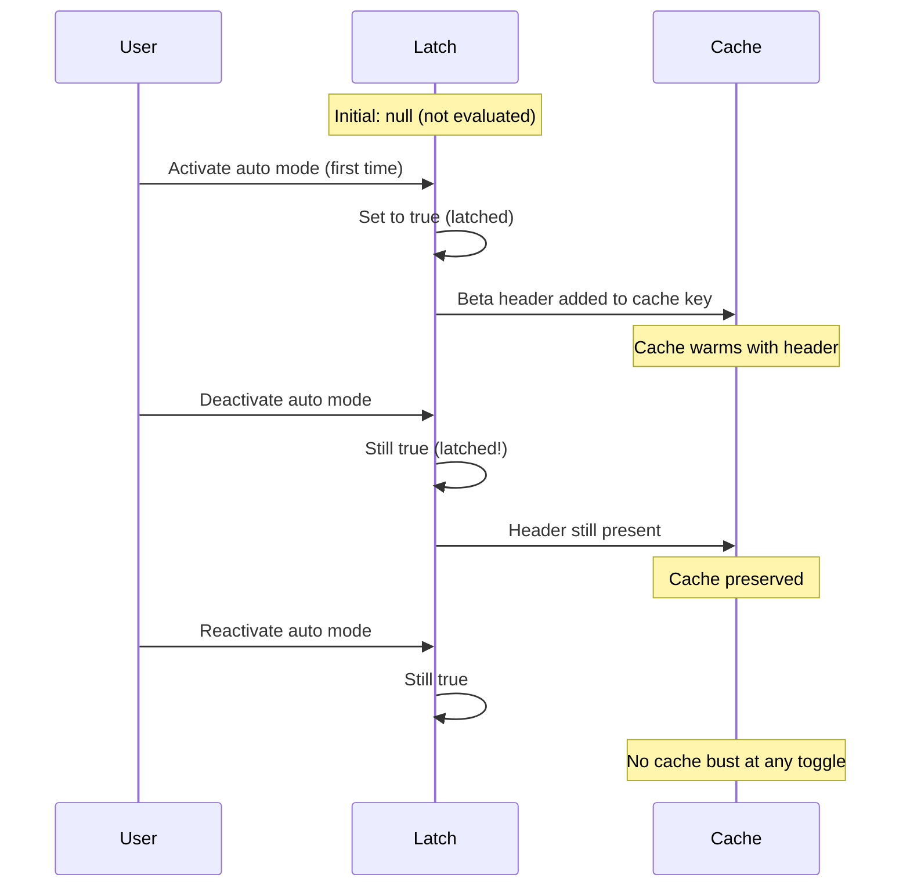
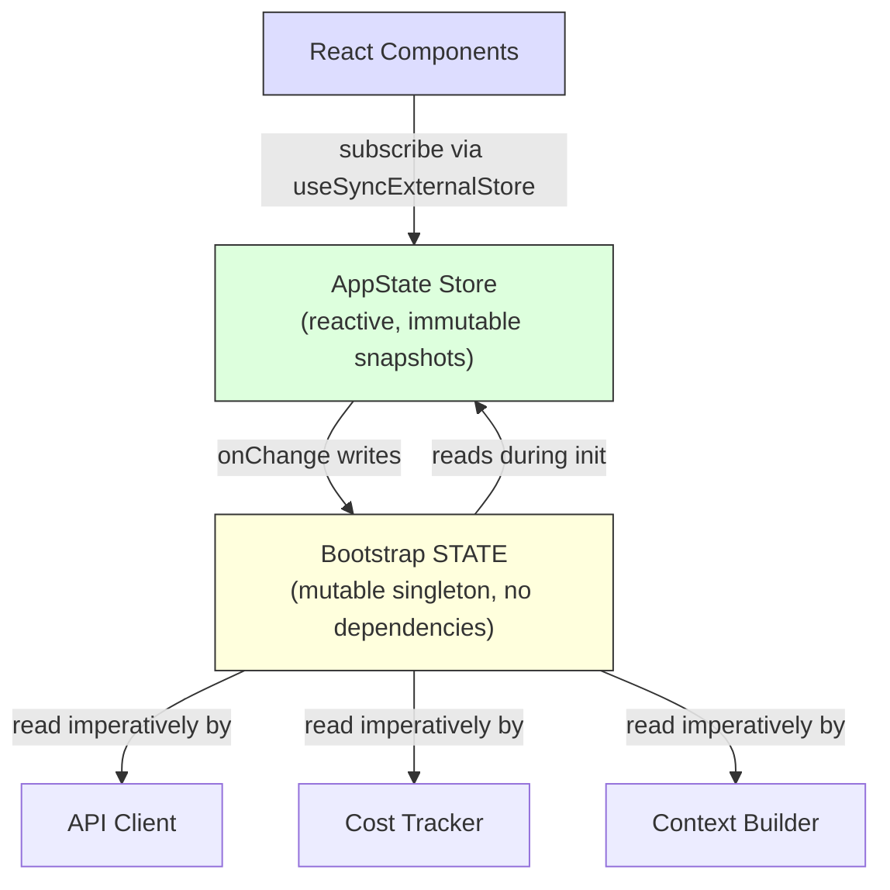

# الفصل 3: الـ State -- الـ Two-Tier Architecture

الفصل 2 تتبّع مسار بدء التشغيل (Bootstrap Pipeline) من لحظة إطلاق الـ Process لحد أول Render على الشاشة، وفي نهايته كان عند النظام بيئة مجهزة بالكامل. لكن مجهزة *بإيه بالظبط*؟ الـ Session ID متخزن فين؟ والـ Model الحالي؟ وسجل الرسائل، ومتابعة التكاليف، وأوضاع الصلاحيات؟ حالة النظام (State) دي متخزنة فين، وليه اختاروا الأماكن دي تحديداً؟

أي تطبيق برمجيات بيشتغل لساعات طويلة في بيئة إنتاجية لازم يواجه السؤال ده عاجلاً أم آجلاً. في أدوات الـ CLI البسيطة الإجابة سهلة: شوية متغيرات في دالة `main()`. لكن Claude Code مش أداة سطر أوامر عادية؛ ده تطبيق React بيتعمله Render داخل الـ Terminal عبر مكتبة Ink، وعمر الـ Process فيه بيمتد لساعات طويلة. عنده نظام Plugins بيتحمل ديناميكياً في أي وقت، وطبقة API محتاجة تبني الـ Prompts من Context محفوظ في الـ Cache، ومتتبع تكلفة بيحتفظ ببياناته حتى بعد إعادة تشغيل البرنامج، وعشرات الموديولات اللي محتاجة تقرأ وتكتب بيانات مشتركة من غير ما تعمل Circular Imports لبعضها.

الحل الساذج للمشكلة دي هو عمل Global Store موحد لكل شيء، لكن الحل ده بيفشل فوراً؛ فلو متتبع التكلفة بيحدث نفس الـ Store اللي بيحرك شاشة React، كل استدعاء API هيسبب Re-renders وإعادة بناء كاملة لشجرة المكونات (Component Tree). ده غير إن موديولات الـ Infrastructure الأساسية (زي الـ Bootstrap وتتبع الاستهلاك والـ Telemetry) مينفعش تعتمد على React، لأنها بتشتغل قبل ما مكونات React تتركب (Mount)، وبتشتغل بعدها، وبتشتغل في أوضاع Headless مفيهاش واجهة بصرية أصلاً! ووضع كل شيء في Store واحد هيخلق شبكة اعتماديات دائرية معقدة (Circular Dependencies) تكسر المشروع كله.

Claude Code بيحل المشكلة دي بمعمارية عبقرية من مستويين (Two-Tier Architecture):
- **المستوى الأول:** كائن وحيد من نمط Singleton على مستوى الـ Process كلها اسمه `STATE`، وهو Mutable ومخصص لبيانات البنية التحتية (Infrastructure State).
- **المستوى الثاني:** عبارة عن Reactive Store صغير جداً ومصمم خصيصاً لتحريك واجهة المستخدم (UI State).

الفصل ده بيفكك المستويين، وبيشرح نظام الآثار الجانبية (Side Effects) اللي بيربط بينهم، والأنظمة المساعدة اللي بتعتمد على الأساس المعماري ده.

---

## 3.1 الـ Bootstrap State -- الـ Process Singleton

### ليه Mutable Singleton؟

موديول الـ Bootstrap State في مسار (`bootstrap/state.ts`) عبارة عن كائن واحد Mutable بيتنشأ مرة واحدة مع بداية الـ Process:

```typescript
const STATE: State = getInitialState()
```

التعليق المكتوب فوق السطر ده في الكود الأصلي بيقول بالحرف: `AND ESPECIALLY HERE`، وقبل تعريف الـ Type بسطرين: `DO NOT ADD MORE STATE HERE - BE JUDICIOUS WITH GLOBAL STATE` (ماتضيفش State زيادة هنا، وخليك حريص جداً مع الـ Global State). نبرة التعليقات دي بتعكس خبرة مهندسين كبار اتعلموا بالتجربة العملية ثمن وجود Global Object غير منضبط!

لكن استخدام الـ Mutable Singleton كان الاختيار الهندسي الصح هنا لـ 3 أسباب حاسمة:
1. **التوفر المبكر:** الـ Bootstrap State لازم يكون متاحاً قبل تهيئة أي Framework في النظام؛ يعني قبل ما React يشتغل، وقبل ما الـ Store يتنشأ، وقبل ما الـ Plugins تتحمل. والإنشاء على مستوى الـ Module Scope هو الطريقة الوحيدة لضمان جهوزيته وقت الـ Import.
2. **طبيعة البيانات:** البيانات هنا بطبيعتها مرتبطة بالـ Process نفسه: أرقام الجلسات (Session IDs)، وعدادات الـ Telemetry، وتراكم التكاليف، والمسارات المحفوظة في الـ Cache. مفيش هنا حاجة اسمها "حالة سابقة" محتاجين نقارن بيها، ولا Subscribers محتاجين نبلغهم برسم الشاشة، ولا تاريخ تراجع (Undo History).
3. **عقدة طرفية في شجرة الاعتماديات (DAG Leaf):** الموديول ده لازم يكون في قاع شجرة الاعتماديات وميعتمدش على أي شيء؛ فلو عمل Import لـ React أو لأي Service ثانية، هيعمل Cycles تكسر مسار الإقلاع المشروح في الفصل 2. ولأنه مبيعتمدش غير على Types مساعدة و `node:crypto`، تقدر تعمل له Import بأمان من أي ملف في المشروع.

### الـ 80 حقلاً (Fields) في الكائن

الـ Type المعرف لكائن `State` بيحتوي على حوالي 80 حقلاً، وعينة بسيطة منها بتوضح تنوعها:
- **الهوية والمسارات:** `originalCwd`، `projectRoot`، `cwd`، `sessionId`، `parentSessionId`. حقل `originalCwd` بيتحدد عبر `realpathSync` وبيتطبق عليه توحيد الحروف القياسي (NFC Normalization) وقت الإقلاع ومستحيل يتغير بعدها.
- **التكلفة والقياسات:** `totalCostUSD`، `totalAPIDuration`، `totalLinesAdded`، `totalLinesRemoved`. القيم دي بتتراكم طول الجلسة ومش بتقل أبداً، وبتتحفظ على القرص عند الخروج.
- **الـ Telemetry:** مقابض OpenTelemetry زي `meter` و `costCounter` و `tokenCounter`.
- **إعدادات الـ Model:** `mainLoopModelOverride` و `initialMainLoopModel` لتحديد النموذج المختار وما إذا كان المستخدم غيره أثناء الجلسة.
- **أعلام الجلسة (Session Flags):** متغيرات Boolean بتحدد السلوك زي `isInteractive` و `sessionTrustAccepted` و `hasExitedPlanMode`.
- **حماية وتحسين الـ Cache:** حقول مخصصة لمنع الحسابات المكررة وضمان عدم تكسير الـ Prompt Cache على خوادم Anthropic.

### نمط الدوال المغلفة (Getter/Setter Pattern)

الكائن `STATE` نفسه مش بيتعمل له Export للخارج أبداً، وكل وصول لمحتوياته بيمر عبر حوالي 100 دالة منفصلة من نوع Getter و Setter:

```typescript
// Pseudocode — illustrates the pattern
export function getProjectRoot(): string {
  return STATE.projectRoot
}

export function setProjectRoot(dir: string): void {
  STATE.projectRoot = dir.normalize('NFC')  // NFC normalization on every path setter
}
```

النمط ده بيفرض كبسلة تامة (Encapsulation)، وتوحيداً قياسياً للمسارات بـ NFC Normalization في كل عملية تعيين (وده بيمنع مشاكل ترميز الـ Unicode الشائعة على أنظمة macOS)، وتحديداً دقيقاً للأنواع (Type Narrowing). والمفاضلة الهندسية (Trade-off) هنا هي كثرة الكود بكتابة 100 دالة لـ 80 حقلاً؛ لكن في مشروع كبير ممكن أي تعديل شارد فيه يكسر Prompt Cache حجمه 50,000 توكن، الوضوح والانضباط بيكسب دائماً.

### نمط الإشارات (The Signal Pattern)

بما إن موديول الـ Bootstrap مينفعش يعمل Import لمكتبات معقدة لإدارة الأحداث، فهو بيستخدم آلية مصغرة وبسيطة جداً لنمط النشر والاشتراك (Pub/Sub) اسمها `createSignal`. الإشارة `sessionSwitched` ليها مستهلك وحيد هو ملف `concurrentSessions.ts` لمزامنة ملفات الـ PID، وده بيسمح لأي موديول يشترك في الحدث بدون ما يعرف موديول الـ Bootstrap أي تفاصيل عن المشتركين.

### مزاليج التثبيت الـ 5 (The 5 Sticky Latches)

من أذكى الأنماط المعمارية في الـ Bootstrap State هي 5 مزاليج Boolean (Sticky Latches) ماشية بقاعدة هندسية صارمة: **أول ما الميزة تتفعل لمرة واحدة أثناء الجلسة، الـ Flag المقابل ليها بيفضل `true` ومستحيل يرجع `false` لباقي مدة الجلسة**. والسبب الوحيد لوجودها هو: **الحفاظ على استقرار الـ Prompt Cache**.



خوادم نموذج Claude بتدعم التخزين المؤقت للبرومبت (Prompt Caching)؛ فلما الطلبات المتتالية تشترك في نفس بداية الـ System Prompt، السيرفر بيعيد استخدام نتائج الحسابات السابقة فوراً. لكن مفتاح التخزين (Cache Key) على السيرفر بيشمل الـ HTTP Headers مع محتوى الطلب؛ فلو الـ Request الأول راح معاه Beta Header معين، والطلب اللي بعده راح من غيره، السيرفر هيعتبر الـ Cache مكسور (Cache Bust) ويعيد الحسابات من الصفر! ومع System Prompt بيتجاوز 50,000 توكن، الـ Cache Miss هيكلفك ثواني انتظار وفلوس حقيقية.

لذلك، المزلاج (Sticky Latch) بيضمن إن الـ Header يفضل موجود دايم حتى لو المستخدم قفل الميزة وشغلها كذا مرة، وده بيمنع تكسير الـ Cache تماماً.

المزاليج الـ 5 المدمجة:
| المزلاج (Latch) | ماذا يمنع؟ |
|---|---|
| `afkModeHeaderLatched` | التبديل المتكرر لوضع Auto بـ Shift+Tab بيخلي الـ AFK Beta Header يظهر ويختفي. |
| `fastModeHeaderLatched` | الدخول والخروج من فترة تهدئة الـ Fast Mode يسبب تذبذب الـ Header. |
| `cacheEditingHeaderLatched` | تغيرات Feature Flags البعيدة تكسر الكاش عند المطورين النشطين. |
| `thinkingClearLatched` | يضمن عدم تكسير كاش دافئ عند التبديل المؤقت لكتل الـ Thinking. |
| `pendingPostCompaction` | علم يُستهلك لمرة واحدة للـ Telemetry للتمييز بين تفريغ الكاش بسبب الضغط أو انتهاء الصلاحية. |

---

## 3.2 AppState -- الـ Reactive Store

### إدارة حالة الواجهة في 34 سطر كود فقط!

الـ Store الخاص بحالة واجهة المستخدم موجود في ملف `state/store.ts`، ومكتوب بالكامل في حوالي 30 إلى 34 سطر كود! مجرد دالة Closure على متغير `state`، مع فحص تطابق المرجع بـ `Object.is` لمنع التحديثات الزائدة، وتبليغ فوري للمشتركين (Listeners)، ودالة استدعاء `onChange` لإدارة الآثار الجانبية:

```typescript
// Pseudocode — illustrates the pattern
function makeStore(initial, onTransition) {
  let current = initial
  const subs = new Set()
  return {
    read:      () => current,
    update:    (fn) => { /* Object.is guard, then notify */ },
    subscribe: (cb) => { subs.add(cb); return () => subs.delete(cb) },
  }
}
```

34 سطر كود، بدون أي مكتبات خارجية، وبدون Redux أو Zustand!

أهم قرارات التصميم هنا:
- **نمط دوال التحديث (Updater Pattern):** مفيش `setState(val)` بل دايماً `setState((prev) => next)`، وده بيقضي على مشاكل القراءة القديمة (Stale State Bugs) الناتجة عن التحديثات المتزامنة.
- **فحص المساواة بـ `Object.is`:** لو دالة التحديث رجعت نفس المرجع بدون تغيير، الـ Store مبيعملش أي حاجة (No-op)، ومفيش Re-renders بتضيع وقت المعالج.
- **تنفيذ دالة `onChange` قبل تنبيه الواجهة:** دالة الـ Callback دي بتستلم الحالة القديمة والجديدة وتتنفذ قبل ما مكونات React تتبلغ، وده بيسمح بإجراء الآثار الجانبية وحفظ الإعدادات في هدوء.
- **ملكية الكود بساطة وشفافية:** بدلاً من تنزيل مكتبة وإدارتها كـ Dependency، كتابة 34 سطراً بيدك بتديك تحكماً كاملاً وفهماً شاملاً في 30 ثانية قراءة.

### نوع AppState والتكامل مع React

الـ Type المسمى `AppState` بيحتوي على كل البيانات اللي محتاجاها الواجهة لتظهر بالشكل الصحيح: إعدادات، وقوائم مهام، وسجل المحادثة، وحالة الموديل. وأغلب الحقول مغلفة بـ `DeepImmutable` لضمان عدم التعديل المباشر، مع استثناءات دقيقة (Escape Hatches) للحقول اللي بتحتوي على Maps أو AbortControllers.

ويتكامل الـ Store مع React عبر الدالة القياسية `useSyncExternalStore`:

```typescript
export function useAppState<T>(selector: (state: AppState) => T): T {
  const store = useContext(AppStoreContext)
  return useSyncExternalStore(
    store.subscribe,
    () => selector(store.getState()),
  )
}
```

---

## 3.3 العلاقة والتواصل بين المستويين

المستويان بيتواصلوا عبر واجهات برمجية محددة ومنضبطة:



- وقت الإقلاع، الـ Bootstrap State بيمد AppState بالقيم الابتدائية عبر قراءة ملفات الإعدادات والـ Feature Flags.
- وقت التشغيل، التغييرات في AppState بتنعكس على الـ Bootstrap عبر الآثار الجانبية: فلما المستخدم يغير الـ Model عبر سطر الأوامر، دالة `onChangeAppState` بتستدعي `setMainLoopModelOverride()` في الـ Bootstrap، وبتمسح الـ Caches عند تعديل الإعدادات.
- لكن الكودين مبيشاركوش نفس المرجع في الذاكرة أبداً؛ فالموديول اللي بيقرأ بيانات الإقلاع ميعرفش أي حاجة عن React، ومكونات الواجهة متعرفش تفاصيل الـ Process Singleton.

المعادلة واضحة: **الـ UI Store هو المصدر المعتمد الوحيد (Source of Truth) لاختيارات المستخدم في الواجهة، بينما الـ Bootstrap State هو المصدر المعتمد الوحيد لما يقراه عميل الـ API والخدمات الخلفية.**

---

## 3.4 مركزية الآثار الجانبية (onChangeAppState)

دالة `onChangeAppState` هي نقطة الالتقاء السحرية؛ فكل عملية `setState` بتمر عليها لتقارن بين الحالة السابقة والحالية وتقرر الآثار الجانبية الخارجية المطلوبة:
- **مزامنة وضع الصلاحيات (Permission Mode):** سابقاً كانت المزامنة بتتم بشكل يدوي ومتفرق في كذا مسار، وكان 6 من أصل 8 مسارات بتفشل في تحديث حالة الـ Remote Session. وبنقل المزامنة لتكون في دالة مركزية تراقب الـ Diff، بقت التغطية مضمونة تلقائياً من صميم المعمارية!
- **مزامنة الموديل والإعدادات:** تحديث الموديل وحفظ تفضيلات المطور في ملفات الإعدادات العامة للبرنامج فور حدوثها.

---

## 3.5 بناء السياق وحفظ التكلفة (Context & Cost)

### بناء الـ Context
3 دوال رئيسية بنمط Memoized بتشتغل في ملف `context.ts` لحساب الـ System Prompt مرة واحدة لكل جلسة:
- فحص حالة الـ Git عبر أوامر متوازية بدون أخذ Write Locks حتى لا تتعارض مع أوامر المطور في نافذة أخرى.
- قراءة محتوى ملفات `CLAUDE.md` وتخزينه في الـ Bootstrap State لفك الاعتماديات الدائرية.
- استخدام Memoization دائم بدلاً من TTL، لأن إعادة حساب السياق كل بضع دقائق هيكسر الـ Prompt Cache على خوادم Anthropic ويكلف المطور أموالاً إضافية.

### تتبع التكلفة واستهلاك الـ Tokens
كل رد من الـ API بيتم حسابه وإضافته فوراً للـ Bootstrap State وإرساله للـ Telemetry. ولرسم توزيعات التأخير (Latency Histograms) بدقة بدون استهلاك الذاكرة، بيستخدم النظام خوارزمية العينة العشوائية ذات الحجم الثابت (Reservoir Sampling بحجم 1,024 عنصر)، وده بيسمح بحساب نسب p50 و p95 و p99 بدقة واقعية بدلاً من الاعتماد على المتوسطات الحسابية المضللة.

---

## 3.6 مقارنة سريعة بين طبقتي الـ State

| الخاصية المعمارية | Bootstrap State (البنية التحتية) | AppState (واجهة المستخدم) |
|---|---|---|
| **المكان والتهيئة** | Singleton على مستوى الـ Module Scope | React Context و Store مخصص |
| **أسلوب التعديل** | Mutable عبر دوال Setters مباشرة | لقطات Immutable عبر دوال Updater |
| **المشتركون (Subscribers)** | إشارات Signal محدودة بنمط Pub/Sub | دالة `useSyncExternalStore` في React |
| **زمن التوفر** | متاح فوراً وقت الـ Import قبل تشغيل أي كود | متاح بعد تركيب مكونات الواجهة |
| **فحص التغيير** | لا ينطبق (قراءات مباشرة) | فحص المرجع بـ `Object.is` |
| **المستهلكون الأساسيون** | عميل الـ API، ومتتبع التكلفة، وبناء السياق | مكونات شاشة الـ Terminal ومسارات العرض |

---

## دروس مستفادة في تصميم الأنظمة (Takeaways)

**1. قسّم الـ State حسب نمط الوصول (Access Pattern) مش حسب المجال:**
البيانات التي تحتاج قراءتها قبل تشغيل أطر العمل ولا تطلب إعادة رسم للشاشة مكانها كائن وحيد في الذاكرة (Process Singleton)؛ بينما البيانات البصرية المتغيرة باستمرار مكانها Reactive Store.

**2. نمط مزلاج التثبيت (Sticky Latch Pattern):**
في أي نظام يتعامل مع Cache خارجي (كاش البرومبت أو خوادم الـ CDN)، اجعل الأعلام التي تغير مفتاح الكاش تثبت على وضع التفعيل فور تشغيلها طوال مدة الجلسة، لمنع تكسير الكاش وتوفير التكاليف والوقت.

**3. اجعل الآثار الجانبية مركزية على فروق الحالة (State Diffs):**
بدلاً من توزيع استدعاءات التنبيه والمزامنة في عشرات الأماكن المختلفة في الكود، راقب التغييرات في مكان واحد مركزي ينفذ المهام فور رصد أي اختلاف بين الحالة القديمة والجديدة.

**4. 34 سطراً بيدك أفضل من مكتبة ضخمة جاهزة:**
عندما تكون متطلباتك واضحة وبسيطة، كتابة Store صغير بأيد مهندسي الفريق يمنحك سرعة فائقة وشفافية كاملة وفهماً فورياً لكل سطر كود دون أي تعقيد زائد.
