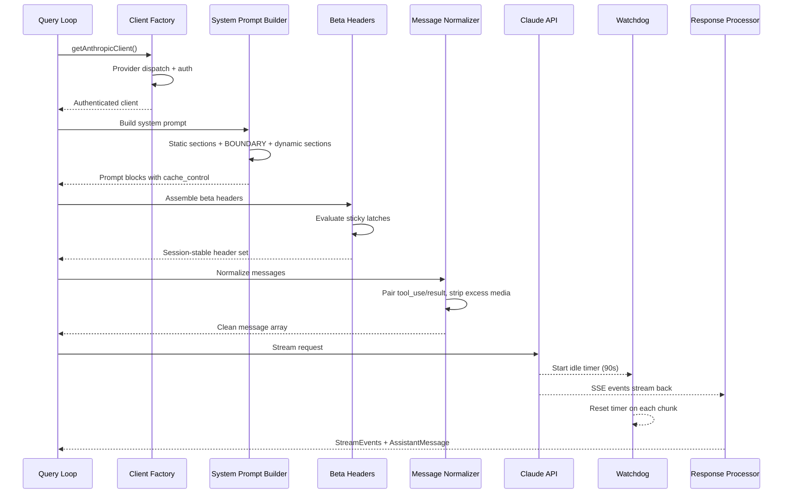
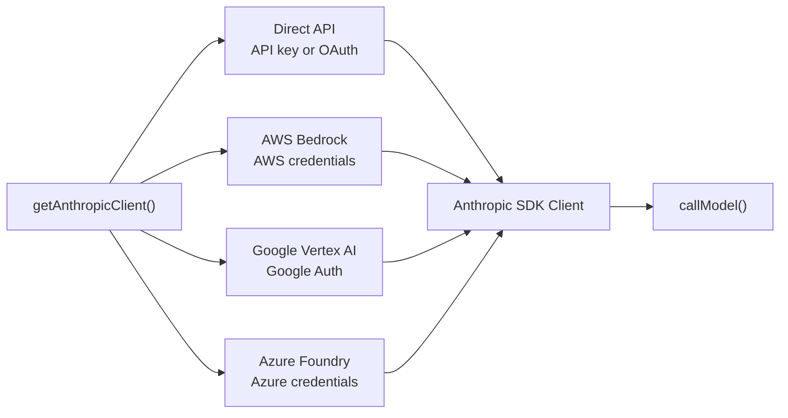
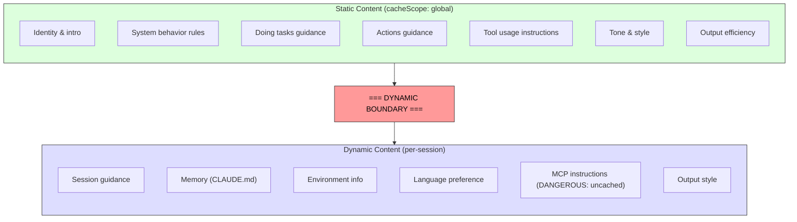

# الفصل 4: الكلام مع Claude -- الـ API Layer

الفصل 3 حدّد الـ state موجود فين وإزاي المستويين بيتواصلوا مع بعض. الآن هنتابع اللي بيحصل لما الـ state ده يتستخدم فعليًا: النظام محتاج يتكلم مع language model. كل حاجة في Claude Code موجودة عشان تخدم اللحظة دي: الـ bootstrap sequence، ونظام الـ state، وإطار الصلاحيات.

الطبقة دي بتتعامل مع failure modes (أشكال الفشل المحتملة) أكثر من أي جزء تاني في النظام. لازم توصّل الـ requests لـ 4 cloud providers من خلال interface واحدة شفافة. ولازم تبني الـ system prompts وهي فاهمة، على مستوى الـ byte، إزاي الـ prompt cache على الـ server بيشتغل، لأن section واحد في غير مكانه ممكن يكسر cache (cache bust) قيمته 50,000+ tokens. ولازم تعمل stream للـ responses مع اكتشاف نشط للفشل، لأن الـ TCP connections بتموت في صمت. ولازم تحافظ على invariants (شروط لازم تفضل صحيحة طول الوقت) ثابتة طول الـ session. بكده لو الـ feature flags (مفاتيح بتشغّل أو تقفل ميزات) اتغيرت في نص المحادثة، مش هيحصل انهيارات مفاجئة في الأداء من غير ما حد يلاحظ.

تعالى نتتبع API call واحد من البداية للنهاية.

---

## الـ Multi-Provider Client Factory

كل الاتصال بالـ model بيعدّي على factory واحد (function وظيفتها تنشئ الـ object المناسب وترجّعه)، وهو الـ function `getAnthropicClient()`. بترجّع Anthropic SDK client مضبوط حسب الـ provider اللي الـ deployment بيستهدفه:

الـ dispatch معتمد بالكامل على الـ environment variables، وبيتقيّم بترتيب أولوية ثابت. الـ 4 SDK classes الخاصة بالـ providers كلها بيتعملها cast لـ `Anthropic` عن طريق `as unknown as Anthropic`. والـ comment الموجود في الـ source صريح بشكل يفرح: "we have always been lying about the return type." (طول عمرنا بنكذب بخصوص الـ return type). الـ type erasure المقصود ده (إخفاء الـ type الحقيقي عمدًا) معناه إن كل consumer بيشوف interface موحدة. وباقي الـ codebase مش بيعمل branch حسب الـ provider أبدًا.

كل provider SDK بيتعمله dynamic import، لأن الـ modules `AnthropicBedrock` و `AnthropicFoundry` و `AnthropicVertex` تقيلة، وكل module منها ليه الـ dependency tree الخاص بيه. الـ dynamic import بيضمن إن الـ providers اللي مش مستخدمة مش بتتحمّل أبدًا.

اختيار الـ provider بيتحدد وقت بدء التشغيل وبيتخزن في الـ bootstrap `STATE`. والـ query loop مش بيسأل أبدًا أي provider شغال. التحويل من Direct API لـ Bedrock تغيير في الإعدادات، مش تغيير في الكود.

### الـ buildFetch Wrapper

كل fetch خارج من البرنامج بيتلف بـ wrapper عشان يضيف header اسمه `x-client-request-id`، وهو UUID بيتولّد لكل request. لما request يحصله timeout، الـ server مش بيدّي الـ response أي request ID. ومن غير الـ ID اللي من ناحية الـ client، فريق الـ API مش هيقدر يربط الـ timeout بالـ logs الموجودة على الـ server. الـ header ده بيسد الفجوة دي. وبيتبعت بس للـ first-party Anthropic endpoints، لأن الـ third-party providers ممكن ترفض headers مش معروفة.

---

## بناء الـ System Prompt

الـ system prompt هو أكثر عنصر حساس للـ cache في النظام كله. الـ API الخاص بـ Claude بيوفر prompt caching على الـ server: الـ prompt prefixes المتطابقة بين الـ requests ممكن تتخزن في الـ cache، وده بيوفّر في الـ latency (زمن الاستجابة) وفي التكلفة. محادثة حجمها 200K tokens ممكن يكون فيها 50-70K tokens متطابقة مع الـ turn اللي قبله. كسر الـ cache ده بيجبر الـ server يعالج كل ده من الأول.

### الـ Dynamic Boundary Marker

الـ prompt بيتبني كـ array من string sections، وفيه خط فاصل حاسم:

كل اللي قبل الـ boundary متطابق بين كل الـ sessions والمستخدمين والمؤسسات، وعشان كده بياخد أعلى مستوى من الـ caching على الـ server. وكل اللي بعده فيه محتوى خاص بالمستخدم، فبينزل لـ caching على مستوى الـ session.

طريقة تسمية الـ sections صارخة عن قصد. عشان تضيف section جديد لازم تختار بين `systemPromptSection` (آمن، وبيتخزن في الـ cache) و `DANGEROUS_uncachedSystemPromptSection` (بيكسر الـ cache، ولازم تكتب معاه reason string). الـ parameter `_reason` مش مستخدم في الـ runtime، لكنه بيشتغل كتوثيق إجباري: كل section بيكسر الـ cache شايل مبرره معاه في الـ source code.

### مشكلة الـ 2^N

فيه comment في ملف `prompts.ts` بيشرح ليه الـ conditional sections لازم تيجي بعد الـ boundary:

> Each conditional here is a runtime bit that would otherwise multiply the Blake2b prefix hash variants (2^N). (كل conditional هنا عبارة عن runtime bit، ولو اتحط قبل الـ boundary كان هيضاعف عدد الـ variants الخاصة بالـ Blake2b prefix hash بمقدار 2^N.)

كل boolean condition قبل الـ boundary بيضاعف عدد الـ global cache entries المختلفة. 3 conditionals بتعمل 8 variants، و5 بتعمل 32. الـ static sections مقصود إنها تكون من غير أي شروط. الـ feature flags اللي بتتحدد في الـ compile-time (الـ bundler هو اللي بيحسمها) مقبولة قبل الـ boundary. أما الـ runtime checks (هل ده Haiku؟ هل المستخدم عنده auto mode؟) فلازم تيجي بعده.

ده نوع القيود اللي مش بتشوفه غير لما تكسره. مهندس نيته كويسة ممكن يضيف قبل الـ boundary section مربوط بإعداد من إعدادات المستخدم. النتيجة إنه يفتّت الـ global cache من غير ما حد يحس، ويضاعف تكلفة معالجة الـ prompts على مستوى كل المستخدمين.

---

## الـ Streaming

### الـ Raw SSE بدل الـ SDK Abstractions

الـ streaming implementation بيستخدم الـ type `Stream<BetaRawMessageStreamEvent>` الخام، بدل الـ class `BetaMessageStream` الأعلى مستوى اللي في الـ SDK. السبب: الـ class `BetaMessageStream` بيستدعي `partialParse()` مع كل event من نوع `input_json_delta`. في الـ tool calls اللي ليها JSON inputs كبيرة (تعديلات ملفات بمئات السطور)، ده معناه إن الـ JSON string اللي بيكبر بيتعمله parse من الصفر مع كل chunk. يعني سلوك O(n^2). و Claude Code بيجمّع الـ tool input بنفسه، فالـ partial parsing ده إهدار تام.

### الـ Idle Watchdog

الـ TCP connections ممكن تموت من غير أي إشعار. ممكن الـ server يقع، أو load balancer يقطع الـ connection في صمت، أو corporate proxy يحصله timeout. والـ request timeout الخاص بالـ SDK بيغطي الـ fetch الأول بس: أول ما HTTP 200 يوصل، الـ timeout بيعتبر إن شرطه اتحقق. ولو الـ streaming body وقف بعد كده، مفيش حاجة هتلاحظه.

الـ watchdog (مؤقّت بيراقب الـ stream ويقطعه لو وقف): عبارة عن `setTimeout` بيرجع للصفر مع كل chunk بيوصل. لو عدّت 90 ثانية من غير أي chunks، الـ stream بيتلغي والنظام بيلجأ لـ retry من غير streaming. فيه تحذير بيطلع عند الثانية 45. ولما الـ watchdog يشتغل، بيسجّل الـ event ومعاه الـ client request ID عشان يتربط بالـ logs.

### الـ Non-Streaming Fallback

لما الـ streaming يفشل في نص الـ response (network error، أو توقف، أو قطع)، النظام بيلجأ لـ fallback (خطة بديلة لما الأساسية تفشل): synchronous call لـ `messages.create()`. وده بيعالج حالات فشل الـ proxy، زي إن الـ proxy يرجّع HTTP 200 ومعاه body مش SSE، أو يقطع الـ SSE stream في نصه.

الـ fallback ممكن يتقفل لما يكون الـ streaming tool execution شغال، لأن الـ fallback هيعيد تنفيذ الـ request كله، وممكن يشغّل الـ tools مرتين.

---

## نظام الـ Prompt Cache

### 3 مستويات

الـ prompt caching بيشتغل على 3 مستويات:

**الـ Ephemeral cache** (الافتراضي): caching على مستوى الـ session، ومعاه TTL (مدة صلاحية الـ cache) الـ server هو اللي بيحدده (~5 دقايق). كل المستخدمين بياخدوا ده.

**الـ 1-hour TTL**: المستخدمين المؤهَّلين بياخدوا caching ممتد. الأهلية بتتحدد حسب حالة الاشتراك، وبتتثبت عن طريق latch (flag لما يتفعّل مرة بيفضل مفعّل لآخر الـ session) في الـ bootstrap state. الـ sticky latch `promptCache1hEligible` من الفصل 3 بيضمن إن لو حالة الـ overage (تجاوز حد الاستهلاك) اتقلبت في نص الـ session، الـ TTL مش هيتغير.

**الـ Global scope**: الـ cache entries الخاصة بالـ system prompt بتتشارك بين الـ sessions وبين المؤسسات. الأجزاء الـ static من الـ prompt متطابقة عند كل مستخدمي Claude Code، فنسخة واحدة في الـ cache بتخدم الكل. الـ global scope بيتقفل لما يكون فيه MCP tools، لأن الـ MCP tool definitions خاصة بكل مستخدم، وكانت هتفتّت الـ cache لملايين الـ prefixes المختلفة.

### الـ Sticky Latches وهي شغالة

الـ 5 sticky latches اللي من الفصل 3 بتتقيّم هنا، أثناء بناء الـ request. كل latch بيبدأ بقيمة `null`، وأول ما يتحط على `true` بيفضل `true` لآخر الـ session. والـ comment اللي فوق الـ latch block دقيق: "Sticky-on latches for dynamic beta headers. Each header, once first sent, keeps being sent for the rest of the session so mid-session toggles don't change the server-side cache key and bust ~50-70K tokens." (latches من نوع sticky-on للـ dynamic beta headers. كل header، بعد أول مرة يتبعت فيها، بيفضل يتبعت لآخر الـ session، بحيث إن أي toggle في نص الـ session مش هيغيّر الـ cache key على الـ server ولا هيكسر ~50-70K tokens).

ارجع للفصل 3، القسم 3.1 عشان تلاقي الشرح الكامل للـ latch pattern، والـ 5 latches بالتحديد، وليه إن كل الـ headers تتبعت دائمًا مش هو الحل الصح.

---

## الـ queryModel Generator

الـ function `queryModel()` عبارة عن async generator (~700 سطر)، يعني function بترجّع قيمها واحدة واحدة بشكل asynchronous. وهي اللي بتنسّق دورة حياة الـ API call كلها. بتعمل yield لـ objects من نوع `StreamEvent` و `AssistantMessage` و `SystemAPIErrorMessage`.

تجميع الـ request ماشي على تسلسل مترتب بعناية:

1. **الـ Kill switch check** -- صمام أمان لأغلى model tier
2. **تجميع الـ beta headers** -- حسب كل model، مع تطبيق الـ sticky latches
3. **بناء الـ tool schemas** -- بالتوازي عن طريق `Promise.all()`، والـ deferred tools بتفضل مستبعدة لحد ما تتكتشف
4. **الـ Message normalization** -- إصلاح الـ tool_use/tool_result اللي مالهاش مقابل (orphaned)، وإزالة الـ media الزيادة، وحذف الـ blocks القديمة
5. **بناء الـ system prompt blocks** -- تقسيم عند الـ dynamic boundary، وتحديد الـ cache scopes
6. **الـ streaming الملفوف بـ retry** -- بيتعامل مع 529 (overloaded)، والـ model fallback، والـ thinking downgrade، والـ OAuth refresh

### الـ Output Token Cap

الـ output cap (الحد الأقصى لعدد الـ output tokens) الافتراضي هو 8,000 tokens، مش 32K أو 64K المعتادين. بيانات الـ production بيّنت إن الـ p99 للـ output هو 4,911 tokens، يعني الحدود المعتادة بتحجز أكثر من المطلوب بـ 8-16x. لما response يوصل للـ cap (<1% من الـ requests)، بياخد retry واحد بحد 64K. وده بيوفّر تكلفة كبيرة على مستوى كل المستخدمين.

### الـ Error Handling والـ Retry

الـ function `withRetry()` هي نفسها async generator، بتعمل yield لـ events من نوع `SystemAPIErrorMessage` عشان الـ UI يقدر يعرض حالة الـ retry. استراتيجيات الـ retry:

- **529 (overloaded)**: النظام بيستنى ويعيد المحاولة، ومعاها اختياريًا downgrade للـ fast mode
- **الـ Model fallback**: الـ model الأساسي فشل، فالنظام بيجرّب fallback (مثلًا من Opus لـ Sonnet)
- **الـ Thinking downgrade**: لما الـ context window يحصله overflow، الـ thinking budget بيقل
- **OAuth 401**: النظام بيعمل refresh للـ token ويعيد المحاولة مرة واحدة

الـ generator pattern معناه إن تقدّم الـ retry ("Server overloaded, retrying in 5s..."، أي: الـ server عليه حمل زايد، وهنعيد المحاولة بعد 5 ثواني) بيظهر كجزء طبيعي من الـ event stream، مش كإشعار جاي من side channel منفصل.

---

## طبّق ده

**اتعامل مع الـ prompt caching كقيد في الـ architecture، مش كميزة بتشغّلها وتقفلها.** معظم تطبيقات الـ LLM "بتشغّل" الـ caching. أما Claude Code فبيتعامل معاه كقيد تصميم بيشكّل ترتيب الـ prompt، والـ section memoization (يحسب النتيجة مرة واحدة ويحتفظ بيها)، والـ header latching، وإدارة الإعدادات. الفرق بين prompt مبني كويس (cache hit على 50K tokens) و prompt مبني بشكل سيئ (إعادة معالجة كاملة في كل turn) هو أكبر عامل بيتحكم في التكلفة في النظام كله.

**استخدم تسمية DANGEROUS للـ escape hatches المكلفة.** لما يكون في الـ codebase invariant سهل يتكسر بالغلط، تسمية الـ escape hatch (مخرج استثنائي من القاعدة) بـ prefix صارخ بتعمل 3 حاجات: بتخلي المخالفات ظاهرة في الـ code review، وبتفرض التوثيق (الـ reason parameter الإجباري)، وبتخلق مقاومة نفسية بتدفعك ناحية الاختيار الافتراضي الآمن. والمبدأ ده مش مقصور على الـ caching، وبينطبق على أي عملية تكلفتها مش ظاهرة.

**ابني الـ streaming ومعاه watchdog، مش مجرد timeout.** الـ request timeout الخاص بالـ SDK بيتحقق شرطه بمجرد وصول HTTP 200، لكن الـ response body ممكن يبطل يوصل في أي لحظة. لو عندك `setTimeout` بيرجع للصفر مع كل chunk، هيمسك الحالة دي. والـ non-streaming fallback بيعالج الـ failure modes الخاصة بالـ proxy (HTTP 200 مع body مش SSE، أو قطع الـ stream في نصه)، ودي حالات منتشرة في بيئات الشركات أكثر مما تتوقع.

**خلي استراتيجيات الـ retry مبنية على yield، مش على exceptions.** لما الـ retry wrapper يبقى async generator بيعمل yield لـ status events، الـ caller بيعرض تقدّم الـ retry كجزء طبيعي من الـ event stream. والـ model fallback pattern (Opus يفشل، فتجرّب Sonnet) مفيد بشكل خاص عشان النظام يصمد في الـ production.

**افصل الـ fast path (طريق مختصر للحالات البسيطة) عن الـ pipeline الكامل.** مش كل API call محتاج الـ tool search، والـ advisor integration، والـ thinking budgets، والـ streaming infrastructure. الـ function `queryHaiku()` في Claude Code بتوفر مسار مبسط للعمليات الداخلية (الـ compaction، والـ classification)، وبتتخطى كل ما يخص الجانب الـ agentic. لما تعمل function منفصلة بـ interface مبسطة، بتمنع تسرّب التعقيد من غير قصد.

---

## الخطوة الجاية

الـ API layer هو الأساس اللي مبني عليه كل اللي جاي. الفصل 5 هيوضح إزاي الـ query loop بيستخدم الـ streaming response عشان يحرّك الـ tool execution، وكمان إزاي الـ tools بتبدأ تتنفذ قبل ما الـ model يخلّص الـ response الخاص بيه. الفصل 6 هيشرح إزاي نظام الـ compaction (ضغط المحادثة عشان تفضل داخل الـ context window) بيحافظ على كفاءة الـ cache لما المحادثات تقرّب من حد الـ context. الفصل 7 هيوضح إزاي كل agent thread بياخد الـ message array والـ request chain الخاصين بيه.

كل الأنظمة دي بتورث القيود اللي اتحطت هنا: ثبات الـ cache كـ invariant في الـ architecture، وشفافية الـ provider من خلال الـ client factory، وإعدادات ثابتة طول الـ session من خلال نظام الـ latch. الـ API layer مش بيبعت requests وبس. هو اللي بيحدد القواعد اللي كل نظام تاني بيشتغل بيها.
