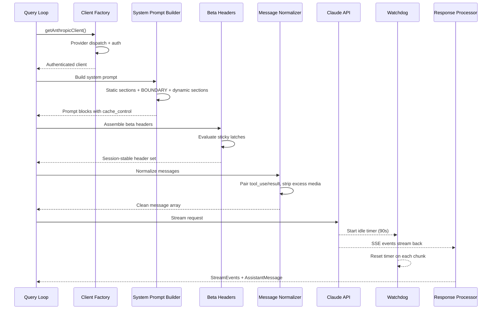
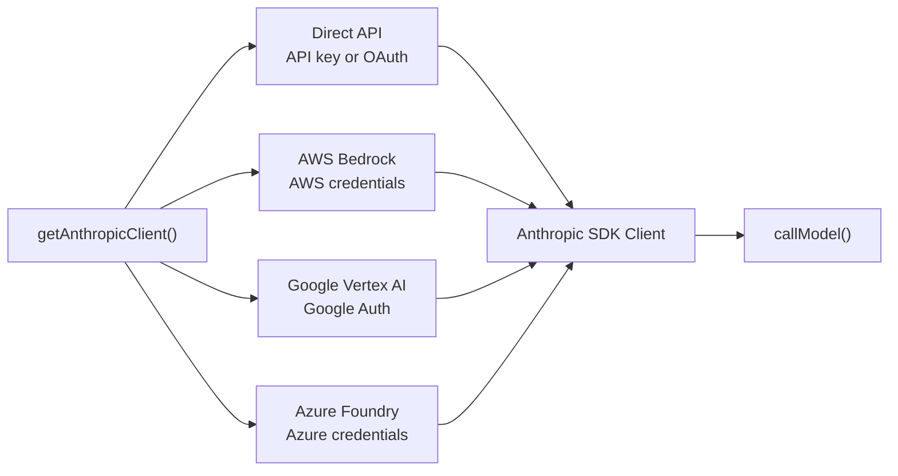
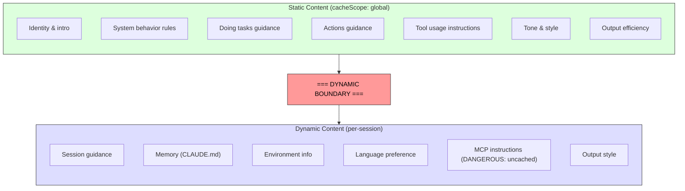

# الفصل 4: الكلام مع Claude -- الـ API Layer

الفصل 3 حدّد الـ State متخزن فين وإزاي المستويين بيتواصلوا مع بعض. دلوقتي هنتابع اللي بيحصل لما الـ State ده يُستخدم فعلياً: النظام محتاج يكلم الـ Language Model. كل شيء في Claude Code اتصمم عشان يخدم اللحظة دي: تسلسل الإقلاع (Bootstrap Sequence)، ونظام الـ State، وإطار الصلاحيات.

الطبقة دي بتتعامل مع حالات وأشكال فشل (Failure Modes) أكثر من أي جزء تاني في النظام:
- لازم توصل الـ Requests لـ 4 مزودي خدمات سحابية مختلفين عبر Interface واحدة موحدة.
- لازم تبني الـ System Prompts وهي فاهمة بدقة البايت إزاي كاش البرومبت (Prompt Cache) شغال على السيرفر؛ لأن سطر واحد في غير مكانه ممكن يكسر الـ Cache بالكامل (Cache Bust) لـ 50,000+ توكن!
- لازم تعمل Stream للـ Responses مع مراقبة حية للفشل؛ لأن اتصالات TCP ممكن تقطع في صمت.
- ولازم تحافظ على قواعد وثوابت معمارية صارمة (Invariants) طول مدة الجلسة؛ بحيث لو اتغيرت الـ Feature Flags في نص المحادثة، ميحصلش انهيار مفاجئ في الأداء بدون ما يلاحظ أحد.

تعالوا نتتبع مسار استدعاء API كامل من البداية للنهاية:

---

## مصنع العملاء متعدد المزودين (Multi-Provider Client Factory)

كل تواصل مع الـ Model بيعدّي على Factory موحد، وهو الدالة `getAnthropicClient()`. بترجّع عميل Anthropic SDK جاهز ومتصل حسب المزود السحابي المستهدف:

توجيه الطلب معتمد بالكامل على متغيرات البيئة (Environment Variables)، وبيتقيم بترتيب أولوية ثابت. كلاسات الـ SDK الـ 4 بيتعمل لها Cast إلى كلاس `Anthropic` الموحد باستخدام `as unknown as Anthropic`. والتعليق اللطيف في الكود الأصلي بيقول بصراحة: "we have always been lying about the return type" (طول عمرنا بنكذب بخصوص الـ Return Type)! التجريد المتعمد ده للأنواع (Type Erasure) معناه إن باقي الكود بيشوف Interface موحدة ومبيحتاجش يعرف أنهي مزود شغال في الخلفية.

كل موديول لمزود سحابي (`AnthropicBedrock`، `AnthropicFoundry`، `AnthropicVertex`) بيتعمل له Dynamic Import، لأنها موديولات ثقيلة وبتحمل معاها شجرة اعتماديات ضخمة، والـ Dynamic Import بيضمن إن المزود اللي مش مستخدم ميلمسش الذاكرة نهائياً.

### الغلاف الواقي: buildFetch Wrapper

كل طلب fetch طالع من البرنامج بيتغلف بـ Wrapper بيضيف Header اسمه `x-client-request-id` (معرف UUID فريد لكل طلب). لما يحصل Timeout للطلب، السيرفر مبيكونش لحق يرجع Request ID في الـ Response، ومن غير الـ ID اللي اتولد في الـ Client، مهندسو الـ API مش هيعرفوا يربطوا الـ Timeout بسجلات الـ Logs على خوادمهم. الـ Header ده بيحل المشكلة دي تماماً.

---

## بناء الـ System Prompt وحماية الـ Cache

الـ System Prompt هو أكثر عنصر حساس للكاش في المنظومة كلها. خوادم Claude بتدعم ميزة الـ Prompt Caching: بدايات الـ Prompts المتطابقة بين الطلبات بتتخزن في الكاش، وده بيوفر سرعة استجابة هائلة (Latency) وبيخفض التكلفة جداً. في محادثة حجمها 200K توكن، ممكن يكون فيه 50K إلى 70K توكن متطابقة مع اللفة اللي قبلها، وتكسير الكاش ده معناه إن السيرفر هيضطر يعيد معالجة كل ده من الصفر.

### الخط الفاصل الديناميكي (The Dynamic Boundary Marker)

البرومبت بيتبني كمصفوفة من المقاطع النصية (Sections)، وفيه خط فاصل حاسم:

- **كل ما قبل الخط الفاصل:** نص ثابت تماماً ومتطابق بين كل الجلسات والمستخدمين والشركات حول العالم؛ عشان كده بياخد أعلى مستوى كاش عالمي (Global Caching) على خوادم Anthropic.
- **كل ما بعد الخط الفاصل:** يحتوي على بيانات خاصة بالمستخدم وجلسته؛ فينزل للكاش المخصص للجلسة فقط (Session-level Cache).

تسمية الدوال في الكود واضحة وصارمة جداً: لما المطور ييجي يضيف مقطع جديد لازم يختار بين `systemPromptSection` (آمن ومخزن في الكاش) وبين `DANGEROUS_uncachedSystemPromptSection` (بيكسر الكاش، ولازم تمرر معاه سبب إجباري `_reason`). والباراميتر ده بيشتغل كتوثيق إلزامي في الكود المصدري يوضح للمراجعين ليه القسم ده بيكسر الكاش.

### معضلة التباديل الرياضية: مشكلة 2^N

فيه تعليق معماري مهم في ملف `prompts.ts` بيوضح ليه الشروط الديناميكية لازم تيجي بعد الخط الفاصل:

> "Each conditional here is a runtime bit that would otherwise multiply the Blake2b prefix hash variants (2^N)."

كل شرط Boolean يتحط قبل الخط الفاصل بيضاعف عدد تفرعات الكاش العالمي؛ فـ 3 شروط بتعمل 8 نسخ مختلفة، و 5 شروط بتعمل 32 نسخة! المقاطع الثابتة لازم تكون خالية من أي شروط وقت التشغيل، وأي فحوصات خاصة بالمستخدم أو بالوضع الحالي لازم تيجي بعد الخط الفاصل لتفادي تفتيت الكاش.

---

## تقنية الـ Streaming والمراقبة الحية

### استخدام الـ Raw SSE بدلاً من مجردات الـ SDK

الـ Streaming بيستخدم كلاس الـ SSE الخام `Stream<BetaRawMessageStreamEvent>` بدلاً من كلاس `BetaMessageStream` عالي المستوى. والسبب: الكلاس عالي المستوى بيستدعي دالة `partialParse()` مع كل حدث وصول لبيانات JSON، وفي الأدوات اللي بتتعامل مع تعديلات ملفات ضخمة، معالجة الـ JSON من الصفر مع كل Chunk بيخلي الأداء يتدهور لـ O(n^2)! و Claude Code بيجمع بيانات الأدوات بنفسه، فاستخدام الـ Raw Stream كان الخيار الأوفر والأسرع بمراحل.

### مؤقت المراقبة (The Idle Watchdog)

اتصالات الشبكة ممكن تموت بدون أي تحذير؛ السيرفر يقع، أو الـ Proxy يقطع الاتصال في صمت. والـ Timeout الافتراضي للـ SDK بيفحص فقط أول اتصال HTTP 200، ولو التدفق وقف بعدها مفيش حاجة هتحس بيه!

هنا بيتدخل الـ Watchdog: مؤقت `setTimeout` بيتعاد ضبطه للصفر مع كل Chunk يوصل بنجاح. لو مرت 90 ثانية كاملة بدون وصول أي داتا، الـ Watchdog بيلغي الـ Stream ويعلن فشل الاتصال ليتم اللجوء لخطة بديلة (Fallback) لإعادة المحاولة.

---

## نظام مستويات الـ Prompt Cache

الكاش بيشتغل على 3 مستويات هندسية:
1. **الـ Ephemeral Cache (الافتراضي):** كاش مؤقت للجلسة بمدة صلاحية (TTL) يحددها السيرفر (~5 دقائق).
2. **الـ 1-Hour Extended TTL:** للمستخدمين المشتركين في خطط معينة؛ وبيتم تثبيته عبر مزلاج (Sticky Latch) يضمن بقاء الـ TTL ثابتاً حتى لو تغيرت حالة الاستهلاك في منتصف الجلسة.
3. **الـ Global Scope:** مشاركة كاش الـ System Prompt الثابت بين كل مستخدمي Claude Code في العالم لتوفير استهلاك الخوادم.

---

## دالة queryModel Generator وإدارة الأخطاء

الدالة `queryModel()` عبارة عن Async Generator بحجم 700 سطر بتدير دورة حياة استدعاء الـ API بالكامل، وتعمل yield لأحداث `StreamEvent` و `AssistantMessage`.

### التحكم في سقف المخرجات (Output Token Cap)

الحد الأقصى الافتراضي لمخرجات الـ Tokens هو **8,000 توكن** فقط بدلاً من 64K المعتادة؛ لأن قياسات البيئات الإنتاجية أثبتت إن نسبة 99% من الردود حجمها 4,911 توكن، وحجز 64K مسبقاً في كل طلب كان بيحجز موارد ضخمة على السيرفر بدون فائدة. وإذا وصل رد معين للسقف (وهذا يحصل في أقل من 1% من الحالات)، بيتم تشغيل Retry واحد فقط بسقف 64K.

### استراتيجيات إعادة المحاولة (Retry Strategies)

دالة `withRetry()` عبارة عن Generator بيرجع أحداث تفاعلية لشاشة المستخدم توضح حالة المحاولة:
- خطأ **529 (Server Overloaded):** النظام ينتظر ويعيد المحاولة مع تقليل الحمل.
- **Model Fallback:** إذا فشل نموذج Opus، ينتقل تلقائياً لـ Sonnet.
- **Thinking Downgrade:** إذا فاضت نافذة السياق (Context Window Overflow)، يقلل مساحة التفكير تلقائياً.
- **OAuth 401:** يجدد الـ Token ويعيد المحاولة فوراً.

---

## دروس مستفادة في تصميم الأنظمة (Takeaways)

**1. تعامل مع الـ Prompt Caching كقيد معماري أساسي وليس مجرد ميزة:**
ترتيب البرومبت، وتجميد المزاليج (Sticky Latches)، وفصل الثوابت عن المتغيرات بخط فاصل، كلها قرارات معمارية توفر آلاف الدولارات وملايين التوكنز يومياً.

**2. استخدم تسميات تحذيرية صريحة (DANGEROUS Naming):**
إطلاق أسماء تحذيرية زي `DANGEROUS_uncached` على الدوال التي تكسر القواعد المعمارية يجعل أي استخدام خاطئ مكشوفاً في مراجعات الكود (Code Reviews).

**3. ابْنِ الـ Streaming ومعه Watchdog حقيقي:**
لا تعتمد على مهلة الاتصال الأولية (Connection Timeout)؛ راقب تدفق الحزم أولاً بأول لتكتشف انقطاعات الشبكة الصامتة فور حدوثها.

**4. افصل المسارات البسيطة (Fast Paths) عن المسار الكامل:**
الاستدعاءات الداخلية السريعة (مثل تصنيف المحادثة أو ضغط النصوص) وفر لها دالة خفيفة مخصصة تتخطى تعقيدات الـ Tools ونظام الوكلاء.
