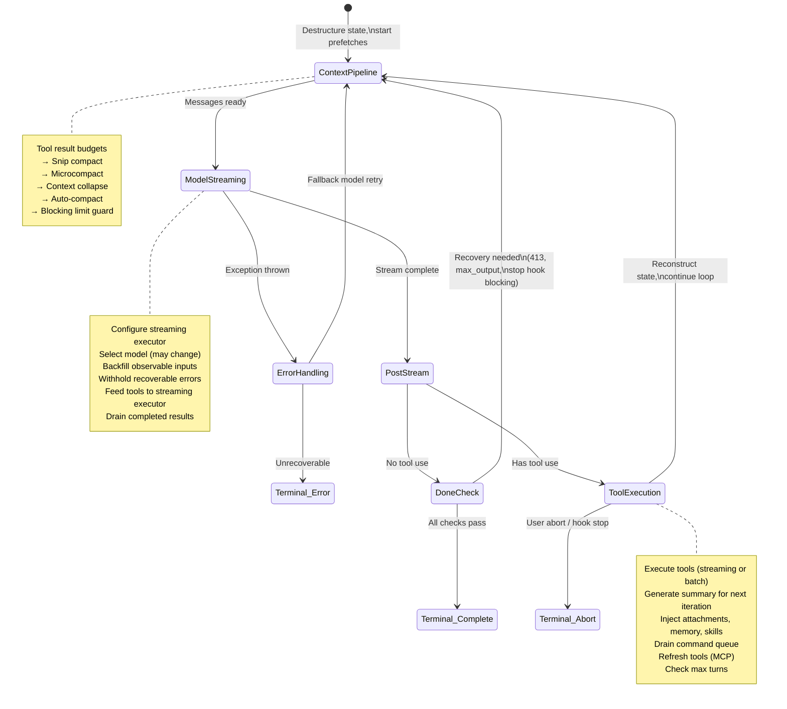
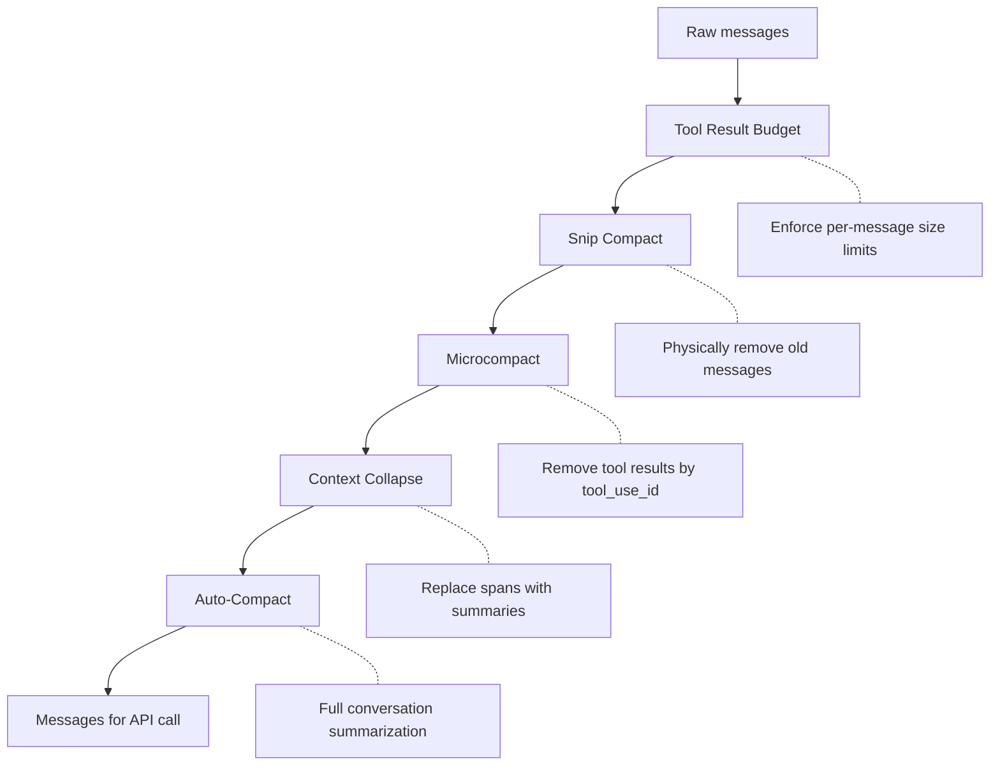
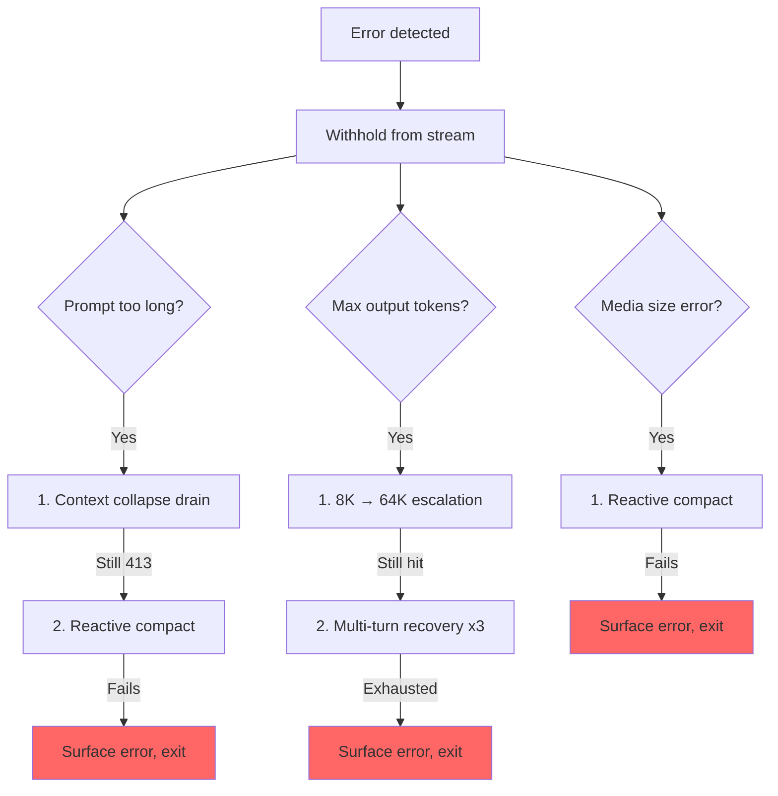

# الفصل 5: الـ Agent Loop

## القلب النابض

الفصل 4 وضّح إزاي الـ API layer بيحوّل الإعدادات لـ streaming HTTP requests: إزاي الـ client بيتبني، وإزاي الـ system prompts بتتجمّع، وإزاي الـ responses بتوصل على شكل server-sent events. الطبقة دي بتتعامل مع *الميكانيكا* الخاصة بالكلام مع الـ model. لكن API call واحد مش agent. الـ agent هو loop: استدعي الـ model، نفّذ الـ tools، رجّع له النتائج، واستدعي الـ model تاني، لحد ما الشغل يخلص.

كل نظام ليه مركز ثقل. في الـ database، هو الـ storage engine. في الـ compiler، هو الـ intermediate representation. وفي Claude Code، هو ملف `query.ts`: ملف واحد من 1,730 سطر فيه الـ async generator (function بترجّع قيمها واحدة واحدة بشكل asynchronous) اللي بيشغّل كل تفاعل، من أول ضغطة مفتاح في الـ REPL لحد آخر tool call في تشغيل headless (من غير UI) بالـ flag `--print`.

ودي مش مبالغة. فيه code path واحد بالضبط هو اللي بيكلم الـ model، وينفّذ الـ tools، ويدير الـ context، ويتعافى من الأخطاء، ويقرر يقف إمتى. الـ code path ده هو الـ function `query()`. الـ REPL بيستدعيها. والـ SDK بيستدعيها. والـ sub-agents بتستدعيها. والـ headless runner بيستدعيها. لو بتستخدم Claude Code، فإنت داخل `query()`.

الملف كثيف، لكن تعقيده مش من نوع تعقيد الـ inheritance hierarchies المتشابكة. تعقيده من نوع تعقيد الغواصة: هيكل واحد فيه أنظمة كثيرة متكررة، وكل واحدة منها اتضافت لأن المحيط لقى طريقة يدخل منها. كل `if` branch وراه قصة. كل رسالة خطأ بتتحجب بتمثل bug حقيقي كان فيه SDK consumer اتفصل في نص عملية التعافي. وكل circuit breaker threshold اتضبط على sessions حقيقية حرقت آلاف الـ API calls في infinite loops.

الفصل ده بيتتبع الـ loop كله من أوله لآخره. ولما تخلصه، مش بس هتفهم إيه اللي بيحصل، لكن كمان ليه كل آلية موجودة وإيه اللي بيتكسر من غيرها.

---

## ليه Async Generator

أول سؤال في الـ architecture: ليه الـ agent loop عبارة عن generator مش event emitter مبني على callbacks؟

```typescript
// Simplified — shows the concept, not the exact types
async function* agentLoop(params: LoopParams): AsyncGenerator<Message | Event, TerminalReason>
```

الـ signature الفعلي بيعمل yield لكذا نوع من الرسائل والـ events، وبيرجّع discriminated union (type بيجمع كذا حالة، وكل حالة ليها علامة بتميزها) بيسجّل ليه الـ loop وقف.

3 أسباب، بترتيب الأهمية.

**الـ Backpressure.** الـ event emitter بيطلق الـ event سواء المستهلك جاهز أو لأ. أما الـ generator فمش بيعمل yield غير لما المستهلك يستدعي `.next()`. لما الـ React renderer الخاص بالـ REPL يكون مشغول برسم الـ frame اللي فات، الـ generator بيقف مؤقتًا بشكل طبيعي. ولما SDK consumer يكون بيعالج tool result، الـ generator بيستنى. مفيش buffer overflow، ولا رسائل ضايعة، ولا مشكلة "fast producer / slow consumer" (منتج سريع ومستهلك بطيء).

**الـ Return value semantics.** الـ return type الخاص بالـ generator هو `Terminal`: discriminated union بيسجّل بالضبط ليه الـ loop وقف. هل كان انتهاء طبيعي؟ abort من المستخدم؟ نفاد الـ token budget؟ تدخل من stop hook؟ الوصول لحد الـ max-turns؟ خطأ في الـ model مش ممكن التعافي منه؟ فيه 10 terminal states مختلفة. الـ callers مش محتاجة تعمل subscribe لـ event اسمه "end" وتتمنى إن الـ payload فيه السبب. بتاخده كـ typed return value من `for await...of` أو `yield*`.

**الـ Composability عن طريق `yield*`.** الـ function الخارجية `query()` بتفوّض لـ `queryLoop()` عن طريق `yield*`، واللي بيمرّر كل قيمة بتتعمل لها yield والـ return النهائي من غير ما حد يحس بالفرق. الـ sub-generators زي `handleStopHooks()` بتستخدم نفس الـ pattern. وده بيعمل chain of responsibility نضيفة من غير callbacks، ومن غير promises ملفوفة في promises، ومن غير boilerplate لتمرير الـ events.

الاختيار ده ليه ثمن: الـ async generators في JavaScript ماينفعش "ترجّعها للخلف" ولا تعمل لها fork. لكن الـ agent loop مش محتاج أي حاجة من الاتنين. هو state machine (مجموعة حالات محددة وانتقالات بينها) بيتحرك للأمام بس.

وفيه نقطة دقيقة كمان: الـ syntax `function*` بتخلّي الـ function *lazy*. جسم الـ function مش بيتنفذ غير عند أول استدعاء لـ `.next()`. وده معناه إن `query()` بترجّع فورًا: كل التهيئة التقيلة (الـ config snapshot، والـ memory prefetch، والـ budget tracker) بتحصل بس لما المستهلك يبدأ يسحب القيم. وفي الـ REPL، ده معناه إن الـ React rendering pipeline بيكون جاهز قبل ما أول سطر في الـ loop يتنفذ.

---

## إيه اللي الـ Callers بتقدمه

قبل ما نتتبع الـ loop، مفيد نعرف إيه اللي بيدخله:

```typescript
// Simplified — illustrates the key fields
type LoopParams = {
  messages: Message[]
  prompt: SystemPrompt
  permissionCheck: CanUseToolFn
  context: ToolUseContext
  source: QuerySource         // 'repl', 'sdk', 'agent:xyz', 'compact', etc.
  maxTurns?: number
  budget?: { total: number }  // API-level task budget
  deps?: LoopDeps             // Injected for testing
}
```

الـ fields اللي تستاهل الوقوف عندها:

- **`querySource`**: string discriminant زي `'repl_main_thread'` أو `'sdk'` أو `'agent:xyz'` أو `'compact'` أو `'session_memory'`. شروط كثيرة بتتفرّع بناءً عليه. الـ compact agent بيستخدم `querySource: 'compact'` عشان الـ blocking limit guard ما يعملش deadlock (الـ compact agent لازم يشتغل عشان *يقلّل* عدد الـ tokens).

- **`taskBudget`**: الـ task budget على مستوى الـ API (`output_config.task_budget`). وده مختلف عن ميزة الـ auto-continue token budget اللي بتتطلب بـ `+500k`. قيمة `total` هي ميزانية الـ agentic turn كله، وقيمة `remaining` بتتحسب في كل iteration من استهلاك الـ API التراكمي، وبتتعدّل لما تعدّي حدود الـ compaction (ضغط المحادثة عشان تفضل داخل الـ context window).

- **`deps`**: dependency injection (الـ function بتاخد اللي محتاجاه كـ parameters بدل ما تجيبه بنفسها) اختياري. الافتراضي هو `productionDeps()`. ودي نقطة الوصل اللي الـ tests بتحقن منها model calls وهمية، و compaction وهمي، و UUIDs من نوع deterministic (نفس المدخلات بتدّي نفس المخرجات كل مرة).

- **`canUseTool`**: function بترجّع هل tool معينة مسموح بيها ولا لأ. ودي طبقة الصلاحيات: بتتحقق من إعدادات الثقة، وقرارات الـ hooks، والـ permission mode الحالي.

---

## الـ Entry Point من طبقتين

الـ public API عبارة عن wrapper رفيع حوالين الـ loop الحقيقي:

الـ function الخارجية بتلف الـ loop الداخلي، وبتتابع أي أوامر من الـ queue اتستهلكت أثناء الـ turn. بعد ما الـ loop الداخلي يخلص، الأوامر اللي اتستهلكت بتتعلّم كـ `'completed'`. لو الـ loop رمى exception أو الـ generator اتقفل عن طريق `.return()`، إشعارات الإكمال مش بتتبعت أبدًا: الـ turn الفاشل مش المفروض يعلّم الأوامر على إنها اتعالجت بنجاح. الأوامر اللي بتدخل الـ queue أثناء الـ turn (عن طريق الأوامر اللي بتبدأ بـ `/` أو إشعارات الـ tasks) بتتعلّم `'started'` داخل الـ loop و `'completed'` في الـ wrapper. لو الـ loop رمى exception أو الـ generator اتقفل عن طريق `.return()`، إشعارات الإكمال مش بتتبعت أبدًا. وده مقصود: الـ turn الفاشل مش المفروض يعلّم الأوامر على إنها اتعالجت بنجاح.

---

## الـ State Object

الـ loop شايل الـ state الخاص بيه في object واحد له type محدد:

```typescript
// Simplified — illustrates the key fields
type LoopState = {
  messages: Message[]
  context: ToolUseContext
  turnCount: number
  transition: Continue | undefined
  // ... plus recovery counters, compaction tracking, pending summaries, etc.
}
```

10 fields. وكل واحد منها مستاهل مكانه:

| الـ Field | ليه موجود |
|-------|---------------|
| `messages` | سجل المحادثة، بيكبر مع كل iteration |
| `toolUseContext` | context من نوع mutable: الـ tools، والـ abort controller، والـ agent state، والـ options |
| `autoCompactTracking` | بيتابع حالة الـ compaction: عداد الـ turns، والـ turn ID، ومرات الفشل المتتالية، و flag الـ compacted |
| `maxOutputTokensRecoveryCount` | عدد محاولات الـ multi-turn recovery لحدود الـ output tokens (الأقصى 3) |
| `hasAttemptedReactiveCompact` | guard بيشتغل مرة واحدة بس ضد الـ infinite loops في الـ reactive compaction |
| `maxOutputTokensOverride` | بيتحدد على 64K أثناء الـ escalation، وبيتمسح بعدها |
| `pendingToolUseSummary` | promise من الـ Haiku summary الخاص بالـ iteration اللي فاتت، بيتعمل له resolve أثناء الـ streaming الحالي |
| `stopHookActive` | بيمنع إعادة تشغيل الـ stop hooks بعد blocking retry |
| `turnCount` | عداد بيزيد بس، بيتقارن بـ `maxTurns` |
| `transition` | ليه الـ iteration اللي فاتت كمّلت. `undefined` في أول iteration |

### الـ Immutable Transitions داخل Mutable Loop

ده الـ pattern اللي بيظهر عند كل `continue` statement في الـ loop:

```typescript
const next: State = {
  messages: [...messagesForQuery, ...assistantMessages, ...toolResults],
  toolUseContext: toolUseContextWithQueryTracking,
  autoCompactTracking: tracking,
  turnCount: nextTurnCount,
  maxOutputTokensRecoveryCount: 0,
  hasAttemptedReactiveCompact: false,
  pendingToolUseSummary: nextPendingToolUseSummary,
  maxOutputTokensOverride: undefined,
  stopHookActive,
  transition: { reason: 'next_turn' },
}
state = next
```

كل نقطة `continue` بتبني object `State` جديد كامل. مش `state.messages = newMessages`. ولا `state.turnCount++`. إعادة بناء كاملة. الفايدة إن كل transition بيوصف نفسه بنفسه. تقدر تقرأ أي نقطة `continue` وتشوف بالضبط أي fields بتتغير وأي fields بتفضل زي ما هي. والـ field `transition` في الـ state الجديد بيسجّل *ليه* الـ loop بيكمّل. والـ tests بتعمل assert عليه عشان تتأكد إن مسار التعافي الصح هو اللي اشتغل.

---

## الـ Loop Body

ده الـ execution flow الكامل لـ iteration واحدة، مضغوط لحد الهيكل بس:



وده الـ loop كله. كل ميزة في Claude Code، من الـ memory للـ sub-agents لـ error recovery، بتدخل في هيكل الـ iteration الواحد ده أو بتستهلك منه.

---

## إدارة الـ Context: 4 Compression Layers

قبل كل API call، سجل الرسائل بيعدّي على 4 مراحل بحد أقصى لإدارة الـ context. بتشتغل بترتيب معين، والترتيب ده مهم.



### الطبقة 0: الـ Tool Result Budget

قبل أي ضغط، الـ function `applyToolResultBudget()` بتفرض على الـ tool results حد أقصى لحجم كل رسالة. والـ tools اللي قيمة `maxResultSizeChars` عندها مش محدودة بتتستثنى.

### الطبقة 1: الـ Snip Compact

أخف عملية. الـ snip بيشيل الرسائل القديمة فعليًا من الـ array، وبيعمل yield لـ boundary message عشان يبلّغ الـ UI بالحذف. وبيبلّغ عن عدد الـ tokens اللي اتحررت، والرقم ده بيتوصّل لفحص الـ threshold الخاص بالـ auto-compact.

### الطبقة 2: الـ Microcompact

الـ microcompact بيشيل الـ tool results اللي مبقاش فيه احتياج ليها، وبيحددها عن طريق الـ field `tool_use_id`. في حالة الـ cached microcompact (اللي بيعدّل الـ API cache)، الـ boundary message بتتأجل لبعد ما الـ API response يوصل. والسبب: تقديرات الـ tokens على جهة الـ client مش موثوقة. القيمة الفعلية `cache_deleted_input_tokens` اللي جاية في الـ API response هي اللي بتقولك إيه اللي اتحرر فعلًا.

### الطبقة 3: الـ Context Collapse

الـ context collapse (طيّ أجزاء من المحادثة من غير حذفها) بيستبدل أجزاء من المحادثة بملخصات. بيشتغل قبل الـ auto-compact، والترتيب ده مقصود: لو الـ collapse قلّل الـ context لتحت الـ auto-compact threshold، الـ auto-compact بيبقى no-op. وده بيحافظ على context تفصيلي بدل ما يستبدل كل حاجة بملخص واحد كبير.

### الطبقة 4: الـ Auto-Compact

أتقل عملية: بتعمل fork لمحادثة Claude كاملة عشان تلخّص سجل المحادثة. الـ implementation فيه circuit breaker: بعد 3 مرات فشل متتالية، بيبطّل يحاول. وده بيمنع السيناريو الكابوسي اللي اتشاف في الـ production: sessions عالقة فوق حد الـ context وبتحرق 250K API calls في اليوم في infinite loop من compact، ففشل، فإعادة محاولة، وهكذا.

### حدود الـ Auto-Compact

الحدود بتتحسب من الـ context window الخاص بالـ model:

```
effectiveContextWindow = contextWindow - min(modelMaxOutput, 20000)

Thresholds (relative to effectiveContextWindow):
  Auto-compact fires:      effectiveWindow - 13,000
  Blocking limit (hard):   effectiveWindow - 3,000
```

| الثابت | القيمة | الغرض |
|----------|-------|---------|
| `AUTOCOMPACT_BUFFER_TOKENS` | 13,000 | مساحة أمان تحت الـ effective window عشان يتفعّل الـ auto-compact |
| `MANUAL_COMPACT_BUFFER_TOKENS` | 3,000 | بيحجز مساحة عشان `/compact` يفضل شغال |
| `MAX_CONSECUTIVE_AUTOCOMPACT_FAILURES` | 3 | الـ threshold الخاص بالـ circuit breaker |

الـ buffer اللي حجمه 13,000 tokens معناه إن الـ auto-compact بيتفعّل قبل الحد الصارم بمسافة كبيرة. والفجوة بين الـ auto-compact threshold والـ blocking limit هي المنطقة اللي بيشتغل فيها الـ reactive compact: لو الـ auto-compact الاستباقي فشل أو كان متقفل، الـ reactive compact بيمسك خطأ الـ 413 ويضغط عند الطلب.

### عدّ الـ Tokens

الـ function الأساسية `tokenCountWithEstimation` بتجمع بين عدد الـ tokens الموثوق اللي الـ API بلّغ عنه (من آخر response) وتقدير تقريبي للرسائل اللي اتضافت بعد الـ response ده. والتقريب ده متحفظ: بيميل للأرقام الأعلى، وده معناه إن الـ auto-compact بيتفعّل بدري شوية بدل ما يتأخر شوية.

---

## الـ Model Streaming

### الـ callModel() Loop

الـ API call بيحصل داخل loop من نوع `while(attemptWithFallback)` بيتيح الـ model fallback (خطة بديلة لما الأساسية تفشل):

```typescript
let attemptWithFallback = true
while (attemptWithFallback) {
  attemptWithFallback = false
  try {
    for await (const message of deps.callModel({ messages, systemPrompt, tools, signal })) {
      // Process each streamed message
    }
  } catch (innerError) {
    if (innerError instanceof FallbackTriggeredError && fallbackModel) {
      currentModel = fallbackModel
      attemptWithFallback = true
      continue
    }
    throw innerError
  }
}
```

لما يكون مفعّل، الـ class `StreamingToolExecutor` بيبدأ ينفّذ الـ tools أول ما الـ blocks من نوع `tool_use` الخاصة بيها توصل أثناء الـ streaming، مش بعد ما الـ response كله يخلص. أما إزاي الـ tools بتتنظّم في concurrent batches فده موضوع الفصل 7.

### الـ Withholding Pattern

ده واحد من أهم الـ patterns في الملف. الأخطاء اللي ممكن التعافي منها بتتحجب من الـ yield stream:

```typescript
let withheld = false
if (contextCollapse?.isWithheldPromptTooLong(message)) withheld = true
if (reactiveCompact?.isWithheldPromptTooLong(message)) withheld = true
if (isWithheldMaxOutputTokens(message)) withheld = true
if (!withheld) yield yieldMessage
```

ليه الحجب؟ لأن الـ SDK consumers، زي Cowork وتطبيق الـ desktop، بتنهي الـ session عند أي رسالة فيها field اسمه `error`. لو عملت yield لخطأ prompt-too-long وبعدين اتعافيت منه بنجاح عن طريق الـ reactive compaction، الـ consumer هيكون اتفصل خلاص. الـ recovery loop بيفضل شغال، لكن مفيش حد بيسمع. عشان كده الخطأ بيتحجب، وبيتحط في `assistantMessages` عشان فحوصات التعافي اللاحقة تقدر تلاقيه. ولو كل مسارات التعافي فشلت، الرسالة المحجوبة بتظهر في الآخر.

### الـ Model Fallback

لما الـ loop يمسك `FallbackTriggeredError` (ضغط عالي على الـ model الأساسي)، بيبدّل الـ model ويعيد المحاولة. لكن الـ thinking signatures مرتبطة بالـ model: لو أعدت إرسال protected-thinking block من model لـ fallback model مختلف، هيطلع خطأ 400. الكود بيشيل الـ signature blocks قبل إعادة المحاولة. وكل الـ assistant messages اللي بقت orphaned من المحاولة الفاشلة بتتحط عليها علامة tombstone عشان الـ UI يشيلها.

---

## الـ Error Recovery: الـ Escalation Ladder

الـ error recovery في query.ts مش استراتيجية واحدة. هو سلّم من تدخلات بتزيد حدّتها درجة درجة، وكل تدخل بيتفعّل لما اللي قبله يفشل.



### الـ Death Spiral Guard

أخطر failure mode (شكل فشل محتمل) هو الـ infinite loop. الكود فيه أكثر من guard:

1. **`hasAttemptedReactiveCompact`**: flag بيشتغل مرة واحدة بس. الـ reactive compact بيتفعّل مرة واحدة لكل نوع خطأ.
2. **`MAX_OUTPUT_TOKENS_RECOVERY_LIMIT = 3`**: سقف صارم لمحاولات الـ multi-turn recovery.
3. **الـ circuit breaker على الـ auto-compact**: بعد 3 مرات فشل متتالية، الـ auto-compact بيبطّل يحاول نهائيًا.
4. **مفيش stop hooks على الـ error responses**: الكود بيرجع صراحةً قبل ما يوصل للـ stop hooks لما تكون آخر رسالة API error. والـ comment بيشرح: "error -> hook blocking -> retry -> error -> ... (the hook injects more tokens each cycle)" (خطأ -> الـ hook بيوقّف -> إعادة محاولة -> خطأ -> ... والـ hook بيحقن tokens أكثر في كل دورة).
5. **الحفاظ على `hasAttemptedReactiveCompact` عبر إعادة المحاولات الخاصة بالـ stop hooks**: لما stop hook يرجّع blocking errors ويفرض إعادة محاولة، الـ guard الخاص بالـ reactive compact بيتحافظ عليه. والـ comment بيوثّق الـ bug: "Resetting to false here caused an infinite loop burning thousands of API calls." (إرجاعه لـ false هنا سبّب infinite loop حرق آلاف الـ API calls.)

كل guard من دول اتضاف لأن حد وقع في الـ failure mode ده في الـ production.

---

## مثال عملي: "Fix the Bug in auth.ts"

عشان الـ loop يبقى ملموس، تعالى نتتبع تفاعل حقيقي على 3 iterations.

**المستخدم بيكتب:** `Fix the null pointer bug in src/auth/validate.ts` (صلّح الـ null pointer bug في src/auth/validate.ts)

**الـ Iteration 1: الـ model بيقرأ الملف.**

الـ loop بيبدأ. إدارة الـ context بتشتغل (مفيش احتياج للضغط، المحادثة قصيرة). الـ model بيعمل stream للـ response: "Let me look at the file." (خليني أبص على الملف.) وبيطلع `tool_use` block واحد: `Read({ file_path: "src/auth/validate.ts" })`. الـ streaming executor بيشوف tool من نوع concurrency-safe وبيبدأها فورًا. ولما الـ model يخلّص نص الـ response، محتوى الملف بيكون في الذاكرة خلاص.

معالجة ما بعد الـ stream: الـ model استخدم tool، فبندخل مسار الـ tool-use. نتيجة الـ Read (محتوى الملف مع أرقام السطور) بتتحط في `toolResults`. وبيبدأ promise لـ Haiku summary في الخلفية. الـ state بيتبني من جديد بالرسائل الجديدة، مع `transition: { reason: 'next_turn' }`، والـ loop بيكمّل.

**الـ Iteration 2: الـ model بيعدّل الملف.**

إدارة الـ context بتشتغل تاني (ما زال تحت الـ threshold). الـ model بيعمل stream: "I see the bug on line 42 -- `userId` can be null." (شايف الـ bug في السطر 42: `userId` ممكن يكون null.) وبيطلع `Edit({ file_path: "src/auth/validate.ts", old_string: "const user = getUser(userId)", new_string: "if (!userId) return { error: 'unauthorized' }\nconst user = getUser(userId)" })`.

الـ Edit مش concurrency-safe، فالـ streaming executor بيحطها في الـ queue لحد ما الـ response يخلص. بعدها الـ execution pipeline اللي من 14 خطوة بيشتغل: الـ Zod validation بيعدّي، والـ input backfill بيحوّل الـ path لمسار absolute، والـ hook `PreToolUse` بيفحص الصلاحيات (المستخدم بيوافق)، والتعديل بيتطبّق. الـ Haiku summary المعلّق من الـ iteration 1 بيتعمل له resolve أثناء الـ streaming، ونتيجته بتتعمل لها yield كـ `ToolUseSummaryMessage`. الـ state بيتبني من جديد، والـ loop بيكمّل.

**الـ Iteration 3: الـ model بيعلن إنه خلّص.**

الـ model بيعمل stream: "I've fixed the null pointer bug by adding a guard clause." (صلّحت الـ null pointer bug بإضافة guard clause.) مفيش `tool_use` blocks. بندخل مسار "done". محتاجين prompt-too-long recovery؟ لأ. الـ max output tokens؟ لأ. الـ stop hooks بتشتغل: مفيش blocking errors. فحص الـ token budget بيعدّي. الـ loop بيرجّع `{ reason: 'completed' }`.

الإجمالي: 3 API calls، وتنفيذ tool مرتين، و permission prompt واحد للمستخدم. الـ loop اتعامل مع الـ streaming tool execution، والـ Haiku summarization اللي بتتداخل مع الـ API call، و pipeline الصلاحيات الكامل، وكل ده من خلال نفس الـ loop `while(true)`.

---

## الـ Token Budgets

المستخدم يقدر يطلب token budget للـ turn (مثلًا `+500k`). نظام الميزانية بيقرر يكمّل ولا يقف بعد ما الـ model يخلّص الـ response.

الـ function `checkTokenBudget` بتاخد قرار ثنائي (كمّل/اقف) بـ 3 قواعد:

1. **الـ Subagents دائمًا بتقف.** الميزانية مفهوم على المستوى الأعلى بس.
2. **حد الإكمال عند 90%.** لو `turnTokens < budget * 0.9`، كمّل.
3. **اكتشاف تناقص العائد.** بعد 3 continuations أو أكثر، لو الـ delta الحالي واللي قبله الاتنين أقل من 500 tokens، اقف بدري. الـ model بينتج output أقل وأقل مع كل continuation.

لما القرار يكون "continue" (كمّل)، بتتحقن رسالة nudge بتقول للـ model فاضل قد إيه من الميزانية.

---

## الـ Stop Hooks: إجبار الـ Model إنه يكمّل شغل

الـ stop hooks بتشتغل لما الـ model يخلّص من غير ما يطلب أي tool use، يعني فاكر إنه خلّص. الـ hooks بتقيّم هل هو *فعلًا* خلّص.

الـ pipeline بيشغّل الـ template job classification، وبيطلق background tasks (اقتراح الـ prompt، واستخراج الـ memory)، وبعدها بينفّذ الـ stop hooks نفسها. لما stop hook يرجّع blocking errors، زي "you said you were done, but the linter found 3 errors" (قلت إنك خلّصت، لكن الـ linter لقى 3 أخطاء)، الأخطاء بتتضاف لسجل الرسائل والـ loop بيكمّل مع `stopHookActive: true`. الـ flag ده بيمنع إعادة تشغيل نفس الـ hooks في إعادة المحاولة.

لما stop hook يبعت إشارة `preventContinuation`، الـ loop بيخرج فورًا بـ `{ reason: 'stop_hook_prevented' }`.

---

## الـ State Transitions: الكتالوج الكامل

كل خروج من الـ loop هو واحد من نوعين: `Terminal` (الـ loop بيرجّع) أو `Continue` (الـ loop بيلف لفّة جديدة).

### الـ Terminal States (10 أسباب)

| السبب | إيه اللي بيفعّله |
|--------|---------|
| `blocking_limit` | عدد الـ tokens وصل للحد الصارم، والـ auto-compact متقفل |
| `image_error` | ImageSizeError أو ImageResizeError أو خطأ media مش ممكن التعافي منه |
| `model_error` | exception من الـ API أو الـ model مش ممكن التعافي منه |
| `aborted_streaming` | المستخدم عمل abort أثناء الـ model streaming |
| `prompt_too_long` | خطأ 413 محجوب بعد استنفاد كل محاولات التعافي |
| `completed` | انتهاء طبيعي (مفيش tool use، أو الميزانية خلصت، أو API error) |
| `stop_hook_prevented` | stop hook منع الاستمرار صراحةً |
| `aborted_tools` | المستخدم عمل abort أثناء تنفيذ الـ tools |
| `hook_stopped` | hook من نوع PreToolUse أوقف الاستمرار |
| `max_turns` | وصل لحد `maxTurns` |

### الـ Continue States (7 أسباب)

| السبب | إيه اللي بيفعّله |
|--------|---------|
| `collapse_drain_retry` | الـ context collapse فرّغ الـ staged collapses عند 413 |
| `reactive_compact_retry` | الـ reactive compact نجح بعد 413 أو خطأ media |
| `max_output_tokens_escalate` | وصل لحد الـ 8K، وبيصعّد لـ 64K |
| `max_output_tokens_recovery` | الـ 64K برضه اتوصل له، multi-turn recovery (لحد 3 محاولات) |
| `stop_hook_blocking` | stop hook رجّع blocking errors، لازم إعادة محاولة |
| `token_budget_continuation` | الـ token budget ما خلصش، واتحقنت رسالة nudge |
| `next_turn` | استمرار عادي بعد tool use |

---

## الـ Orphaned Tool Results: شبكة أمان البروتوكول

بروتوكول الـ API بيشترط إن كل `tool_use` block يتبعه `tool_result`. الـ function `yieldMissingToolResultBlocks` بتنشئ رسائل `tool_result` من نوع error لكل `tool_use` block الـ model طلعه ومجاش له نتيجة مقابلة أبدًا. من غير شبكة الأمان دي، أي crash أثناء الـ streaming هيسيب `tool_use` blocks orphaned، ودي هتسبب protocol error في الـ API call اللي بعده.

بتشتغل في 3 أماكن: الـ error handler الخارجي (crash في الـ model)، والـ fallback handler (تبديل الـ model في نص الـ stream)، والـ abort handler (مقاطعة من المستخدم). كل مسار له رسالة خطأ مختلفة، لكن الآلية واحدة.

---

## التعامل مع الـ Abort: مسارين

الـ abort ممكن يحصل عند نقطتين: أثناء الـ streaming وأثناء تنفيذ الـ tools. وكل واحدة ليها سلوك مختلف.

**الـ abort أثناء الـ streaming**: الـ streaming executor (لو شغال) بيفرّغ النتائج المتبقية، وبيولّد `tool_results` اصطناعية للـ tools اللي في الـ queue. ومن غير الـ executor، الـ function `yieldMissingToolResultBlocks` هي اللي بتسد الفجوة. فحص `signal.reason` بيفرّق بين الـ hard abort (Ctrl+C) والـ submit-interrupt (المستخدم كتب رسالة جديدة): الـ submit-interrupts بتتخطى رسالة المقاطعة لأن رسالة المستخدم اللي في الـ queue بتوفر الـ context خلاص.

**الـ abort أثناء تنفيذ الـ tools**: منطق مشابه، مع parameter `toolUse: true` على رسالة المقاطعة بيبلّغ الـ UI إن كان فيه tools شغالة.

---

## قواعد الـ Thinking

الـ thinking/redacted_thinking blocks الخاصة بـ Claude ليها 3 قواعد ماينفعش تتكسر:

1. أي رسالة فيها thinking block لازم تكون جزء من query فيه `max_thinking_length > 0`
2. الـ thinking block ماينفعش يكون آخر block في الرسالة
3. الـ thinking blocks لازم تتحافظ عليها طول مدة الـ assistant trajectory

ومخالفة أي قاعدة منهم بتنتج API errors غامضة. الكود بيتعامل معاها في أكثر من مكان: الـ fallback handler بيشيل الـ signature blocks (لأنها مرتبطة بالـ model)، والـ compaction pipeline بيحافظ على الـ protected tail، والـ microcompact layer عمره ما بيلمس الـ thinking blocks.

---

## الـ Dependency Injection

الـ type `QueryDeps` ضيّق عن قصد: 4 dependencies، مش 40:

4 dependencies بتتحقن: الـ model caller، والـ compactor، والـ microcompactor، و UUID generator. الـ tests بتمرّر `deps` في الـ loop params عشان تحقن fakes مباشرة. واستخدام `typeof fn` في تعريفات الـ types بيخلّي الـ signatures متزامنة تلقائيًا. وجنب الـ object `State` اللي هو mutable والـ type `QueryDeps` اللي بيتحقن، فيه type `QueryConfig` من نوع immutable بيتاخد له snapshot (نسخة مجمّدة في لحظة معينة) مرة واحدة عند دخول `query()`: الـ feature flags، والـ session state، والـ environment variables بتتلقط مرة واحدة وعمرها ما بتتقري تاني. والتقسيم الثلاثي ده (mutable state، و immutable config، و injectable deps) بيخلّي الـ loop قابل للاختبار، وبيخلّي الـ refactor المستقبلي لـ pure reducer على شكل `step(state, event, config)` سهل.

---

## طبّق ده: ابني الـ Agent Loop الخاص بيك

**استخدم generator، مش callbacks.** الـ backpressure ببلاش. والـ return value semantics ببلاش. والـ composability عن طريق `yield*` ببلاش. الـ agent loops بتتحرك للأمام بس: عمرك ما هتحتاج ترجّعها للخلف أو تعمل لها fork.

**خلّي الـ state transitions صريحة.** ابني الـ state object كامل من جديد عند كل نقطة `continue`. الإطالة دي هي الميزة: بتمنع الـ bugs الناتجة عن التحديث الجزئي، وبتخلّي كل transition يوصف نفسه بنفسه.

**احجب الأخطاء اللي ممكن التعافي منها.** لو الـ consumers عندك بتتفصل عند الأخطاء، ماتعملش yield للأخطاء غير لما تتأكد إن التعافي فشل. حطها في buffer داخلي، وحاول تتعافى، وماتظهرهاش غير عند استنفاد كل المحاولات.

**قسّم إدارة الـ context لطبقات.** العمليات الخفيفة الأول (الحذف)، والعمليات التقيلة في الآخر (التلخيص). وده بيحافظ على context تفصيلي لما يكون ممكن، ومش بيلجأ للملخصات الكبيرة غير لما يكون ضروري.

**ضيف circuit breakers لكل retry.** كل آلية تعافي في `query.ts` ليها حد صريح: 3 مرات فشل للـ auto-compact، و 3 محاولات للـ max-output recovery، ومحاولة واحدة للـ reactive compact. من غير الحدود دي، أول production session تدخل في loop من نوع retry-on-failure هتحرق ميزانية الـ API عندك في ليلة واحدة.

ولو بتبدأ من الصفر، ده أقل هيكل ممكن لـ agent loop:

```
async function* agentLoop(params) {
  let state = initState(params)
  while (true) {
    const context = compressIfNeeded(state.messages)
    const response = await callModel(context)
    if (response.error) {
      if (canRecover(response.error, state)) { state = recoverState(state); continue }
      return { reason: 'error' }
    }
    if (!response.toolCalls.length) return { reason: 'completed' }
    const results = await executeTools(response.toolCalls)
    state = { ...state, messages: [...context, response.message, ...results] }
  }
}
```

كل ميزة في الـ loop الخاص بـ Claude Code هي تفصيل لواحدة من الخطوات دي. الـ 4 compression layers بتفصّل الخطوة 3 (الضغط). والـ withholding pattern بيفصّل استدعاء الـ model. والـ escalation ladder بيفصّل الـ error recovery. والـ stop hooks بتفصّل مخرج "no tool use". ابدأ بالهيكل ده. وضيف كل تفصيل بس لما تقابل المشكلة اللي بيحلها.

---

## الملخص

الـ agent loop هو 1,730 سطر من `while(true)` واحد بيعمل كل حاجة. بيعمل stream للـ model responses، وينفّذ الـ tools بشكل concurrent، ويضغط الـ context عبر 4 طبقات، ويتعافى من 5 فئات من الأخطاء، ويتابع الـ token budgets مع اكتشاف تناقص العائد، ويشغّل stop hooks تقدر تجبر الـ model يرجع يشتغل، ويدير الـ prefetch pipelines الخاصة بالـ memory والـ skills، وينتج discriminated union له type بيقول بالضبط ليه وقف.

وهو أهم ملف في النظام لأنه الملف الوحيد اللي بيلمس كل subsystem تاني. الـ context pipeline بيصب فيه. والـ tool system بياخد منه. والـ error recovery بيلف حواليه. والـ hooks بتعترضه. والـ state layer بيتحفظ من خلاله. والـ UI بيرسم منه.

لو فهمت `query()`، فهمت Claude Code. وكل حاجة تانية مجرد ملحقات.
