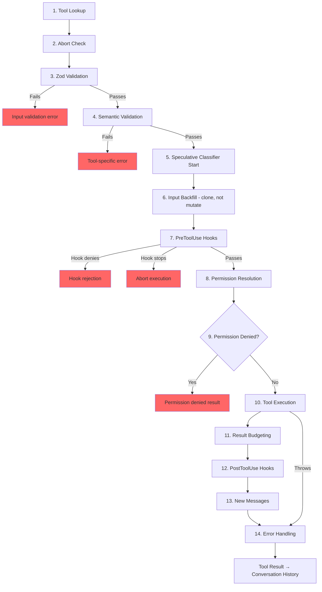

# الفصل 6: الـ Tools -- من التعريف للتنفيذ

## الجهاز العصبي

الفصل 5 وراك الـ agent loop: الـ loop `while(true)` اللي بيعمل stream للـ responses الخاصة بالـ model، ويجمع الـ tool calls، ويرجّع النتائج للـ model تاني. الـ loop هو نبض القلب. لكن النبض ده ملوش معنى من غير الجهاز العصبي اللي بيحوّل "the model wants to run `git status`" (الـ model عايز يشغّل `git status`) لأمر shell حقيقي، مع فحص الصلاحيات، والـ result budgeting، والـ error handling.

الـ tool system هو الجهاز العصبي ده. بيغطي 40+ tool implementations، و registry مركزي فيه feature-flag gating، و execution pipeline من 14 خطوة، و permission resolver ليه 7 modes، و streaming executor بيبدأ يشغّل الـ tools قبل ما الـ model يخلّص الـ response.

كل tool call في Claude Code بيعدّي من نفس الـ pipeline: كل قراءة ملف، وكل أمر shell، وكل grep، وكل تشغيل لـ sub-agent. والتوحيد ده هو الهدف نفسه: سواء كانت الـ tool هي الـ Bash executor المدمج أو third-party MCP server، بتاخد نفس الـ validation، ونفس فحص الصلاحيات، ونفس الـ result budgeting، ونفس تصنيف الأخطاء.

الـ interface `Tool` فيها حوالي 45 members. الرقم ده شكله مرعب، لكن فيه 5 بس هما اللي مهمين عشان تفهم النظام بيشتغل إزاي:

1. **`call()`**: تنفيذ الـ tool
2. **`inputSchema`**: التحقق من الـ input وعمل parse ليه
3. **`isConcurrencySafe()`**: هل دي ينفع تشتغل بالتوازي؟
4. **`checkPermissions()`**: هل ده مسموح؟
5. **`validateInput()`**: هل الـ input ده ليه معنى منطقي؟

كل حاجة تانية موجودة عشان تخدم طبقات الـ UI والـ telemetry: الـ 12 rendering methods، والـ analytics hooks، والـ search hints. ابدأ بالـ 5 دول، والباقي هيترتب لوحده.

---

## الـ Tool Interface

### 3 Type Parameters

كل tool معرّفة على 3 types:

```typescript
Tool<Input extends AnyObject, Output, P extends ToolProgressData>
```

الـ type `Input` هو Zod object schema بيقوم بوظيفتين: بيولّد الـ JSON Schema اللي بيتبعت للـ API (عشان الـ model يعرف يبعت أي parameters)، وبيتحقق من الـ response الخاص بالـ model وقت التشغيل عن طريق `safeParse`. والـ type `Output` هو الـ TypeScript type الخاص بنتيجة الـ tool. أما `P` فهو الـ type الخاص بالـ progress events اللي الـ tool بتصدرها أثناء ما هي شغالة: BashTool بتصدر stdout chunks، و GrepTool بتصدر عدد النتائج المطابقة، و AgentTool بتصدر transcripts (سجلات المحادثة) الخاصة بالـ sub-agents.

### buildTool() والـ Fail-Closed Defaults

مفيش tool definition بتنشئ object من `Tool` بشكل مباشر. كل tool بتعدّي من `buildTool()`، وهي factory (function وظيفتها تنشئ الـ object المناسب وترجّعه) بتعمل spread لـ object من الـ defaults تحت الـ definition الخاصة بالـ tool:

```typescript
// Pseudocode — illustrates the fail-closed defaults pattern
const SAFE_DEFAULTS = {
  isEnabled:         () => true,
  isParallelSafe:    () => false,   // Fail-closed: new tools run serially
  isReadOnly:        () => false,   // Fail-closed: treated as writes
  isDestructive:     () => false,
  checkPermissions:  (input) => ({ behavior: 'allow', updatedInput: input }),
}

function buildTool(definition) {
  return { ...SAFE_DEFAULTS, ...definition }  // Definition overrides defaults
}
```

الـ defaults دي fail-closed (لو حصل شك، الافتراضي هو الأكثر أمانًا) عن قصد في الأماكن اللي الأمان فيها مهم. أي tool جديدة نسيت تعمل implement لـ `isConcurrencySafe` بتاخد `false` افتراضيًا، يعني بتشتغل بالتتابع ومش بالتوازي أبدًا. والـ tool اللي نسيت `isReadOnly` بتاخد `false`، فالنظام بيعاملها كعملية كتابة. والـ tool اللي نسيت `toAutoClassifierInput` بترجّع string فاضي، فالـ security classifier (model صغير بيصنّف الطلب: مسموح ولا لأ) الخاص بالـ auto mode بيتخطاها، وده معناه إن نظام الصلاحيات العام هو اللي بيتعامل معاها بدل أي تجاوز آلي.

الـ default الوحيد اللي *مش* fail-closed هو `checkPermissions`، اللي بيرجّع `allow`. وده شكله معكوس لحد ما تفهم إن نظام الصلاحيات مبني من طبقات: الـ method `checkPermissions` هي logic خاص بكل tool، وبيشتغل *بعد* ما نظام الصلاحيات العام يكون قيّم القواعد والـ hooks والسياسات المبنية على الـ mode. لما tool ترجّع `allow` من `checkPermissions`، هي بتقول "I have no tool-specific objection" (مفيش عندي اعتراض خاص بالـ tool دي)، مش بتدّي صلاحية مفتوحة. وتجميع الحاجات في sub-objects (زي `options`، و fields ليها أسماء زي `readFileState`) بيدّي نفس التنظيم اللي كانت هتدّيه interfaces صغيرة متخصصة، من غير عناء إنك تعلن 5 interface types منفصلة وتعملها implement وتمررها في 40+ call sites.

### الـ Concurrency بتعتمد على الـ Input

الـ signature `isConcurrencySafe(input: z.infer<Input>): boolean` بتاخد الـ input بعد الـ parse لأن نفس الـ tool ممكن تكون آمنة مع inputs معينة وغير آمنة مع غيرها. و BashTool هي المثال الكلاسيكي: الأمر `ls -la` قراءة فقط و concurrency-safe، لكن `rm -rf /tmp/build` مش كده. الـ tool بتعمل parse للأمر، وبتصنّف كل subcommand مقابل مجموعات الأوامر المعروف إنها آمنة، وبترجّع `true` بس لما كل جزء غير محايد يكون عملية بحث أو قراءة.

### الـ ToolResult Return Type

كل `call()` بترجّع `ToolResult<T>`:

```typescript
type ToolResult<T> = {
  data: T
  newMessages?: (UserMessage | AssistantMessage | AttachmentMessage | SystemMessage)[]
  contextModifier?: (context: ToolUseContext) => ToolUseContext
}
```

الـ field `data` هو الـ output اللي ليه type محدد، وبيتعمله serialize داخل الـ content block `tool_result` الخاص بالـ API. والـ field `newMessages` بيسمح للـ tool تحقن رسائل إضافية في المحادثة، و AgentTool بتستخدمه عشان تضيف transcripts الـ sub-agents. أما `contextModifier` فهو function بتعدّل الـ object `ToolUseContext` للـ tools اللي بعدها، ودي الطريقة اللي `EnterPlanMode` بيغيّر بيها الـ permission mode. الـ context modifiers بتتنفذ بس للـ tools اللي مش concurrency-safe. لو الـ tool الخاصة بيك بتشتغل بالتوازي، الـ modifier الخاص بيها بيتحط في الـ queue لحد ما الـ batch يخلص.

---

## ToolUseContext: الـ God Object

الـ object `ToolUseContext` هو الـ context bag الضخم اللي بيتمرر في كل tool call. فيه حوالي 40 fields. وهو، بأي تعريف معقول، god object. وموجود لأن البديل أسوأ.

الـ tool زي BashTool محتاجة الـ abort controller، والـ file state cache، والـ app state، وسجل الرسائل، ومجموعة الـ tools، واتصالات الـ MCP، وحوالي 6 UI callbacks. لو مررت كل دول كـ parameters منفصلة، هتطلع function signatures فيها 15+ arguments. الحل العملي هو context object واحد، مقسّم حسب الغرض:

**الإعدادات** (الـ sub-object `options`): مجموعة الـ tools، واسم الـ model، واتصالات الـ MCP، والـ debug flags. بتتحدد مرة واحدة في بداية الـ query، وأغلبها immutable.

**الـ execution state**: الـ field `abortController` للإلغاء، و `readFileState` للـ LRU file cache، و `messages` لسجل المحادثة الكامل. ودول بيتغيروا أثناء التنفيذ.

**الـ UI callbacks**: `setToolJSX`، و `addNotification`، و `requestPrompt`. بتتوصل بس في السياقات التفاعلية (الـ REPL). أما الـ SDK والـ headless modes فبتسيبها undefined.

**الـ agent context**: `agentId`، و `renderedSystemPrompt` (نسخة مجمّدة من prompt الـ parent للـ fork sub-agents، لأن لو اتعمل لها re-render ممكن تختلف بسبب الـ feature flag warm-up وتكسر الـ cache).

النسخة الخاصة بالـ sub-agents من `ToolUseContext` بتكشف حاجات كثيرة عن التصميم. لما `createSubagentContext()` تبني context لـ child agent، بتاخد قرارات مقصودة عن أي fields تتشارك وأي fields تتعزل: `setAppState` بيبقى no-op للـ async agents، و `localDenialTracking` بياخد object جديد، و `contentReplacementState` بيتنسخ من الـ parent. كل قرار من دول وراه درس اتعلموه من bug في الـ production.

---

## الـ Registry

### getAllBaseTools(): الـ Single Source of Truth

الـ function `getAllBaseTools()` بترجّع القائمة الكاملة لكل tool ممكن توجد في الـ process الحالية. الـ tools الموجودة دائمًا بتيجي الأول، وبعدها الـ tools المشروطة اللي متحكم فيها feature flags (مفاتيح بتشغّل أو تقفل ميزات):

```typescript
const SleepTool = feature('PROACTIVE') || feature('KAIROS')
  ? require('./tools/SleepTool/SleepTool.js').SleepTool
  : null
```

الـ import الخاص بـ `feature()` من `bun:bundle` بيتحدد وقت الـ bundle. لما `feature('AGENT_TRIGGERS')` تكون false بشكل static، الـ bundler بيحذف استدعاء `require()` بالكامل، وده dead code elimination (حذف الكود اللي مستحيل يتنفذ) بيخلّي الـ binary صغير.

### assembleToolPool(): دمج الـ Built-in Tools مع الـ MCP Tools

مجموعة الـ tools النهائية اللي بتوصل للـ model بتيجي من `assembleToolPool()`:

1. جيب الـ built-in tools (مع فلترة بقواعد الـ deny، والإخفاء حسب الـ REPL mode، وفحص `isEnabled()`)
2. فلتر الـ MCP tools بقواعد الـ deny
3. رتّب كل مجموعة أبجديًا بالاسم
4. ضم الـ built-ins (في الأول) + الـ MCP tools (في الآخر)

أسلوب "رتّب وبعدين ضم" ده مش مسألة ذوق. الـ API server بيحط prompt-cache breakpoint بعد آخر built-in tool. لو رتّبنا كل الـ tools مع بعض في قائمة واحدة، الـ MCP tools هتتداخل وسط الـ built-in tools، وإضافة أو حذف أي MCP tool هيزحزح مواضع الـ built-in tools، وده هيكسر الـ cache.

---

## الـ Execution Pipeline من 14 خطوة

الـ function `checkPermissionsAndCallTool()` هي المكان اللي النية بتتحول فيه لفعل. كل tool call بيعدّي من الـ 14 خطوة دول.



### الخطوات 1-4: الـ Validation

**الـ Tool Lookup** بيرجع لـ `getAllBaseTools()` عشان يطابق الـ aliases، وده بيتعامل مع transcripts من sessions قديمة كانت الـ tool فيها باسم تاني. **الـ Abort Check** بيمنع الشغل على الفاضي في tool calls كانت في الـ queue قبل ما إشارة Ctrl+C تنتشر. **الـ Zod Validation** بيمسك عدم تطابق الـ types. وبالنسبة للـ deferred tools، الخطأ بيضيف تلميح إن لازم تستدعي ToolSearch الأول. **الـ Semantic Validation** بيروح أبعد من مطابقة الـ schema: FileEditTool بترفض التعديلات اللي مش بتغيّر حاجة، و BashTool بتمنع `sleep` لوحده لما MonitorTool تكون متاحة.

### الخطوات 5-6: التجهيز

**الـ Speculative Classifier Start** بيشغّل الـ security classifier الخاص بالـ auto mode بالتوازي لأوامر Bash، وده بيوفّر مئات الملي ثانية في المسار الشائع. **الـ Input Backfill** بيعمل clone للـ input بعد الـ parse ويضيف عليه fields مشتقة (زي تحويل `~/foo.txt` لمسار absolute) عشان الـ hooks والصلاحيات، مع الاحتفاظ بالأصل عشان الـ transcript يفضل ثابت.

### الخطوات 7-9: الصلاحيات

**الـ PreToolUse Hooks** هي آلية التوسعة: تقدر تاخد قرارات صلاحيات، أو تعدّل الـ inputs، أو تحقن context، أو توقف التنفيذ تمامًا. **الـ Permission Resolution** بتربط بين الـ hooks ونظام الصلاحيات العام: لو hook قرر خلاص، فقراره نهائي. غير كده، `canUseTool()` بتشغّل مطابقة القواعد، والفحوصات الخاصة بكل tool، والـ defaults المبنية على الـ mode، والـ prompts التفاعلية. **الـ Permission Denied Handling** بيبني رسالة خطأ وبينفذ الـ hooks من نوع `PermissionDenied`.

### الخطوات 10-14: التنفيذ والتنظيف

**الـ Tool Execution** بيشغّل الـ method `call()` الفعلية بالـ input الأصلي. **الـ Result Budgeting** بيحفظ الـ output الكبير زيادة عن الحد على الـ disk في `~/.claude/tool-results/{hash}.txt` وبيستبدله بمعاينة. **الـ PostToolUse Hooks** تقدر تعدّل output الـ MCP أو تمنع الاستمرار. **الـ New Messages** بتتضاف (transcripts الـ sub-agents، والـ system reminders). **الـ Error Handling** بيصنّف الأخطاء للـ telemetry، وبيستخرج strings آمنة من أسماء ممكن تكون اتشوهت، وبيصدر OTel events.

---

## نظام الصلاحيات

### الـ 7 Modes

| الـ Mode | السلوك |
|------|----------|
| `default` | فحوصات خاصة بكل tool، وبيسأل المستخدم عن العمليات غير المعروفة |
| `acceptEdits` | بيسمح تلقائيًا بتعديلات الملفات، وبيسأل المستخدم عن باقي العمليات |
| `plan` | قراءة فقط: بيرفض كل عمليات الكتابة |
| `dontAsk` | بيرفض تلقائيًا أي حاجة كانت هتسأل المستخدم في العادي (للـ background agents) |
| `bypassPermissions` | بيسمح بكل حاجة من غير ما يسأل |
| `auto` | بيستخدم الـ transcript classifier عشان يقرر (وراه feature flag) |
| `bubble` | mode داخلي للـ sub-agents اللي بتصعّد القرار للـ parent |

### الـ Resolution Chain

لما tool call يوصل لمرحلة حسم الصلاحيات:

1. **قرار الـ hook**: لو PreToolUse hook رجّع `allow` أو `deny` خلاص، فده نهائي.
2. **مطابقة القواعد**: 3 مجموعات قواعد بتتطابق على اسم الـ tool و content patterns اختيارية: `alwaysAllowRules`، و `alwaysDenyRules`، و `alwaysAskRules`. القاعدة `Bash(git *)` بتطابق أي أمر Bash بيبدأ بـ `git`.
3. **الفحص الخاص بالـ tool**: الـ method `checkPermissions()` الخاصة بالـ tool. أغلبها بترجّع `passthrough`.
4. **الـ default المبني على الـ mode**: `bypassPermissions` بيسمح بكل حاجة. و `plan` بيرفض الكتابة. و `dontAsk` بيرفض أي حاجة كانت هتسأل.
5. **الـ prompt التفاعلي**: في الـ modes `default` و `acceptEdits`، القرارات اللي ماتحسمتش بتظهر للمستخدم في prompt.
6. **الـ classifier الخاص بالـ auto mode**: classifier من مرحلتين (model سريع، وبعدين extended thinking للحالات الملتبسة).

النسخة `safetyCheck` فيها boolean اسمه `classifierApprovable`: تعديلات `.claude/` و `.git/` بتاخد `classifierApprovable: true` (غير معتادة لكنها مشروعة أحيانًا)، بينما محاولات تجاوز مسارات Windows بتاخد `classifierApprovable: false` (تقريبًا دائمًا هجوم).

### قواعد الصلاحيات والمطابقة

قواعد الصلاحيات بتتخزن كـ objects من `PermissionRule` من 3 أجزاء: `source` بيحدد مصدر القاعدة (userSettings، أو projectSettings، أو localSettings، أو cliArg، أو policySettings، أو session، وغيرها)، و `ruleBehavior` (allow، أو deny، أو ask)، و `ruleValue` فيه اسم الـ tool و content pattern اختياري.

الـ field `ruleContent` هو اللي بيسمح بمطابقة دقيقة. القاعدة `Bash(git *)` بتسمح بأي أمر Bash بيبدأ بـ `git`. و `Edit(/src/**)` بتسمح بالتعديلات داخل `/src` بس. و `Fetch(domain:example.com)` بتسمح بالـ fetch من domain معين. والقواعد اللي من غير `ruleContent` بتطابق كل استدعاءات الـ tool دي.

الـ permission matcher الخاص بـ BashTool بيعمل parse للأمر عن طريق `parseForSecurity()` (وهو bash AST parser) وبيقسّم الأوامر المركبة لـ subcommands. لو الـ AST parsing فشل (syntax معقد فيه heredocs أو subshells متداخلة)، الـ matcher بيرجّع `() => true`، وده fail-safe، يعني الـ hook بيشتغل دائمًا. الافتراض هنا إن الأمر لو معقد لدرجة إننا مش قادرين نعمله parse، فهو معقد لدرجة إننا مش بنقدر نستبعده بثقة من فحوصات الأمان.

### الـ Bubble Mode للـ Sub-Agents

الـ sub-agents في الـ coordinator-worker patterns مش بتقدر تعرض permission prompts لأنها ملهاش terminal. الـ mode `bubble` بيخلّي طلبات الصلاحيات تطلع لفوق للـ parent context. والـ coordinator agent (agent وظيفته يوزّع الشغل على agents تانية ويجمع النتائج)، اللي شغال في الـ main thread ومعاه terminal، بيتعامل مع الـ prompt وبيرجّع القرار لتحت.

---

## الـ Deferred Loading للـ Tools

الـ tools اللي عندها `shouldDefer: true` بتتبعت للـ API بـ `defer_loading: true`، يعني الأسماء والأوصاف بس، من غير الـ parameter schemas الكاملة. وده بيقلل حجم الـ prompt الأولي. وعشان الـ model يستخدم deferred tool، لازم يستدعي `ToolSearchTool` الأول عشان يحمّل الـ schema الخاص بيها. والـ failure mode (شكل الفشل المحتمل) هنا فيه درس: لما الـ model يستدعي deferred tool من غير ما يحمّلها، الـ Zod validation بيفشل (كل الـ parameters اللي ليها types بتوصل كـ strings)، والنظام بيضيف تلميح موجّه عشان يصلح الوضع.

الـ deferred loading (التحميل بيتأجل لحد ما الحاجة تتطلب) بيحسّن كمان نسبة الـ cache hits: الـ tools اللي بتتبعت بـ `defer_loading: true` مش بتضيف للـ prompt غير اسمها، فإضافة أو حذف deferred MCP tool بيغيّر الـ prompt بشوية tokens بدل مئات.

---

## الـ Result Budgeting

### حدود الحجم لكل Tool

كل tool بتعلن عن `maxResultSizeChars`:

| الـ Tool | maxResultSizeChars | السبب |
|------|-------------------|-----------|
| BashTool | 30,000 | كفاية لأغلب الـ output المفيد |
| FileEditTool | 100,000 | الـ diffs ممكن تكون كبيرة لكن الـ model محتاجها |
| GrepTool | 100,000 | نتائج البحث مع سطور الـ context بتتراكم بسرعة |
| FileReadTool | Infinity | بتحد نفسها بنفسها عن طريق حدود الـ tokens الخاصة بيها. ولو اتحفظت على الـ disk هتعمل Read loops دائرية |

لما النتيجة تعدّي الحد، المحتوى الكامل بيتحفظ على الـ disk وبيتستبدل بـ wrapper اسمه `<persisted-output>` فيه معاينة ومسار الملف. وبعدها الـ model يقدر يستخدم `Read` عشان يوصل للـ output الكامل لو محتاجه.

### الميزانية الإجمالية لكل محادثة

فوق حدود كل tool، الـ object `ContentReplacementState` بيتابع ميزانية إجمالية على مستوى المحادثة كلها، عشان الـ context ما يموتش بالتقسيط: tools كثيرة كل واحدة بترجّع 90% من حدها الخاص ممكن مع بعض تغرق الـ context window.

---

## أبرز الـ Tools واحدة واحدة

### BashTool: الـ Tool الأكثر تعقيدًا

BashTool هي الـ tool الأكثر تعقيدًا في النظام بفارق كبير. بتعمل parse للأوامر المركبة، وبتصنّف الـ subcommands كقراءة فقط أو كتابة، وبتدير الـ background tasks، وبتكتشف الـ output اللي هو صورة عن طريق الـ magic bytes، وبتعمل implement لمحاكاة sed عشان معاينات آمنة للتعديلات.

الـ parsing الخاص بالأوامر المركبة مثير للاهتمام بشكل خاص. الـ function `splitCommandWithOperators()` بتفكك أمر زي `cd /tmp && mkdir build && ls build` لـ subcommands منفصلة. وكل واحد منهم بيتصنّف مقابل مجموعات الأوامر المعروف إنها آمنة (`BASH_SEARCH_COMMANDS`، و `BASH_READ_COMMANDS`، و `BASH_LIST_COMMANDS`). والأمر المركب بيتعتبر قراءة فقط بس لو كل الأجزاء غير المحايدة آمنة. أما المجموعة المحايدة (echo، printf) فبتتجاهل: هي مش بتخلّي الأمر قراءة فقط، لكنها كمان مش بتخلّيه كتابة.

محاكاة sed (الـ field `_simulatedSedEdit`) تستاهل اهتمام خاص. لما المستخدم يوافق على أمر sed في الـ permission dialog، النظام بيحسب النتيجة مقدمًا عن طريق تشغيل أمر sed في sandbox والتقاط الـ output. والنتيجة المحسوبة دي بتتحقن في الـ input تحت اسم `_simulatedSedEdit`. ولما `call()` تتنفذ، بتطبّق التعديل مباشرة، من غير ما تمر على الـ shell أصلًا. وده بيضمن إن اللي المستخدم شافه في المعاينة هو بالضبط اللي هيتكتب، مش إعادة تنفيذ ممكن تدّي نتيجة مختلفة لو الملف اتغير بين المعاينة والتنفيذ.

### FileEditTool: اكتشاف الـ Staleness

FileEditTool بتشتغل مع `readFileState`، وهو الـ LRU cache لمحتويات الملفات والـ timestamps الخاصة بيها اللي بيتحافظ عليه طول المحادثة. قبل ما تطبّق تعديل، بتتحقق هل الملف اتعدّل من آخر مرة الـ model قراه. لو نسخة الـ model من الملف بقت قديمة (يعني الملف اتعدّل عن طريق background process، أو tool تانية، أو المستخدم)، التعديل بيترفض برسالة بتقول للـ model يقرأ الملف تاني الأول.

الـ fuzzy matching في `findActualString()` بيتعامل مع الحالة الشائعة اللي الـ model فيها بيغلط شوية في المسافات. بيوحّد المسافات وأشكال علامات الاقتباس قبل المطابقة، فالتعديل اللي بيستهدف `old_string` فيه مسافات في الآخر ما زال بيطابق المحتوى الفعلي للملف. والـ flag `replace_all` بيسمح بالاستبدال الجماعي. ومن غيره، المطابقات غير الفريدة بتترفض، فالـ model لازم يدّي context كفاية لتحديد مكان واحد.

### FileReadTool: القارئ متعدد الاستخدامات

FileReadTool هي الـ built-in tool الوحيدة اللي عندها `maxResultSizeChars: Infinity`. لو output الـ Read اتحفظ على الـ disk، الـ model هيحتاج يعمل Read للملف المحفوظ، واللي ممكن هو كمان يعدّي الحد، وكده بندخل في infinite loop. بدل كده، الـ tool بتحد نفسها بنفسها عن طريق تقدير الـ tokens وبتقطع من المصدر.

والـ tool دي متعددة الاستخدامات بشكل ملحوظ: بتقرأ الملفات النصية بأرقام السطور، والصور (وبترجّع base64 multimodal content blocks)، وملفات PDF (عن طريق `extractPDFPages()`)، و Jupyter notebooks (عن طريق `readNotebook()`)، والمجلدات (وبترجع فيها لـ `ls`). وبتمنع مسارات الأجهزة الخطيرة (`/dev/zero`، و `/dev/random`، و `/dev/stdin`)، وبتتعامل مع غرابة أسماء ملفات screenshots في macOS (المسافة الضيقة U+202F narrow no-break space بدل المسافة العادية في أسماء ملفات "Screen Shot").

### GrepTool: الـ Pagination عن طريق head_limit

GrepTool بتغلّف `ripGrep()` وبتضيف آلية pagination عن طريق `head_limit`. الـ default هو 250 نتيجة: كفاية لنتائج مفيدة، وصغير كفاية عشان الـ context ما يتضخمش. ولما يحصل قطع، الـ response بيتضمن `appliedLimit: 250`، وده إشارة للـ model إنه يستخدم `offset` في الاستدعاء الجاي عشان يكمّل الصفحات. أما `head_limit: 0` بشكل صريح فبيلغي الحد تمامًا.

GrepTool بتستبعد تلقائيًا 6 مجلدات VCS (`.git`، و `.svn`، و `.hg`، و `.bzr`، و `.jj`، و `.sl`). البحث داخل `.git/objects` شبه مستحيل يكون هو اللي الـ model محتاجه، ودخول ملفات الـ pack الثنائية بالغلط هيستنزف الـ token budgets.

### AgentTool والـ Context Modifiers

AgentTool بتعمل spawn لـ sub-agents بتشغّل query loops خاصة بيها. الـ method `call()` الخاصة بيها بترجّع `newMessages` فيه الـ transcript الخاص بالـ sub-agent، واختياريًا `contextModifier` بينقل تغييرات الـ state للـ parent. ولأن AgentTool مش concurrency-safe افتراضيًا، أكثر من Agent tool call في response واحد بتتنفذ بالتتابع، والـ context modifier الخاص بكل sub-agent بيتطبّق قبل ما الـ sub-agent اللي بعده يبدأ. وفي الـ coordinator mode، الـ pattern بيتقلب: الـ coordinator بيشغّل sub-agents للـ tasks المستقلة، وفحص `isAgentSwarmsEnabled()` هو اللي بيفتح باب تشغيل الـ agents بالتوازي.

---

## إزاي الـ Tools بتتعامل مع سجل الرسائل

نتائج الـ tools مش مجرد data بترجع للـ model. هي بتشارك في المحادثة كرسائل منظمة.

الـ API بيتوقع نتائج الـ tools كـ objects من `ToolResultBlockParam` بتشير للـ block الأصلي `tool_use` بالـ ID الخاص بيه. أغلب الـ tools بتعمل serialize لنص. أما FileReadTool فتقدر تعمل serialize لـ image content blocks (بترميز base64) للـ responses من نوع multimodal. و BashTool بتكتشف الـ output اللي هو صورة عن طريق فحص الـ magic bytes في الـ stdout وبتتحول لـ image blocks بناءً على كده.

الـ field `ToolResult.newMessages` هو الطريقة اللي الـ tools بتوسّع بيها المحادثة لأبعد من الـ pattern البسيط "استدعاء ورد". **الـ agent transcripts**: AgentTool بتحقن سجل رسائل الـ sub-agent كـ attachment messages. **الـ system reminders**: الـ memory tools بتحقن system messages بتظهر بعد نتيجة الـ tool. الـ model بيشوفها في الـ turn الجاي لكنها بتتشال عند حد `normalizeMessagesForAPI`. **الـ attachment messages**: نتائج الـ hooks، والـ context الإضافي، وتفاصيل الأخطاء بتشيل metadata منظمة الـ model يقدر يرجع لها في الـ turns الجاية.

الـ function `contextModifier` هي الآلية الخاصة بالـ tools اللي بتغيّر بيئة التنفيذ. لما `EnterPlanMode` يتنفذ، بيرجّع modifier بيحوّل الـ permission mode لـ `'plan'`. ولما `ExitWorktree` يتنفذ، بيعدّل الـ working directory. الـ modifiers دي هي الطريقة الوحيدة اللي tool تقدر بيها تأثر على الـ tools اللي بعدها. التعديل المباشر على `ToolUseContext` مش ممكن لأن الـ context بيتنسخ بالـ spread قبل كل tool call. وقيد "بالتتابع بس" بتفرضه طبقة الـ orchestration: لو فيه tools اتنين بتشتغل بالتوازي والاتنين عدّلت الـ working directory، مين اللي تكسب؟

---

## طبّق ده: تصميم Tool System

**الـ fail-closed defaults.** الـ tools الجديدة لازم تكون متحفظة لحد ما تتعلّم صراحةً غير كده. المطوّر اللي بينسى يحدد flag بياخد السلوك الآمن، مش الخطير.

**الأمان بيعتمد على الـ input.** الـ methods `isConcurrencySafe(input)` و `isReadOnly(input)` بياخدوا الـ input بعد الـ parse لأن نفس الـ tool مع inputs مختلفة بتبقى درجة أمانها مختلفة. الـ tool registry اللي بيعلّم BashTool على إنها "دائمًا بالتتابع" صحيح لكن فيه إهدار.

**اعمل طبقات لصلاحياتك.** الفحوصات الخاصة بكل tool، والمطابقة المبنية على القواعد، والـ defaults المبنية على الـ mode، والـ prompts التفاعلية، والـ classifiers الآلية كل واحد فيهم بيتعامل مع حالات مختلفة. مفيش آلية واحدة كفاية لوحدها.

**حط ميزانية للنتائج، مش للـ inputs بس.** حدود الـ tokens على الـ input حاجة عادية. لكن نتائج الـ tools ممكن تكون بأي حجم وبتتراكم عبر الـ turns. حدود كل tool بتمنع إن نتيجة واحدة تنفجر في الحجم. وحدود المحادثة الإجمالية بتمنع إن المجموع يفيض على الـ context.

**خلّي تصنيف الأخطاء آمن للـ telemetry.** في الـ minified builds، قيمة `error.constructor.name` بتتشوه. الـ function `classifyToolError()` بتستخرج أكثر string آمن ومفيد متاح (رسائل آمنة للـ telemetry، أو errno codes، أو أسماء أخطاء ثابتة)، من غير ما تسجّل رسالة الخطأ الخام في الـ analytics أبدًا.

---

## اللي جاي

الفصل ده تتبّع إزاي tool call واحد بيمشي من التعريف للـ validation فالصلاحيات فالتنفيذ فالـ result budgeting. لكن الـ model نادرًا ما بيطلب tool واحدة بس في المرة. وإزاي الـ tools بتتنظم في concurrent batches هو موضوع الفصل 7.
