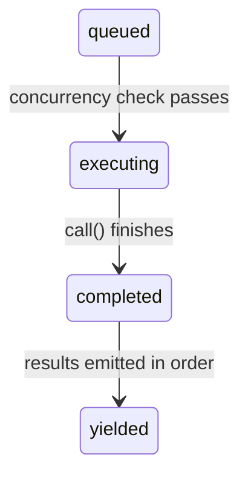

# الفصل 7: تنفيذ الـ Tools بشكل Concurrent

## ثمن الانتظار

الفصل 6 تتبّع دورة حياة tool call واحد: من الـ block `tool_use` الخام في الـ API response، مرورًا بالتحقق من الـ input وفحص الصلاحيات والتنفيذ، ووصولًا لتنسيق النتيجة. الـ pipeline ده بيتعامل مع tool واحدة. لكن الـ model نادرًا ما بيطلب tool واحدة بس.

التفاعل العادي مع Claude Code بيتضمن من 3 لـ 5 tool calls في الـ turn الواحد. "Read these two files, grep for this pattern, then edit this function." (اقرأ الملفين دول، ودوّر على الـ pattern ده، وبعدين عدّل الـ function دي.) الـ model بيطلع كل دول في response واحد. لو كل tool بتاخد 200 ملي ثانية، تشغيلهم بالتتابع هيكلّف ثانية كاملة. ولو الـ Read والـ Grep calls مستقلة عن بعض (وهي فعلًا كده)، تشغيلهم بالتوازي بينزل الرقم ده لـ 200 ملي ثانية. تحسين 5 لـ 1، ببلاش.

لكن مش كل الـ tools مستقلة. الـ Edit اللي بتعدّل `config.ts` ماينفعش تشتغل بشكل concurrent مع Edit تانية بتعدّل `config.ts`. وأمر Bash بينشئ مجلد لازم يخلص قبل أمر Bash تاني بيكتب ملف داخل المجلد ده. الـ concurrency مش خاصية عامة للـ tool. هي خاصية لاستدعاء معين للـ tool بـ inputs معينة.

ودي الفكرة الأساسية اللي بتحرّك نظام الـ concurrency كله: **الأمان بيتحدد لكل call، مش لكل نوع tool**. استدعاء `Bash("ls -la")` آمن إنه يتشغّل بالتوازي. أما `Bash("rm -rf build/")` فلأ. نفس الـ tool، inputs مختلفة، تصنيف concurrency مختلف. النظام لازم يفحص الـ input قبل ما يقرر.

بيطبّق Claude Code طبقتين من تحسين الـ concurrency. الأولى هي **الـ batch orchestration**: بعد ما الـ response الخاص بالـ model يوصل كامل، بنقسّم الـ tool calls لمجموعات concurrent ومجموعات بالتتابع، وبعدين ننفذ كل مجموعة بالطريقة المناسبة لها. التانية هي **الـ speculative execution**: نبدأ نشغّل الـ tools *والـ model ما زال بيعمل stream للـ response*، ونجمع النتائج قبل حتى ما الـ response يكتمل. الآليتين دول مع بعض بيلغوا أغلب الـ wall-clock time (الوقت الفعلي اللي بيعدّي على الساعة) اللي كان هيتقضى في الانتظار.

---

## الـ Partition Algorithm

نقطة البداية هي الـ function `partitionToolCalls()` في ملف `toolOrchestration.ts`. بتاخد array مرتب من رسائل `ToolUseBlock` وبتنتج array من الـ batches، كل batch فيه إما "كل الـ tools فيه concurrent-safe" أو "tool واحدة بتتنفذ لوحدها بالتتابع".

```typescript
// Pseudocode — illustrates the partition algorithm
type Group = { parallel: boolean; calls: ToolCall[] }

function groupBySafety(calls: ToolCall[], registry: ToolRegistry): Group[] {
  return calls.reduce((groups, call) => {
    const def = registry.lookup(call.name)
    const input = def?.schema.safeParse(call.input)
    // Fail-closed: parse failure or exception → serial
    const safe = input?.success
      ? tryCatch(() => def.isParallelSafe(input.data), false)
      : false
    // Merge consecutive safe calls into one group
    if (safe && groups.at(-1)?.parallel) {
      groups.at(-1)!.calls.push(call)
    } else {
      groups.push({ parallel: safe, calls: [call] })
    }
    return groups
  }, [] as Group[])
}
```

الـ algorithm بيمشي على الـ array من أولها لآخرها. ولكل tool call:

1. **بيدوّر على الـ tool definition** بالاسم.
2. **بيعمل parse للـ input** بالـ Zod schema الخاص بالـ tool عن طريق `safeParse()`. لو الـ parse فشل، الـ tool بتتصنّف بشكل تحفّظي على إنها مش concurrency-safe.
3. **بيستدعي `isConcurrencySafe(parsedInput)`** على الـ tool definition. وهنا بيحصل التصنيف حسب الـ input. الـ Bash tool بتعمل parse لـ string الأمر، وبتتحقق إن كل subcommand فيه للقراءة فقط (`ls`، `grep`، `cat`، `git status`)، وبترجّع `true` بس لو الأمر المركّب كله عبارة عن قراءة بحتة. الـ Read tool دائمًا بترجّع `true`. والـ Edit tool دائمًا بترجّع `false`. الاستدعاء ده متلفوف في try-catch: لو `isConcurrencySafe` رمت exception (مثلًا الـ shell-quote library ماقدرتش تعمل parse لـ string الأمر الخاص بـ Bash)، الـ tool بترجع للوضع الافتراضي وهو التنفيذ بالتتابع.
4. **بيدمج في batch موجود أو ينشئ batch جديد.** لو الـ tool الحالية concurrency-safe وكمان آخر batch concurrency-safe، بيضيفها للـ batch ده. غير كده، بيبدأ batch جديد.

النتيجة سلسلة من الـ batches بتتناوب بين مجموعات concurrent وعناصر فردية بتتنفذ بالتتابع. تعالى نمشي على مثال عملي:

```
Model requests: [Read, Read, Grep, Edit, Read]

Step 1: Read  → concurrent-safe → new batch {safe, [Read]}
Step 2: Read  → concurrent-safe → append   {safe, [Read, Read]}
Step 3: Grep  → concurrent-safe → append   {safe, [Read, Read, Grep]}
Step 4: Edit  → NOT safe        → new batch {serial, [Edit]}
Step 5: Read  → concurrent-safe → new batch {safe, [Read]}

Result: 3 batches
  Batch 1: [Read, Read, Grep]  — run concurrently
  Batch 2: [Edit]              — run alone
  Batch 3: [Read]              — run concurrently (just one tool)
```

التقسيم greedy وبيحافظ على الترتيب. الـ tools الآمنة المتتالية بتتجمع في batch واحد. وأي tool مش آمنة بتقطع السلسلة وتبدأ batch جديد. وده معناه إن ترتيب الـ tool calls اللي الـ model بيطلعها بيفرق: لو حط Write بين Read و Read، هتطلع 3 batches بدل اتنين. وعمليًا، الـ models بتميل تجمّع القراءات مع بعض، ودي الحالة الشائعة اللي الـ algorithm متحسّن عشانها.

---

## تنفيذ الـ Batches

الـ generator `runTools()` بيلف على الـ batches بعد التقسيم وبيبعت كل واحد للـ executor المناسب.

### الـ Concurrent Batches

للـ batch الـ concurrent، الـ function `runToolsConcurrently()` بتشغّل كل الـ tools بالتوازي عن طريق utility اسمها `all()` بتحدد عدد الـ generators النشطة بحد الـ concurrency الأقصى:

```typescript
// Pseudocode — illustrates the concurrent dispatch pattern
async function* dispatchParallel(calls, context) {
  yield* boundedAll(
    calls.map(async function* (call) {
      context.markInProgress(call.id)
      yield* executeSingle(call, context)
      context.markComplete(call.id)
    }),
    MAX_CONCURRENCY,  // Default: 10
  )
}
```

حد الـ concurrency الافتراضي 10، وتقدر تغيّره عن طريق `CLAUDE_CODE_MAX_TOOL_USE_CONCURRENCY`. والـ 10 رقم سخي: نادرًا ما هتشوف أكثر من 5 أو 6 tool calls في response واحد من الـ model. الحد ده موجود كصمام أمان للحالات الشاذة، مش كقيد في الاستخدام العادي.

الـ utility `all()` عبارة عن نسخة من `Promise.all` بتفهم الـ generators ومحدودة الـ concurrency. بتبدأ لحد N generators في نفس الوقت، وبتعمل yield للنتائج من أي واحد يخلص الأول، وبتبدأ الـ generator التالي في الـ queue كل ما واحد يخلص. الآلية شبه task pool محمي بـ semaphore، لكن متعدّلة عشان تناسب async generators بتعمل yield لنتائج وسيطة.

**تجميع الـ context modifiers في الـ queue** هو الجزء الدقيق. بعض الـ tools بتنتج *context modifiers*: وهي functions بتحوّل الـ object `ToolUseContext` للـ tools اللي بعدها. لما الـ tools بتشتغل بشكل concurrent، ماتقدرش تطبّق الـ modifiers دي فورًا، لأن tools تانية في نفس الـ batch بتقرأ نفس الـ context. بدل كده، الـ modifiers بتتجمع في map مفتاحها الـ tool use ID:

```typescript
const queuedContextModifiers: Record<
  string,
  ((context: ToolUseContext) => ToolUseContext)[]
> = {}
```

بعد ما الـ batch الـ concurrent كله يخلص، الـ modifiers بتتطبق بترتيب الـ tools (مش بترتيب الاكتمال)، وده بيحافظ على تطور الـ context بشكل deterministic:

```typescript
for (const block of blocks) {
  const modifiers = queuedContextModifiers[block.id]
  if (!modifiers) continue
  for (const modifier of modifiers) {
    currentContext = modifier(currentContext)
  }
}
```

عمليًا، مفيش ولا tool من الـ tools الـ concurrency-safe الحالية بتنتج context modifiers، والـ comment اللي في الـ codebase بيعترف بده صراحة. لكن البنية التحتية موجودة لأن الـ tools ممكن تتضاف من MCP servers، و MCP tool مخصصة للقراءة فقط ممكن يكون عندها سبب مشروع إنها تعدّل الـ context (مثلًا إنها تحدّث Set بيتتبع "files seen"، يعني الملفات اللي اتشافت).

### الـ Serial Batches

التنفيذ بالتتابع بسيط. كل tool بتشتغل، والـ context modifiers الخاصة بيها بتتطبق فورًا، والـ tool اللي بعدها بتشوف الـ context المحدّث:

```typescript
for (const toolUse of toolUseMessages) {
  for await (const update of runToolUse(toolUse, /* ... */)) {
    if (update.contextModifier) {
      currentContext = update.contextModifier.modifyContext(currentContext)
    }
    yield { message: update.message, newContext: currentContext }
  }
}
```

وده الفرق الجوهري. الـ tools اللي بتتنفذ بالتتابع تقدر تغيّر العالم للـ tools اللي بعدها. الـ Edit بتعدّل ملف، والـ Read اللي بعدها بتشوف النسخة المعدّلة. وأمر Bash بينشئ مجلد، وأمر Bash اللي بعده بيكتب فيه. الـ context modifiers هي الصياغة الرسمية للاعتمادية دي: بتخلّي الـ tool تقول "the execution environment has changed, here's how" (بيئة التنفيذ اتغيرت، وده اللي اتغير فيها).

---

## الـ Streaming Tool Executor

الـ batch orchestration بيلغي التسلسل اللي ملوش لازمة *بعد* ما الـ response الخاص بالـ model يوصل. لكن فيه فرصة أكبر: الـ response الخاص بالـ model بياخد وقت في الـ streaming. الـ response العادي اللي فيه أكثر من tool ممكن ياخد من 2 لـ 3 ثواني عشان يوصل كامل. وأول tool call بيبقى قابل للـ parse بعد 500 ملي ثانية. ليه نستنى الثانيتين الباقيين؟

الـ class `StreamingToolExecutor` هو اللي بيطبّق الـ speculative execution. أثناء ما الـ model بيعمل stream للـ response، كل block من نوع `tool_use` بيتسلّم للـ executor لحظة ما يكتمل الـ parse الخاص بيه. الـ executor بيبدأ يشغّله فورًا، والـ model ما زال بيولّد الـ tool call اللي بعده. ولما الـ response يخلص streaming، ممكن تلاقي كذا tool خلصت فعلًا.

```mermaid
gantt
    title Sequential vs Streaming Tool Execution
    dateFormat X
    axisFormat %Ls

    section Sequential
    Model streams response     :a1, 0, 2500
    Tool 1 (0.2s)              :a2, after a1, 200
    Tool 2 (0.3s)              :a3, after a2, 300
    Tool 3 (0.1s)              :a4, after a3, 100

    section Streaming Executor
    Model streams response     :b1, 0, 2500
    Tool 1 starts at 0.5s      :b2, 500, 700
    Tool 2 starts at 1.2s      :b3, 1200, 1500
    Tool 3 drain after stream  :b4, 2500, 2600
```



الإجمالي بالتتابع: 3.1s. الإجمالي مع الـ streaming: 2.6s. الـ tool 1 والـ tool 2 خلصوا أثناء الـ streaming، وده وفّر 16% من الـ wall-clock time.

والتوفير بيتراكم. لما الـ model يطلب 5 tools للقراءة فقط والـ response بياخد 3 ثواني في الـ streaming، الـ 5 tools كلها تقدر تبدأ وتخلص خلال الـ 3 ثواني دول. ومرحلة الـ drain اللي بعد الـ stream (تفريغ النتائج المتبقية) مش بيبقى فيها حاجة تتعمل. والمستخدم بيشوف النتائج تقريبًا فورًا بعد ما آخر حرف في الـ response الخاص بالـ model يظهر.

### دورة حياة الـ Tool

كل tool الـ executor بيتتبعها بتمر بـ 4 حالات:



- **queued**: الـ block `tool_use` اتعمله parse واتسجّل. مستني شروط الـ concurrency تسمح بالتنفيذ.
- **executing**: الـ function `call()` الخاصة بالـ tool شغالة. النتائج بتتجمع في buffer.
- **completed**: التنفيذ خلص. النتائج جاهزة إنها تتعمل لها yield للمحادثة.
- **yielded**: النتائج اتبعتت. ودي الـ terminal state.

### addTool(): الإضافة للـ queue أثناء الـ Stream

```typescript
addTool(block: ToolUseBlock, assistantMessage: AssistantMessage): void
```

بيستدعيها الـ parser الخاص بالـ streaming response كل ما block `tool_use` كامل يوصل. الـ method بتعمل الآتي:

1. بتدوّر على الـ tool definition. لو مالقتهوش، بتنشئ فورًا entry بحالة `completed` مع رسالة خطأ: مفيش داعي نحط في الـ queue tool مش موجودة أصلًا.
2. بتعمل parse للـ input وبتحدد `isConcurrencySafe` بنفس منطق `partitionToolCalls()`.
3. بتضيف `TrackedTool` بحالة `'queued'`.
4. بتستدعي `processQueue()`، واللي ممكن تبدأ تشغيل الـ tool فورًا.

استدعاء `processQueue()` من نوع fire-and-forget (`void this.processQueue()`). الـ executor مش بيعمل await ليه. وده مقصود: `addTool()` بتتستدعى من الـ event handler الخاص بالـ streaming parser، والانتظار هناك هيعطّل parse الـ response. الـ tool بتبدأ تتنفذ في الخلفية أثناء ما الـ parser بيكمّل استهلاك الـ stream.

### processQueue(): الـ Admission Check

الـ admission check عبارة عن شرط واحد:

```typescript
// Pseudocode — illustrates the mutual exclusion rule
canRun = noToolsRunning || (newToolIsSafe && allRunningAreSafe)
```

الـ tool تقدر تبدأ التنفيذ فقط لو:
- **مفيش tools بتتنفذ حاليًا** (الـ queue فاضي)، أو
- **الـ tool الجديدة وكل الـ tools اللي بتتنفذ حاليًا كلها concurrency-safe.**

ده عقد mutual exclusion (الاتنين ماينفعش يشتغلوا مع بعض). الـ tool اللي مش concurrent محتاجة وصول حصري: مفيش حاجة تانية تكون شغالة. الـ tools الـ concurrent تقدر تشتغل جنب tools concurrent تانية، لكن tool واحدة مش concurrent في مجموعة التنفيذ بتوقّف الكل.

الـ method `processQueue()` بتلف على كل الـ tools بالترتيب. ولكل tool في الـ queue، بتفحص `canExecuteTool()`. لو الـ tool تقدر تشتغل، بتبدأ. لو tool مش concurrent مش قادرة تشتغل بعد، الـ loop *بيقف* (break): بيبطّل يفحص الـ tools اللي بعدها تمامًا، لأن الـ tools اللي مش concurrent لازم تحافظ على الترتيب. ولو tool concurrent مش قادرة تشتغل (لأن فيه tool مش concurrent بتتنفذ وحاجزاها)، الـ loop *بيكمّل* (continue). لكن عمليًا ده نادرًا ما بيفيد، لأن الـ tools الـ concurrent اللي جاية بعد tool مش concurrent حاجزة الطريق غالبًا بتعتمد على نتائجها على أي حال.

### executeTool(): الـ Loop الأساسي للتنفيذ

هنا بيعيش التعقيد الحقيقي. الـ method دي بتدير الـ abort controllers، والـ error cascades (سلاسل الأخطاء)، وتقارير التقدم، والـ context modifiers.

**الـ child abort controllers.** كل tool بتاخد `AbortController` خاص بيها، وهو child من controller مشترك على مستوى الـ siblings.

الهرم من 3 مستويات: الـ controller على مستوى الـ query (الـ REPL هو اللي بيملكه، وبيتفعّل لما المستخدم يضغط Ctrl+C) هو الـ parent للـ sibling controller (الـ streaming executor هو اللي بيملكه، وبيتفعّل عند أخطاء Bash)، واللي بدوره parent للـ controller الفردي الخاص بكل tool. عمل abort للـ sibling controller بيوقف كل الـ tools الشغالة. وعمل abort للـ controller الفردي الخاص بـ tool بيوقف الـ tool دي بس، لكنه كمان بيتصاعد لفوق للـ query controller لو سبب الـ abort مش خطأ من sibling. التصعيد ده لفوق بيمنع النظام إنه يتجاهل الـ executor في صمت لما، مثلًا، رفض صلاحية المفروض ينهي الـ turn كله.

التصعيد ده ضروري لحالة رفض الصلاحية. لما المستخدم يرفض tool في الـ permission dialog، الـ abort controller الخاص بالـ tool بيتفعّل. الإشارة دي لازم توصل للـ query loop عشان يقدر ينهي الـ turn. من غيرها، الـ query loop هيكمّل كأن حاجة ماحصلتش، وهيبعت للـ model رسالة رفض قديمة.

**الـ sibling error cascade.** لما tool تنتج نتيجة خطأ، الـ executor بيفحص هل يلغي الـ sibling tools ولا لأ. القاعدة: **أخطاء Bash بس هي اللي بتنتقل للـ siblings.** لما أمر shell يفشل، الـ executor بيسجّل الفشل، وبياخد وصف للـ tool اللي فشلت، وبيعمل abort للـ sibling controller، وده بيلغي كل الـ tools التانية الشغالة في الـ batch.

المنطق عملي. أوامر Bash غالبًا بتكوّن سلاسل اعتمادية ضمنية: `mkdir build && cp src/* build/ && tar -czf dist.tar.gz build/`. لو `mkdir` فشل، تشغيل `cp` و `tar` ملوش معنى. إلغاء الـ siblings فورًا بيوفّر وقت وبيتجنب رسائل خطأ مربكة.

أما أخطاء Read و Grep فمستقلة عن بعض. لو قراءة ملف فشلت لأن الملف اتمسح، ده ملوش علاقة بـ grep شغال بشكل concurrent بيدوّر في مجلد تاني. إلغاء الـ grep هيضيّع شغل من غير سبب.

سلسلة الأخطاء بتنتج رسائل خطأ اصطناعية للـ sibling tools:

```
Cancelled: parallel tool call Bash(mkdir build) errored
```

الوصف بيشمل أول 40 حرف من الأمر أو مسار الملف الخاص بالـ tool اللي فشلت، وده بيدّي الـ model context كفاية عشان يفهم إيه اللي حصل غلط.

**رسائل التقدم** بتتعامل بشكل منفصل عن النتائج. النتائج بتتحفظ في buffer وبتتعمل لها yield بالترتيب، أما رسائل التقدم (تحديثات الحالة زي "Reading file..." أي بيقرأ الملف، أو "Searching..." أي بيبحث) فبتروح لـ array اسمه `pendingProgress` وبتتعمل لها yield فورًا عن طريق `getCompletedResults()`. وفيه resolve callback بيصحّي الـ loop الخاص بـ `getRemainingResults()` لما تقدم جديد يوصل، وده بيمنع الـ UI إنه يبان متجمد أثناء الـ tools اللي بتاخد وقت طويل.

**إعادة معالجة الـ queue.** بعد ما كل tool تخلص، `processQueue()` بتتستدعى تاني:

```typescript
void promise.finally(() => {
  void this.processQueue()
})
```

وده إزاي الـ tools اللي بتتنفذ بالتتابع واللي كانت محجوزة ورا batch concurrent بتبدأ. لما آخر tool concurrent تخلص، فحص `canExecuteTool()` الخاص بالـ tool اللي بعدها (اللي مش concurrent) بيعدّي، وبتبدأ تتنفذ.

### الـ Result Harvesting

الـ streaming executor بيوفّر methods اتنين للـ result harvesting، متصممة لمرحلتين مختلفتين من دورة حياة الـ response.

**`getCompletedResults()`: الجمع أثناء الـ stream.** ده synchronous generator بيتستدعى بين الـ chunks الخاصة بالـ streaming API response. بيمشي على الـ tools array بالترتيب وبيعمل yield لنتائج أي tools خلصت:

الـ method `getCompletedResults()` هي synchronous generator بيمشي على الـ tools array بترتيب الإضافة. ولكل tool، بيفرّغ الأول أي رسائل تقدم معلّقة. لو الـ tool خلصت، بيعمل yield للنتائج وبيعلّمها على إنها yielded. والقاعدة الحاسمة: لو فيه tool مش concurrent ما زالت بتتنفذ، المشي **بيقف** (break): مفيش حاجة بعدها ممكن تتعمل لها yield، حتى لو الـ tools اللي بعدها خلصت فعلًا. النتائج اللي بعد tool بتتنفذ بالتتابع ممكن تعتمد على تعديلاتها للـ context، فلازم تستنى. أما الـ tools الـ concurrent فالقيد ده مش بينطبق عليها: الـ loop بيتخطى الـ tools الـ concurrent اللي بتتنفذ وبيكمّل فحص العناصر اللي بعدها.

الـ break ده هو آلية الحفاظ على الترتيب. لو فيه tool مش concurrent ما زالت بتتنفذ، مفيش حاجة بعدها ممكن تتعمل لها yield، حتى لو الـ tools اللي بعدها خلصت فعلًا. النتائج اللي بعد tool بتتنفذ بالتتابع ممكن تعتمد على تعديلاتها للـ context، فلازم تستنى. أما الـ tools الـ concurrent فالقيد ده مش بينطبق عليها: الـ loop بيتخطى الـ tools الـ concurrent اللي بتتنفذ وبيكمّل فحص العناصر اللي بعدها.

**`getRemainingResults()`: الـ drain بعد الـ stream.** بتتستدعى بعد ما الـ response الخاص بالـ model يوصل كامل. الـ async generator ده بيلف لحد ما كل tool تتعمل لها yield:

الـ method `getRemainingResults()` هي الـ drain اللي بعد الـ stream. بتلف لحد ما كل tool تتعمل لها yield. في كل دورة، بتعالج الـ queue (وتبدأ أي tools اتفكّت من الحجز)، وبتعمل yield لأي نتائج مكتملة عن طريق `getCompletedResults()`، وبعدين، لو فيه tools ما زالت بتتنفذ لكن مفيش جديد خلص، بتستخدم `Promise.race` عشان تستنى بهدوء على أي حاجة تخلص الأول: الـ promise الخاص بأي tool بتتنفذ، أو إشارة إن فيه تقدم متاح. ده بيتجنب الـ busy-polling ومع ذلك بيصحى لحظة ما حاجة تحصل. لما مفيش tools خلصت ومفيش جديد يقدر يبدأ، الـ executor بيستنى أي tool بتتنفذ تخلص (أو تقدم يوصل). ده بيتجنب الـ busy-polling ومع ذلك بيصحى لحظة ما حاجة تحصل.

### الحفاظ على الترتيب

النتائج بتتعمل لها yield بترتيب *استلام* الـ tools، مش بترتيب *اكتمالها*. وده قرار تصميم مقصود.

خد response من الـ model بيطلب `[Read("a.ts"), Read("b.ts"), Read("c.ts")]`. التلاتة بتبدأ بشكل concurrent. الملف `c.ts` بيخلص الأول (لأنه أصغر)، وبعده `a.ts`، وبعده `b.ts`. لو النتائج اتعمل لها yield بترتيب الاكتمال، المحادثة هتظهر كده:

```
Tool result: c.ts contents
Tool result: a.ts contents
Tool result: b.ts contents
```

لكن الـ model طلعهم بترتيب a-b-c. سجل المحادثة لازم يطابق توقع الـ model، وإلا الـ turn اللي بعده هيتلخبط في أي نتيجة بتخص أي طلب. وبعمل yield بترتيب الوصول، المحادثة بتفضل متماسكة:

```
Tool result: a.ts contents  (completed second, yielded first)
Tool result: b.ts contents  (completed third, yielded second)
Tool result: c.ts contents  (completed first, yielded third)
```

التكلفة بسيطة: لو الـ tool 1 بطيئة والـ tools من 2 لـ 5 سريعة، النتائج السريعة بتقعد في الـ buffers لحد ما الـ tool 1 تخلص. لكن البديل، وهو تفكك المحادثة، أسوأ بكثير.

### discard(): الـ Escape Hatch الخاص بالـ Streaming Fallback

لما الـ API response stream يفشل في النص (خطأ في الشبكة، أو الـ server قطع الاتصال)، النظام بيعيد المحاولة بـ API call جديد. لكن الـ streaming executor ممكن يكون بدأ فعلًا tools من المحاولة اللي فشلت. النتائج دي بقت orphaned: بتخص response ماوصلش كامل أبدًا.

```typescript
discard(): void {
  this.discarded = true
}
```

ضبط `discarded = true` بيسبب الآتي:
- الـ method `getCompletedResults()` بترجع فورًا من غير نتائج.
- الـ method `getRemainingResults()` بترجع فورًا من غير نتائج.
- أي tool تبدأ تتنفذ بتفحص `getAbortReason()`، بتلاقي `streaming_fallback`، وبتاخد خطأ اصطناعي بدل ما تتشغّل فعلًا.

الـ executor اللي اتعمل له discard بيتساب، و executor جديد بيتنشئ لمحاولة الإعادة.

---

## خصائص الـ Concurrency للـ Tools

كل tool من الـ built-in tools بتعلن عن خصائص الـ concurrency الخاصة بيها عن طريق الـ method `isConcurrencySafe()`. التصنيف مش عشوائي: بيعكس التأثير الفعلي للـ tool على الـ shared state.

| الـ Tool | آمنة للـ Concurrency | الشرط | السبب |
|------|-----------------|-----------|-----------|
| **Read** | دائمًا | -- | قراءة بحتة. من غير side effects. |
| **Grep** | دائمًا | -- | قراءة بحتة. بتلف حوالين ripgrep. |
| **Glob** | دائمًا | -- | قراءة بحتة. عرض للملفات. |
| **Fetch** | دائمًا | -- | HTTP GET. من غير side effects محلية. |
| **WebSearch** | دائمًا | -- | API call لمزوّد البحث. |
| **Bash** | أحيانًا | الأوامر اللي للقراءة فقط | `isReadOnly()` بتعمل parse للأمر وبتصنّف الـ subcommands. `ls` و `git status` و `cat` و `grep` آمنة. `rm` و `mkdir` و `mv` لأ. |
| **Edit** | أبدًا | -- | بتعدّل ملفات. تعديلين concurrent على نفس الملف بيتلفوه. |
| **Write** | أبدًا | -- | بتنشئ أو بتكتب فوق ملفات. نفس خطر التلف. |
| **NotebookEdit** | أبدًا | -- | بتعدّل ملفات `.ipynb`. |

تصنيف الـ Bash tool يستاهل شرح أكثر. بتستخدم `splitCommandWithOperators()` عشان تفكك الأوامر المركّبة (`&&`، `||`، `;`، `|`)، وبعدين بتصنّف كل subcommand مقابل مجموعات معروفة إنها آمنة:

- **أوامر البحث**: `grep`، `rg`، `find`، `fd`، `ag`، `ack`
- **أوامر القراءة**: `cat`، `head`، `tail`، `wc`، `jq`، `less`، `file`، `stat`
- **أوامر العرض**: `ls`، `tree`، `du`، `df`
- **أوامر محايدة**: `echo`، `printf` (من غير side effects لكنها مش "قراءات")

الأمر المركّب بيعتبر للقراءة فقط بس لو كل subcommand مش محايد فيه موجود في مجموعة البحث أو القراءة أو العرض. الأمر `ls -la && cat README.md` آمن. أما `ls -la && rm -rf build/` فلأ: الأمر `rm` بيلوّث الأمر كله.

---

## عقد الـ Interrupt Behavior

أثناء ما الـ tools بتتنفذ، المستخدم ممكن يكتب رسالة جديدة. المفروض يحصل إيه؟ الإجابة بتعتمد على الـ tool.

كل tool بتعلن عن method اسمها `interruptBehavior()` بترجّع إما `'cancel'` أو `'block'`:

- **`'cancel'`**: وقّف الـ tool فورًا، وارمي النتائج الجزئية، وعالج رسالة المستخدم الجديدة. بتستخدمها الـ tools اللي التنفيذ الجزئي فيها مش مضر (القراءات، وعمليات البحث).
- **`'block'`**: سيب الـ tool تكمّل لآخرها. ورسالة المستخدم الجديدة تستنى. بتستخدمها الـ tools اللي مقاطعتها هتسيب النظام في حالة غير متسقة (عمليات كتابة ما خلصتش، وأوامر bash طويلة). وده الوضع الافتراضي.

الـ streaming executor بيتتبع حالة قابلية المقاطعة لمجموعة الـ tools الحالية:

حالة قابلية المقاطعة بتتحدث بفحص كل الـ tools اللي بتتنفذ حاليًا: المجموعة بتبقى قابلة للمقاطعة بس لما كل tool بتتنفذ تدعم الإلغاء. لو حتى tool واحدة الـ interrupt behavior الخاص بيها `'block'`، المجموعة كلها بتتعامل على إنها غير قابلة للمقاطعة.

الـ UI بيعرض مؤشر "interruptible" (قابل للمقاطعة) بس لما كل الـ tools اللي بتتنفذ تدعم الإلغاء. لو حتى tool واحدة `'block'`، المجموعة كلها بتتعامل على إنها غير قابلة للمقاطعة. ده تحفّظي لكنه صحيح: مش هينفع تقاطع batch بشكل له معنى لو فيه tool واحدة فيه هتكمّل شغل على أي حال.

لما المستخدم يقاطع فعلًا وكل الـ tools قابلة للإلغاء، الـ abort controller بيتفعّل بسبب `'interrupt'`. الـ method `getAbortReason()` الخاصة بالـ executor بتفحص الـ interrupt behavior لكل tool على حدة: الـ tool من نوع `'cancel'` بتاخد خطأ اصطناعي `user_interrupted`، أما الـ tool من نوع `'block'` (واللي مش المفروض تكون موجودة في مجموعة قابلة للمقاطعة بالكامل، لكن الكود بيتعامل مع الحالة الحدّية دي) فبتكمّل شغل.

---

## الـ Context Modifiers: عقد التنفيذ بالتتابع فقط

الـ context modifiers هي functions من الـ type `(context: ToolUseContext) => ToolUseContext`. بتخلّي الـ tool تقول "I've changed something about the execution environment that subsequent tools need to know about." (أنا غيّرت حاجة في بيئة التنفيذ الـ tools اللي بعدي محتاجة تعرفها.)

العقد بسيط: **الـ context modifiers بتتطبق بس للـ tools اللي بتتنفذ بالتتابع (اللي مش concurrent-safe).** وده منصوص عليه صراحة في الـ source:

```typescript
// NOTE: we currently don't support context modifiers for concurrent
//       tools. None are actively being used, but if we want to use
//       them in concurrent tools, we need to support that here.
if (!tool.isConcurrencySafe && contextModifiers.length > 0) {
  for (const modifier of contextModifiers) {
    this.toolUseContext = modifier(this.toolUseContext)
  }
}
```

في مسار الـ batch orchestration (`toolOrchestration.ts`)، الـ modifiers الخاصة بالـ batch الـ concurrent بتتجمع وبتتطبق بعد ما الـ batch يخلص، بترتيب إرسال الـ tools. وده معناه إن الـ tools الـ concurrent داخل الـ batch الواحد مش بتشوف تغييرات الـ context الخاصة ببعضها، لكن الـ batch اللي بعدها بيشوفها.

عدم التماثل ده مقصود. لو الـ Tool A بتعدّل الـ context والـ Tool B بتقرأ الـ context ده، فبينهم data dependency. والـ data dependencies معناها إنهم ماينفعش يشتغلوا بشكل concurrent. بالتعريف، لو فيه tools اتنين concurrency-safe، مفيش واحدة فيهم المفروض تعتمد على تعديلات التانية للـ context. والنظام بيفرض ده بتأجيل التطبيق.

---

## طبّق ده

الـ concurrency patterns اللي في Claude Code بتنطبق على أي نظام بينسّق عمليات مستقلة متعددة. فيه 3 مبادئ تستاهل إنك تاخدها معاك.

**قسّم حسب الأمان، مش حسب النوع.** الـ method `isConcurrencySafe(input)` بتستلم الـ input بعد الـ parse، مش اسم الـ tool بس. التصنيف ده على مستوى كل استدعاء أدق من إعلان ثابت زي "this tool type is always safe" (نوع الـ tool ده آمن دائمًا). في أنظمتك، افحص الـ arguments الخاصة بالعملية قبل ما تقرر تشغّلها بالتوازي ولا لأ. قراءة من الـ database آمنة للتوازي، أما كتابة في نفس الـ row فلأ. نوع العملية لوحده مش بيقولك كفاية.

**الـ speculative execution أثناء انتظار الـ I/O.** الـ streaming executor بيبدأ الـ tools والـ API response ما زال بيوصل. نفس الـ pattern بينفع في أي مكان عندك فيه producer بطيء و consumers سريعة: ابدأ معالجة العناصر الأولى أثناء ما العناصر اللي بعدها ما زالت بتتولّد. الـ HTTP/2 server push، والـ parallelism في الـ compiler pipeline، والـ speculative execution في الـ CPU كلهم بيشتركوا في البنية دي. الشرط الأساسي إنك تقدر تحدد الشغل المستقل قبل ما مجموعة التعليمات الكاملة تبقى متاحة.

**حافظ على ترتيب الإرسال في النتائج.** عمل yield للنتائج بترتيب الاكتمال مغري: بيقلل الـ latency (زمن الاستجابة) لحد أول نتيجة. لكن لو المستهلك (وهنا هو الـ language model) متوقع النتائج بترتيب معين، إعادة ترتيبها بتخلق لخبطة حلّها بياخد وقت أكثر من الوقت اللي وفرته. خزّن النتائج المكتملة في buffer وأطلقها بالترتيب اللي اتطلبت بيه. تكلفة الـ implementation مجرد لفّة بسيطة على array، أما المكسب من ناحية صحة النتائج فمطلق.

الـ streaming executor pattern قوي بشكل خاص لأنظمة الـ agents. في أي وقت الـ agent loop عندك فيه دورة "think, then act" (فكّر، وبعدين نفّذ) ومرحلة التفكير بتنتج أفعال مستقلة متعددة، تقدر تعمل overlap بين آخر التفكير وبداية التنفيذ. والتوفير بيتناسب مع نسبة وقت التفكير لوقت التنفيذ. وفي الـ language model agents، اللي وقت التفكير فيها (توليد الـ API response) هو المسيطر، التوفير كبير.

---

## الملخص

نظام الـ concurrency في Claude Code بيشتغل على مستويين. الـ partition algorithm (`partitionToolCalls`) بيجمّع الـ tools الـ concurrency-safe المتتالية في batches بتشتغل بالتوازي، وبيعزل الـ tools اللي مش آمنة في serial batches كل tool فيها بتشوف آثار اللي قبلها. والـ streaming tool executor (`StreamingToolExecutor`) بيروح أبعد من كده، وبيبدأ الـ tools بشكل speculative أول ما توصل أثناء streaming الـ response الخاص بالـ model، وبيعمل overlap بين تنفيذ الـ tools وتوليد الـ response.

نموذج الأمان تحفّظي بالتصميم. أمان الـ concurrency بيتحدد لكل استدعاء بفحص الـ inputs بعد الـ parse. الـ tools المجهولة بتتنفذ بالتتابع افتراضيًا. وفشل الـ parse معناه التتابع. والـ exceptions في فحوصات الأمان معناها التتابع. النظام عمره ما بيخمّن إن حاجة آمنة للتوازي: الـ tool لازم تعلن ده بشكل صريح.

الـ error handling بيتبع بنية الاعتمادية بين الـ tools. أخطاء Bash بتنتقل للـ siblings لأن أوامر الـ shell غالبًا بتكوّن pipelines ضمنية. وأخطاء القراءة والبحث معزولة لأنها عمليات مستقلة. وهرم الـ abort controllers (الـ query controller، والـ sibling controller، والـ controller الخاص بكل tool) بيدّي كل مستوى القدرة إنه يلغي نطاقه من غير ما يعطّل المستوى اللي فوقه.

النتيجة نظام بيستخرج أقصى parallelism من طلبات الـ tools الخاصة بالـ model، مع الحفاظ على الـ invariant (شرط لازم يفضل صحيح طول الوقت) إن سجل المحادثة بيعكس تسلسل أفعال متماسك ومرتب. الـ model بيشوف النتائج بالترتيب اللي طلبها بيه. والمستخدم بيشوف الـ tools بتخلص بأسرع ما العمليات الأساسية تسمح. والفجوة بين الاتنين، سرعة التنفيذ مقابل ترتيب العرض، بيسدّها الـ buffering، والـ buffer ده أبسط جزء في النظام كله.
