# الفصل 8: عمل Spawn للـ Sub-Agents

## مضاعفة الذكاء

الـ agent الواحد قوي. يقدر يقرأ ملفات، ويعدّل كود، ويشغّل tests، ويبحث على الـ web، ويفكر في النتائج. لكن فيه سقف صارم لما يقدر agent واحد يعمله في محادثة واحدة: الـ context window بيتملى، والـ task بتتفرّع في اتجاهات محتاجة قدرات مختلفة، وتنفيذ الـ tools بالتتابع بيتحوّل لـ bottleneck (عنق زجاجة). الحل مش model أكبر. الحل هو agents أكثر.

نظام الـ sub-agents في Claude Code بيخلّي الـ model يطلب مساعدة. لما الـ parent agent يقابل task التفويض أنسب لها: بحث في الـ codebase مش المفروض يلوّث المحادثة الأساسية، أو مرحلة verification محتاجة تفكير عدائي (يدوّر على الأخطاء عمدًا)، أو مجموعة تعديلات مستقلة ممكن تشتغل بالتوازي. في الحالات دي بيستدعي الـ tool `Agent`. الاستدعاء ده بيعمل spawn لـ child: agent مستقل بالكامل، ليه الـ conversation loop الخاص بيه، ومجموعة الـ tools الخاصة بيه، وحدود الصلاحيات الخاصة بيه، والـ abort controller الخاص بيه. الـ child بينفذ شغله ويرجّع نتيجة. الـ parent عمره ما بيشوف الـ reasoning الداخلي للـ child، بيشوف الـ output النهائي بس.

ده مش مجرد feature للراحة. ده الأساس اللي الـ architecture كلها واقفة عليه: من استكشاف الملفات بالتوازي، لهياكل الـ coordinator-worker، لفرق الـ multi-agent swarm (مجموعة agents بتشتغل مع بعض على نفس الهدف). وكله بيعدّي من ملفين: `AgentTool.tsx` اللي بيعرّف الـ interface اللي الـ model بيشوفها، و `runAgent.ts` اللي بينفذ الـ lifecycle (دورة حياة التنفيذ).

تحدي التصميم هنا كبير. الـ sub-agent محتاج context كافي عشان يعمل شغله، لكن مش لدرجة إنه يضيّع tokens على معلومات ملهاش علاقة. محتاج حدود صلاحيات صارمة بما يكفي للأمان، ومرنة بما يكفي عشان يكون مفيد. ومحتاج lifecycle management بينظّف كل resource لمسها، من غير ما يطلب من اللي استدعاه إنه يفتكر إيه اللي لازم يتنظّف. وكل ده لازم يشتغل مع طيف كامل من أنواع الـ agents: من باحث read-only رخيص وسريع شغال بـ Haiku، لـ verification agent غالي ودقيق شغال بـ Opus وبينفذ tests عدائية في الخلفية.

الفصل ده بيتتبع المسار من لحظة ما الـ model يقول "I need help" (أنا محتاج مساعدة) لحد ما يبقى عندنا child agent شغال بالكامل. هنفحص الـ tool definition اللي الـ model بيشوفه، والـ lifecycle من 15 خطوة اللي بيبني بيئة التنفيذ، والـ 6 built-in agent types وكل واحد منها متحسّن لإيه، ونظام الـ frontmatter (الـ metadata اللي في أول الملف بين `---`) اللي بيخلّي المستخدمين يعرّفوا agents مخصصة، ومبادئ التصميم اللي بتطلع من كل ده.

ملاحظة عن المصطلحات: في الفصل ده كله، "parent" هو الـ agent اللي بيستدعي الـ tool `Agent`، و "child" هو الـ agent اللي بيتعمله spawn. الـ parent غالبًا (لكن مش دائمًا) هو الـ REPL agent الرئيسي. في الـ coordinator mode، الـ coordinator (agent وظيفته يوزّع الشغل على agents تانية ويجمع النتائج) بيعمل spawn لـ workers، ودول children. وفي الحالات المتداخلة، الـ child نفسه يقدر يعمل spawn لـ grandchildren، ونفس الـ lifecycle بيتطبق عليهم بشكل recursive.

الـ orchestration layer بيمتد على حوالي 40 ملف موزعة على `tools/AgentTool/` و `tasks/` و `coordinator/` و `tools/SendMessageTool/` و `utils/swarm/`. الفصل ده بيركّز على آليات الـ spawning: الـ AgentTool definition والـ runAgent lifecycle. والفصل الجاي بيغطي الـ runtime: تتبّع التقدم، واسترجاع النتائج، و patterns التنسيق بين أكثر من agent.

---

## الـ AgentTool Definition

الـ tool `AgentTool` مسجّلة باسم `"Agent"`، ومعاها alias قديم `"Task"` عشان الـ backward compatibility مع الـ transcripts (سجلات المحادثة) القديمة وقواعد الصلاحيات وإعدادات الـ hooks. مبنية بالـ factory (function وظيفتها تنشئ الـ object المناسب وترجّعه) العادية `buildTool()`، لكن الـ schema الخاص بيها أكثر ديناميكية من أي tool تانية في النظام.

### الـ Input Schema

الـ input schema بيتبني بشكل lazy عن طريق `lazySchema()`، وده pattern شفناه في الفصل 6 بيأجّل compile الـ zod schema لحد أول استخدام. فيه طبقتين: base schema، و full schema بيضيف parameters خاصة بالـ multi-agent والـ isolation.

الـ base fields موجودة دائمًا:

| الـ Field | الـ Type | مطلوب؟ | الغرض |
|-------|------|----------|---------|
| `description` | `string` | نعم | ملخص قصير للـ task من 3-5 كلمات |
| `prompt` | `string` | نعم | الوصف الكامل للـ task اللي هينفذها الـ agent |
| `subagent_type` | `string` | لا | أي agent متخصص هيتستخدم |
| `model` | `enum('sonnet','opus','haiku')` | لا | model override للـ agent ده |
| `run_in_background` | `boolean` | لا | تشغيل بشكل asynchronous |

الـ full schema بيضيف parameters خاصة بالـ multi-agent (لما ميزات الـ swarm تكون مفعّلة) وعناصر تحكم في الـ isolation:

| الـ Field | الـ Type | الغرض |
|-------|------|---------|
| `name` | `string` | بيخلّي الـ agent ممكن يتراسل عن طريق `SendMessage({to: name})` |
| `team_name` | `string` | الـ team context الخاص بالـ spawn |
| `mode` | `PermissionMode` | الـ permission mode للـ teammate اللي بيتعمله spawn |
| `isolation` | `enum('worktree','remote')` | استراتيجية عزل الـ filesystem |
| `cwd` | `string` | مسار مطلق بيستبدل الـ working directory |

الـ multi-agent fields بتفعّل الـ swarm pattern اللي الفصل 9 بيغطيه: agents ليها أسماء وتقدر تبعت رسائل لبعض عن طريق `SendMessage({to: name})` وهي شغالة بشكل concurrent. والـ isolation fields بتوفّر الأمان على مستوى الـ filesystem: الـ worktree isolation بيعمل git worktree (نسخة عمل منفصلة من الـ repo في مجلد تاني) مؤقت، فالـ agent بيشتغل على نسخة من الـ repository. وده بيمنع تعارض التعديلات لما أكثر من agent يشتغلوا على نفس الـ codebase في نفس الوقت.

اللي بيخلّي الـ schema ده غير عادي إنه **شكله بيتحدد ديناميكيًا بالـ feature flags** (مفاتيح بتشغّل أو تقفل ميزات):

```typescript
// Pseudocode — illustrates the feature-gated schema pattern
inputSchema = lazySchema(() => {
  let schema = baseSchema()
  if (!featureEnabled('ASSISTANT_MODE')) schema = schema.omit({ cwd: true })
  if (backgroundDisabled || forkMode)    schema = schema.omit({ run_in_background: true })
  return schema
})
```

لما الـ fork experiment يكون مفعّل، الـ field `run_in_background` بيختفي من الـ schema تمامًا، لأن كل الـ spawns في المسار ده بتتنفذ async إجباريًا. ولما الـ background tasks تكون متعطلة (عن طريق `CLAUDE_CODE_DISABLE_BACKGROUND_TASKS`)، الـ field بيتشال كمان. ولما الـ KAIROS feature flag يكون مقفول، الـ field `cwd` بيتشال. الـ model عمره ما بيشوف fields مش هيقدر يستخدمها.

ده قرار تصميم دقيق لكنه مهم. الـ schema مش مجرد validation، هو دليل الاستخدام الخاص بالـ model. كل field في الـ schema موصوف في الـ tool definition اللي الـ model بيقرأه. وإنك تشيل الـ fields اللي الـ model مش المفروض يستخدمها أكثر فعالية من إنك تضيف "do not use this field" (ماتستخدمش الـ field ده) للـ prompt. الـ model مش هيقدر يسيء استخدام حاجة مش شايفها.

### الـ Output Schema

الـ output عبارة عن discriminated union (type بيجمع كذا حالة، وكل حالة ليها علامة بتميزها) ليه حالتين عامتين:

- `{ status: 'completed', prompt, ...AgentToolResult }` -- إتمام synchronous ومعاه الـ output النهائي للـ agent
- `{ status: 'async_launched', agentId, description, prompt, outputFile }` -- تأكيد إن الـ agent اتشغّل في الخلفية

فيه حالتين داخليتين إضافيتين (`TeammateSpawnedOutput` و `RemoteLaunchedOutput`)، لكنهم مستبعدين من الـ schema اللي بيتعمله export عشان يسمحوا بالـ dead code elimination (حذف الكود اللي مستحيل يتنفذ) في الـ external builds. الـ bundler بيشيل الحالتين دول والـ code paths المرتبطة بيهم لما الـ feature flags المقابلة تكون مقفولة، فالـ binary اللي بيتوزع بيبقى أصغر.

الحالة `async_launched` مهمة بسبب اللي بتشيله معاها: مسار الـ `outputFile` اللي نتائج الـ agent هتتكتب فيه لما يخلص. وده بيخلّي الـ parent (أو أي مستهلك تاني) يعمل poll على الملف أو يراقبه عشان يجيب النتائج، وبيوفر قناة تواصل مبنية على الـ filesystem بتصمد حتى لو الـ process اتعملها restart.

### الـ Dynamic Prompt

الـ prompt الخاص بالـ tool `AgentTool` بيتولّد عن طريق `getPrompt()` وبيتغير حسب السياق. بيتكيّف حسب الـ agents المتاحة (بتتعرض inline، أو كـ attachment عشان الـ prompt cache يفضل سليم من غير cache bust)، وهل الـ fork مفعّل (بيضيف إرشادات "When to fork" يعني إمتى تعمل fork)، وهل الـ session في الـ coordinator mode (prompt مختصر لأن الـ system prompt الخاص بالـ coordinator بيغطي طريقة الاستخدام أصلًا)، ومستوى الاشتراك. المستخدمين غير الـ pro بيوصلهم تنويه عن تشغيل أكثر من agent بشكل concurrent.

قائمة الـ agents المبنية على attachment تستاهل نقف عندها. الـ comments في الـ codebase بتشير إن "approximately 10.2% of fleet cache_creation tokens" (حوالي 10.2% من الـ cache_creation tokens على مستوى كل المستخدمين) سببها الـ tool descriptions الديناميكية. نقل قائمة الـ agents من الـ tool description لرسالة attachment بيخلّي الـ tool description ثابت، فتوصيل MCP server أو تحميل plugin مش بيكسر الـ prompt cache في كل API call بعد كده.

ده pattern يستاهل تحفظه لأي نظام بيستخدم tool definitions فيها محتوى ديناميكي. الـ Anthropic API بيعمل cache للـ prompt prefix (الـ system prompt والـ tool definitions وسجل المحادثة)، وبيعيد استخدام الحسابات المخزنة في الـ requests اللي بعد كده اللي بتشترك في نفس الـ prefix. لو الـ tool definition اتغير بين API call والتاني (لأن agent اتضاف أو MCP server اتوصّل)، الـ cache كله بيبطل. نقل المحتوى المتغير من الـ tool definition (اللي هو جزء من الـ prefix المخزن) لرسالة attachment (اللي بتتضاف بعد الجزء المخزن) بيحافظ على الـ cache، ومع ذلك المعلومة بتوصل للـ model.

بعد ما فهمنا الـ tool definition، نقدر نتتبع إيه اللي بيحصل لما الـ model يستدعيها فعلًا.

### الـ Feature Gating

الـ feature gating في نظام الـ sub-agents هو الأكثر تعقيدًا في الـ codebase كلها. فيه على الأقل 12 feature flags و GrowthBook experiments بيتحكموا في أي agents متاحة، وأي parameters بتظهر في الـ schema، وأي code paths بتتنفذ:

| الـ Feature Gate | بيتحكم في |
|-------------|----------|
| `FORK_SUBAGENT` | مسار الـ fork agent |
| `BUILTIN_EXPLORE_PLAN_AGENTS` | الـ agents من نوع Explore و Plan |
| `VERIFICATION_AGENT` | الـ Verification agent |
| `KAIROS` | الـ override الخاص بـ `cwd`، والـ force-async في وضع الـ assistant |
| `TRANSCRIPT_CLASSIFIER` | تصنيف الـ handoff، والـ override الخاص بالـ mode `auto` |
| `PROACTIVE` | التكامل مع الـ Proactive module |

كل gate بيستخدم إما `feature()` من نظام الـ dead code elimination الخاص بـ Bun (compile-time)، أو `getFeatureValue_CACHED_MAY_BE_STALE()` من GrowthBook (A/B testing وقت التشغيل). الـ gates من نوع compile-time بيتبدل نصها بقيمتها الثابتة وقت الـ build: لما `FORK_SUBAGENT` تكون `'ant'`، مسار كود الـ fork كله بيتضمّن، ولما تكون `'external'`، ممكن يتستبعد بالكامل. أما gates الـ GrowthBook فبتسمح بالتجريب الحي: الـ experiment `tengu_amber_stoat` يقدر يختبر بالـ A/B testing هل شيل الـ agents من نوع Explore و Plan بيغيّر سلوك المستخدمين ولا لأ، من غير ما يتنزل binary جديد.

### شجرة القرارات في call()

قبل ما `runAgent()` يتستدعى أصلًا، الـ method `call()` في `AgentTool.tsx` بتمرّر الطلب على شجرة قرارات بتحدد *نوع* الـ agent اللي هيتعمله spawn و*إزاي* هيتعمله spawn:

```
1. Is this a teammate spawn? (team_name + name both set)
   YES -> spawnTeammate() -> return teammate_spawned
   NO  -> continue

2. Resolve effective agent type
   - subagent_type provided -> use it
   - subagent_type omitted, fork enabled -> undefined (fork path)
   - subagent_type omitted, fork disabled -> "general-purpose" (default)

3. Is this the fork path? (effectiveType === undefined)
   YES -> Recursive fork guard check -> Use FORK_AGENT definition

4. Resolve agent definition from activeAgents list
   - Filter by permission deny rules
   - Filter by allowedAgentTypes
   - Throw if not found or denied

5. Check required MCP servers (wait up to 30s for pending)

6. Resolve isolation mode (param overrides agent def)
   - "remote" -> teleportToRemote() -> return remote_launched
   - "worktree" -> createAgentWorktree()
   - null -> normal execution

7. Determine sync vs async
   shouldRunAsync = run_in_background || selectedAgent.background ||
                    isCoordinator || forceAsync || isProactiveActive

8. Assemble worker tool pool

9. Build system prompt and prompt messages

10. Execute (async -> registerAsyncAgent + void lifecycle; sync -> iterate runAgent)
```

الخطوات من 1 لـ 6 كلها routing بس، ولحد هنا مفيش agent اتعمل. الـ lifecycle الفعلي بيبدأ عند `runAgent()`: الـ sync path بيعمل iterate عليه مباشرة، والـ async path بيلفّه داخل `runAsyncAgentLifecycle()`.

الـ routing بيحصل في `call()` مش في `runAgent()` لسبب: `runAgent()` عبارة عن lifecycle function وبس: مش بتعرف حاجة عن الـ teammates ولا الـ remote agents ولا الـ fork experiment. بتستقبل agent definition جاهز وبتنفذه. أما قرار *أي* definition هيتحدد، و*إزاي* الـ agent هيتعزل، و*هل* هيشتغل synchronous ولا asynchronous، فده شغل الطبقة اللي فوقها. التقسيم ده بيخلّي `runAgent()` قابلة للاختبار وإعادة الاستخدام: بتتستدعى من مسار الـ AgentTool العادي، ومن الـ async lifecycle wrapper لما agent اتنقل للخلفية بيتعمله resume.

الـ fork guard في الخطوة 3 يستاهل الانتباه. الـ fork children (نسخ من الـ agent بتشترك معاه في نفس الـ context) بتحتفظ بالـ tool `Agent` في الـ pool الخاص بيها (عشان الـ tool definitions تبقى متطابقة مع الـ parent من ناحية الـ cache)، لكن الـ fork داخل fork بشكل recursive هيبقى كارثة. فيه 2 guards بيمنعوه: `querySource === 'agent:builtin:fork'` (بيتحدد في الـ context options الخاصة بالـ child، وبيصمد بعد الـ autocompact)، و `isInForkChild(messages)` (بيفحص سجل المحادثة بحثًا عن الـ tag `<fork-boilerplate>` كـ fallback). حماية مزدوجة: الـ guard الأساسي سريع وموثوق، والـ fallback guard بيلقط الحالات الشاذة اللي الـ querySource ما اتمرّرش فيها.

---

## الـ runAgent Lifecycle

الـ function `runAgent()` في `runAgent.ts` عبارة عن async generator (function بترجّع قيمها واحدة واحدة بشكل asynchronous) بيحرّك الـ lifecycle الكامل للـ sub-agent. بيعمل yield لـ objects من النوع `Message` أثناء ما الـ agent شغال. كل sub-agent، سواء fork أو built-in أو custom أو coordinator worker، بيعدّي من الـ function الواحدة دي. الـ function حوالي 400 سطر، وكل سطر فيها ليه سبب.

الـ signature الخاص بالـ function بيكشف تعقيد المشكلة:

```typescript
export async function* runAgent({
  agentDefinition,       // What kind of agent
  promptMessages,        // What to tell it
  toolUseContext,        // Parent's execution context
  canUseTool,           // Permission callback
  isAsync,              // Background or blocking?
  canShowPermissionPrompts,
  forkContextMessages,  // Parent's history (fork only)
  querySource,          // Origin tracking
  override,             // System prompt, abort controller, agent ID overrides
  model,                // Model override from caller
  maxTurns,             // Turn limit
  availableTools,       // Pre-assembled tool pool
  allowedTools,         // Permission scoping
  onCacheSafeParams,    // Callback for background summarization
  useExactTools,        // Fork path: use parent's exact tools
  worktreePath,         // Isolation directory
  description,          // Human-readable task description
  // ...
}: { ... }): AsyncGenerator<Message, void>
```

17 parameters. كل واحد منهم بيمثّل بُعد من أبعاد الاختلاف اللي الـ lifecycle لازم يتعامل معاها. ده مش over-engineering، ده النتيجة الطبيعية لإن function واحدة بتخدم fork agents و built-in agents و custom agents و sync agents و async agents و agents معزولة في worktree و coordinator workers. البديل هيكون 7 lifecycle functions مختلفة بمنطق مكرر، وده أسوأ.

الـ object `override` مهم بشكل خاص: هو الـ escape hatch (مخرج استثنائي من القاعدة) للـ fork agents والـ agents اللي بيتعملها resume، اللي محتاجة تحقن قيم محسوبة مسبقًا (الـ system prompt، والـ abort controller، والـ agent ID) في الـ lifecycle من غير ما تعيد حسابها.

ودي الـ 15 خطوة.

### الخطوة 1: الـ Model Resolution

```typescript
const resolvedAgentModel = getAgentModel(
  agentDefinition.model,                    // Agent's declared preference
  toolUseContext.options.mainLoopModel,      // Parent's model
  model,                                    // Caller's override (from input)
  permissionMode,                           // Current permission mode
)
```

الـ resolution chain هي: **caller override > agent definition > parent model > default**. الـ function `getAgentModel()` بتتعامل مع القيم الخاصة زي `'inherit'` (استخدم نفس اللي الـ parent بيستخدمه) ومع الـ overrides اللي GrowthBook بيتحكم فيها لأنواع agents معينة. مثلًا الـ Explore agent بيستخدم Haiku افتراضيًا للمستخدمين الخارجيين: أرخص وأسرع model، ومناسب لمتخصص بحث read-only بيشتغل 34 مليون مرة في الأسبوع.

ليه الترتيب ده مهم: اللي بيستدعي (وهو الـ parent model) يقدر يتخطى تفضيل الـ agent definition بإنه يمرّر parameter `model` في الـ tool call. وده بيخلّي الـ parent يرقّي agent رخيص عادةً لـ model أقدر عشان بحث معقد بشكل خاص، أو ينزّل agent غالي لما الـ task تكون بسيطة. لكن الـ model الافتراضي هو اللي في الـ agent definition، مش model الـ parent: الـ Explore agent الشغال بـ Haiku مش المفروض يورث Opus من الـ parent بالغلط بس لأن محدش حدد غير كده.

فهم الـ model resolution chain مهم لأنه بيرسّخ مبدأ تصميم بيتكرر في الـ lifecycle كله: **الـ overrides الصريحة بتغلب الإعلانات، والإعلانات بتغلب الوراثة، والوراثة بتغلب الافتراضيات.** نفس المبدأ بيحكم الـ permission modes والـ abort controllers والـ system prompts. والاتساق ده بيخلّي النظام متوقّع: لما تفهم resolution chain واحدة، تبقى فهمتهم كلهم.

### الخطوة 2: إنشاء الـ Agent ID

```typescript
const agentId = override?.agentId ? override.agentId : createAgentId()
```

الـ agent IDs بتمشي على الـ pattern `agent-<hex>`، والجزء الـ hex مشتق من `crypto.randomUUID()`. الـ branded type `AgentId` بيمنع الخلط بين الـ strings بالغلط على مستوى الـ type. ومسار الـ override موجود للـ agents اللي بيتعملها resume ومحتاجة تحتفظ بالـ ID الأصلي عشان استمرارية الـ transcript.

### الخطوة 3: تجهيز الـ Context

الـ fork agents والـ agents الجديدة بيختلفوا هنا:

```typescript
const contextMessages: Message[] = forkContextMessages
  ? filterIncompleteToolCalls(forkContextMessages)
  : []
const initialMessages: Message[] = [...contextMessages, ...promptMessages]

const agentReadFileState = forkContextMessages !== undefined
  ? cloneFileStateCache(toolUseContext.readFileState)
  : createFileStateCacheWithSizeLimit(READ_FILE_STATE_CACHE_SIZE)
```

في حالة الـ fork agents، سجل المحادثة الكامل للـ parent بيتنسخ في `contextMessages`. لكن فيه فلتر أساسي: `filterIncompleteToolCalls()` بيشيل أي `tool_use` blocks ملهاش `tool_result` blocks مقابلة. من غير الفلتر ده، الـ API هيرفض المحادثة لأن شكلها غلط. وده بيحصل لما الـ parent يكون في نص تنفيذ tool لحظة الـ fork: الـ tool_use خرج، لكن النتيجة ما وصلتش بعد.

الـ file state cache بيمشي على نفس الـ pattern: fork أو جديد. الـ fork children بتاخد نسخة من cache الـ parent (هي "عارفة" أصلًا أي ملفات اتقرت). والـ agents الجديدة بتبدأ فاضية. النسخة دي shallow copy: الـ strings الخاصة بمحتوى الملفات بتتشارك بالـ reference، مش بتتكرر. وده مهم للذاكرة: fork child معاه cache فيه 50 ملف مش بيكرر محتوى 50 ملف، بيكرر 50 pointer بس. أما سلوك الـ LRU eviction فمستقل: كل cache بيطرد عناصره حسب الـ access pattern الخاص بيه.

### الخطوة 4: الـ CLAUDE.md Stripping

الـ agents من نوع read-only زي Explore و Plan عندها `omitClaudeMd: true` في تعريفها:

```typescript
const shouldOmitClaudeMd =
  agentDefinition.omitClaudeMd &&
  !override?.userContext &&
  getFeatureValue_CACHED_MAY_BE_STALE('tengu_slim_subagent_claudemd', true)
const { claudeMd: _omittedClaudeMd, ...userContextNoClaudeMd } = baseUserContext
const resolvedUserContext = shouldOmitClaudeMd
  ? userContextNoClaudeMd
  : baseUserContext
```

ملفات CLAUDE.md فيها تعليمات خاصة بالمشروع عن الـ commit messages، و conventions الـ PRs، وقواعد الـ lint، ومعايير الكود. الـ search agent اللي read-only مش محتاج أي حاجة من ده: مش بيقدر يعمل commit، ولا ينشئ PRs، ولا يعدّل ملفات. الـ parent agent عنده الـ context الكامل وهو اللي هيفسر نتائج البحث. حذف CLAUDE.md هنا بيوفر مليارات الـ tokens في الأسبوع على مستوى كل المستخدمين، وده خفض إجمالي في التكلفة بيبرر التعقيد الإضافي اللي بيجيبه حقن الـ context بشكل شرطي.

وبالمثل، الـ agents من نوع Explore و Plan بيتشال منها `gitStatus` من الـ system context. الـ snapshot (نسخة مجمّدة في لحظة معينة) الخاص بالـ git status اللي بيتاخد في بداية الـ session ممكن يوصل لـ 40KB، وموصوف صراحةً إنه stale. ولو الـ agents دي محتاجة معلومات git، تقدر تشغّل `git status` بنفسها وتجيب بيانات حديثة.

ودي مش premature optimizations. مع 34 مليون spawn لـ Explore في الأسبوع، كل token زيادة بيتراكم لتكلفة ملموسة. الـ kill-switch (زر إيقاف طوارئ) هنا هو `tengu_slim_subagent_claudemd`، وقيمته الافتراضية true، لكن ممكن يتقلب عن طريق GrowthBook لو الحذف سبّب regressions.

### الخطوة 5: الـ Permission Isolation

دي الخطوة الأكثر تعقيدًا. كل agent بياخد wrapper مخصص لـ `getAppState()` بيركّب إعدادات صلاحياته فوق الـ state الخاص بالـ parent:

```typescript
const agentGetAppState = () => {
  const state = toolUseContext.getAppState()
  let toolPermissionContext = state.toolPermissionContext

  // Override mode unless parent is in bypassPermissions, acceptEdits, or auto
  if (agentPermissionMode && canOverride) {
    toolPermissionContext = {
      ...toolPermissionContext,
      mode: agentPermissionMode,
    }
  }

  // Auto-deny prompts for agents that can't show UI
  const shouldAvoidPrompts =
    canShowPermissionPrompts !== undefined
      ? !canShowPermissionPrompts
      : agentPermissionMode === 'bubble'
        ? false
        : isAsync
  if (shouldAvoidPrompts) {
    toolPermissionContext = {
      ...toolPermissionContext,
      shouldAvoidPermissionPrompts: true,
    }
  }

  // Scope tool allow rules
  if (allowedTools !== undefined) {
    toolPermissionContext = {
      ...toolPermissionContext,
      alwaysAllowRules: {
        cliArg: state.toolPermissionContext.alwaysAllowRules.cliArg,
        session: [...allowedTools],
      },
    }
  }

  return { ...state, toolPermissionContext, effortValue }
}
```

فيه 4 اهتمامات مختلفة متراكبة فوق بعض:

**الـ permission mode cascade.** لو الـ parent في mode `bypassPermissions` أو `acceptEdits` أو `auto`، mode الـ parent هو اللي بيكسب دائمًا، والـ agent definition مش بيقدر يضعّفه. غير كده، الـ `permissionMode` الخاص بالـ agent definition بيتطبق. وده بيمنع agent مخصص من إنه ينزّل مستوى الأمان لما المستخدم يكون حدد صراحةً mode متساهل للـ session.

**تجنّب الـ prompts.** الـ background agents مش بتقدر تعرض permission dialogs، لأن مفيش terminal متصل بيها. فـ `shouldAvoidPermissionPrompts` بيتحدد على `true`، وده بيخلّي نظام الصلاحيات يرفض تلقائيًا بدل ما يوقف وينتظر. الاستثناء هو الـ mode `bubble`: الـ agents دي بتظهر الـ prompts في terminal الـ parent، فتقدر تعرض prompts دائمًا بغض النظر عن كونها sync أو async.

**ترتيب الفحوصات الآلية.** الـ background agents اللي *تقدر* تعرض prompts (في الـ bubble mode) بتحدد `awaitAutomatedChecksBeforeDialog`. وده معناه إن الـ classifier (model صغير بيصنّف الطلب: مسموح ولا لأ) والـ permission hooks بيشتغلوا أولًا، والمستخدم مش بيتقاطع إلا لو الحل الآلي فشل. في الشغل اللي في الخلفية، الانتظار ثانية زيادة للـ classifier مش مشكلة، والمستخدم مش المفروض يتقاطع من غير داعي.

**تحديد نطاق صلاحيات الـ tools.** لما `allowedTools` تتمرّر، بتستبدل قواعد السماح على مستوى الـ session بالكامل. وده بيمنع موافقات الـ parent من إنها تتسرب للـ agents المحدودة النطاق. لكن الصلاحيات على مستوى الـ SDK (من الـ CLI flag `--allowedTools`) بتفضل محفوظة، لأنها بتمثّل السياسة الأمنية الصريحة للتطبيق اللي بيستضيف Claude Code، ولازم تتطبق في كل مكان.

### الخطوة 6: الـ Tool Resolution

```typescript
const resolvedTools = useExactTools
  ? availableTools
  : resolveAgentTools(agentDefinition, availableTools, isAsync).resolvedTools
```

الـ fork agents بتستخدم `useExactTools: true`، وده بيمرّر الـ tool array الخاص بالـ parent زي ما هو من غير تغيير. وده مش مجرد راحة، ده تحسين للـ cache. الـ tool definitions المختلفة بتتحول لـ strings مختلفة (الـ permission modes المختلفة بتنتج tool metadata مختلفة)، وأي اختلاف في الـ tool block بيكسر الـ prompt cache. الـ fork children محتاجة prefixes من نوع byte-identical (متطابقة byte بـ byte).

أما الـ agents العادية، فـ `resolveAgentTools()` بتطبق فلتر متعدد الطبقات:
- `tools: ['*']` معناها كل الـ tools، و `tools: ['Read', 'Bash']` معناها دول بس
- `disallowedTools: ['Agent', 'FileEdit']` بتشيل دول من الـ pool
- الـ built-in agents والـ custom agents ليهم مجموعات disallowed tools أساسية مختلفة
- الـ async agents بتتفلتر عن طريق `ASYNC_AGENT_ALLOWED_TOOLS`

النتيجة إن كل agent type بيشوف بالضبط الـ tools اللي المفروض تكون معاه. الـ Explore agent مش بيقدر يستدعي FileEdit. والـ Verification agent مش بيقدر يستدعي Agent (مفيش spawn بشكل recursive من الـ verifier). والـ custom agents عندها default deny list أكثر تقييدًا من الـ built-ins.

### الخطوة 7: الـ System Prompt

```typescript
const agentSystemPrompt = override?.systemPrompt
  ? override.systemPrompt
  : asSystemPrompt(
      await getAgentSystemPrompt(
        agentDefinition, toolUseContext,
        resolvedAgentModel, additionalWorkingDirectories, resolvedTools
      )
    )
```

الـ fork agents بتستقبل الـ system prompt الخاص بالـ parent بعد ما اتعمله render عن طريق `override.systemPrompt`. وده بيتمرّر من `toolUseContext.renderedSystemPrompt`: نفس الـ bytes بالضبط اللي الـ parent استخدمها في آخر API call. إعادة حساب الـ system prompt عن طريق `getSystemPrompt()` ممكن تدّي نتيجة مختلفة. ميزات GrowthBook ممكن تكون اتحولت من cold لـ warm بين استدعاء الـ parent واستدعاء الـ child. واختلاف byte واحد في الـ system prompt بيكسر الـ prompt cache prefix كله.

أما الـ agents العادية، فـ `getAgentSystemPrompt()` بتستدعي الـ function `getSystemPrompt()` الخاصة بالـ agent definition، وبعدين بتضيف عليها تفاصيل البيئة: المسارات المطلقة، وإرشادات الـ emojis (Claude بيميل يبالغ في استخدام الـ emojis في سياقات معينة)، وتعليمات خاصة بالـ model.

### الخطوة 8: الـ Abort Controller Isolation

```typescript
const agentAbortController = override?.abortController
  ? override.abortController
  : isAsync
    ? new AbortController()
    : toolUseContext.abortController
```

3 سطور، 3 سلوكيات:

- **الـ Override**: بيتستخدم لما agent اتنقل للخلفية بيتعمله resume، أو لإدارة lifecycle خاصة. وليه الأولوية.
- **الـ async agents بتاخد controller جديد مش مربوط بحاجة.** لما المستخدم يضغط Escape، الـ abort controller الخاص بالـ parent بيشتغل. الـ async agents المفروض تعيش بعد ده، لأنها شغل في الخلفية المستخدم اختار إنه يفوّضه. والـ controller المستقل معناه إنها بتكمّل شغلها.
- **الـ sync agents بتشارك controller الـ parent.** Escape بيوقف الاتنين. الـ child بيوقف الـ parent لحد ما يخلص، فلو المستخدم محتاج يوقف، يبقى محتاج يوقف كل حاجة.

ده من القرارات اللي بتبان بديهية بعد ما تحصل، لكن لو اتاخدت غلط هتكون كارثية. الـ async agent اللي بيعمل abort لما الـ parent يعمل abort هيضيّع كل شغله كل مرة المستخدم يضغط Escape عشان يسأل سؤال متابعة. والـ sync agent اللي بيتجاهل abort الـ parent هيسيب المستخدم متسمّر قدام terminal متجمد.

### الخطوة 9: تسجيل الـ Hooks

```typescript
if (agentDefinition.hooks && hooksAllowedForThisAgent) {
  registerFrontmatterHooks(
    rootSetAppState, agentId, agentDefinition.hooks,
    `agent '${agentDefinition.agentType}'`, true
  )
}
```

الـ agent definitions تقدر تعلن عن hooks خاصة بيها (PreToolUse و PostToolUse وغيرها) في الـ frontmatter. الـ hooks دي محدودة النطاق بالـ lifecycle الخاص بالـ agent عن طريق الـ `agentId`: بتشتغل بس مع الـ tool calls الخاصة بالـ agent ده، وبتتنظّف تلقائيًا في الـ block `finally` لما الـ agent ينتهي.

الـ flag `isAgent: true` (وهو الـ parameter الأخير `true`) بيحوّل الـ hooks من نوع `Stop` لـ `SubagentStop`. الـ sub-agents بتطلق `SubagentStop` مش `Stop`، فالتحويل ده بيضمن إن الـ hooks تشتغل عند الـ event الصح.

الأمان مهم هنا. لما `strictPluginOnlyCustomization` يكون مفعّل للـ hooks، الـ hooks اللي بتتسجّل هي بس اللي جاية من agents الـ plugins والـ built-in وإعدادات الـ policy. أما الـ agents اللي المستخدم بيتحكم فيها (من `.claude/agents/`)، فالـ hooks الخاصة بيها بتتجاهل بصمت. وده بيمنع agent definition خبيث أو معدّ بشكل غلط من إنه يحقن hooks بتتخطى ضوابط الأمان.

### الخطوة 10: الـ Skill Preloading

```typescript
const skillsToPreload = agentDefinition.skills ?? []
if (skillsToPreload.length > 0) {
  const allSkills = await getSkillToolCommands(getProjectRoot())
  // resolve names, load content, prepend to initialMessages
}
```

الـ agent definitions تقدر تحدد `skills: ["my-skill"]` في الـ frontmatter الخاص بيها. عملية التحديد بتجرّب 3 استراتيجيات: تطابق تام، وإضافة اسم الـ plugin الخاص بالـ agent كـ prefix (مثلًا `"my-skill"` بتبقى `"plugin:my-skill"`)، وتطابق على الـ suffix `":skillName"` للـ skills اللي داخل namespace خاص بـ plugin. الـ 3 استراتيجيات دي بتضمن إن الإشارات للـ skills تشتغل سواء كاتب الـ agent استخدم الاسم الكامل، أو الاسم المختصر، أو الاسم النسبي للـ plugin.

الـ skills اللي بتتحمّل بتتحول لـ user messages بتتحط في أول محادثة الـ agent. يعني الـ agent "بيقرأ" تعليمات الـ skill قبل ما يشوف الـ task prompt، وده نفس الآلية المستخدمة للأوامر في الـ REPL الرئيسي، لكن معاد استخدامها لحقن الـ skills تلقائيًا. محتوى الـ skills بيتحمّل بشكل concurrent عن طريق `Promise.all()` عشان يقلّل الـ startup latency لما أكثر من skill يتحدد.

### الخطوة 11: تهيئة الـ MCP

```typescript
const { clients: mergedMcpClients, tools: agentMcpTools, cleanup: mcpCleanup } =
  await initializeAgentMcpServers(agentDefinition, toolUseContext.options.mcpClients)
```

الـ agents تقدر تعرّف MCP servers خاصة بيها في الـ frontmatter، وبتتضاف فوق الـ clients الخاصة بالـ parent. فيه شكلين مدعومين:

- **الإشارة بالاسم**: `"slack"` بتدوّر على MCP config موجود وبتاخد client مشترك و memoized (بيحسب النتيجة مرة واحدة ويحتفظ بيها)
- **الـ inline definition**: `{ "my-server": { command: "...", args: [...] } }` بينشئ client جديد بيتنظّف لما الـ agent يخلص

الـ clients اللي اتعملت جديد (الـ inline) هي بس اللي بتتنظّف. الـ clients المشتركة memoized على مستوى الـ parent وبتعيش بعد انتهاء الـ agent. والتفرقة دي بتمنع agent من إنه يقفل بالغلط MCP connection ما زالت agents تانية أو الـ parent بيستخدموها.

تهيئة الـ MCP بتحصل *بعد* تسجيل الـ hooks والـ skill preloading لكن *قبل* إنشاء الـ context. والترتيب ده مهم: الـ MCP tools لازم تندمج في الـ tool pool قبل ما `createSubagentContext()` تاخد snapshot للـ tools في الـ options الخاصة بالـ agent. ولو الخطوات دي اتغير ترتيبها، الـ agent إما مش هيكون عنده MCP tools، أو هتكون عنده لكن مش موجودة في الـ tool pool الخاص بيه.

### الخطوة 12: إنشاء الـ Context

```typescript
const agentToolUseContext = createSubagentContext(toolUseContext, {
  options: agentOptions,
  agentId,
  agentType: agentDefinition.agentType,
  messages: initialMessages,
  readFileState: agentReadFileState,
  abortController: agentAbortController,
  getAppState: agentGetAppState,
  shareSetAppState: !isAsync,
  shareSetResponseLength: true,
  criticalSystemReminder_EXPERIMENTAL:
    agentDefinition.criticalSystemReminder_EXPERIMENTAL,
  contentReplacementState,
})
```

الـ function `createSubagentContext()` في `utils/forkedAgent.ts` بتجمّع الـ `ToolUseContext` الجديد. قرارات العزل الأساسية:

- **الـ sync agents بتشارك `setAppState`** مع الـ parent. تغييرات الـ state (زي موافقات الصلاحيات) بتبان للاتنين فورًا. والمستخدم بيشوف state واحد متماسك.
- **الـ async agents بتاخد `setAppState` معزول.** نسخة الـ parent منه no-op بالنسبة لكتابات الـ child. لكن `setAppStateForTasks` بيوصل للـ root store، فالـ child ما زال يقدر يحدّث الـ task state (التقدم والإتمام) اللي الـ UI بيراقبه.
- **الاتنين بيشاركوا `setResponseLength`** لتتبّع metrics الـ response.
- **الـ fork agents بتورث `thinkingConfig`** عشان الـ API requests تبقى متطابقة من ناحية الـ cache. أما الـ agents العادية فبتاخد `{ type: 'disabled' }`: الـ thinking (يعني الـ extended reasoning tokens) متعطل عشان التحكم في تكلفة الـ output. الـ parent بيدفع ثمن الـ thinking، والـ children بتنفذ.

الـ function `createSubagentContext()` تستاهل نفحصها من ناحية إيه اللي *بتعزله* وإيه اللي *بتشاركه*. حد العزل مش كل حاجة أو ولا حاجة، هو مجموعة مختارة بعناية من القنوات المشتركة والمعزولة:

| الاهتمام | الـ Sync Agent | الـ Async Agent |
|---------|-----------|-------------|
| `setAppState` | مشترك (الـ parent بيشوف التغييرات) | معزول (نسخة الـ parent no-op) |
| `setAppStateForTasks` | مشترك | مشترك (الـ task state لازم يوصل للـ root) |
| `setResponseLength` | مشترك | مشترك (الـ metrics محتاجة رؤية عامة) |
| `readFileState` | cache خاص بيه | cache خاص بيه |
| `abortController` | الخاص بالـ parent | مستقل |
| `thinkingConfig` | Fork: موروث / عادي: متعطل | Fork: موروث / عادي: متعطل |
| `messages` | array خاص بيه | array خاص بيه |

عدم التماثل بين `setAppState` (معزول في حالة الـ async) و `setAppStateForTasks` (مشترك دائمًا) قرار تصميم أساسي. الـ async agent مش بيقدر يدفع تغييرات state للـ reactive store الخاص بالـ parent، لأن ده هيخلّي الـ UI الخاص بالـ parent يتغيّر فجأة بشكل غير متوقع. لكن الـ agent لازم يفضل قادر يحدّث الـ task registry العام، لأن دي الطريقة اللي الـ parent بيعرف بيها إن الـ background agent خلّص. والقناة المنقسمة بتحل المطلبين.

### الخطوة 13: الـ Cache-Safe Params Callback

```typescript
if (onCacheSafeParams) {
  onCacheSafeParams({
    systemPrompt: agentSystemPrompt,
    userContext: resolvedUserContext,
    systemContext: resolvedSystemContext,
    toolUseContext: agentToolUseContext,
    forkContextMessages: initialMessages,
  })
}
```

الـ callback ده بيستهلكه الـ background summarization. لما async agent يكون شغال، خدمة التلخيص تقدر تعمل fork لمحادثة الـ agent، مستخدمة نفس الـ params دي بالضبط عشان تبني prefix متطابق من ناحية الـ cache، وتولّد ملخصات تقدم دورية من غير ما تزعج المحادثة الأساسية. الـ params دي "cache-safe" لأنها بتنتج نفس الـ API request prefix اللي الـ agent بيستخدمه، وده بيزوّد الـ cache hits للحد الأقصى.

### الخطوة 14: الـ Query Loop

```typescript
try {
  for await (const message of query({
    messages: initialMessages,
    systemPrompt: agentSystemPrompt,
    userContext: resolvedUserContext,
    systemContext: resolvedSystemContext,
    canUseTool,
    toolUseContext: agentToolUseContext,
    querySource,
    maxTurns: maxTurns ?? agentDefinition.maxTurns,
  })) {
    // Forward API request starts for metrics
    // Yield attachment messages
    // Record to sidechain transcript
    // Yield recordable messages to caller
  }
}
```

نفس الـ function `query()` من الفصل 3 هي اللي بتحرّك محادثة الـ sub-agent. رسائل الـ sub-agent بيتعملها yield للي استدعاها: إما `AgentTool.call()` في حالة الـ sync agents (وهي بتعمل iterate على الـ generator inline)، أو `runAsyncAgentLifecycle()` في حالة الـ async agents (وهي بتستهلك الـ generator في async context منفصل).

كل رسالة بيتعملها yield بتتسجّل في sidechain transcript عن طريق `recordSidechainTranscript()`، وهو ملف JSONL من نوع append-only (بيتضاف له بس، ولا بيتعدّل ولا بيتمسح) لكل agent. وده بيسمح بالـ resume: لو الـ session اتقاطعت، الـ agent ممكن يتعاد بناؤه من الـ transcript الخاص بيه. التسجيل `O(1)` لكل رسالة: بيضيف الرسالة الجديدة بس ومعاها reference للـ UUID السابق عشان استمرارية السلسلة.

### الخطوة 15: الـ Cleanup

الـ block `finally` بيشتغل عند الإتمام الطبيعي أو الـ abort أو الخطأ. وهو أشمل سلسلة تنظيف في الـ codebase كلها:

```typescript
finally {
  await mcpCleanup()                              // Tear down agent-specific MCP servers
  clearSessionHooks(rootSetAppState, agentId)      // Remove agent-scoped hooks
  cleanupAgentTracking(agentId)                    // Prompt cache tracking state
  agentToolUseContext.readFileState.clear()         // Release file state cache memory
  initialMessages.length = 0                        // Release fork context (GC hint)
  unregisterPerfettoAgent(agentId)                 // Perfetto trace hierarchy
  clearAgentTranscriptSubdir(agentId)              // Transcript subdir mapping
  rootSetAppState(prev => {                        // Remove agent's todo entries
    const { [agentId]: _removed, ...todos } = prev.todos
    return { ...prev, todos }
  })
  killShellTasksForAgent(agentId, ...)             // Kill orphaned bash processes
}
```

كل subsystem الـ agent لمسه طول حياته بيتنظّف. الـ MCP connections، والـ hooks، وتتبّع الـ cache، والـ file state، والـ perfetto tracing، والـ todo entries، والـ shell processes اليتيمة. الـ comment عن "whale sessions" (الـ sessions الضخمة) اللي بتعمل spawn لمئات الـ agents له دلالة كبيرة: من غير التنظيف ده، كل agent هيسيب وراه تسريبات صغيرة بتتراكم لضغط ملموس على الذاكرة في الـ sessions الطويلة.

السطر `initialMessages.length = 0` عبارة عن GC hint يدوي. في حالة الـ fork agents، `initialMessages` فيها سجل المحادثة الكامل للـ parent. تصفير الطول بيحرر الـ references دي عشان الـ garbage collector يقدر يسترجع الذاكرة. في session معاها context بحجم 200K token وبتعمل spawn لـ 5 fork children، ده megabyte من الـ message objects المكررة لكل child.

فيه درس هنا عن إدارة الـ resources في أنظمة الـ agents اللي بتشتغل لفترات طويلة. كل خطوة من خطوات التنظيف بتعالج نوع مختلف من التسريب: الـ MCP connections (file descriptors)، والـ hooks (ذاكرة في الـ app state store)، والـ file state caches (محتوى ملفات في الذاكرة)، وتسجيلات Perfetto (tracing metadata)، والـ todo entries (مفاتيح reactive state)، والـ shell processes (processes على مستوى نظام التشغيل). الـ agent بيتفاعل مع subsystems كثيرة طول حياته، وكل subsystem لازم يتبلّغ لما الـ agent يخلص. الـ block `finally` هو المكان الوحيد اللي كل التبليغات دي بتحصل فيه، وبروتوكول الـ generator بيضمن إنه يشتغل. وده سبب إن الـ architecture المبنية على generators مش مجرد راحة، دي شرط أساسي لصحة النظام.

### الـ Generator Chain

قبل ما نفحص الـ built-in agent types، يستاهل نرجع خطوة لورا ونشوف الـ pattern البنائي اللي بيخلّي كل ده يشتغل. نظام الـ sub-agents كله مبني على async generators. والسلسلة بتمشي كده:

```mermaid
graph TD
    subgraph Sync Path
        S1[AgentTool.call] -->|iterates inline| S2[runAgent generator]
        S2 -->|yield* query| S3[Child query loop]
        S3 -->|messages| S2
        S2 -->|final result| S1
        S1 -->|tool_result| S4[Parent query loop]
    end

    subgraph Async Path
        A1[AgentTool.call] -->|detaches| A2[runAsyncAgentLifecycle]
        A2 -->|wraps| A3[runAgent generator]
        A3 -->|yield* query| A4[Child query loop]
        A1 -->|immediate return| A5[Parent continues]
        A4 -->|completion| A6[Task notification]
        A6 -->|injected| A5
    end

    subgraph Fork Path
        F1[AgentTool.call] -->|detaches, forced async| F2[runAsyncAgentLifecycle]
        F2 -->|wraps| F3[runAgent generator]
        F3 -->|yield* query with\nbyte-identical prefix| F4[Child query loop]
        F1 -->|immediate return| F5[Parent continues]
        F4 -->|completion| F6[Task notification]
    end
```



الـ architecture المبنية على generators بتوفّر 4 قدرات أساسية:

**الـ Streaming.** الرسائل بتتدفق في النظام واحدة واحدة. الـ parent (أو الـ async lifecycle wrapper) يقدر يراقب كل رسالة لحظة إنتاجها، فيحدّث مؤشرات التقدم، ويمرّر الـ metrics، ويسجّل الـ transcripts، من غير ما يعمل buffer للمحادثة كلها.

**الإلغاء.** عمل return للـ async iterator بيطلق الـ block `finally` في `runAgent()`. والتنظيف اللي في الخطوة 15 بيشتغل بغض النظر عن إن الـ agent خلّص بشكل طبيعي، أو المستخدم عمله abort، أو رمى خطأ. بروتوكول الـ async generator في JavaScript بيضمن ده.

**الـ Backgrounding.** الـ sync agent اللي بياخد وقت طويل ممكن يتنقل للخلفية في نص التنفيذ. الـ iterator بيتسلّم من المقدمة لـ async context: بدل ما `AgentTool.call()` تعمل iterate عليه، `runAsyncAgentLifecycle()` بتستلمه. الـ agent مش بيبدأ من الأول، بيكمّل من المكان اللي وصل له.

**تتبّع التقدم.** كل رسالة بيتعملها yield هي نقطة مراقبة. الـ async lifecycle wrapper بيستخدم نقاط المراقبة دي عشان يحدّث الـ task state machine (مجموعة حالات محددة وانتقالات بينها)، ويحسب نسب التقدم، ويولّد إشعارات لما الـ agent يخلص.

---

## الـ Built-In Agent Types

الـ built-in agents بتتسجّل عن طريق `getBuiltInAgents()` في `builtInAgents.ts`. الـ registry ديناميكي: الـ agents المتاحة بتعتمد على الـ feature flags، و experiments الـ GrowthBook، ونوع الـ entrypoint الخاص بالـ session. النظام بيجي معاه 6 built-in agents، كل واحد متحسّن لنوع معين من الشغل.

### General-Purpose

الـ agent الافتراضي لما `subagent_type` يتحذف والـ fork مش مفعّل. وصول كامل للـ tools، ومفيش حذف لـ CLAUDE.md، والـ model بيتحدد عن طريق `getDefaultSubagentModel()`. الـ system prompt الخاص بيه بيقدمه كـ worker هدفه إنه يخلّص: "Complete the task fully -- don't gold-plate, but don't leave it half-done." (خلّص الـ task بالكامل: ماتبالغش في التجميل، لكن ماتسيبهاش نص مخلّصة). وفيه إرشادات عن استراتيجية البحث (واسع أولًا، وبعدين ضيّق) وانضباط إنشاء الملفات (عمرك ما تنشئ ملفات إلا لو الـ task محتاجة ده).

ده اللي شايل الشغل التقيل. لما الـ model مش بيعرف نوع الـ agent اللي محتاجه، بياخد general-purpose agent يقدر يعمل كل اللي الـ parent يقدر يعمله، ما عدا إنه يعمل spawn لـ sub-agents خاصة بيه. قيد "ما عدا الـ spawn" ده مهم: من غيره، الـ general-purpose child يقدر يعمل spawn لـ children خاصة بيه، ودول يعملوا spawn لغيرهم، فيتكوّن fan-out أُسّي بيحرق ميزانية الـ API في ثواني. الـ tool `Agent` موجودة في الـ default disallowed list لسبب وجيه.

### Explore

متخصص بحث read-only. بيستخدم Haiku (أرخص وأسرع model). بيحذف CLAUDE.md والـ git status. الـ tools `FileEdit` و `FileWrite` و `NotebookEdit` و `Agent` متشالة من الـ tool pool الخاص بيه، وده مفروض على مستوى الـ tooling وكمان عن طريق قسم `=== CRITICAL: READ-ONLY MODE ===` في الـ system prompt الخاص بيه.

الـ Explore agent هو الـ built-in agent اللي اتعمل له أكبر قدر من التحسين، لأنه الأكثر استخدامًا: بيتعمله spawn 34 مليون مرة في الأسبوع على مستوى كل المستخدمين. ومعلّم كـ one-shot agent (`ONE_SHOT_BUILTIN_AGENT_TYPES`)، وده معناه إن الـ agentId وتعليمات SendMessage والـ usage trailer بتتشال من الـ prompt الخاص بيه، وده بيوفر حوالي 135 حرف لكل استدعاء. مع 34 مليون استدعاء، الـ 135 حرف دول بيتجمعوا لحوالي 4.6 مليار حرف في الأسبوع من الـ prompt tokens الموفّرة.

توفّره محكوم بالـ feature flag `BUILTIN_EXPLORE_PLAN_AGENTS` وكمان بالـ GrowthBook experiment `tengu_amber_stoat` (لازم الاتنين)، وده اللي بيعمل A/B test لأثر شيل الـ agents المتخصصة دي.

### Plan

عبارة عن agent في دور الـ software architect. نفس مجموعة الـ tools الـ read-only الخاصة بـ Explore، لكن بيستخدم `'inherit'` للـ model الخاص بيه (نفس قدرة الـ parent). الـ system prompt الخاص بيه بيمشّيه على عملية منظمة من 4 خطوات: Understand Requirements (افهم المتطلبات)، Explore Thoroughly (استكشف بدقة)، Design Solution (صمّم الحل)، Detail the Plan (فصّل الخطة). ولازم ينتهي بقائمة "Critical Files for Implementation" (الملفات الحرجة للتنفيذ).

الـ Plan agent بيورث model الـ parent لأن الـ architecture محتاجة نفس قدرة الـ reasoning اللي الـ implementation محتاجها. مش المفروض model من فئة Haiku ياخد قرارات تصميم هيضطر model من فئة Opus ينفذها. عدم التطابق في الـ model هينتج خطط الـ agent المنفذ مش هيقدر يمشي وراها، أو أسوأ: خطط شكلها منطقي لكنها غلط بشكل خفي، بطريقة مش هيلقطها غير model أقدر.

نفس شرط التوفر الخاص بـ Explore (`BUILTIN_EXPLORE_PLAN_AGENTS` + `tengu_amber_stoat`).

### Verification

الـ tester العدائي. tools من نوع read-only، و model `'inherit'`، وبيشتغل دائمًا في الخلفية (`background: true`)، وبيتعرض باللون الأحمر في الـ terminal. الـ system prompt الخاص بيه هو الأكثر تفصيلًا بين كل الـ built-in agents، بحوالي 130 سطر.

اللي بيخلّي الـ Verification agent مثير للاهتمام هو برمجته ضد التهرّب. الـ prompt بيعدّد صراحةً الأعذار اللي الـ model ممكن يتمسك بيها وبيوجّهه إنه "recognize them and do the opposite." (يتعرف عليها ويعمل العكس). كل فحص لازم يتضمّن block اسمه "Command run" (الأمر اللي اتنفذ) فيه output فعلي من الـ terminal: مفيش كلام في الهوا، ولا "this should work." (ده المفروض يشتغل). ولازم الـ agent يتضمّن على الأقل probe عدائي واحد (concurrency، أو حدود، أو idempotency، أو تنظيف الـ orphans). وقبل ما يبلّغ عن فشل، لازم يتحقق هل السلوك ده مقصود أو متعامل معاه في مكان تاني.

الـ field `criticalSystemReminder_EXPERIMENTAL` بيحقن تذكير بعد كل tool result، بيأكد إن ده verification بس. ده guard ضد انحراف الـ model من "verify" (تحقق) لـ "fix" (صلّح)، وده ميل هيقوّض الهدف كله من مرحلة verification مستقلة. الـ language models عندها ميل قوي إنها تكون مفيدة، و"مفيد" في أغلب السياقات معناه "صلّح المشكلة". والقيمة الكاملة للـ Verification agent بتعتمد على مقاومة الميل ده.

الـ flag `background: true` معناه إن الـ Verification agent بيشتغل دائمًا بشكل asynchronous. الـ parent مش بيستنى نتائج الـ verification، بيكمّل شغله أثناء ما الـ verifier بيفحص في الخلفية. ولما الـ verifier يخلص، بيظهر إشعار بالنتائج. وده بيشبه طريقة الـ code review بين البشر: المطوّر مش بيبطّل يكتب كود أثناء ما المراجع بيقرأ الـ PR الخاص بيه.

توفّره محكوم بالـ feature flag `VERIFICATION_AGENT` وكمان بالـ GrowthBook experiment `tengu_hive_evidence` (لازم الاتنين).

### Claude Code Guide

عبارة عن agent بيجيب الـ documentation للأسئلة عن Claude Code نفسه، والـ Claude Agent SDK، والـ Claude API. بيستخدم Haiku، وبيشتغل بالـ permission mode `dontAsk` (مش محتاج أي prompts للمستخدم، هو بس بيقرأ documentation)، وعنده 2 documentation URLs مكتوبين hardcoded.

الـ `getSystemPrompt()` الخاصة بيه مميزة لأنها بتستقبل الـ `toolUseContext` وبتضمّن ديناميكيًا context عن الـ custom skills الخاصة بالمشروع، والـ custom agents، والـ MCP servers المعدّة، وأوامر الـ plugins، وإعدادات المستخدم. وده بيخلّيه يجاوب على "how do I configure X?" (إزاي أعمل إعداد لـ X؟) وهو عارف إيه المعدّ أصلًا.

بيتستبعد لما الـ entrypoint يكون SDK (سواء TypeScript أو Python أو CLI)، لأن مستخدمي الـ SDK مش بيسألوا Claude Code إزاي يستخدموا Claude Code. هم بيبنوا tools خاصة بيهم فوقه.

الـ Guide agent حالة دراسية مثيرة في تصميم الـ agents لأنه الـ built-in agent الوحيد اللي الـ system prompt الخاص بيه ديناميكي بشكل بيعتمد على مشروع المستخدم. هو محتاج يعرف إيه المعدّ عشان يجاوب على "how do I configure X?" بشكل فعّال. وده بيخلّي الـ function `getSystemPrompt()` الخاصة بيه أكثر تعقيدًا من غيرها، لكن الـ trade-off (مفاضلة: بتكسب حاجة وبتدفع ثمنها في حاجة تانية) يستاهل: الـ documentation agent اللي مش بيعرف إيه اللي المستخدم أعدّه أصلًا بيدّي إجابات أسوأ من اللي يعرف.

### Statusline Setup

عبارة عن agent متخصص لإعداد الـ status line في الـ terminal. بيستخدم Sonnet، وبيتعرض باللون البرتقالي، ومحدود بالـ tools `Read` و `Edit` بس. عارف إزاي يحوّل الـ PS1 escape sequences الخاصة بالـ shell لأوامر shell، ويكتب في `~/.claude/settings.json`، ويتعامل مع صيغة الـ JSON input الخاصة بأمر `statusLine`.

ده أضيق built-in agent من ناحية النطاق. موجود لأن إعداد الـ status line مجال مستقل بذاته، وليه قواعد تنسيق معينة هتزحم context الـ general-purpose agent. متاح دائمًا، من غير feature gate.

الـ Statusline Setup agent بيوضح مبدأ مهم: **أحيانًا الـ agent المتخصص أحسن من general-purpose agent معاه context أكثر.** الـ general-purpose agent لو اتدّى documentation الـ status line كـ context، غالبًا هيعمل الإعداد صح. لكنه كمان هيكون أغلى (model أكبر)، وأبطأ (context أكثر يتعالج)، وأكثر عرضة إنه يتلخبط من التفاعل بين syntax الـ status line والـ task اللي في إيده. أما agent مخصص شغال بـ Sonnet ومعاه الـ tools Read و Edit و system prompt مركّز، فبيعمل الشغل أسرع وأرخص وبشكل أكثر موثوقية.

### الـ Worker Agent (الـ Coordinator Mode)

مش موجود في مجلد `built-in/`، لكن بيتحمّل ديناميكيًا لما الـ coordinator mode يكون مفعّل:

```typescript
if (isEnvTruthy(process.env.CLAUDE_CODE_COORDINATOR_MODE)) {
  const { getCoordinatorAgents } = require('../../coordinator/workerAgent.js')
  return getCoordinatorAgents()
}
```

الـ worker agent بيحل مكان كل الـ built-in agents العادية في الـ coordinator mode. ليه type واحد `"worker"` ووصول كامل للـ tools. والتبسيط ده مقصود: لما coordinator بيدير workers، الـ coordinator هو اللي بيقرر كل worker يعمل إيه. الـ worker مش محتاج تخصص Explore أو Plan، محتاج المرونة إنه يعمل أي حاجة الـ coordinator يكلّفه بيها.

---

## الـ Fork Agents

الـ fork agents هي موضوع الفصل 9: فيها الـ child بيورث سجل المحادثة الكامل للـ parent، والـ system prompt، والـ tool array، عشان يستغل الـ prompt cache. مسار الـ fork بيتفعّل لما الـ model يحذف `subagent_type` من استدعاء الـ tool Agent ويكون الـ fork experiment مفعّل. وكل قرار تصميم في نظام الـ fork بيرجع لهدف واحد: API request prefixes متطابقة byte بـ byte بين الـ children اللي شغالة بالتوازي، وده بيتيح خصم 90% على الـ cache للـ context المشترك.

---

## الـ Agent Definitions من الـ Frontmatter

المستخدمين والـ plugins يقدروا يعرّفوا custom agents بإنهم يحطوا ملفات markdown في `.claude/agents/`. الـ frontmatter schema بيدعم كل إعدادات الـ agent:

```yaml
---
description: "When to use this agent"
tools:
  - Read
  - Bash
  - Grep
disallowedTools:
  - FileWrite
model: haiku
permissionMode: dontAsk
maxTurns: 50
skills:
  - my-custom-skill
mcpServers:
  - slack
  - my-inline-server:
      command: node
      args: ["./server.js"]
hooks:
  PreToolUse:
    - command: "echo validating"
      event: PreToolUse
color: blue
background: false
isolation: worktree
effort: high
---

# My Custom Agent

You are a specialized agent for...
```

نص الـ markdown بيبقى الـ system prompt الخاص بالـ agent. والـ frontmatter fields بتتطابق مباشرة مع الـ interface `AgentDefinition` اللي `runAgent()` بتستهلكها. الـ loading pipeline في `loadAgentsDir.ts` بيتحقق من الـ frontmatter مقابل `AgentJsonSchema`، وبيحدد المصدر (user أو plugin أو policy)، وبيسجّل الـ agent في قائمة الـ agents المتاحة.

فيه 4 مصادر للـ agent definitions، بترتيب الأولوية:

1. **الـ Built-in agents** -- مكتوبة hardcoded بـ TypeScript، ومتاحة دائمًا (مع مراعاة الـ feature gates)
2. **الـ User agents** -- ملفات markdown في `.claude/agents/`
3. **الـ Plugin agents** -- بتتحمّل عن طريق `loadPluginAgents()`
4. **الـ Policy agents** -- بتتحمّل عن طريق إعدادات الـ policy الخاصة بالمؤسسة

لما الـ model يستدعي `Agent` ومعاه `subagent_type`، النظام بيدوّر على الاسم في القائمة المجمّعة دي، وبيفلتر حسب قواعد الصلاحيات (قواعد الرفض من شكل `Agent(AgentName)`) وحسب `allowedAgentTypes` من الـ tool spec. ولو الـ agent type المطلوب مش موجود أو مرفوض، الـ tool call بيفشل بخطأ.

التصميم ده معناه إن المؤسسات تقدر توزع custom agents عن طريق plugins (agent للـ code review، و agent للـ security audit، و agent للـ deployment) وتظهر جنب الـ built-in agents من غير أي فرق. الـ model بيشوفها في نفس القائمة، بنفس الـ interface، وبيفوّض لها بنفس الطريقة.

قوة الـ agents المعرّفة بالـ frontmatter إنها مش محتاجة ولا سطر TypeScript. الـ team lead اللي محتاج agent للـ "PR review" بيكتب ملف markdown بالـ frontmatter الصح، ويحطه في `.claude/agents/`، فيظهر في قائمة الـ agents عند كل عضو في الفريق في الـ session الجاية. الـ system prompt هو نص الـ markdown. وقيود الـ tools وتفضيل الـ model والـ permission mode معلنين في YAML. والـ lifecycle الخاص بـ `runAgent()` بيتعامل مع كل حاجة تانية: نفس الـ 15 خطوة، ونفس التنظيف، ونفس ضمانات العزل.

وده معناه كمان إن الـ agent definitions بتتحفظ في الـ version control جنب الـ codebase. الـ repository يقدر يوزع agents مفصّلة على الـ architecture والـ conventions والـ tooling الخاصة بيه. والـ agents بتتطور مع الكود. لما الفريق يعتمد testing framework جديد، الـ prompt الخاص بالـ verification agent بيتحدّث في نفس الـ commit اللي بيضيف الـ dependency الخاصة بالـ framework.

فيه اعتبار أمني واحد مهم: الـ trust boundary. الـ user agents (من `.claude/agents/`) المستخدم هو اللي بيتحكم فيها، فالـ hooks والـ MCP servers وإعدادات الـ tools الخاصة بيها بتخضع لقيود `strictPluginOnlyCustomization` لما الـ policies دي تكون مفعّلة. أما الـ plugin agents والـ policy agents فموثوقة من الـ admin وبتتخطى القيود دي. والـ built-in agents جزء من الـ binary الخاص بـ Claude Code نفسه. النظام بيتتبع الـ `source` الخاص بكل agent definition بدقة، عشان السياسات الأمنية تقدر تفرّق بين "the user wrote this" (المستخدم هو اللي كتب ده) و "the organization approved this." (المؤسسة وافقت على ده).

الـ field `source` مش مجرد metadata، هو بيتحكم في سلوك حقيقي. لما policy من نوع plugin-only تكون مفعّلة للـ MCP، الـ frontmatter الخاص بالـ user agent اللي بيعلن عن MCP servers بيتجاهل بصمت (الـ MCP connections مش بتتفتح). ولما policy من نوع plugin-only تكون مفعّلة للـ hooks، الـ hooks اللي في frontmatter الـ user agent مش بتتسجّل. الـ agent بيشتغل برضه، لكن من غير الإضافات غير الموثوقة. وده مبدأ الـ graceful degradation: الـ agent بيفضل مفيد حتى لما الـ policy تقيّد قدراته الكاملة.

---

## طبّق ده: تصميم الـ Agent Types

الـ built-in agents بتوضح لغة patterns لتصميم الـ agents. لو بتبني نظام بيعمل spawn لـ sub-agents، سواء باستخدام AgentTool الخاصة بـ Claude Code مباشرة أو بتصميم multi-agent architecture خاصة بيك، مساحة التصميم بتتقسم لـ 5 أبعاد.

### البُعد 1: إيه اللي يقدر يشوفه؟

مجموعة `omitClaudeMd` وحذف الـ git status والـ skill preloading بتتحكم في وعي الـ agent. الـ agents من نوع read-only بتشوف أقل (مش محتاجة conventions المشروع). والـ agents المتخصصة بتشوف أكثر (الـ skills المحمّلة مسبقًا بتحقن معرفة بالمجال).

الفكرة الأساسية إن الـ context مش ببلاش. كل token في الـ system prompt أو الـ user context أو سجل المحادثة بيكلّف فلوس وبياخد مكان من الذاكرة العاملة. بيشيل Claude Code ملف CLAUDE.md من الـ Explore agents مش لأن التعليمات دي ضارة، لكن لأنها ملهاش علاقة، والحاجة اللي ملهاش علاقة مع 34 مليون spawn في الأسبوع بتتحول لبند في فاتورة الـ infrastructure. لما تصمم الـ agent types الخاصة بيك، اسأل: "What does this agent need to know to do its job?" (الـ agent ده محتاج يعرف إيه عشان يعمل شغله؟) وشيل كل حاجة تانية.

### البُعد 2: إيه اللي يقدر يعمله؟

الـ fields `tools` و `disallowedTools` بتحدد حدود صارمة. الـ Verification agent مش بيقدر يعدّل ملفات. والـ Explore agent مش بيقدر يكتب أي حاجة. والـ General-Purpose agent يقدر يعمل كل حاجة ما عدا إنه يعمل spawn لـ sub-agents خاصة بيه.

قيود الـ tools بتخدم غرضين: **الأمان** (الـ Verification agent مش بيقدر "يصلّح" بالغلط اللي بيلاقيه، وده بيحافظ على استقلاليته) و**التركيز** (الـ agent اللي معاه tools أقل بيقضي وقت أقل في تقرير أي tool يستخدم). والـ pattern اللي بيجمع القيود على مستوى الـ tools مع إرشادات الـ system prompt (زي `=== CRITICAL: READ-ONLY MODE ===` الخاصة بـ Explore) هو defense in depth (أكثر من طبقة حماية فوق بعض): الـ tools بتفرض الحد بشكل ميكانيكي، والـ prompt بيشرح *ليه* الحد ده موجود، بدل ما الـ model يضيّع turns في محاولة الالتفاف عليه.

### البُعد 3: إزاي بيتفاعل مع المستخدم؟

إعدادات `permissionMode` و `canShowPermissionPrompts` بتحدد هل الـ agent بيطلب صلاحية، أو بيرفض تلقائيًا، أو بيعمل bubble للـ prompts لـ terminal الـ parent. الـ background agents اللي مش بتقدر تقاطع المستخدم لازم إما تشتغل داخل حدود موافق عليها مسبقًا، أو تعمل bubble.

إعداد `awaitAutomatedChecksBeforeDialog` تفصيلة دقيقة تستاهل تفهمها. الـ background agents اللي *تقدر* تعرض prompts (في الـ bubble mode) بتستنى الـ classifier والـ permission hooks يشتغلوا قبل ما تقاطع المستخدم. يعني المستخدم بيتقاطع بس في الصلاحيات الملتبسة فعلًا، مش في حاجات النظام الآلي كان يقدر يحلها. وفي نظام multi-agent فيه 5 background agents شغالين في نفس الوقت، ده الفرق بين interface قابلة للاستخدام ووابل من الـ permission prompts.

### البُعد 4: إيه علاقته بالـ Parent؟

الـ sync agents بتوقّف الـ parent لحد ما تخلص وبتشارك الـ state الخاص بيه. والـ async agents بتشتغل بشكل مستقل بـ abort controller خاص بيها. والـ fork agents بتورث الـ conversation context كامل. والاختيار بيشكّل تجربة المستخدم (هل الـ parent بيستنى؟) وسلوك النظام (هل Escape بيوقف الـ child؟) في نفس الوقت.

قرار الـ abort controller في الخطوة 8 بيبلور ده: الـ sync agents بتشارك controller الـ parent (Escape بيوقف الاتنين)، والـ async agents بتاخد controller خاص بيها (Escape بيسيبها شغالة). والـ fork agents بتروح أبعد من كده: بتورث الـ system prompt والـ tool array وسجل الرسائل الخاصة بالـ parent عشان تزوّد مشاركة الـ prompt cache لأقصى حد. وكل نوع علاقة ليه حالة استخدام واضحة: sync للتفويض بالتتابع ("do this then I'll continue" يعني اعمل ده وبعدين هكمّل)، و async للشغل بالتوازي ("do this while I do something else" يعني اعمل ده أثناء ما أنا أعمل حاجة تانية)، و fork للتفويض المحمّل بالـ context ("you know everything I know, now go handle this part" يعني إنت عارف كل اللي أنا عارفه، روح اتعامل مع الجزء ده).

### البُعد 5: بيكلّف قد إيه؟

اختيار الـ model، وإعدادات الـ thinking، وحجم الـ context كلهم بيساهموا في التكلفة. استخدام Haiku للشغل الـ read-only الرخيص. و Sonnet للـ tasks المتوسطة. والوراثة من الـ parent للـ tasks اللي محتاجة قدرة الـ reasoning الخاصة بالـ parent. الـ thinking متعطل للـ agents اللي مش fork عشان التحكم في تكلفة الـ output tokens: الـ parent بيدفع ثمن الـ reasoning، والـ children بتنفذ.

البُعد الاقتصادي غالبًا بيبقى آخر حاجة بيتفكّر فيها في تصميم أنظمة الـ multi-agent، لكنه في قلب الـ architecture الخاصة بـ Claude Code. الـ Explore agent لو استخدم Opus بدل Haiku هيشتغل كويس في أي استدعاء منفرد. لكن مع 34 مليون استدعاء في الأسبوع، اختيار الـ model عامل تكلفة بيتضاعف. وتحسين الـ one-shot اللي بيوفر 135 حرف لكل استدعاء لـ Explore بيتحول لـ 4.6 مليار حرف في الأسبوع من الـ prompt tokens الموفّرة. ودي مش micro-optimizations، دي الفرق بين منتج قابل للاستمرار ومنتج محدش يقدر يتحمّل تكلفته.

### الـ Lifecycle الموحّد

الـ lifecycle الخاص بـ `runAgent()` بينفذ الـ 5 أبعاد كلها من خلال الـ 15 خطوة، وبيجمّع بيئة تنفيذ فريدة لكل agent type من نفس مجموعة القطع. والنتيجة نظام فيه عمل spawn لـ sub-agent مش معناه "run another copy of the parent" (شغّل نسخة تانية من الـ parent). معناه إنشاء execution context معزول، محدد النطاق بدقة، ومتحكم في الـ resources الخاصة بيه، ومفصّل على الشغل المطلوب، وبيتنظّف بالكامل لما الشغل يخلص.

أناقة الـ architecture هنا في التوحيد. سواء الـ agent باحث read-only شغال بـ Haiku، أو fork child شغال بـ Opus بوصول كامل للـ tools وصلاحيات bubble، بيعدّي من نفس الـ 15 خطوة. الخطوات مش بتتفرّع حسب الـ agent type، هي بتاخد parameters. الـ model resolution بيختار الـ model الصح. وتجهيز الـ context بيختار الـ file state الصح. والـ permission isolation بيختار الـ mode الصح. الـ agent type مش مكتوب في الـ control flow، هو مكتوب في الإعدادات. وده اللي بيخلّي النظام قابل للتوسعة: إضافة agent type جديد معناها كتابة definition، مش تعديل الـ lifecycle.

### ملخص مساحة التصميم

الـ 6 built-in agents بتغطي طيفًا كاملًا:

| الـ Agent | الـ Model | الـ Tools | الـ Context | Sync/Async | الغرض |
|-------|-------|-------|---------|------------|---------|
| General-Purpose | الافتراضي | كلها | كامل | أي منهما | التفويض للشغل العام |
| Explore | Haiku | Read-only | مختصر | Sync | بحث سريع ورخيص |
| Plan | Inherit | Read-only | مختصر | Sync | تصميم الـ architecture |
| Verification | Inherit | Read-only | كامل | async دائمًا | اختبار عدائي |
| Guide | Haiku | Read + Web | ديناميكي | Sync | البحث في الـ documentation |
| Statusline | Sonnet | Read + Edit | أدنى حد | Sync | task إعداد |

مفيش agents اتنين بياخدوا نفس الاختيارات في الـ 5 أبعاد كلها. كل واحد متحسّن لحالة الاستخدام الخاصة بيه. والـ lifecycle الخاص بـ `runAgent()` بيتعامل معاهم كلهم من خلال نفس الـ 15 خطوة، بـ parameters من الـ agent definition. ودي قوة الـ architecture: الـ lifecycle آلة عامة، والـ agent definitions هي البرامج اللي بتشتغل عليها.

الفصل الجاي بيفحص الـ fork agents بالتفصيل: آلية استغلال الـ prompt cache اللي بتخلّي التفويض بالتوازي مجدي اقتصاديًا. وبعده الفصل 10 بيغطي الـ orchestration layer: إزاي الـ async agents بتبلّغ عن تقدمها من خلال الـ task state machine، وإزاي الـ parent بيسترجع النتائج، وإزاي الـ coordinator pattern بيدير عشرات الـ agents الشغالة نحو هدف واحد. لو الفصل ده كان عن *إنشاء* الـ agents، فالفصل 9 عن إنها تبقى رخيصة، والفصل 10 عن *إدارتها*.
