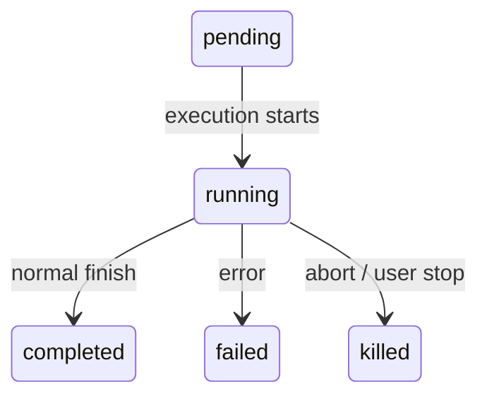
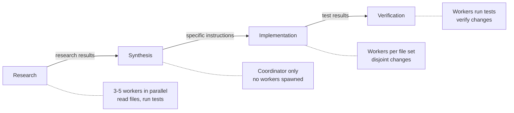
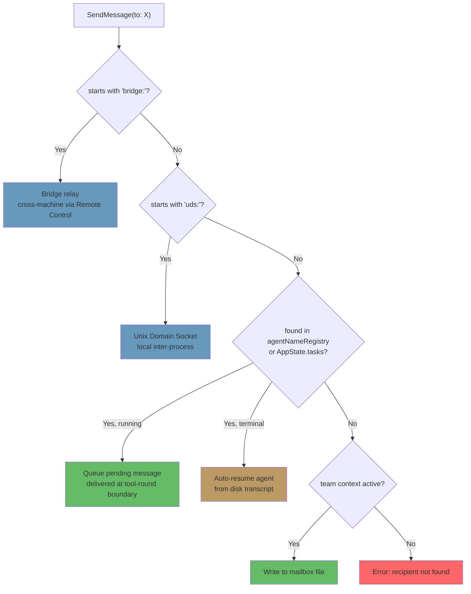

# الفصل 10: الـ Tasks والتنسيق والـ Swarms

## حدود الـ Thread الواحد

الفصل 8 شرح إزاي تعمل sub-agent: الـ lifecycle المكوّن من 15 خطوة اللي بيبني execution context معزول من agent definition. والفصل 9 شرح إزاي تخلّي الـ parallel spawns اقتصادية عن طريق استغلال الـ prompt cache. لكن إنشاء الـ agents وإدارة الـ agents مشكلتين مختلفتين. الفصل ده بيتكلم عن التانية.

الـ agent loop الواحد، يعني model واحد ومحادثة واحدة و tool واحدة في كل مرة، بيقدر ينجز كمية شغل مذهلة. بيقدر يقرأ ملفات، ويعدّل كود، ويشغّل tests، ويبحث على الـ web، ويفكّر في مشاكل معقدة. لكنه بيوصل لسقف.

السقف ده مش سقف ذكاء. هو سقف parallelism وسقف اتساع. مطوّر شغال على refactoring كبير محتاج يعدّل 40 ملف، ويشغّل الـ tests بعد كل batch، ويتأكد إن مفيش حاجة اتكسرت. الـ migration لـ codebase بتلمس طبقات الـ frontend والـ backend والـ database في نفس الوقت. والـ code review الشاملة بتقرأ عشرات الملفات أثناء ما الـ test suite شغالة في الخلفية. المشاكل دي مش أصعب، هي أوسع. بتحتاج القدرة على إنك تعمل أكثر من حاجة في نفس الوقت، وتفوّض الشغل لمتخصصين، وتنسّق النتائج.

رد Claude Code على المشكلة دي مش mechanism واحد، لكن stack متعدد الطبقات من الـ orchestration patterns، كل واحد منها مناسب لشكل مختلف من الشغل. الـ background tasks للأوامر من نوع fire-and-forget (بتشغّلها ومش بتستنى نتيجتها). والـ coordinator mode لهيكل الـ manager-worker. والـ swarm teams للتعاون بين أقران (peer-to-peer). وكمان communication protocol موحّد بيربطها كلها ببعض.

طبقة الـ orchestration بتمتد على حوالي 40 ملف موزّعين على `tools/AgentTool/` و `tasks/` و `coordinator/` و `tools/SendMessageTool/` و `utils/swarm/`. ورغم الاتساع ده، التصميم مرتكز على state machine واحد كل الـ patterns بتشترك فيه. فهم الـ state machine ده، وهو الـ abstraction اسمه `Task` في ملف `Task.ts`، هو الشرط الأساسي لفهم كل حاجة تانية.

الفصل ده بيتتبع الـ stack كله، من الـ task state machine في الأساس لحد أكثر الـ multi-agent topologies تعقيدًا.

---

## الـ Task State Machine

كل عملية بتشتغل في الخلفية في Claude Code، سواء أمر shell أو sub-agent أو remote session أو workflow script، بتتتبع كـ *task*. الـ task abstraction عايش في ملف `Task.ts` وبيوفّر الـ state model الموحّد اللي باقي طبقة الـ orchestration مبنية عليه.

### 7 أنواع

النظام بيعرّف 7 task types، كل واحد منها بيمثّل execution model مختلف:

الـ 7 task types هي: `local_bash` (أوامر shell في الخلفية)، و `local_agent` (sub-agents في الخلفية)، و `remote_agent` (الـ remote sessions)، و `in_process_teammate` (الـ swarm teammates)، و `local_workflow` (تنفيذ الـ workflow scripts)، و `monitor_mcp` (مراقبة الـ MCP servers)، و `dream` (تفكير speculative في الخلفية).

الـ `local_bash` والـ `local_agent` هما اللي شايلين أغلب الشغل: أوامر shell في الخلفية و sub-agents في الخلفية على الترتيب. الـ `in_process_teammate` هو الـ primitive الخاص بالـ swarm. الـ `remote_agent` بيوصّلك ببيئات Claude Code Runtime عن بُعد. الـ `local_workflow` بيشغّل scripts متعددة الخطوات. الـ `monitor_mcp` بيراقب صحة الـ MCP servers. أما `dream` فهو الأغرب: task في الخلفية بيخلّي الـ agent يفكّر بشكل speculative أثناء ما هو مستني input من المستخدم.

كل type بياخد prefix من حرف واحد في الـ ID عشان تعرفه بنظرة واحدة:

| النوع | الـ Prefix | مثال على الـ ID |
|------|--------|------------|
| `local_bash` | `b` | `b4k2m8x1` |
| `local_agent` | `a` | `a7j3n9p2` |
| `remote_agent` | `r` | `r1h5q6w4` |
| `in_process_teammate` | `t` | `t3f8s2v5` |
| `local_workflow` | `w` | `w6c9d4y7` |
| `monitor_mcp` | `m` | `m2g7k1z8` |
| `dream` | `d` | `d5b4n3r6` |

الـ task IDs بتستخدم prefix من حرف واحد (a للـ agents، و b للـ bash، و t للـ teammates، وهكذا) وبعده 8 حروف وأرقام عشوائية من alphabet آمن بغض النظر عن حالة الحروف (الأرقام زائد الحروف الصغيرة). ده بيدّي حوالي 2.8 تريليون احتمال، وده كفاية عشان يقاوم هجمات الـ brute-force symlink على ملفات output الـ tasks على الـ disk.

لما تشوف `a7j3n9p2` في سطر log، بتعرف فورًا إنه background agent. ولما تشوف `b4k2m8x1`، تعرف إنه أمر shell. الـ prefix عبارة عن micro-optimization للقارئ البشري، لكن في نظام ممكن يكون فيه عشرات الـ tasks شغالة في نفس الوقت، بيفرق.

### 5 حالات

الـ lifecycle عبارة عن directed graph بسيط من غير أي cycles:



الحالة `pending` هي الحالة القصيرة بين التسجيل وأول تنفيذ. و `running` معناها إن الـ task شغالة فعليًا. والـ 3 حالات النهائية هي `completed` (نجاح)، و `failed` (خطأ)، و `killed` (اتوقفت صراحةً من المستخدم أو الـ coordinator أو abort signal). وفيه helper function بتحمي من التعامل مع الـ tasks اللي ماتت:

```typescript
export function isTerminalTaskStatus(status: TaskStatus): boolean {
  return status === 'completed' || status === 'failed' || status === 'killed'
}
```

الـ function دي بتظهر في كل مكان: في الـ guards الخاصة بحقن الرسائل، ومنطق الـ eviction، وتنظيف الـ orphans، والـ SendMessage routing اللي بيقرر هل الرسالة تتحط في الـ queue ولا الـ agent الميت يترجّع للشغل.

### الـ Base State

كل task state بيمتد من `TaskStateBase`، اللي شايل الـ fields اللي الـ 7 types كلها بتشترك فيها:

```typescript
export type TaskStateBase = {
  id: string              // Prefixed random ID
  type: TaskType          // Discriminator
  status: TaskStatus      // Current lifecycle position
  description: string     // Human-readable summary
  toolUseId?: string      // The tool_use block that spawned this task
  startTime: number       // Creation timestamp
  endTime?: number        // Terminal-state timestamp
  totalPausedMs?: number  // Accumulated pause time
  outputFile: string      // Disk path for streaming output
  outputOffset: number    // Read cursor for incremental output
  notified: boolean       // Whether completion was reported to parent
}
```

فيه 2 fields تستاهل الانتباه. الـ field `outputFile` هو الجسر بين التنفيذ الـ async ومحادثة الـ parent: كل task بتكتب الـ output الخاص بيها في ملف على الـ disk، والـ parent بيقدر يقرأه بشكل تدريجي عن طريق `outputOffset`. والـ field `notified` بيمنع تكرار رسائل الإكمال: أول ما الـ parent يتبلّغ إن task خلصت، الـ flag بيتحوّل لـ `true` والإشعار مش بيتبعت تاني أبدًا. من غير الحماية دي، الـ task اللي بتخلص بين 2 polls متتالية على الـ notification queue هتولّد إشعارات مكررة، وده هيلبّك الـ model ويخليه يفتكر إن 2 tasks خلصت وهي في الحقيقة task واحدة بس.

### الـ Agent Task State

الـ type `LocalAgentTaskState` هو الأكثر تعقيدًا، وشايل كل حاجة محتاجة لإدارة الـ lifecycle الكامل لـ sub-agent في الخلفية:

```typescript
export type LocalAgentTaskState = TaskStateBase & {
  type: 'local_agent'
  agentId: string
  prompt: string
  selectedAgent?: AgentDefinition
  agentType: string
  model?: string
  abortController?: AbortController
  pendingMessages: string[]       // Queued via SendMessage
  isBackgrounded: boolean         // Was this originally a foreground agent?
  retain: boolean                 // UI is holding this task
  diskLoaded: boolean             // Sidechain transcript loaded
  evictAfter?: number             // GC deadline
  progress?: AgentProgress
  lastReportedToolCount: number
  lastReportedTokenCount: number
  // ... additional lifecycle fields
}
```

فيه 3 fields بتكشف قرارات تصميم مهمة. الـ field `pendingMessages` هو صندوق الوارد: لما `SendMessage` يستهدف agent شغال، الرسالة بتتحط في الـ queue هنا بدل ما تتحقن فورًا. الرسائل بتتسحب عند حدود الـ tool rounds، وده بيحافظ على بنية الـ turns الخاصة بالـ agent. والـ field `isBackgrounded` بيفرّق بين الـ agents اللي اتولدت async من الأول، والـ agents اللي بدأت كـ foreground sync agents وبعدين المستخدم نقلها للخلفية بضغطة زر. أما `evictAfter` فهو mechanism للـ garbage collection: الـ tasks اللي خلصت ومش محجوزة للـ UI بتاخد فترة سماح قبل ما الـ state الخاص بيها يتمسح من الذاكرة.

كل الـ task states بتتخزن في `AppState.tasks` كـ `Record<string, TaskState>`، والمفتاح هو الـ ID اللي ليه prefix. ده flat map مش tree: النظام مش بيمثّل علاقات الـ parent-child في الـ state store. علاقة الـ parent-child ضمنية في مسار المحادثة: الـ parent هو اللي شايل الـ `toolUseId` اللي عمل spawn للـ child.

### الـ Task Registry

كل task type وراه object من الـ type `Task` بـ interface في أضيق حدودها:

```typescript
export type Task = {
  name: string
  type: TaskType
  kill(taskId: string, setAppState: SetAppState): Promise<void>
}
```

والـ registry بيجمع كل الـ task implementations:

```typescript
export function getAllTasks(): Task[] {
  return [
    LocalShellTask,
    LocalAgentTask,
    RemoteAgentTask,
    DreamTask,
    ...(LocalWorkflowTask ? [LocalWorkflowTask] : []),
    ...(MonitorMcpTask ? [MonitorMcpTask] : []),
  ]
}
```

لاحظ الإضافة الشرطية: `LocalWorkflowTask` و `MonitorMcpTask` وراهم feature gating وممكن ما يكونوش موجودين وقت التشغيل. والـ interface `Task` صغيرة عن قصد. النسخ الأولى كان فيها methods زي `spawn()` و `render()`، لكن اتشالت لما بقى واضح إن الـ spawning والـ rendering عمرهم ما بيتستدعوا بشكل polymorphic. كل task type ليه منطق الـ spawn الخاص بيه، وإدارة الـ state الخاصة بيه، والـ rendering الخاص بيه. العملية الوحيدة اللي فعلًا محتاجة dispatch حسب الـ type هي `kill()`، وعشان كده هي كل اللي الـ interface بتطلبه.

ده مثال على تطوير الـ interface بالحذف. التصميم الأولي كان متخيّل إن كل الـ task types هتشترك في lifecycle interface واحدة. لكن في الواقع، الـ types اختلفت عن بعض لدرجة إن الـ interface المشتركة بقت وهم: `spawn()` لأمر shell و `spawn()` لـ in-process teammate تقريبًا مفيش بينهم أي حاجة مشتركة. وبدل ما يحتفظوا بـ leaky abstraction، الفريق شال كل حاجة ما عدا الـ method الوحيدة اللي بتستفيد فعلًا من الـ polymorphism.

---

## الـ Communication Patterns

الـ task اللي بتشتغل في الخلفية مفيش منها فايدة إلا لو الـ parent يقدر يراقب تقدمها ويستقبل نتائجها. Claude Code بيدعم 3 communication channels، كل واحدة منها مصممة لنمط وصول مختلف.

### الـ Foreground: الـ Generator Chain

لما الـ agent يشتغل بشكل synchronous، الـ parent بيعمل iterate مباشرة على الـ async generator الخاص بـ `runAgent()`، وبيعمل yield لكل رسالة لأعلى في الـ call stack. الـ mechanism المهم هنا هو الـ background escape hatch: الـ sync loop بيعمل race بين "next message from agent" (الرسالة الجاية من الـ agent) و "background signal" (إشارة النقل للخلفية):

```typescript
const agentIterator = runAgent({ ...params })[Symbol.asyncIterator]()

while (true) {
  const nextMessagePromise = agentIterator.next()
  const raceResult = backgroundPromise
    ? await Promise.race([nextMessagePromise.then(...), backgroundPromise])
    : { type: 'message', result: await nextMessagePromise }

  if (raceResult.type === 'background') {
    // User triggered backgrounding -- transition to async
    await agentIterator.return(undefined)
    void runAgent({ ...params, isAsync: true })
    return { data: { status: 'async_launched' } }
  }

  agentMessages.push(message)
}
```

لو المستخدم قرر في نص التنفيذ إن الـ sync agent يتحوّل لـ background task، الـ foreground iterator بيتقفل بشكل نظيف (وده بيشغّل الـ block `finally` الخاص بيه عشان ينظّف الموارد)، والـ agent بيتعمل له spawn تاني كـ async task بنفس الـ ID. الانتقال سلس: مفيش شغل بيضيع، والـ agent بيكمّل من المكان اللي وقف فيه بـ async abort controller مفصول عن زر ESC الخاص بالـ parent.

ده state transition صعب فعلًا إنك تعمله صح. الـ foreground agent بيشترك مع الـ parent في نفس الـ abort controller (زر ESC بيوقف الاتنين). والـ background agent محتاج controller خاص بيه (زر ESC مش المفروض يوقفه). ورسائل الـ agent لازم تنتقل من الـ foreground generator stream لنظام الإشعارات في الخلفية. والـ task state لازم يقلب `isBackgrounded` عشان الـ UI يعرف إنه يعرضه في الـ background panel. وكل ده لازم يحصل بشكل atomic: مفيش رسائل تضيع في الانتقال، ومفيش zombie iterators سايبة شغالة. الـ `Promise.race` بين الرسالة الجاية وإشارة الخلفية هو الـ mechanism اللي بيخلّي ده ممكن.

### الخلفية: 3 Channels

الـ background agents بتتواصل عن طريق الـ disk، والإشعارات، والرسائل اللي في الـ queue.

**ملفات الـ output على الـ disk.** كل task بتكتب في مسار `outputFile`، وهو symlink للـ transcript الخاص بالـ agent بصيغة JSONL. الـ parent (أو أي مراقب) يقدر يقرأ الملف ده بشكل تدريجي باستخدام `outputOffset`، اللي بيتتبع لحد فين الملف اتقرأ. والـ tool `TaskOutputTool` بتعرض ده للـ model:

```typescript
inputSchema = z.strictObject({
  task_id: z.string(),
  block: z.boolean().default(true),
  timeout: z.number().default(30000),
})
```

لما `block: true`، الـ tool بتعمل poll لحد ما الـ task توصل لحالة نهائية أو الـ timeout ينتهي. ده الـ mechanism الأساسي للـ coordinator اللي بيعمل spawn لـ worker ويستنى نتيجته.

**إشعارات الـ tasks.** لما background agent يخلّص، النظام بيولّد إشعار بصيغة XML وبيحطه في الـ queue عشان يتوصّل لمحادثة الـ parent:

```xml
<task-notification>
  <task-id>a7j3n9p2</task-id>
  <tool-use-id>toolu_abc123</tool-use-id>
  <output-file>/path/to/output</output-file>
  <status>completed</status>
  <summary>Agent "Investigate auth bug" completed</summary>
  <result>Found null pointer in src/auth/validate.ts:42...</result>
  <usage>
    <total_tokens>15000</total_tokens>
    <tool_uses>8</tool_uses>
    <duration_ms>12000</duration_ms>
  </usage>
</task-notification>
```

الإشعار بيتحقن كرسالة بـ user role في محادثة الـ parent، وده معناه إن الـ model بيشوفه في مسار الرسائل العادي. مش محتاج tool خاصة عشان يتحقق من الـ tasks اللي خلصت، هي بتوصله كـ context. والـ flag `notified` على الـ task state بيمنع التوصيل المكرر.

**الـ command queue.** الـ array `pendingMessages` على `LocalAgentTaskState` هي الـ channel التالتة. لما `SendMessage` يستهدف agent شغال، الرسالة بتتحط في الـ queue:

```typescript
if (isLocalAgentTask(task) && task.status === 'running') {
  queuePendingMessage(agentId, input.message, setAppState)
  return { data: { success: true, message: 'Message queued...' } }
}
```

الرسائل دي بتتسحب عند حدود الـ tool rounds عن طريق `drainPendingMessages()` وبتتحقن كـ user messages في محادثة الـ agent. وده قرار تصميم حاسم: الرسائل بتوصل بين الـ tool rounds، مش في نص التنفيذ. الـ agent بيخلّص فكرته الحالية، وبعدين بيستقبل المعلومة الجديدة. مفيش race conditions، ومفيش state متلف.

### تتبّع التقدم

الـ `ProgressTracker` بيوفّر رؤية حية لنشاط الـ agent:

```typescript
export type ProgressTracker = {
  toolUseCount: number
  latestInputTokens: number        // Cumulative (latest value, not sum)
  cumulativeOutputTokens: number   // Summed across turns
  recentActivities: ToolActivity[] // Last 5 tool uses
}
```

الفرق بين طريقة تتبّع الـ input tokens والـ output tokens مقصود، وبيعكس نقطة دقيقة في نموذج الفوترة الخاص بالـ API. الـ input tokens تراكمية في كل API call لأن المحادثة كاملة بتتبعت من جديد كل مرة: الـ turn رقم 15 شايل الـ 14 turns اللي قبله كلها، فعدد الـ input tokens اللي الـ API بيبلّغ عنه بيعكس الإجمالي أصلًا. فالاحتفاظ بآخر قيمة هو التجميع الصحيح. أما الـ output tokens فهي لكل turn على حدة، لأن الـ model بيولّد tokens جديدة كل مرة، فالجمع هو التجميع الصحيح. لو غلطت في ده، إما هتبالغ في العد بشكل كبير (لو جمعت input tokens تراكمية) أو هتقلّل العد بشكل كبير (لو احتفظت بآخر قيمة بس من الـ output tokens).

الـ array `recentActivities` (بحد أقصى 5 عناصر) بيوفّر stream مقروء للبشر عن اللي الـ agent بيعمله: "Read src/auth/validate.ts"، و "Bash: npm test"، و "Edit src/auth/validate.ts". ده بيظهر في الـ subagent panel في VS Code وفي مؤشر الـ background tasks في الـ terminal، وبيدّي المستخدمين رؤية لشغل الـ agent من غير ما يحتاجوا يقرؤوا الـ transcripts كاملة.

بالنسبة للـ background agents، التقدم بيتكتب في `AppState` عن طريق `updateAsyncAgentProgress()` وبيتبعت كـ SDK events عن طريق `emitTaskProgress()`. والـ subagent panel في VS Code بيستهلك الـ events دي عشان يرسم progress bars حية وعدد الـ tools و activity streams. وتتبّع التقدم مش مجرد تجميل: هو الـ feedback mechanism الأساسي اللي بيقول للمستخدمين هل الـ background agent بيتقدم فعلًا ولا علق في loop.

---

## الـ Coordinator Mode

الـ coordinator mode بيحوّل Claude Code من agent واحد معاه مساعدين في الخلفية لـ manager-worker architecture حقيقية. وهو الـ orchestration pattern اللي بيفرض طريقة شغل محددة أكثر من أي pattern تاني في النظام، وتصميمه بيكشف تفكير عميق في إزاي الـ LLMs المفروض تفوّض الشغل وإزاي مش المفروض تفوّضه.

### المشكلة اللي الـ Coordinator Mode بيحلها

الـ agent loop العادي ليه محادثة واحدة و context window واحد. لما يعمل spawn لـ background agent، الـ background agent بيشتغل بشكل مستقل وبيبلّغ النتائج عن طريق الـ task notifications. ده بيشتغل كويس للتفويض البسيط، زي "run the tests while I keep editing" (شغّل الـ tests وأنا أكمّل تعديل)، لكنه بينهار قدام الـ workflows المعقدة متعددة الخطوات.

خد مثال migration لـ codebase. الـ agent محتاج: (1) يفهم الـ patterns الحالية في 200 ملف، و(2) يصمم استراتيجية الـ migration، و(3) يطبّق التغييرات على كل ملف، و(4) يتأكد إن مفيش حاجة اتكسرت. الخطوتين 1 و 3 بيستفيدوا من الـ parallelism. الخطوة 2 محتاجة تجمّع نتائج الخطوة 1. والخطوة 4 معتمدة على الخطوة 3. الـ agent الواحد لو عمل ده بالتتابع هيصرف أغلب الـ token budget الخاص بيه في إعادة قراءة الملفات. و background agents كثيرة لو عملت ده من غير تنسيق هتنتج تغييرات مش متسقة.

الـ coordinator mode بيحل ده بفصل الـ agent اللي "بيفكّر" عن الـ agents اللي "بتنفّذ". الـ coordinator بيتولّى الخطوتين 1 و 2 (يبعت research workers، وبعدين يجمّع). والـ workers بيتولّوا الخطوتين 3 و 4 (تطبيق التغييرات وتشغيل الـ tests). الـ coordinator بيشوف الصورة الكاملة، والـ workers بتشوف الـ task المحددة الخاصة بكل واحد.

### التفعيل

environment variable واحد بيقلب المفتاح:

```typescript
export function isCoordinatorMode(): boolean {
  if (feature('COORDINATOR_MODE')) {
    return isEnvTruthy(process.env.CLAUDE_CODE_COORDINATOR_MODE)
  }
  return false
}
```

عند استئناف الـ session، الـ function `matchSessionMode()` بتتحقق هل الـ mode المخزّن للـ session اللي بتترجع مطابق للبيئة الحالية. لو اختلفوا، الـ environment variable بيتقلب عشان يطابق. ده بيمنع السيناريو المُحيّر إن coordinator session ترجع كـ agent عادي (فتفقد وعيها بالـ workers الخاصة بيها) أو session عادية ترجع كـ coordinator (فتفقد الوصول للـ tools الخاصة بيها). الـ mode الخاص بالـ session هو الـ source of truth، والـ environment variable هو إشارة الـ runtime.

### قيود الـ Tools

قوة الـ coordinator مش جاية من إن معاه tools أكثر، لكن من إن معاه tools أقل. في الـ coordinator mode، الـ coordinator agent بياخد 3 tools بالضبط:

- **Agent** -- بيعمل spawn للـ workers
- **SendMessage** -- بيتواصل مع الـ workers الموجودين
- **TaskStop** -- بيوقف الـ workers الشغالة

وده كل حاجة. مفيش قراءة ملفات. مفيش تعديل كود. مفيش أوامر shell. الـ coordinator مش بيقدر يلمس الـ codebase مباشرة. والقيد ده مش عيب، ده مبدأ التصميم الأساسي. شغل الـ coordinator إنه يفكّر، ويخطط، ويفكّك المشكلة، ويجمّع النتائج. والـ workers هي اللي بتنفّذ.

أما الـ workers، فبالعكس، بتاخد مجموعة الـ tools كاملة ما عدا الـ tools الداخلية الخاصة بالتنسيق:

```typescript
const INTERNAL_WORKER_TOOLS = new Set([
  TEAM_CREATE_TOOL_NAME,
  TEAM_DELETE_TOOL_NAME,
  SEND_MESSAGE_TOOL_NAME,
  SYNTHETIC_OUTPUT_TOOL_NAME,
])
```

الـ workers مش بتقدر تعمل spawn لـ sub-teams خاصة بيها ولا تبعت رسائل لأقرانها. بتبلّغ نتائجها عن طريق mechanism إكمال الـ task العادي، والـ coordinator بيجمّع من كل الـ workers.

### الـ System Prompt اللي طوله 370 سطر

الـ system prompt الخاص بالـ coordinator هو، سطر بسطر، أكثر document في الـ codebase بيعلّمك إزاي تستخدم الـ LLMs في الـ orchestration. طوله حوالي 370 سطر وبيلخّص دروس اتعلموها بالتجربة المُرّة عن الـ delegation patterns. أهم الدروس:

**"Never delegate understanding."** (عمرك ما تفوّض الفهم.) دي الفكرة المركزية. الـ coordinator لازم يحوّل نتائج البحث لـ prompts محددة فيها مسارات الملفات وأرقام السطور والتغييرات بالضبط. والـ prompt بيسمّي صراحةً anti-patterns زي "based on your findings, fix the bug" (بناءً على نتائجك، أصلح الـ bug): ده prompt بيفوّض *الفهم* للـ worker، وبيجبره يعيد استخراج context الـ coordinator عنده أصلًا. الـ pattern الصحيح هو: "In `src/auth/validate.ts` at line 42, the `userId` parameter can be null when called from the OAuth flow. Add a null check that returns a 401 response." (في `src/auth/validate.ts` عند السطر 42، الـ parameter `userId` ممكن يكون null لما يتستدعى من الـ OAuth flow. ضيف null check بيرجّع response بكود 401.)

**"Parallelism is your superpower."** (الـ parallelism هو قوتك الخارقة.) الـ prompt بيحدد concurrency model واضح. الـ tasks اللي بتقرأ بس بتشتغل بالتوازي بحرية: البحث، والاستكشاف، وقراءة الملفات. والـ tasks اللي بتكتب كثير بتشتغل بالتتابع لكل مجموعة ملفات. والمتوقع من الـ coordinator إنه يفكّر في أنهي tasks ممكن تتداخل وأنهي لازم تتسلسل. الـ coordinator الكويس بيعمل spawn لـ 5 research workers في نفس الوقت، ويستناها كلها، ويجمّع، وبعدين يعمل spawn لـ 3 implementation workers بتلمس مجموعات ملفات منفصلة. أما الـ coordinator الضعيف فبيعمل spawn لـ worker واحد، ويستنى، ويعمل spawn للتاني، ويستنى تاني: بيحوّل لتتابع شغل كان ممكن يمشي بالتوازي.

**مراحل الـ task workflow.** الـ prompt بيعرّف 4 مراحل:



1. **الـ Research** -- الـ workers بتستكشف الـ codebase بالتوازي، بتقرأ ملفات، وتشغّل tests، وتجمع معلومات
2. **الـ Synthesis** -- الـ coordinator (مش worker) بيقرأ كل نتائج البحث ويبني فهم موحّد
3. **الـ Implementation** -- الـ workers بتستقبل تعليمات دقيقة مستخرجة من الـ synthesis
4. **الـ Verification** -- الـ workers بتشغّل الـ tests وتتأكد من التغييرات

الـ coordinator مش المفروض يعدّي مراحل. أشهر failure mode هو القفز من الـ research مباشرة للـ implementation من غير synthesis. لما ده يحصل، الـ coordinator بيكون فوّض الفهم للـ implementation workers: كل واحد منهم لازم يعيد استخراج الـ context من الصفر، وده بيؤدي لتغييرات مش متسقة و tokens ضايعة.

**قرار الـ continue-vs-spawn.** لما worker يخلّص والـ coordinator عنده شغل تكميلي، هل يبعت رسالة للـ worker الموجود (عن طريق SendMessage) ولا يعمل spawn لواحد جديد (عن طريق Agent)؟ القرار بيعتمد على مدى تداخل الـ context:

- **تداخل كبير، نفس الملفات**: كمّل. الـ worker عنده محتوى الملفات في الـ context الخاص بيه أصلًا، وفاهم الـ patterns، ويقدر يبني على شغله السابق. عمل spawn لواحد جديد هيجبره يعيد قراءة نفس الملفات ويعيد استخراج نفس الفهم.
- **تداخل قليل، مجال مختلف**: اعمل spawn لواحد جديد. الـ worker اللي خلّص للتو فحص نظام الـ authentication شايل 20,000 token من context خاص بالـ auth، وده حمل زيادة ملوش فايدة في task لـ CSS refactoring. البداية بـ context فاضي أرخص.
- **تداخل كبير لكن الـ worker فشل**: اعمل spawn لواحد جديد مع توجيه صريح عن اللي حصل غلط. تكملة worker فشل غالبًا معناها إنك بتصارع context ملبّك. البداية من جديد بـ "the previous attempt failed because X, avoid Y" (المحاولة السابقة فشلت بسبب X، تجنّب Y) أكثر اعتمادية.
- **الشغل التكميلي محتاج output الـ worker**: كمّل، وضمّن الـ output في الـ SendMessage. الـ worker مش محتاج يعيد استخراج نتائجه هو.

**كتابة الـ worker prompts والـ anti-patterns.** الـ prompt بيعلّم الـ coordinator إزاي يكتب worker prompts فعّالة وبيعلّم صراحةً على الـ patterns السيئة:

الـ anti-pattern: *"Based on your research findings, implement the fix."* (بناءً على نتائج بحثك، نفّذ الإصلاح.) ده بيفوّض الفهم. الـ worker مش هو اللي عمل البحث، الـ coordinator هو اللي قرأ نتائج البحث.

الـ anti-pattern: *"Fix the bug in the auth module."* (أصلح الـ bug في الـ auth module.) مفيش مسارات ملفات، ولا أرقام سطور، ولا وصف للـ bug. الـ worker لازم يدوّر في الـ codebase كلها من الصفر.

الـ anti-pattern: *"Make the same change to all the other files."* (اعمل نفس التغيير في كل الملفات التانية.) أي ملفات؟ وأي تغيير؟ الـ coordinator عارف، فالمفروض يسمّيهم واحد واحد.

الـ pattern الكويس: *"In `src/auth/validate.ts` at line 42, the `userId` parameter can be null when called from `src/oauth/callback.ts:89`. Add a null check: if `userId` is null, return `{ error: 'unauthorized', status: 401 }`. Then update the test in `src/auth/__tests__/validate.test.ts` to cover the null case."* (في `src/auth/validate.ts` عند السطر 42، الـ parameter `userId` ممكن يكون null لما يتستدعى من `src/oauth/callback.ts:89`. ضيف null check: لو `userId` بـ null، رجّع `{ error: 'unauthorized', status: 401 }`. وبعدين حدّث الـ test في `src/auth/__tests__/validate.test.ts` عشان يغطي حالة الـ null.)

تكلفة كتابة prompt محدد بتتدفع مرة واحدة، من الـ coordinator. والفايدة، وهي worker بينفّذ صح من أول مرة، ضخمة. الـ prompts الغامضة بتعمل توفير وهمي: الـ coordinator بيوفّر 30 ثانية كتابة prompt، والـ worker بيضيّع 5 دقايق استكشاف.

### الـ Worker Context

الـ coordinator بيحقن معلومات عن الـ tools المتاحة في الـ context الخاص بيه هو، عشان الـ model يعرف الـ workers تقدر تعمل إيه:

```typescript
export function getCoordinatorUserContext(mcpClients, scratchpadDir?) {
  return {
    workerToolsContext: `Workers spawned via Agent have access to: ${workerTools}`
      + (mcpClients.length > 0
        ? `\nWorkers also have MCP tools from: ${serverNames}` : '')
      + (scratchpadDir ? `\nScratchpad: ${scratchpadDir}` : '')
  }
}
```

مجلد الـ scratchpad (وراه الـ feature flag `tengu_scratch`) هو مكان مشترك على الـ filesystem الـ workers تقدر تقرأ وتكتب فيه من غير permission prompts. بيتيح مشاركة معرفة دائمة بين الـ workers: ملاحظات بحث worker بتبقى input لـ worker تاني، عن طريق الـ filesystem بدل الـ token window الخاص بالـ coordinator.

وده مهم لأنه بيحل قيد أساسي في الـ coordinator pattern. من غير scratchpad، كل المعلومات بتعدّي من الـ coordinator: الـ Worker A بينتج نتائج، والـ coordinator بيقرأها عن طريق TaskOutput، ويجمّعها في prompt الـ Worker B. الـ context window الخاص بالـ coordinator بيبقى الـ bottleneck (عنق زجاجة): لازم يشيل كل النتائج الوسيطة لفترة كفاية عشان يجمّعها. مع الـ scratchpad، الـ Worker A بيكتب نتائجه في `/tmp/scratchpad/auth-analysis.md`، والـ coordinator بيقول للـ Worker B: "Read the auth analysis at `/tmp/scratchpad/auth-analysis.md` and apply the pattern to the OAuth module." (اقرأ تحليل الـ auth في `/tmp/scratchpad/auth-analysis.md` وطبّق الـ pattern على الـ OAuth module.) الـ coordinator بينقل المعلومات by reference، مش by value.

### الـ Mutual Exclusion مع الـ Fork

الـ coordinator mode والـ subagents المبنية على الـ fork بينهم mutual exclusion (الاتنين ماينفعش يشتغلوا مع بعض):

```typescript
export function isForkSubagentEnabled(): boolean {
  if (feature('FORK_SUBAGENT')) {
    if (isCoordinatorMode()) return false
    // ...
  }
}
```

التعارض جوهري. الـ fork agents (نسخ من الـ agent بتشترك معاه في نفس الـ context) بتورث context محادثة الـ parent كله: هي نسخ رخيصة بتشترك في الـ prompt cache. أما الـ coordinator workers فهي agents مستقلة بـ context جديد وتعليمات محددة. دول فلسفتين متعارضتين في التفويض، والنظام بيفرض الاختيار على مستوى الـ feature flag.

---

## نظام الـ Swarm

الـ coordinator mode هرمي: manager واحد، و workers كثيرة، وتحكم من فوق لتحت. أما نظام الـ swarm فهو البديل الـ peer-to-peer: أكثر من instance من Claude Code شغالة كفريق، وفيه leader بينسّق بين teammates كثيرة عن طريق تبادل الرسائل.

### الـ Team Context

الـ teams بتتعرّف بـ `teamName` وبتتتبع في `AppState.teamContext`:

```typescript
teamContext?: {
  teamName: string
  teammates: {
    [id: string]: { name: string; color?: string; ... }
  }
}
```

كل teammate بياخد اسم (عشان تخاطبه) ولون (عشان يتميز بصريًا في الـ UI). وملف الـ team بيتحفظ على الـ disk عشان عضوية الـ team تصمد لو الـ process اتعمل لها restart.

### الـ Agent Name Registry

الـ background agents ممكن تاخد أسماء وقت الـ spawn، وده بيخليها قابلة للمخاطبة بمعرّفات مقروءة للبشر بدل الـ task IDs العشوائية:

```typescript
if (name) {
  rootSetAppState(prev => {
    const next = new Map(prev.agentNameRegistry)
    next.set(name, asAgentId(asyncAgentId))
    return { ...prev, agentNameRegistry: next }
  })
}
```

الـ `agentNameRegistry` عبارة عن `Map<string, AgentId>`. لما `SendMessage` يحل الـ field `to`، بيبص في الـ registry أولًا:

```typescript
const registered = appState.agentNameRegistry.get(input.to)
const agentId = registered ?? toAgentId(input.to)
```

ده معناه إنك تقدر تبعت رسالة لـ `"researcher"` بدل `a7j3n9p2`. الـ indirection ده بسيط، لكنه بيخلّي الـ coordinator يفكّر بمنطق الأدوار بدل الـ IDs، وده تحسين كبير في قدرة الـ model على التفكير في الـ multi-agent workflows.

### الـ In-Process Teammates

الـ in-process teammates بتشتغل في نفس الـ Node.js process الخاصة بالـ leader، ومعزولة عن طريق `AsyncLocalStorage`. الـ state الخاص بيها بيمتد من الـ base بـ fields خاصة بالـ team:

```typescript
export type InProcessTeammateTaskState = TaskStateBase & {
  type: 'in_process_teammate'
  identity: TeammateIdentity
  prompt: string
  messages?: Message[]                  // Capped at 50
  pendingUserMessages: string[]
  isIdle: boolean
  shutdownRequested: boolean
  awaitingPlanApproval: boolean
  permissionMode: PermissionMode
  onIdleCallbacks?: Array<() => void>
  currentWorkAbortController?: AbortController
}
```

الحد الأقصى لـ `messages` وهو 50 عنصر يستاهل شرح. أثناء التطوير، التحليل كشف إن كل in-process agent بيراكم حوالي 20MB من الـ RSS عند 500+ turn. والـ whale sessions (جلسات المستخدمين الثقيلين اللي بيشغّلوا workflows طويلة) اتلاحظ إنها بتشغّل 292 agent في دقيقتين، وده رفع الـ RSS لـ 36.8GB. فالحد الأقصى 50 رسالة للتمثيل في الـ UI هو صمام أمان للذاكرة. محادثة الـ agent الفعلية بتكمّل بسجلها الكامل، والـ snapshot الموجّه للـ UI هو بس اللي بيتقطع.

الـ flag `isIdle` بيتيح work-stealing pattern. الـ teammate الـ idle مش بيستهلك tokens ولا API calls، هو ببساطة مستني الرسالة الجاية. والـ array `onIdleCallbacks` بيخلّي النظام يتدخل عند لحظة الانتقال من النشاط للـ idle، وده بيتيح orchestration patterns زي "wait for all teammates to finish, then proceed" (استنى كل الـ teammates يخلّصوا، وبعدين كمّل).

الـ `currentWorkAbortController` مختلف عن الـ abort controller الرئيسي الخاص بالـ teammate. عمل abort لـ controller الشغل الحالي بيلغي الـ turn الجاري للـ teammate لكنه مش بيوقف الـ teammate نفسه. وده بيتيح pattern "إعادة التوجيه": الـ leader بيبعت رسالة أعلى أولوية، والشغل الحالي للـ teammate بيتعمل له abort، والـ teammate بيلتقط الرسالة الجديدة. أما الـ abort controller الرئيسي، لما يتعمل له abort، فبيوقف الـ teammate بالكامل. مستويين من المقاطعة لمستويين من النيّة.

الـ flag `shutdownRequested` بيطبّق إنهاء تعاوني. لما الـ leader يبعت shutdown request، الـ flag ده بيتفعّل. والـ teammate يقدر يفحصه عند نقاط التوقف الطبيعية ويقفل بهدوء: يخلّص كتابة الملف الحالي، أو يعمل commit لتغييراته، أو يبعت تحديث حالة أخير. وده ألطف من الـ hard kill، اللي ممكن يسيب الملفات في حالة مش متسقة.

### الـ Mailbox

الـ teammates بتتواصل عن طريق نظام mailbox مبني على الملفات. لما `SendMessage` يستهدف teammate، الرسالة بتتكتب في ملف الـ mailbox الخاص بالمستلم على الـ disk:

```typescript
await writeToMailbox(recipientName, {
  from: senderName,
  text: content,
  summary,
  timestamp: new Date().toISOString(),
  color: senderColor,
}, teamName)
```

الرسائل ممكن تكون نص عادي، أو structured protocol messages (طلبات الـ shutdown، وموافقات الـ plan)، أو broadcasts (`to: "*"` بيبعت لكل أعضاء الـ team ما عدا المُرسل). وفيه poller hook بيعالج الرسائل الواردة وبيوجّهها لمحادثة الـ teammate.

المنهج المبني على الملفات بسيط عن قصد. مفيش message broker، ولا event bus، ولا shared memory channel. الملفات دائمة (بتصمد لو الـ process اتعطلت)، وقابلة للفحص (تقدر تعمل `cat` للـ mailbox)، ورخيصة (من غير اعتماديات على infrastructure). وفي نظام حجم الرسائل فيه بيتقاس بالعشرات في الـ session، مش بالآلاف في الثانية، ده الـ trade-off الصحيح. الـ message queue المبني على Redis هيضيف تعقيد تشغيلي، و dependency، و failure modes (أشكال الفشل المحتملة)، وكل ده عشان متطلب throughput (كمية الشغل اللي بتخلص في الوقت) بسيط لدرجة إن استدعاء واحد للـ filesystem بيغطيه.

الـ broadcast mechanism يستاهل ملاحظة. لما رسالة تتبعت لـ `"*"`، المُرسل بيلف على كل أعضاء الـ team من ملف الـ team، وبيعدّي نفسه (بمقارنة مش حساسة لحالة الحروف)، وبيكتب في mailbox كل عضو على حدة:

```typescript
for (const member of teamFile.members) {
  if (member.name.toLowerCase() === senderName.toLowerCase()) continue
  recipients.push(member.name)
}
for (const recipientName of recipients) {
  await writeToMailbox(recipientName, { from: senderName, text: content, ... }, teamName)
}
```

مفيش أي fan-out optimization: كل مستلم بياخد كتابة ملف منفصلة. ومرة تانية، على مقياس فرق الـ agents (عادةً من 3 لـ 8 أعضاء)، ده كافي تمامًا. لو الـ team فيه 100 عضو، ده هيحتاج إعادة نظر. لكن الحد الأقصى 50 رسالة في الذاكرة اللي بيمنع سيناريوهات الـ 36GB RSS بيحد كمان بشكل ضمني من حجم الـ team الفعلي.

### الـ Permission Forwarding

الـ swarm workers بتشتغل بصلاحيات مقيّدة، لكنها تقدر تصعّد للـ leader لما تحتاج موافقة على عمليات حساسة:

```typescript
const request = createPermissionRequest({
  toolName, toolUseId, input, description, permissionSuggestions
})
registerPermissionCallback({ requestId, toolUseId, onAllow, onReject })
void sendPermissionRequestViaMailbox(request)
```

المسار كالتالي: الـ worker بيقابل tool محتاجة صلاحية، والـ bash classifier بيحاول يوافق تلقائيًا، ولو فشل، الطلب بيتمرّر للـ leader عن طريق نظام الـ mailbox. الـ leader بيشوف الطلب في الـ UI الخاص بيه ويقدر يوافق أو يرفض. الـ callback بيشتغل والـ worker بيكمّل. وده بيخلّي الـ workers تشتغل بشكل مستقل في العمليات الآمنة، مع الحفاظ على إشراف بشري على العمليات الخطيرة.

---

## التواصل بين الـ Agents: SendMessage

الـ tool `SendMessageTool` هي الـ communication primitive الشامل. بتتعامل مع 4 routing modes مختلفة عن طريق tool interface واحدة، والاختيار بينها بيتحدد حسب شكل الـ field `to`.

### الـ Input Schema

```typescript
inputSchema = z.object({
  to: z.string(),
  // "teammate-name", "*", "uds:<socket>", "bridge:<session-id>"
  summary: z.string().optional(),
  message: z.union([
    z.string(),
    z.discriminatedUnion('type', [
      z.object({ type: z.literal('shutdown_request'), reason: z.string().optional() }),
      z.object({ type: z.literal('shutdown_response'), request_id, approve, reason }),
      z.object({ type: z.literal('plan_approval_response'), request_id, approve, feedback }),
    ]),
  ]),
})
```

الـ field `message` عبارة عن union بين نص عادي و structured protocol messages. ده معناه إن SendMessage بيلعب دورين: هو قناة الكلام غير الرسمي، زي "here are my findings" (دي نتائجي)، وهو كمان طبقة الـ protocol الرسمية، زي "I approve your plan" (أنا موافق على خطتك) أو "please shut down" (من فضلك اقفل).

### الـ Routing Dispatch

الـ method `call()` بتمشي على dispatch chain مرتّب حسب الأولوية:



**1. رسائل الـ Bridge** (`bridge:<session-id>`). تواصل بين أجهزة مختلفة عن طريق الـ Remote Control servers الخاصة بـ Anthropic. ده أوسع مدى: 2 instances من Claude Code على جهازين مختلفين، وربما في قارتين مختلفتين، بتتواصل عن طريق relay. النظام بيطلب موافقة صريحة من المستخدم قبل إرسال رسائل الـ bridge، ودي حماية بتمنع agent إنه يفتح اتصال مع instance بعيدة من نفسه. من غير البوابة دي، agent مخترق أو ملبّك ممكن يسرّب معلومات لـ remote session. فحص الموافقة بيستخدم `postInterClaudeMessage()`، اللي بيتولّى الـ serialization والنقل عبر الـ Remote Control relay.

**2. رسائل الـ UDS** (`uds:<socket-path>`). تواصل محلي بين processes عن طريق Unix Domain Sockets. ده للـ instances من Claude Code الشغالة على نفس الجهاز لكن في processes مختلفة: مثلًا VS Code extension شايل instance، و terminal شايل instance تانية. تواصل الـ UDS سريع (مفيش network round-trip)، وآمن (صلاحيات الـ filesystem هي اللي بتتحكم في الوصول)، وموثوق (الـ kernel هو اللي بيتولّى التوصيل). الـ function `sendToUdsSocket()` بتعمل serialize للرسالة وتكتبها في مسار الـ socket المحدد في الـ field `to`. والأقران بيكتشفوا بعض عن طريق tool اسمها `ListPeers` بتدوّر على الـ UDS endpoints النشطة.

**3. الـ routing للـ in-process subagents** (اسم عادي أو agent ID). ده المسار الأكثر شيوعًا. منطق الـ routing:

- دوّر على `input.to` في الـ `agentNameRegistry`
- لو موجود وشغال: `queuePendingMessage()`، الرسالة بتستنى حدود الـ tool round الجاي
- لو موجود لكن في حالة نهائية: `resumeAgentBackground()`، الـ agent بيرجع يشتغل من غير ما المُرسل يحس بالفرق
- لو مش موجود في `AppState`: بيحاول يرجّعه من الـ transcript اللي على الـ disk

**4. الـ team mailbox** (الـ fallback لما يكون الـ team context مفعّل). المستلمين المسمّيين بتتكتب رسائلهم في ملفات الـ mailbox الخاصة بيهم. والـ wildcard `"*"` بيشغّل broadcast لكل أعضاء الـ team.

### الـ Structured Protocols

غير النص العادي، SendMessage بيشيل 2 protocols رسمية.

**الـ shutdown protocol.** الـ leader بيبعت `{ type: 'shutdown_request', reason: '...' }` لـ teammate. والـ teammate بيرد بـ `{ type: 'shutdown_response', request_id, approve: true/false, reason }`. لو وافق، الـ in-process teammates بتعمل abort للـ controller الخاص بيها، والـ teammates المبنية على tmux بتستقبل استدعاء لـ `gracefulShutdown()`. الـ protocol تعاوني: الـ teammate يقدر يرفض shutdown request لو كان في نص شغل حرج، والـ leader لازم يتعامل مع الحالة دي.

**الـ plan approval protocol.** الـ teammates الشغالة في الـ plan mode لازم تاخد موافقة قبل التنفيذ. بتقدّم plan، والـ leader بيرد بـ `{ type: 'plan_approval_response', request_id, approve, feedback }`. الـ team lead بس هو اللي يقدر يصدر موافقات. وده بيعمل بوابة مراجعة: الـ leader يقدر يفحص المنهج اللي الـ worker ناوي عليه قبل ما أي ملف يتلمس، ويلتقط سوء الفهم مبكرًا.

### الـ Auto-Resume Pattern

أجمل ميزة في نظام الـ routing هي إعادة تشغيل الـ agent من غير ما حد يحس. لما `SendMessage` يستهدف agent مكتمل أو متوقف، بدل ما يرجّع خطأ، بيرجّع الـ agent للحياة:

```typescript
if (task.status !== 'running') {
  const result = await resumeAgentBackground({
    agentId,
    prompt: input.message,
    toolUseContext: context,
    canUseTool,
  })
  return {
    data: {
      success: true,
      message: `Agent "${input.to}" was stopped; resumed with your message`
    }
  }
}
```

الـ function `resumeAgentBackground()` بتعيد بناء الـ agent من الـ transcript الخاص بيه على الـ disk:

1. بتقرأ الـ sidechain JSONL transcript
2. بتعيد بناء سجل الرسائل، وبتفلتر الـ thinking blocks اليتيمة والـ tool uses اللي ماتحلّتش
3. بتعيد بناء الـ content replacement state عشان استقرار الـ prompt cache
4. بتحل الـ agent definition الأصلي من الـ metadata المخزّنة
5. بتسجّله تاني كـ background task بـ abort controller جديد
6. بتستدعي `runAgent()` بالسجل المسترجع زائد الرسالة الجديدة كـ prompt

من وجهة نظر الـ coordinator، إرسال رسالة لـ agent ميت وإرسال رسالة لـ agent حي نفس العملية. طبقة الـ routing هي اللي بتتعامل مع التعقيد. ده معناه إن الـ coordinators مش محتاجة تتتبع أنهي agents ما زالت حية: هي ببساطة بتبعت رسائل والنظام بيتصرف.

والآثار المترتبة على ده كبيرة. من غير auto-resume، الـ coordinator كان هيحتاج يحتفظ بـ mental model عن حياة الـ agents: "Is `researcher` still running? Let me check. It completed. I need to spawn a new agent. But wait, should I use the same name? Will it have the same context?" (هل `researcher` ما زال شغال؟ خلّيني أتحقق. خلّص. محتاج أعمل spawn لـ agent جديد. لكن استنى، هل أستخدم نفس الاسم؟ هل هيكون عنده نفس الـ context؟) مع الـ auto-resume، كل ده بيتلخّص في: "Send `researcher` a message." (ابعت رسالة لـ `researcher`.) لو حي، الرسالة بتتحط في الـ queue. لو ميت، بيرجع للحياة بسجله الكامل. وتعقيد الـ prompt الخاص بالـ coordinator بينزل بشكل كبير.

طبعًا فيه تكلفة. الاسترجاع من transcript على الـ disk معناه إعادة قراءة رسائل ممكن تكون بالآلاف، وإعادة بناء الـ state الداخلي، وعمل API call جديد بـ context window كامل. وبالنسبة لـ agent عايش من فترة طويلة، ده ممكن يكون مكلّف في الـ latency (زمن الاستجابة) وفي الـ tokens. لكن البديل، وهو إن الـ coordinator يدير الـ lifecycles الخاصة بالـ agents يدويًا، أسوأ. الـ coordinator عبارة عن LLM. هو كويس في التفكير في المشاكل وكتابة التعليمات. لكنه ضعيف في الـ bookkeeping (شغل المتابعة والتسجيل). والـ auto-resume بيلعب على نقاط قوة الـ LLM بإنه بيشيل فئة كاملة من الـ bookkeeping من الصورة.

---

## TaskStop: الـ Kill Switch

الـ tool `TaskStopTool` هي المكمّلة لـ Agent و SendMessage: بتوقف الـ tasks الشغالة:

```typescript
inputSchema = z.strictObject({
  task_id: z.string().optional(),
  shell_id: z.string().optional(),  // Deprecated backward compat
})
```

الـ implementation بتفوّض لـ `stopTask()`، اللي بتعمل dispatch حسب الـ task type:

1. بتدوّر على الـ task في `AppState.tasks`
2. بتستدعي `getTaskByType(task.type).kill(taskId, setAppState)`
3. للـ agents: بتعمل abort للـ controller، وتحدد الحالة بـ `'killed'`، وتبدأ الـ eviction timer
4. للـ shells: بتوقف الـ process group

الـ tool ليها alias قديم `"KillShell"`، وده تذكير إن نظام الـ tasks اتطوّر من بداية أبسط كانت فيها العملية الوحيدة في الخلفية هي أمر shell.

الـ kill mechanism بيختلف حسب الـ task type، لكن الـ pattern ثابت. للـ agents، الإيقاف معناه عمل abort للـ abort controller (وده بيخلّي الـ loop `query()` يخرج عند أول yield point جاية)، وتحديد الحالة بـ `'killed'`، وبدء eviction timer عشان الـ task state يتنظّف بعد فترة سماح. للـ shells، الإيقاف معناه إرسال signal للـ process group: `SIGTERM` أولًا، وبعدين `SIGKILL` لو الـ process ماخرجتش خلال timeout. وللـ in-process teammates، الإيقاف بيشغّل كمان shutdown notification للـ team عشان باقي الأعضاء يعرفوا إن الـ teammate ده مشي.

الـ eviction timer يستاهل ملاحظة. لما agent يتوقف، الـ state الخاص بيه مش بيتمسح فورًا. بيفضل في `AppState.tasks` لفترة سماح (بيتحكم فيها `evictAfter`) عشان الـ UI يقدر يعرض حالة الـ killed، وأي output نهائي يتقرأ، والـ auto-resume عن طريق SendMessage يفضل ممكن. وبعد فترة السماح، الـ state بيتعمل له garbage collection. وده نفس الـ pattern المستخدم مع الـ tasks المكتملة: النظام بيفرّق بين "خلص" (النتيجة متاحة) و "اتنسي" (الـ state اتمسح).

---

## الاختيار بين الـ Patterns

(ملاحظة عن التسمية: الـ codebase فيها كمان tools اسمها `TaskCreate`/`TaskGet`/`TaskList`/`TaskUpdate` بتدير todo list منظمة، وده نظام منفصل تمامًا عن الـ background task state machine اللي وصفناه هنا. `TaskStop` بتشتغل على `AppState.tasks`، و `TaskUpdate` بتشتغل على data store لتتبّع المشروع. التداخل في التسمية سببه تاريخي، وهو مصدر متكرر لتلبيك الـ model.)

مع وجود 3 orchestration patterns، وهي التفويض في الخلفية والـ coordinator mode والـ swarm teams، السؤال الطبيعي هو إمتى تستخدم كل واحد.

**التفويض البسيط** (الـ tool `Agent` بـ `run_in_background: true`) مناسب لما الـ parent عنده task أو اتنين مستقلين محتاج يشيلهم عن كتفه. شغّل الـ tests في الخلفية وكمّل تعديل. دوّر في الـ codebase أثناء ما بتستنى build. الـ parent بيفضل هو المتحكم، وبيتحقق من النتائج لما تجهز، وعمره ما بيحتاج communication protocol معقد. والـ overhead في أضيق حدوده: entry واحد في الـ task state، وملف output واحد على الـ disk، وإشعار واحد عند الإكمال.

**الـ coordinator mode** مناسب لما المشكلة تتفكك لمرحلة research ومرحلة synthesis ومرحلة implementation، ولما الـ coordinator يحتاج يفكّر في نتائج workers كثيرة مع بعض قبل ما يوجّه الخطوة الجاية. الـ coordinator مش بيقدر يلمس الملفات، وده بيفرض فصل نظيف للاهتمامات: التفكير بيحصل في context، والتنفيذ بيحصل في context تاني. والـ system prompt اللي طوله 370 سطر مش مجرد شكليات: هو بيلخّص patterns بتمنع أشهر failure mode في تفويض الـ LLMs، وهو تفويض الفهم بدل تفويض الفعل.

**الـ swarm teams** مناسبة للـ sessions التعاونية الطويلة اللي الـ agents فيها محتاجة تواصل peer-to-peer، ولما الشغل مستمر مش على شكل batches، ولما الـ agents ممكن تحتاج تقف idle وترجع تشتغل حسب الرسائل الواردة. نظام الـ mailbox بيدعم patterns بتشتغل بشكل asynchronous، وده اللي الـ coordinator mode (اللي هو synchronous على شكل spawn-wait-synthesize) مش بيدعمه. وبوابات الـ plan approval بتضيف طبقة مراجعة. والـ permission forwarding بيحافظ على الأمان من غير ما كل agent يحتاج صلاحيات كاملة.

جدول قرار عملي:

| السيناريو | الـ Pattern | ليه |
|----------|---------|-----|
| تشغيل الـ tests أثناء التعديل | التفويض البسيط | background task واحدة، من غير أي تنسيق |
| البحث في الـ codebase عن كل الاستخدامات | التفويض البسيط | fire-and-forget، اقرأ الـ output لما يخلص |
| Refactor لـ 40 ملف في 3 modules | الـ Coordinator | مرحلة الـ research بتلاقي الـ patterns، والـ synthesis بتخطط التغييرات، والـ workers بتنفّذ بالتوازي لكل module |
| تطوير feature على مدار أيام مع بوابات مراجعة | الـ Swarm | agents عايشة لفترة طويلة، و plan approval protocol، وتواصل بين الأقران |
| إصلاح bug مكانه معروف | ولا واحد -- agent واحد | الـ overhead الخاص بالـ orchestration أكبر من الفايدة في الشغل المركّز المتتابع |
| Migration لـ database schema + تحديث الـ API + تحديث الـ frontend | الـ Coordinator | 3 مسارات شغل مستقلة بعد مرحلة research/planning مشتركة |
| Pair programming تحت إشراف المستخدم | الـ Swarm مع الـ plan mode | الـ worker بيقترح، والـ leader بيوافق، والـ worker بينفّذ |

الـ patterns مش متعارضة نظريًا، لكنها متعارضة في الواقع العملي. الـ coordinator mode بيعطّل الـ fork subagents. والـ swarm teams ليها communication protocol خاص بيها مش بيختلط بالـ task notifications الخاصة بالـ coordinator. والاختيار بيتحدد عند بدء الـ session عن طريق الـ environment variables والـ feature flags، وبيشكّل نموذج التفاعل كله.

ملاحظة أخيرة: أبسط pattern هو دائمًا تقريبًا نقطة البداية الصحيحة. أغلب الـ tasks مش محتاجة coordinator mode ولا swarm teams. الـ agent الواحد مع تفويض في الخلفية من وقت للتاني بيغطي الغالبية العظمى من شغل التطوير. الـ patterns المتقدمة موجودة لنسبة الـ 5% من الحالات اللي المشكلة فيها فعلًا واسعة، أو فعلًا متوازية، أو فعلًا طويلة الأمد. إنك تلجأ للـ coordinator mode عشان bug fix في ملف واحد زي إنك تنشر Kubernetes عشان static website: ممكن تقنيًا، لكنه غلط من ناحية الـ architecture.

---

## تكلفة الـ Orchestration

قبل ما نشوف إيه اللي طبقة الـ orchestration بتكشفه من ناحية الفلسفة، يستاهل نعترف بتكلفتها من الناحية العملية.

كل background agent عبارة عن محادثة API منفصلة. ليه الـ context window الخاص بيه، والـ token budget الخاص بيه، والـ prompt cache slot الخاص بيه. الـ coordinator اللي بيعمل spawn لـ 5 research workers بيعمل 6 API calls في نفس الوقت، كل واحد منها بـ system prompt خاص بيه، و tool definitions، وحقن لـ CLAUDE.md. والـ overhead في الـ tokens مش بسيط: الـ system prompt لوحده ممكن يكون آلاف الـ tokens، وكل worker بيعيد قراءة ملفات ممكن workers تانية تكون قرأتها قبله.

والـ communication channels بتضيف latency. ملفات الـ output على الـ disk بتحتاج filesystem I/O. والـ task notifications بتتوصّل عند حدود الـ tool rounds، مش فورًا. والـ command queue بيضيف تأخير round-trip كامل: الـ coordinator بيبعت رسالة، والرسالة بتستنى الـ worker يخلّص الـ tool use الحالي، والـ worker بيعالج الرسالة، والنتيجة بتتكتب على الـ disk عشان الـ coordinator يقرأها.

وإدارة الـ state بتضيف تعقيد. 7 task types، و 5 حالات، وعشرات الـ fields لكل task state. منطق الـ eviction، و timers الـ garbage collection، وحدود الذاكرة، كل ده موجود لأن نمو الـ state من غير حد سبّب حوادث حقيقية في الـ production (36.8GB RSS).

ولا حاجة من ده معناها إن الـ orchestration غلط. معناها إن الـ orchestration أداة ليها تكلفة، والتكلفة لازم تتوزن مع الفايدة. تشغيل 5 workers بالتوازي للبحث في codebase يستاهل لما البحث بالتتابع هياخد 5 دقايق. أما تشغيل coordinator عشان يصلح typo في ملف واحد فده overhead بحت.

---

## إيه اللي طبقة الـ Orchestration بتكشفه

أكثر جانب مثير في النظام ده مش أي mechanism بعينه: الـ task states والـ mailboxes والـ notification XML كلها هندسة عادية مفيش فيها حاجة معقدة. المثير هو *فلسفة التصميم* اللي بتظهر من طريقة تركيبها مع بعض.

عبارة "never delegate understanding" (عمرك ما تفوّض الفهم) في الـ coordinator prompt مش مجرد نصيحة كويسة للـ LLM orchestration. هي تصريح عن القيد الجوهري في التفكير المبني على الـ context window. الـ worker بـ context window جديد مستحيل يفهم اللي الـ coordinator فهمه بعد ما قرأ 50 ملف وجمّع 3 research reports. الطريقة الوحيدة لتجسير الفجوة دي إن الـ coordinator يقطّر فهمه في prompt محدد وقابل للتنفيذ. التفويض الغامض مش بس غير كفء، هو بيضيّع معلومات فعلًا، بمفهوم نظرية المعلومات (information-theoretically lossy).

والـ auto-resume pattern في SendMessage بيكشف تفضيل *البساطة الظاهرية على البساطة الفعلية*. الـ implementation معقدة: قراءة transcripts من الـ disk، وإعادة بناء الـ content replacement state، وإعادة حل الـ agent definitions. لكن الـ interface في غاية البساطة: ابعت رسالة، وهي هتشتغل بغض النظر عن كون المستلم حي أو ميت. الـ infrastructure هي اللي بتستوعب التعقيد عشان الـ model (والمستخدم) يقدروا يفكّروا بمصطلحات أبسط.

والحد الأقصى 50 رسالة في الذاكرة للـ in-process teammates تذكير إن أنظمة الـ orchestration بتشتغل تحت قيود فيزيائية حقيقية. 292 agent في دقيقتين بيوصلوا لـ 36.8GB من الـ RSS مش قلق نظري، ده حصل فعلًا في الـ production. الـ abstractions أنيقة، لكنها بتشتغل على hardware ذاكرته محدودة، والنظام لازم ينزل أداءه بالتدريج بدل ما ينهار لما المستخدمين يدفعوه للحدود القصوى.

وفيه كمان درس في الـ layered architecture نفسها. الـ task state machine مش مرتبط بحاجة: هو مش عارف حاجة عن الـ coordinators ولا الـ swarms. والـ communication channels مش مرتبطة بحاجة: SendMessage مش عارف هل اللي بيستدعيه coordinator ولا swarm leader ولا agent مستقل. والـ coordinator prompt طبقة فوق ده كله، بتضيف منهجية من غير ما تغيّر الآلية اللي تحتها. كل طبقة ممكن تتفهم لوحدها، وتتختبر لوحدها، وتتطوّر لوحدها. لما الفريق أضاف نظام الـ swarm، ماحتاجش يعدّل الـ task state machine. ولما أضاف الـ coordinator prompt، ماحتاجش يعدّل SendMessage.

ودي علامة الـ orchestration المصمّمة صح: الـ primitives عامة، والـ patterns بتتركّب منها. الـ coordinator مجرد agent بـ tools مقيّدة و system prompt مفصّل. والـ swarm leader مجرد agent بـ team context ووصول للـ mailbox. والـ background worker مجرد agent بـ abort controller مستقل وملف output على الـ disk. الـ 7 task types، والـ 5 حالات، والـ 4 routing modes بتتركّب مع بعض عشان تنتج orchestration patterns أكبر من مجموع أجزائها.

طبقة الـ orchestration هي المكان اللي Claude Code فيه بيبطّل يكون tool executor بـ thread واحد ويبقى أقرب لفريق تطوير. الـ task state machine بيوفّر الـ bookkeeping. والـ communication channels بتوفّر مسار المعلومات. والـ coordinator prompt بيوفّر المنهجية. ونظام الـ swarm بيوفّر الـ peer-to-peer topology للمشاكل اللي مش بتناسب هيكل هرمي صارم. ومع بعض، بيخلّوا language model يقدر يعمل اللي ولا استدعاء واحد للـ model يقدر يعمله: يشتغل على مشاكل واسعة، بالتوازي، وبتنسيق.

الفصل الجاي بيفحص نظام الصلاحيات: طبقة الأمان اللي بتحدد أنهي agent من دول يقدر يعمل إيه، وإزاي العمليات الخطيرة بتتصعّد من الـ workers للبشر. الـ orchestration من غير ضوابط صلاحيات هتكون مضاعِف للأخطاء. ونظام الصلاحيات بيضمن إن agents أكثر معناها قدرة أكثر، مش مخاطرة أكثر.
