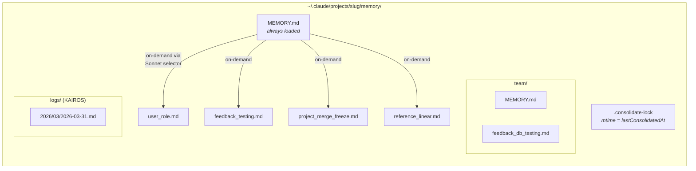
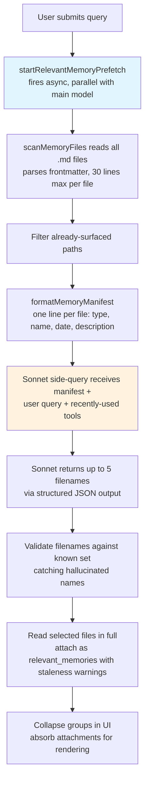
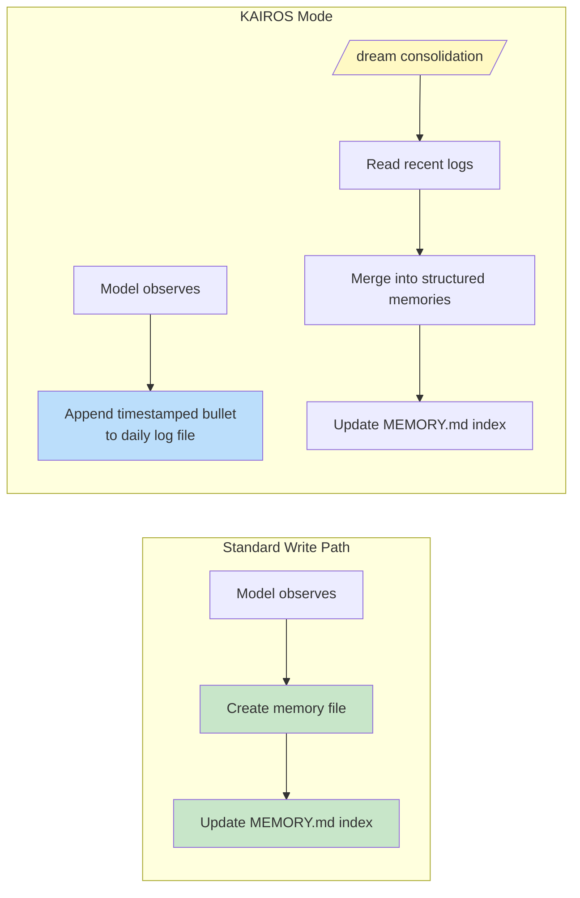

# الفصل 11: الـ Memory -- التعلّم من محادثة للتانية

## مشكلة الـ Stateless

كل فصل لحد الآن كان بيوصف آليات بتعيش داخل session واحدة. الـ agent loop بيشتغل، والـ tools بتتنفذ، والـ sub-agents بتنسّق مع بعضها، ولما الـ process تخرج، كل ده بيختفي. المحادثة اللي بعدها بتبدأ بنفس الـ system prompt، ونفس الـ tool definitions، ونفس الـ model، ومن غير أي معرفة باللي حصل قبلها.

دي المحدودية الأساسية في أي architecture من نوع stateless (مش بيفتكر حاجة من session للتانية). المطوّر بيصحّح للـ model طريقته في الاختبار يوم الاتنين، ويوم التلات الـ model بيكرر نفس الغلطة. المستخدم بيشرح دوره، وقيود مشروعه، وتفضيلاته في أسلوب الكود، وكل session جديدة بتطلب منه يشرح كل ده تاني. الـ model مش بينسى. هو أصلًا ماكانش يعرف. كل محادثة عالم مستقل بذاته.

المشكلة مش نظرية. بتظهر بأشكال ملموسة بتأكل من الثقة. المستخدم بيقول "remember, we use real database instances in tests, not mocks" (افتكر، إحنا بنستخدم database instances حقيقية في الاختبارات، مش mocks)، والأسبوع اللي بعده الـ model بيولّد اختبارات بـ mocks. المستخدم بيشرح إنه مهندس senior مش محتاج شرح للمبتدئين، والـ session اللي بعدها بتفتح بشرح تفصيلي على مستوى tutorial. من غير memory، كل session بتبدأ من الصفر. الـ agent بيفضل طول الوقت موظف جديد في أول يوم شغل له.

الحل المعتاد في الصناعة هو الـ Retrieval-Augmented Generation (RAG): تحوّل المستندات لـ vectors، وتخزنها في vector database، وتسترجع الأجزاء المناسبة وقت الـ query. ده بيشتغل كويس مع قواعد المعرفة: الـ documentation، والأسئلة الشائعة، والمواد المرجعية. لكنه من ناحية الـ architecture مش مناسب للي الـ agent محتاج يفتكره فعليًا بين الـ sessions. الـ memory الخاص بالـ agent مش قاعدة معرفة. هو مجموعة ملاحظات: المستخدم مين، صحّح إيه، إيه قيود المشروع الحالية، وفين الحاجات موجودة. الملاحظات دي صغيرة، وبتتغير كثير، ولازم الإنسان يقدر يعدّلها. الـ vector database بتحل المشكلة الغلط.

نظام الـ memory في Claude Code رهان مختلف تمامًا: ملفات على الـ disk، بصيغة Markdown، و recall (استرجاع الـ memories المناسبة للمحادثة) معتمد على LLM، ومن غير أي infrastructure. الرهان إن البساطة في التخزين، مع الذكاء في الاسترجاع، بتنتج نظام أحسن من التعقيد في الاتنين.

فلسفة التصميم دي ليها عواقب بتشكّل النظام كله:

- **قابل للقراءة من الإنسان.** المستخدم اللي محتاج يشوف Claude Code فاكر إيه، يقدر يفتح `~/.claude/projects/<slug>/memory/MEMORY.md` في أي text editor. من غير tools خاصة، ولا فك تشفير، ولا أمر export.
- **قابل للتعديل من الإنسان.** الـ memory القديم ممكن يتصحّح بـ vim. والـ memory الغلط ممكن يتمسح بـ `rm`. المستخدم عنده سلطة كاملة على معرفة الـ agent.
- **قابل للـ version control.** الـ team memories ممكن تتعمل لها commit في git. وتغييرات الـ memory بتعمل diff نظيف لأنها Markdown.
- **من غير infrastructure.** نظام الـ memory بيشتغل offline، وبيشتغل من غير server، وبيشتغل على أي OS فيه filesystem. مفيش migration path لأن مفيش schema.
- **قابل للـ debugging.** لما الـ memory يتصرف بشكل غير متوقع، طريق التشخيص هو `ls` و `cat`، مش query logs وفحص database.

الـ model بيقرأ ويكتب الـ memories باستخدام `FileWriteTool` و `FileEditTool`، وهي نفس الـ tools اللي بيعدّل بيها الـ source code (اتعرفنا عليها في الفصل 6). مفيش أي memory API خاص. الـ system prompt بيعلّم الـ model بروتوكول كتابة من خطوتين (أنشئ الملف، وحدّث الـ index)، والـ model بينفذه بقدراته الموجودة أصلًا تحت تعليمات جديدة. ده إعادة استخدام للـ tools كمبدأ في الـ architecture: نظام الـ memory مش subsystem متركّب على الـ agent من الخارج، هو سلوك ناشئ من الـ agent وهو بيستخدم قدراته الموجودة.

وفيه سبب أعمق بيخلي اختيار الملفات ينجح هنا. الـ memory عند الـ AI agent مختلف جوهريًا عن الـ memory في تطبيق تقليدي. الـ database في التطبيق التقليدي بتحتفظ بـ state موثوق: هي الـ source of truth (المرجع الوحيد المعتمد) لبيانات النظام. أما الـ memory الخاص بالـ agent فبيحتفظ بـ *ملاحظات*: حاجات كانت صحيحة في لحظة معينة، وممكن تكون ما زالت صحيحة وممكن لأ. الملفات بتوصّل الحالة المعرفية دي بشكل طبيعي. عندها modification times بتكشف إمتى الملاحظة اتسجلت. وبيقدر يقرأها ويعدّلها ويمسحها إنسان عارف إن الملاحظة غلط. الـ database بتوحي بالدوام والسلطة، أما ملف Markdown فبيوحي بملاحظة حد كتبها وممكن تحتاج تتحدّث. وسيلة التخزين نفسها بتوصّل طبيعة البيانات: دي ملاحظات شغل، مش حقائق مقدسة.

### الـ Per-Project Scoping

الـ scope الخاص بالـ memory هو الـ git repository root، مش الـ working directory. لو المستخدم فتح terminal في `src/components/` و terminal تاني في `tests/`، الـ sessions الاتنين بتشترك في نفس مجلد الـ memory. منطق الـ resolution بيدوّر أولًا على الـ canonical git root، ولو ملقاه بيرجع للـ project root:

الـ base path resolution بيدوّر أولًا على الـ canonical git root، ولو ملقاه بيرجع للـ project root. وده بيضمن إن كل الـ git worktrees (نسخ عمل منفصلة من الـ repo في مجلدات تانية) الخاصة بنفس الـ repository تشترك في مجلد memory واحد.

الاستدعاء `findCanonicalGitRoot` هو اللي بيضمن إن كل الـ git worktrees الخاصة بنفس الـ repository تشترك في مجلد memory واحد. الـ git root بيتنظّف (الـ slashes بتتحول لـ dashes عن طريق `sanitizePath()`) عشان يطلع اسم مجلد مسطّح:

```
~/.claude/projects/-Users-alex-code-myapp/memory/
```

مجلد memory ممتلي بالكامل بيكشف بنية النظام:



طريقة التسمية دلالية: `<type>_<topic>.md`. الـ type prefix مش الكود هو اللي بيفرضه، لكنه جزء من تعليمات الـ prompt، وده بيخلي من السهل إنك تمسح المجلد بعينك وتفهم خريطة الـ memory فيه.

---

## الـ Taxonomy من 4 أنواع

مش كل حاجة تستاهل إنها تتفتكر. نظام الـ memory بيقيّد كل الـ memories في 4 أنواع بالضبط:

الـ 4 أنواع هي: **user**، و **feedback**، و **project**، و **reference**.

الـ taxonomy (تصنيف) ده متصمم حوالين معيار واحد: **هل المعرفة دي ممكن تستنتج من حالة المشروع الحالية؟** الـ code patterns، والـ architecture، وبنية الملفات، والـ git history: كل دول ممكن تستنتجهم من جديد بقراءة الـ codebase. فهي مستبعدة. الـ 4 أنواع بتلتقط اللي ماينفعش يستنتج من جديد.

**الـ User memories** بتسجّل معلومات عن الشخص: دوره، وأهدافه، ومسؤولياته، ومستوى خبرته. مهندس Go من مستوى senior وجديد على React بياخد شرح مختلف عن مبرمج بيبرمج لأول مرة.

**الـ Feedback memories** بتلتقط الإرشادات عن طريقة الشغل: التصحيحات والتأكيدات مع بعض. النظام بيوجّه الـ model صراحةً إنه يسجّل الاتنين: "if you only save corrections, you will drift away from approaches the user has already validated" (لو حفظت التصحيحات بس، هتبعد تدريجيًا عن الطرق اللي المستخدم وافق عليها فعلًا). كل feedback memory ليه بنية محددة: القاعدة نفسها، وبعدها سطر `**Why:**` فيه السبب (غالبًا حادثة قديمة)، وبعدها سطر `**How to apply:**` فيه شروط التفعيل.

**الـ Project memories** بتسجّل سياق الشغل الجاري: مين بيعمل إيه، وليه، وإمتى لازم يخلص. الـ prompt بيشدد على تحويل التواريخ النسبية لتواريخ مطلقة: "Thursday" بيتحول لـ "2026-03-05" عشان الـ memory يفضل مفهوم بعد أسابيع.

**الـ Reference memories** عبارة عن bookmarks: مؤشرات لمكان المعلومات في أنظمة خارجية. رابط project على Linear، أو Grafana dashboard، أو Slack channel. دي بتقول للـ model يدوّر فين، مش يلاقي إيه.

### الـ Taxonomy كـ Filter

الـ 4 أنواع مش مجرد تصنيفات، هي فلتر كمان. لما النظام بيعرّف بالضبط إيه اللي يعتبر memory، فهو ضمنيًا بيعرّف إيه اللي مش memory. من غير الـ taxonomy، الـ model المتحمس هيحفظ كل حاجة: الـ code patterns، ومخططات الـ architecture، ورسائل الأخطاء. وكلها ممكن تستنتج من الـ codebase. حفظها بيعمل نسخة موازية، وممكن تكون قديمة، من معلومات الأفضل إنها تيجي من مصدرها الأصلي.

الـ taxonomy كمان بيمنع فشل أدق: الاعتماد على الـ memory كعكاز. لو الـ model حفظ قرارات الـ architecture كـ memories، هيبطّل يقرأ الـ codebase عشان يفهم الـ architecture. وباستبعاد المعلومات اللي ممكن تستنتج، النظام بيجبر الـ model يفضل مرتبط بالحالة الحالية للكود.

قائمة الاستبعاد صريحة: الـ code patterns، والـ git history، وحلول الـ debugging، وأي حاجة موجودة في CLAUDE.md، وتفاصيل الـ tasks المؤقتة. والاستبعادات دي بتنطبق حتى لو المستخدم طلب الحفظ صراحةً. لو المستخدم قال "remember this PR list" (افتكر قائمة الـ PRs دي)، الـ model عنده تعليمات إنه يعترض ويسأل: "what was *surprising* or *non-obvious* about it?" (إيه اللي كان مفاجئ أو مش واضح فيها؟). الجزء المفاجئ ده هو اللي يستاهل الحفظ. القائمة الخام لأ. التعليمة دي اتأكدت صحتها بالـ evals: النتيجة اتحركت من 0/2 لـ 3/3 لما تعليمة تجاوز الاستبعاد اتضافت.

### الـ Frontmatter كـ Contract

كل ملف memory بيستخدم YAML frontmatter (الـ metadata اللي في أول الملف بين `---`) فيه 3 fields مطلوبة:

```markdown
---
name: {{memory name}}
description: {{one-line description -- used to decide relevance}}
type: {{user, feedback, project, reference}}
---
```

الـ field `description` هو اللي شايل الحمل الأكبر. هو اللي الـ relevance selector (وهو side-query لـ Sonnet، يعني API call جانبي لـ model أصغر، وهنتكلم عنه بعدين) بيستخدمه عشان يقرر هل يظهر الـ memory ده ولا لأ. الوصف الغامض زي "testing stuff" (حاجات عن الاختبار) يا إما هيطابق حاجات كثيرة زيادة عن اللزوم، يا إما مش هيطابق أي حاجة. أما الوصف المحدد زي "Integration tests must hit real DB, not mocks -- burned by mock divergence Q4" (الـ integration tests لازم تشتغل على DB حقيقية، مش mocks. اتحرقنا من اختلاف الـ mocks عن الواقع في Q4) فبيطابق بالضبط المحادثات اللي بيفرق فيها. الوصف هو الـ search index الخاص بالـ memory، لكن اللي بيستهلكه مش محرك بحث، وإنما language model بيفهم الفروق الدقيقة والسياق والنية.

الـ frontmatter كمان هو الجزء الوحيد من الملف اللي نظام الـ scanning بيقرأه أثناء الـ recall. الـ function `scanMemoryFiles()` بتقرأ من كل ملف أول 30 سطر بس عشان تستخرج الـ header. أما المحتوى فبيفضل خاص لحد ما الملف يتختار صراحةً ويتحمّل.

---

## الـ Write Path

كتابة memory عملية من خطوتين بتتنفذ بـ file tools عادية.

**الخطوة 1: كتابة ملف الـ memory.** الـ model بينشئ ملف `.md` في مجلد الـ memory ومعاه YAML frontmatter:

```markdown
---
name: Testing Policy
description: Integration tests must hit real DB, not mocks
type: feedback
---

Don't mock the database in integration tests.

**Why:** We got burned last quarter when mocked tests passed but production
queries hit edge cases the mocks didn't cover.

**How to apply:** Any test file under `__tests__/` that touches database
operations should use the real PGlite instance from test-utils.
```

**الخطوة 2: تحديث الـ index.** الـ model بيضيف مؤشر من سطر واحد في `MEMORY.md`:

```markdown
- [Testing Policy](feedback_testing.md) -- integration tests must hit real DB
```

كل entry لازم يفضل تحت حوالي 150 حرف. الـ index فهرس محتويات، مش قاعدة معرفة.

لما الـ model يتعلم معلومة جديدة بتعدّل memory موجود، بيستخدم `FileEditTool` عشان يحدّث الملف الموجود بدل ما ينشئ نسخة مكررة. النظام مش بيعمل versioning للـ memories داخليًا: الملف على الـ filesystem المحلي، والمستخدم عنده `git` لو محتاج versioning. وقبل ما الـ prompt يتبنى، الـ function `ensureMemoryDirExists()` بتنشئ مجلد الـ memory، والـ prompt بيقول للـ model إن المجلد موجود أصلًا، وده بيوفّر turns ضايعة على `ls` و `mkdir -p`.

---

## الـ Recall Path

كتابة الـ memories ضرورية لكنها مش كافية. المشكلة الأصعب هي الاسترجاع: لو عندك query من المستخدم، أي ملف من مئات ملفات الـ memory المحتملة لازم يتحمّل في context الـ model؟ تحميلها كلها هيستهلك الـ token budget بالكامل. وتحميل ولا واحد منها هيضيّع الهدف أصلًا. وتحميل الملفات الغلط هيضيّع tokens على معلومات ملهاش علاقة، وفي نفس الوقت هيفوّت المعرفة اللي كانت هتغيّر سلوك الـ model.

نظام الـ recall بيشتغل على مستويين. الـ index `MEMORY.md` بيتحمّل في الـ context دائمًا مع بداية الـ session، وده بيدّي توجيه عام. أما ملفات الـ memory الفردية فبتظهر عند الحاجة عن طريق relevance query معتمد على LLM بيختار لحد 5 memories في كل turn.

### الـ Recall Pipeline بالكامل



الـ async prefetch في الخطوة 2 هو قرار الأداء الأساسي. لما الـ model الرئيسي يوصل للنقطة اللي الـ context المسترجع بيبقى مفيد فيها، الـ side-query غالبًا بيكون خلّص أصلًا. والمستخدم مش بيحس بأي latency (زمن الاستجابة) إضافي.

### الـ Sonnet Side-Query

الـ manifest بيتبعت لـ Sonnet model كـ side-query. والـ system prompt الخاص بالـ selector ده دقيق:

الـ system prompt بيوجّه الـ selector إنه يكون متحفظ: يضمّن بس الـ memories اللي هتفيد الـ query الحالي، ويتخطى أي memory لو مش متأكد، ويتجنب اختيار documentation عن الـ API أو طريقة الاستخدام لـ tools شغالة فعليًا في المحادثة (لأن الـ model عنده الـ tools دي محمّلة أصلًا). لكنه مع ذلك يظهر التحذيرات، والمطبات، والمشاكل المعروفة عن الـ tools دي.

الرد بيستخدم structured output: `{ selected_memories: string[] }`، وأسماء الملفات بتتحقق مقابل المجموعة المعروفة.

الطريقة دي بتضحّي بشوية latency في مقابل الدقة، وتحليل الـ trade-off (مفاضلة: بتكسب حاجة وبتدفع ثمنها في حاجة تانية) هنا مفيد. **الـ Keyword matching** هيكون سريع لكنه مش بيفهم السياق: مش بيقدر يعبّر عن "do not select memories for tools already in active use" (ماتختارش memories لـ tools شغالة فعليًا). **الـ Embedding similarity** بيتعامل مع التطابق الدلالي لكنه بيجيب معاه infrastructure (embedding model، و vector store، و update pipeline) وضعيف في التعامل مع النفي: الـ embedding الخاص بـ "do NOT use database mocks" (ماتستخدمش database mocks) قريب جدًا من "use database mocks" (استخدم database mocks). **الـ Sonnet side-query** بيفهم الصلة الدلالية، وبيفكّر في السياق، وبيتعامل مع النفي، ومش محتاج أي infrastructure. وتكلفة الـ latency محدودة (مئات الملي ثانية) ومخفية وراء المعالجة الأولية للـ model الرئيسي.

نظام الـ telemetry بيتابع معدلات الاختيار حتى لما مفيش memories بتتختار. معدل اختيار 0/150 معناه حاجة مختلفة عن 0/3: الأول بيشير لمشكلة في الدقة، والتاني لمشكلة في التغطية.

---

## الـ Staleness

نظام الـ staleness (إن الـ memory بقى قديم ومش مطابق للواقع) بيعالج failure mode (شكل من أشكال الفشل) ظهر من الاستخدام الفعلي. المستخدمين بلّغوا إن الـ model كان بيقدم memories قديمة كحقائق، وهي memories فيها إشارات على شكل file:line لكود اتغير بعدها. والإشارة دي خلّت الادعاء القديم يبان *أكثر* موثوقية، مش أقل.

الحل مش إن الـ memories تنتهي صلاحيتها. الـ memories القديمة مش بتتمسح، لأنها ممكن تكون شايلة معرفة مؤسسية صالحة لسنين. بدل كده، النظام بيربط بيها تحذيرات عن عمرها:

الـ staleness function بتحسب عمر الـ memory بالأيام. الـ memories من اليوم أو أمس مش بتاخد تحذير (الـ function بترجّع string فاضي). وأي حاجة أقدم بتاخد تنبيه بيتحقن جنب محتوى الـ memory: رسالة بتذكر العمر بالأيام، وبتحذّر إن الادعاءات عن سلوك الكود أو الإشارات على شكل file:line ممكن تكون قديمة، وبتنصح بالتحقق منها مقابل الكود الحالي.

الـ memories من اليوم أو أمس مش بتاخد تحذير. وأي حاجة أقدم بتاخد تنبيه staleness بيتحقن جنب محتوى الـ memory. الصيغة المقروءة للإنسان، "today," "yesterday," "47 days ago" (اليوم، أمس، من 47 يوم)، موجودة لأن الـ models ضعيفة في حسابات التواريخ. الـ ISO timestamp الخام مش بيحرّك تفكير الـ staleness زي ما "47 days ago" بتعمل. ودي ملاحظة تجريبية عن سلوك الـ model، اتأكدت بالـ evals: الصياغة اللي بتبدأ بإشارة للفعل "Before recommending from memory" (قبل ما توصي بحاجة من الـ memory) جابت 3/3 مقابل 0/3 للصياغة الأكثر تجريدًا "Trusting what you recall" (الثقة في اللي بتفتكره)، مع نفس نص المحتوى بالضبط.

وفيه توتر فلسفي يستاهل نسمّيه. نظام الـ staleness بيتعامل مع الـ memories كفرضيات، مش حقائق. لكن الميل الطبيعي للـ model إنه يقدّم المعلومات بثقة. فتحذير الـ staleness بيحارب صوت الـ model نفسه: بيستخدم قدرته على اتباع التعليمات عشان يتغلب على ميله لتوليد الثقة.

---

## ملف MEMORY.md كـ Index دائم التحميل

كل محادثة بتبدأ و `MEMORY.md` موجود في الـ context. هو مش memory، هو index: فهرس محتويات لملفات الـ memory الفعلية.

الـ index ليه حدّين صارمين:

الـ index ليه حدّين صارمين: 200 سطر و 25,000 byte.

حد الـ 200 سطر بيلتقط النمو العادي. أما حد الـ 25KB فبيلتقط failure mode اتلاحظ فعليًا: مستخدمين بيحشروا سطور طويلة بتفضل تحت 200 سطر لكنها بتستهلك token budgets ضخمة. عند الـ 97th percentile، كان فيه ملف MEMORY.md فيه 197 سطر بس ووزنه 197KB. ولما أي حد من الاتنين يتفعّل، إرشاد عملي بيقول للمستخدم يصلّح إيه: "Keep index entries to one line under ~200 chars; move detail into topic files." (خلّي كل entry في الـ index سطر واحد أقل من ~200 حرف، وانقل التفاصيل لملفات المواضيع.)

الـ architecture من مستويين دي، index خفيف شغال دائمًا زائد محتوى تقيل بيتحمّل عند الحاجة، هي التصميم اللي بيسمح للـ memory إنه يكبر. مشروع فيه 150 memory عنده index من 150 سطر بيستهلك حوالي 3,000 token، مش 150 ملف كامل بيستهلكوا 100,000.

---

الانتقال من الـ memory الفردي للمعرفة المشتركة طبيعي. سياسة اختبار، أو convention للـ deployment، أو مطب معروف في نظام الـ build: كل دول لازم يتشاركوا على مستوى الفريق.

## الـ Team Memory

الـ team memory عبارة عن مجلد فرعي داخل مجلد الـ auto-memory على المسار `<autoMemPath>/team/`، ومحمي وراء feature flag (مفتاح بيشغّل أو يقفل ميزة) وبيشترط إن الـ auto-memory يكون مفعّل. وإن الـ team memory يكون جزء داخل الـ auto-memory في الـ architecture أمر مقصود: تعطيل الـ auto-memory بيعطّل الـ team memory معاه بالتبعية.

### الـ Defense in Depth

الـ team memory بيفتح attack surface مش موجود في الـ memory الفردي. الملفات اللي بتتزامن من الفريق جاية من مستخدمين تانيين، و teammate خبيث ممكن يحاول يعمل path traversal. نموذج الأمان بيستخدم 3 طبقات دفاع.

**الطبقة 1: تنظيف الـ input.** الـ function `sanitizePathKey()` بتتحقق من الـ null bytes، والـ traversals المشفّرة بصيغة URL (`%2e%2e%2f`)، وهجمات الـ Unicode normalization (حروف fullwidth بتتحول بعد الـ normalization لـ `../`)، والـ backslashes، والمسارات المطلقة.

**الطبقة 2: التحقق من المسار على مستوى الـ string.** بعد التنظيف، الـ function `path.resolve()` بتطبّع أي أجزاء `..` متبقية، والمسار الناتج بيتفحص مقابل الـ prefix الخاص بمجلد الـ team (مع separator في الآخر عشان `team-evil/` ما يطابقش `team/`).

**الطبقة 3: حل الـ symlinks.** الـ function `realpathDeepestExisting()` بتحل الـ symlinks على أعمق ancestor موجود فعليًا، وده بيلتقط هجمات التحقق على مستوى الـ string مش بيقدر يكشفها. لو `team/evil` عبارة عن symlink بيشير لـ `/etc/`، التحقق على مستوى الـ string هيشوف prefix صالح، لكن `realpath` بيكشف الهدف الحقيقي.

كل حالات فشل التحقق بتنتج `PathTraversalError`. مفيش نجاح جزئي، ولا fallbacks. النظام fail-closed (لو حصل شك، الافتراضي هو الأكثر أمانًا).

### إرشادات الـ Scope

الـ prompt بيعلّم الـ model الفرق بين الـ memory الخاص والمشترك. الـ user memories دائمًا خاصة. الـ reference memories غالبًا للفريق. والـ feedback memories افتراضيًا خاصة إلا لو كانت بتمثّل conventions على مستوى المشروع كله. وتعليمة الفحص المتبادل، "Before saving a private feedback memory, check that it does not contradict a team feedback memory" (قبل ما تحفظ feedback memory خاص، اتأكد إنه مش بيناقض feedback memory خاص بالفريق)، بتمنع إن إرشادات متضاربة تظهر بشكل غير متوقع حسب أي memory بيتفتكر الأول.

---

## الـ KAIROS Mode: سجلات يومية من نوع Append-Only

الـ memory العادي بيفترض sessions منفصلة. الـ KAIROS mode (وهو الـ assistant mode في Claude Code) بيكسر الافتراض ده: الـ sessions طويلة العمر، وممكن تفضل شغالة لأيام. ونمط الكتابة من خطوتين مش بينفع مع التشغيل المستمر.

الحل هو فصل في الـ architecture بين الالتقاط والـ consolidation (دمج الملاحظات المتفرقة في memories منظمة):



في الـ KAIROS mode، الـ model بيضيف على ملفات log مسماة بالتاريخ (`<autoMemPath>/logs/YYYY/MM/YYYY-MM-DD.md`). كل entry عبارة عن bullet قصير ومعاه timestamp. والـ model عنده تعليمات: "Do not rewrite or reorganize the log" (ماتعيدش كتابة الـ log ولا تعيد ترتيبه)، لأن إعادة الهيكلة أثناء الالتقاط بتضيّع الإشارة الزمنية اللي الـ consolidation محتاجها.

المسار في الـ prompt موصوف كـ *pattern* مش كتاريخ اليوم الحرفي. ودي optimization للـ caching: الـ memory prompt بيتعمل له cache ومش بيتبطّل لما التاريخ يتغير عند منتصف الليل. والـ model بيستنتج التاريخ الحالي من attachment منفصل اسمه `date_change`.

### الـ /dream Consolidation

الـ consolidation بيشتغل في 4 مراحل: **Orient** (عرض محتوى المجلد، وقراءة الـ index، والمرور السريع على الملفات الموجودة)، و **Gather** (البحث في الـ logs، والتحقق من memories انحرفت عن الواقع)، و **Consolidate** (كتابة الملفات أو تحديثها، والدمج بدل التكرار)، و **Prune** (تحديث الـ index تحت 200 سطر، وحذف المؤشرات القديمة). التركيز على الدمج في الملفات الموجودة بدل إنشاء ملفات جديدة مهم: من غيره، مجلد الـ memory هيكبر بشكل خطي مع الاستخدام.

### الـ Consolidation Lock

ملف الـ lock `.consolidate-lock` بيخدم غرضين: محتواه هو الـ PID الخاص بالـ process اللي ماسكاه (mutual exclusion، يعني الاتنين ماينفعش يشتغلوا مع بعض)، والـ mtime الخاص به *هو نفسه* `lastConsolidatedAt` (حالة الجدولة). الـ auto-dream بيتفعّل لما 3 بوابات تعدّي، وبتتقيّم من الأرخص للأغلى: الساعات من آخر consolidation أكثر من 24، والـ sessions اللي اتعدّلت من وقتها أكثر من 5، ومفيش process تانية ماسكة الـ lock. واستعادة الوضع بعد crash بتكشف الـ PIDs الميتة عن طريق `process.kill(pid, 0)`، مع staleness timeout قدره ساعة واحدة كحماية من إعادة استخدام الـ PID.

---

## الـ Background Extraction

الـ agent الرئيسي عنده تعليمات كاملة لكتابة الـ memories بمبادرة منه. لكن الـ agents مش كاملة، وعدم الكمال ده متوقع. لما المستخدم يقول "remember to always use integration tests" (افتكر إنك تستخدم integration tests دائمًا) وبعدها على طول يطلب "now fix the login bug" (والآن أصلح الـ bug في الـ login)، انتباه الـ model بيتحوّل بالكامل للـ bug. تعليمة حفظ الـ memory اتعالجت، لكنها ممكن ما تتنفذش.

في نهاية كل query loop كامل، fork agent (نسخة من الـ agent بتشترك معاه في نفس الـ context) بيشترك مع الـ parent في الـ prompt cache، وبيحلل الرسائل الأخيرة ويكتب أي memories الـ agent الرئيسي فوّتها. ولما الـ agent الرئيسي يكون كتب memories فعلًا في نطاق الـ turns الحالي، الـ extraction agent بيتخطى النطاق ده. والـ extraction agent عنده tool budget محدود: tools للقراءة بس، زائد صلاحية كتابة على مسارات مجلد الـ memory بس. والـ prompt الخاص به بيوجّهه لاستراتيجية من 2 turns: الـ turn الأول يقرأ بالتوازي، والـ turn التاني يكتب بالتوازي.

التفاعل بينهم تعاوني، مش تنافسي. الـ prompt الخاص بالـ agent الرئيسي دائمًا فيه تعليمات الحفظ الكاملة. لما الـ agent الرئيسي يحفظ، الـ background agent بيتنحى. ولما ما يحفظش، الـ background agent بيلتقط الفجوة. الـ pattern ده، مسار أساسي ومعاه شبكة أمان في الخلفية، بيخلي التقاط الـ memory أكثر موثوقية من غير ما يثقّل على التفاعل الأساسي. وأي واحد منهم لوحده ماكانش هيكفي.

---

## الـ Path Resolution والأمان

مسار الـ auto-memory بيتحدد عن طريق سلسلة أولويات:

1. **`CLAUDE_COWORK_MEMORY_PATH_OVERRIDE`** -- override بالمسار الكامل لـ Cowork.
2. **`autoMemoryDirectory` في settings.json** -- من مصادر الإعدادات الموثوقة بس. إعدادات المشروع مستبعدة عن قصد.
3. **المسار الافتراضي المحسوب** -- `~/.claude/projects/<sanitized-git-root>/memory/`.

استبعاد إعدادات المشروع قرار أمني. الـ repository الخبيث ممكن يعمل commit لملف `.claude/settings.json` فيه `autoMemoryDirectory: "~/.ssh"`، وساعتها الاستثناء في الصلاحيات المخصص لملفات الـ memory هيدّي الـ model صلاحية كتابة تلقائية على مفاتيح SSH. وبحصر الـ override في إعدادات الـ policy والـ flag والـ local والـ user، وكلها ماينفعش تتعمل لها commit في repository، الـ attack vector ده بيتقفل.

الـ function `isAutoMemPath()` بتطبّع المسارات قبل فحص الـ prefix عشان تمنع الـ traversal، و convention الـ separator في الآخر بيضمن إن مطابقة الـ prefix تستلزم حد مجلد.

### سلسلة الـ Enable/Disable

هل الـ auto-memory شغال ولا لأ بتحدده الـ function `isAutoMemoryEnabled()`، وهي بتنفذ سلسلة أولويات خاصة بها: environment variable، وبعدها الـ bare mode، وبعدها CCR من غير persistent storage، وبعدها الإعدادات، والافتراضي إنه مفعّل. لما يتعطّل، قسم الـ prompt بيتشال (فالـ model مش بيستقبل أي تعليمات عن الـ memory) والـ background processes بتتوقف (extract-memories، و auto-dream، و team sync). ولازم البوابتين يتوافقوا: شيل الـ prompt لوحده ماكانش هيوقف الـ extraction agent، لأن ليه prompt خاص به.

---

## طبّق ده: تصميم الـ Memory للـ Agent

تعقيد نظام الـ memory موجود في الطبقة السلوكية: تعليمات الـ prompt، والـ recall المعتمد على LLM، وإدارة الـ staleness، والـ background extraction. مش في infrastructure التخزين. وتوزيع التعقيد ده هو نفسه مبدأ تصميم.

**الملفات بتكسب على الـ databases كـ memory للـ agent.** الملفات ممكن تتفحص، وتتعدّل، وتتعمل لها version control. والشفافية بتبني الثقة. لما البديل database المستخدمين مش بيقدروا يقرؤوها بسهولة، الملفات بتكسب بالثقة لوحدها.

**قيّد إيه اللي بيتحفظ، مش بس إزاي.** اختبار القابلية للاستنتاج، يعني هل المعرفة دي ممكن تستنتج من جديد من حالة المشروع الحالية؟ الاختبار ده بيستبعد أغلب الـ memories المحتملة مع الحفاظ على اللي فعلًا بتفرق.

**استخدم LLM للـ recall، مش keywords ولا embeddings.** الـ LLM side-query بيفهم السياق، وبيفكّر في اللي متاح أصلًا في المحادثة، وبيتعامل مع النفي، ومش محتاج صيانة لأي index. تكلفة الـ latency حقيقية لكنها محدودة ومخفية وراء معالجة الـ model الرئيسي.

**حذّر من الـ staleness، ماتنهيش الصلاحية.** المعرفة المؤسسية ممكن تفضل صالحة لسنين. وربط تحذيرات العمر بالـ memories بيخلي الـ model يتعامل مع القديمة منها كفرضيات مش حقائق. وصيغة العمر المقروءة للإنسان بتحرّك التفكير الصحيح بشكل الـ timestamps الخام مش بتقدر عليه.

**ابني شبكة أمان للالتقاط.** الـ agent الرئيسي هيفوّت memories. والـ background extraction agent اللي بيراجع المحادثة الأخيرة بيخلي النظام أكثر موثوقية من غير ما يثقّل على التفاعل الأساسي. ولما الـ agent الرئيسي يحفظ، الـ background agent بيتنحى.

---

الـ agent بقى يقدر يتعلم من session للتانية: بيجمّع معرفة عن مستخدمه، وتفضيلاته، وحالة مشروعه، والتصحيحات اللي عملها. ونظام الـ memory بيقطع التزام فلسفي: إن علاقة الـ agent بمستخدمه لازم تتعمّق مع الوقت، مش تتصفّر مع كل تفاعل. والـ implementation المبني على الملفات بيخلي الالتزام ده ملموس: ظاهر على الـ disk، وقابل للتعديل من الإنسان، ومحفوظ في الـ version control جنب الكود. الـ memory الخاص بالـ agent مش black box. هو مجموعة ملاحظات في مجلد، مكتوبة بلغة الـ model والإنسان الاتنين بيقدروا يقرؤوها.

الفصل اللي بعده بيدرس إزاي Claude Code بيوسّع قدراته خارج النواة: نظام الـ skills اللي بيعلّم الـ model سلوكيات جديدة، ونظام الـ hooks اللي بيسمح لكود خارجي إنه يقيّد السلوكيات دي ويعدّلها عند أكثر من 24 نقطة في الـ lifecycle.
