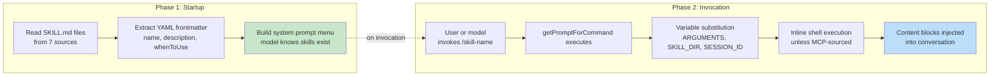
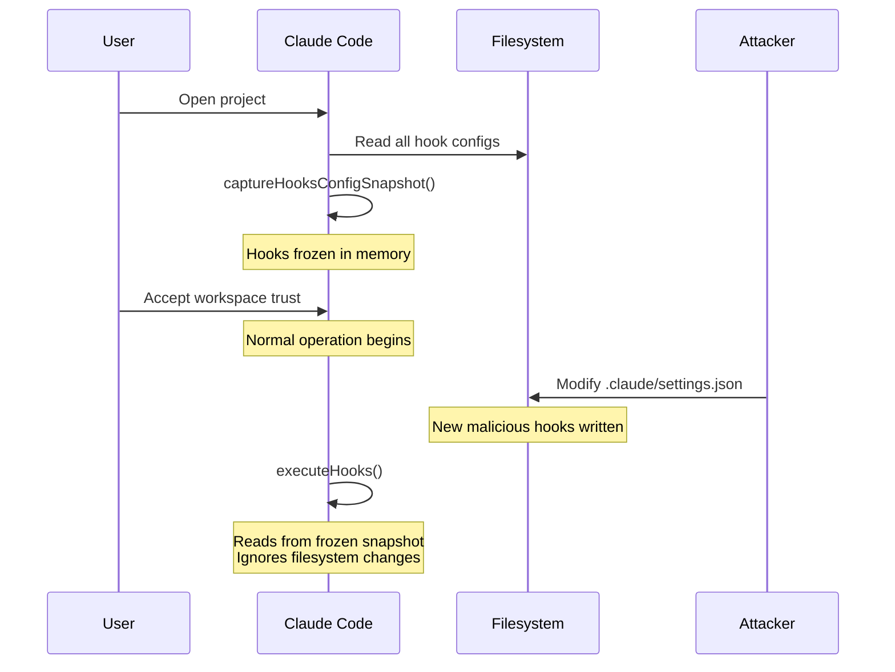
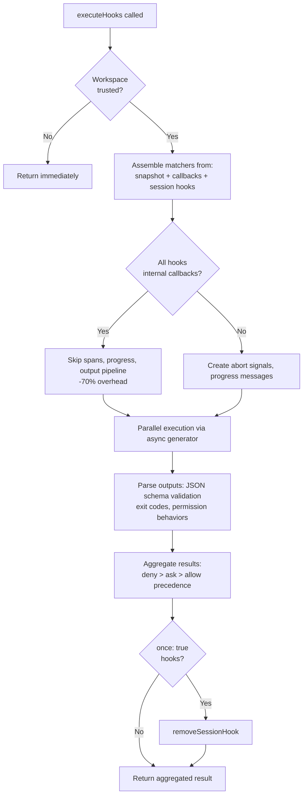

# الفصل 12: قابلية التوسعة -- الـ Skills والـ Hooks

## بُعدين للتوسعة

كل extensibility system بيجاوب على سؤالين: النظام يقدر يعمل إيه، وإمتى بيعمله. أغلب الـ frameworks بتخلط الاتنين مع بعض: الـ plugin بيسجّل القدرات والـ lifecycle callbacks في نفس الـ object، والحد الفاصل بين "adding a feature" (إضافة ميزة) و "intercepting a feature" (اعتراض ميزة) بيتلاشى في registration API واحد.

أما Claude Code فبيفصل بينهم بشكل واضح. الـ skills بتوسّع اللي الـ model يقدر يعمله. هي ملفات markdown بتتحوّل لأوامر، وبتحقن تعليمات جديدة في المحادثة لما تتستدعى. والـ hooks بتوسّع إمتى الحاجات بتحصل وإزاي. هي lifecycle interceptors، بتشتغل عند أكثر من 24 نقطة مختلفة أثناء الـ session، وبتشغّل أي كود: كود يقدر يمنع أفعال، أو يعدّل الـ inputs، أو يجبر الـ model يكمّل، أو يراقب في صمت.

والفصل بينهم ده مش صدفة. الـ skills محتوى: بتوسّع معرفة الـ model وقدراته بإضافة نص للـ prompt. والـ hooks control flow: بتغيّر مسار التنفيذ من غير ما تغيّر اللي الـ model يعرفه. الـ skill ممكن تعلّم الـ model إزاي يشغّل عملية الـ deployment الخاصة بفريقك. والـ hook ممكن يضمن إن مفيش أمر deployment بيتنفذ من غير test suite ناجح. الـ skill بتضيف قدرة، والـ hook بيضيف قيد.

الفصل ده بيغطي النظامين بالتفصيل، وبعدين بيبص على نقطة التقاطع بينهم: hooks معلنة داخل الـ skill، بتتسجّل كـ interceptors على مستوى الـ session لما الـ skill تتستدعى.

---

## الـ Skills: تعليم الـ Model حيل جديدة

### الـ Two-Phase Loading

التحسين الأساسي في نظام الـ skills هو إن الـ frontmatter بيتحمّل عند بدء التشغيل، لكن المحتوى الكامل مش بيتحمّل غير عند الاستدعاء.



**المرحلة 1** بتقرأ كل ملف `SKILL.md`، وتفصل الـ YAML frontmatter عن نص الـ markdown، وتستخرج الـ metadata. حقول الـ frontmatter بتبقى جزء من الـ system prompt عشان الـ model يعرف إن الـ skill موجودة. أما نص الـ markdown فبيتحفظ داخل closure من غير ما يتعالج. مشروع فيه 50 skills بيدفع تكلفة tokens لـ 50 وصف قصير، مش 50 مستند كامل.

**المرحلة 2** بتشتغل لما الـ model أو المستخدم يستدعي skill. الـ function `getPromptForCommand` بتحط الـ base directory في البداية، وتستبدل المتغيرات (`$ARGUMENTS` و `${CLAUDE_SKILL_DIR}` و `${CLAUDE_SESSION_ID}`)، وتنفّذ أوامر الـ shell المكتوبة inline (اللي بين backticks ومسبوقة بـ `!`). والنتيجة بترجع على شكل content blocks بتتحقن في المحادثة.

### 7 مصادر بترتيب أولوية

الـ skills بتيجي من 7 مصادر مختلفة، بتتحمّل بالتوازي وبتتدمج حسب ترتيب الأولوية:

| الأولوية | المصدر | المكان | ملاحظات |
|----------|--------|----------|-------|
| 1 | Managed (Policy) | `<MANAGED_PATH>/.claude/skills/` | بتتحكم فيها المؤسسة |
| 2 | User | `~/.claude/skills/` | شخصية، ومتاحة في كل مكان |
| 3 | Project | `.claude/skills/` (بيمشي لفوق لحد الـ home) | محفوظة في الـ version control |
| 4 | Additional Dirs | `<add-dir>/.claude/skills/` | عن طريق الـ flag `--add-dir` |
| 5 | Legacy Commands | `.claude/commands/` | للتوافق مع الإصدارات القديمة |
| 6 | Bundled | مضمّنة داخل الـ binary | وراها feature gate |
| 7 | MCP | prompts من MCP server | remote ومش موثوقة |

إزالة التكرار بتستخدم `realpath` عشان تحل الـ symlinks والمجلدات الأب المتداخلة. وأول مصدر بيتشاف هو اللي بيكسب. والـ function `getFileIdentity` بتحوّل المسارات لـ canonical paths عن طريق `realpath` بدل ما تعتمد على قيم الـ inode، لأن الـ inodes مش موثوقة على الـ container/NFS mounts وعلى ExFAT.

### اتفاق الـ Frontmatter

أهم حقول الـ frontmatter اللي بتتحكم في سلوك الـ skill:

| حقل الـ YAML | الغرض |
|-----------|---------|
| `name` | اسم العرض اللي المستخدم بيشوفه |
| `description` | بيظهر في الـ autocomplete والـ system prompt |
| `when_to_use` | سيناريوهات استخدام مفصّلة عشان الـ model يكتشف الـ skill |
| `allowed-tools` | الـ tools اللي الـ skill تقدر تستخدمها |
| `disable-model-invocation` | بيمنع الـ model من استخدامها من نفسه |
| `context` | `'fork'` عشان تشتغل كـ sub-agent |
| `hooks` | lifecycle hooks بتتسجّل عند الاستدعاء |
| `paths` | glob patterns للتفعيل الشرطي |

الخيار `context: 'fork'` بيشغّل الـ skill كـ sub-agent ليه context window خاص بيه. وده ضروري للـ skills اللي محتاجة شغل كبير من غير ما تلوّث الـ token budget الخاص بالمحادثة الأساسية. والحقلين `disable-model-invocation` و `user-invocable` بيتحكموا في مسارين وصول مختلفين: لو ضبطت الاتنين على true، الـ skill بتبقى مخفية تمامًا، وده مفيد للـ skills اللي كل وظيفتها hooks.

### الـ MCP Security Boundary

بعد استبدال المتغيرات، أوامر الـ shell الـ inline بتتنفذ. وهنا حد الأمان قاطع: **الـ MCP skills عمرها ما بتنفّذ أوامر shell من نوع inline.** الـ MCP servers أنظمة خارجية. و prompt من MCP فيه `` !`rm -rf /` `` كان هيتنفذ بصلاحيات المستخدم الكاملة لو كان مسموح. فالنظام بيتعامل مع الـ MCP skills كمحتوى بس. والـ trust boundary ده مرتبط بنموذج أمان MCP الأوسع اللي هنناقشه في الفصل 15.

### الـ Dynamic Discovery

الـ skills مش بتتحمّل عند بدء التشغيل بس. لما الـ model يلمس ملفات، الـ function `discoverSkillDirsForPaths` بتمشي لفوق من كل مسار وتدوّر على مجلدات `.claude/skills/`. والـ skills اللي عندها حقل `paths` في الـ frontmatter بتتخزن في map اسمه `conditionalSkills`، ومش بتتفعّل غير لما المسارات اللي اتلمست تطابق الـ patterns الخاصة بيها. يعني skill معلنة `paths: "packages/database/**"` بتفضل مخفية لحد ما الـ model يقرأ أو يعدّل ملف database. ده توسيع للقدرات حسب الـ context.

---

## الـ Hooks: التحكم في إمتى بتحصل الحاجات

الـ hooks هي آلية Claude Code لاعتراض السلوك وتعديله عند نقاط الـ lifecycle. محرك التنفيذ الأساسي فيها أكثر من 4,900 سطر. والنظام بيخدم 3 فئات: المطوّرين الأفراد (linting مخصص، و validation)، والفرق (quality gates مشتركة محفوظة في المشروع)، والمؤسسات (قواعد compliance بتتحكم فيها policy).

### مثال hook من الواقع: منع الـ Commits على Main

قبل ما نغوص في الآليات، ده شكل الـ hook في الواقع. افترض إن فريقك محتاج يمنع الـ model من إنه يعمل commit مباشرة على branch `main`.

**الخطوة 1: إعدادات settings.json:**

```json
{
  "hooks": {
    "PreToolUse": [
      {
        "matcher": "Bash",
        "hooks": [
          {
            "type": "command",
            "command": "/path/to/check-not-main.sh",
            "if": "Bash(git commit*)"
          }
        ]
      }
    ]
  }
}
```

**الخطوة 2: الـ shell script:**

```bash
#!/bin/bash
BRANCH=$(git rev-parse --abbrev-ref HEAD 2>/dev/null)
if [ "$BRANCH" = "main" ]; then
  echo "Cannot commit directly to main. Create a feature branch first." >&2
  exit 2  # Exit 2 = blocking error
fi
exit 0
```

**الخطوة 3: اللي الـ model بيشوفه.** لما الـ model يجرّب `git commit` وهو على branch `main`، الـ hook بيشتغل قبل ما الأمر يتنفذ. الـ script بيفحص الـ branch، ويكتب في stderr، ويخرج بالكود 2. والـ model بيشوف system message: "Cannot commit directly to main. Create a feature branch first." (ماينفعش تعمل commit مباشرة على main. اعمل feature branch أولًا.) الـ commit مش بيتنفذ أصلًا. فالـ model بيعمل branch جديد ويعمل commit عليه بدل كده.

الشرط `if: "Bash(git commit*)"` معناه إن الـ script مش بيشتغل غير مع أوامر git commit، مش مع كل استدعاء لـ Bash. الـ exit code 2 بيمنع، والـ exit code 0 بيعدّي، وأي exit code تاني بيطلع تحذير من غير منع. وده البروتوكول كله.

### الـ 4 أنواع اللي المستخدم بيقدر يضبطها

بيعرّف Claude Code 6 أنواع من الـ hooks: 4 منها المستخدم بيقدر يضبطها، و 2 داخلية.

**الـ Command hooks** بتعمل spawn لـ shell process. الـ input الخاص بالـ hook بيتبعت كـ JSON على stdin، والـ hook بيرد عن طريق الـ exit code و stdout/stderr. وده النوع اللي شايل الشغل التقيل.

**الـ Prompt hooks** بتعمل LLM call واحد، وبترجّع `{"ok": true}` أو `{"ok": false, "reason": "..."}`. دي طريقة validation خفيفة بالـ AI من غير agent loop كامل.

**الـ Agent hooks** بتشغّل agentic loop من نوع multi-turn (بحد أقصى 50 turns، وصلاحيات `dontAsk`، والـ thinking متعطّل). وكل واحد منها ليه session scope خاص بيه. ودي الآلة التقيلة لحاجات زي "verify that the test suite passes and covers the new feature." (اتأكد إن الـ test suite بينجح وبيغطي الميزة الجديدة.)

**الـ HTTP hooks** بتبعت الـ hook input بـ POST لـ URL. وده بيسمح بـ policy servers بعيدة و audit logging من غير عمل spawn لأي process محلية.

والنوعين الداخليين هما **الـ callback hooks** (بتتسجّل من الكود مباشرة، وبتقلّل الـ overhead على الـ hot path بنسبة 70% عن طريق fast path بيتخطى الـ span tracking) و **الـ function hooks** (callbacks مكتوبة بـ TypeScript على مستوى الـ session، لفرض structured output في الـ agent hooks).

### أهم 5 Lifecycle Events

نظام الـ hooks بيشتغل عند أكثر من 24 نقطة في الـ lifecycle. لكن 5 منها هي اللي بتستحوذ على أغلب الاستخدام الفعلي:

**PreToolUse** -- بيشتغل قبل تنفيذ كل tool. يقدر يمنع، أو يعدّل الـ input، أو يوافق تلقائيًا، أو يحقن context. وسلوك الصلاحيات بيمشي على ترتيب أولوية صارم: deny > ask > allow. ودي أكثر نقطة hook شيوعًا للـ quality gates.

**PostToolUse** -- بيشتغل بعد التنفيذ الناجح. يقدر يحقن context أو يستبدل output الـ MCP tool بالكامل. مفيد للـ feedback الآلي على نتائج الـ tools.

**Stop** -- بيشتغل قبل ما Claude يختم رده. والـ hook اللي بيرجّع blocking result هنا بيجبر الـ model يكمّل. ودي آلية الـ verification loops الآلية: "are you really done?" (إنت فعلًا خلّصت؟)

**SessionStart** -- بيشتغل في بداية الـ session. يقدر يضبط environment variables، أو يستبدل أول رسالة من المستخدم، أو يسجّل مسارات ملفات للمراقبة. ومش بيقدر يمنع (الـ hook مش بيقدر يمنع session من إنها تبدأ).

**UserPromptSubmit** -- بيشتغل لما المستخدم يبعت prompt. يقدر يمنع المعالجة، وده بيسمح بـ input validation أو content filtering قبل ما الـ model يشوفه.

**جدول مرجعي -- باقي الـ events:**

| الفئة | الـ Events |
|----------|--------|
| الـ tool lifecycle | PostToolUseFailure, PermissionDenied, PermissionRequest |
| الـ Session | SessionEnd (1.5s timeout), Setup |
| الـ Subagent | SubagentStart, SubagentStop |
| الـ Compaction | PreCompact, PostCompact |
| الـ Notification | Notification, Elicitation, ElicitationResult |
| الإعدادات | ConfigChange, InstructionsLoaded, CwdChanged, FileChanged, TaskCreated, TaskCompleted, TeammateIdle |

وعدم التماثل في المنع ده مقصود. الـ events اللي بتمثل قرارات ممكن الرجوع فيها (الـ tool calls، وشروط التوقف) بتدعم المنع. أما الـ events اللي بتمثل حقائق وقعت وانتهت (الـ session بدأت، الـ API فشل) فلا.

### دلالات الـ Exit Code

في الـ command hooks، الـ exit codes ليها معاني محددة:

| الـ Exit Code | المعنى | بيمنع؟ |
|-----------|---------|--------|
| 0 | نجاح، والـ stdout بيتعمل له parse لو كان JSON | لا |
| 2 | خطأ بيمنع، والـ stderr بيظهر كـ system message | نعم |
| غير كده | تحذير من غير منع، بيظهر للمستخدم بس | لا |

الـ exit code 2 اختيار مقصود. الـ exit code 1 شائع أكثر من اللازم: أي exception مش متعامل معاه، أو assertion فشل، أو syntax error بيطلع exit 1. استخدام exit 2 بيتجنّب إن المنع يحصل بالصدفة.

### 6 مصادر للـ Hooks

| المصدر | مستوى الثقة | ملاحظات |
|--------|-------------|-------|
| `userSettings` | المستخدم | `~/.claude/settings.json`، أعلى أولوية |
| `projectSettings` | المشروع | `.claude/settings.json`، محفوظ في الـ version control |
| `localSettings` | محلي | `.claude/settings.local.json`، gitignored |
| `policySettings` | المؤسسة | مفيش حاجة تقدر تتخطاها |
| `pluginHook` | الـ Plugin | أولوية 999 (الأدنى) |
| `sessionHook` | الـ Session | في الذاكرة بس، وبتسجّلها الـ skills |

---

## الـ Snapshot Security Model

الـ hooks بتنفّذ أي كود. وملف `.claude/settings.json` الخاص بالمشروع يقدر يعرّف hooks بتشتغل قبل كل tool call. طيب إيه اللي بيحصل لو repository خبيث عدّل الـ hooks الخاصة بيه بعد ما المستخدم وافق على الـ workspace trust dialog؟

ولا حاجة. إعدادات الـ hooks بتتجمّد عند بدء التشغيل.



الـ function `captureHooksConfigSnapshot()` بتتستدعى مرة واحدة أثناء بدء التشغيل. ومن اللحظة دي، الـ function `executeHooks()` بتقرأ من الـ snapshot، وعمرها ما بترجع تقرأ ملفات الإعدادات بشكل ضمني. والـ snapshot مش بيتحدّث غير من قنوات صريحة: الأمر `/hooks` أو اكتشاف من الـ file watcher، والاتنين بيعيدوا بناءه عن طريق `updateHooksConfigSnapshot()`.

سلسلة تطبيق الـ policy: الإعداد `disableAllHooks` في إعدادات الـ policy بيمسح كل حاجة. والإعداد `allowManagedHooksOnly` بيستبعد hooks المستخدم والمشروع. المستخدم يقدر يعطّل الـ hooks الخاصة بيه بضبط `disableAllHooks`، لكن مش بيقدر يعطّل الـ hooks اللي المؤسسة بتديرها. طبقة الـ policy دائمًا بتكسب.

أما فحص الثقة نفسه (`shouldSkipHookDueToTrust()`) فاتضاف بعد ثغرتين: hooks من نوع SessionEnd اتنفذت لما المستخدم *رفض* الـ trust dialog، و hooks من نوع SubagentStop اشتغلت قبل ما الـ trust dialog يظهر أصلًا. والاتنين ليهم نفس السبب الجذري: hooks بتشتغل في حالات من الـ lifecycle المستخدم ماوافقش فيها على تنفيذ كود الـ workspace. والحل هو بوابة مركزية في أول `executeHooks()`.

---

## مسار التنفيذ



الـ fast path الخاص بالـ callbacks الداخلية تحسين كبير. لما كل الـ hooks المطابقة تكون داخلية (analytics للوصول للملفات، و commit attribution)، النظام بيتخطى الـ span tracking، وإنشاء الـ abort signals، ورسائل التقدم، والـ pipeline الكامل لمعالجة الـ output. وأغلب استدعاءات PostToolUse مش بتقابل غير callbacks داخلية.

الـ JSON الخاص بالـ hook input بيتعمل له serialize مرة واحدة عن طريق closure من نوع lazy اسمه `getJsonInput()`، وبيتستخدم في كل الـ hooks المتوازية. وحقن البيئة بيضبط `CLAUDE_PROJECT_DIR` و `CLAUDE_PLUGIN_ROOT`، وفي events معينة `CLAUDE_ENV_FILE`، وهو ملف الـ hooks تقدر تكتب فيه environment exports.

---

## التكامل: لما الـ Skills تقابل الـ Hooks

لما skill تتستدعى، الـ hooks المعلنة في الـ frontmatter الخاص بيها بتتسجّل كـ hooks على مستوى الـ session. وقيمة `skillRoot` بتبقى هي `CLAUDE_PLUGIN_ROOT` لأوامر الـ shell الخاصة بالـ hook:

```
my-skill/
  SKILL.md          # The skill content
  validate.sh       # Called by a PreToolUse hook declared in frontmatter
```

والـ frontmatter الخاص بالـ skill بيعلن:

```yaml
hooks:
  PreToolUse:
    - matcher: "Bash"
      hooks:
        - type: command
          command: "${CLAUDE_PLUGIN_ROOT}/validate.sh"
          once: true
```

لما المستخدم يستدعي `/my-skill`، محتوى الـ skill بيتحمّل في المحادثة وكمان الـ hook من نوع PreToolUse بيتسجّل. أول Bash tool call بعدها بيشغّل `validate.sh`. وعشان `once: true` مضبوط، الـ hook بيشيل نفسه بعد أول تنفيذ ناجح.

وفي حالة الـ agents، الـ hooks من نوع `Stop` المعلنة في الـ frontmatter بتتحوّل تلقائيًا لـ hooks من نوع `SubagentStop`، لأن الـ subagents بتطلق `SubagentStop` مش `Stop`. ومن غير التحويل ده، الـ hook اللي بيتحقق وقت توقف الـ agent عمره ما كان هيشتغل.

### ترتيب أولوية سلوك الصلاحيات

الـ function `executePreToolHooks()` تقدر تمنع (عن طريق `blockingError`)، أو توافق تلقائيًا (عن طريق `permissionBehavior: 'allow'`)، أو تجبر النظام يسأل المستخدم (عن طريق `'ask'`)، أو ترفض (عن طريق `'deny'`)، أو تعدّل الـ input (عن طريق `updatedInput`)، أو تضيف context (عن طريق `additionalContext`). ولما أكثر من hook يرجّعوا سلوكيات مختلفة، الـ deny دائمًا بيكسب. وده الافتراضي الصحيح للقرارات اللي ليها علاقة بالأمان.

### الـ Stop Hooks: إجبار الـ Model على التكملة

لما hook من نوع Stop يرجّع exit code 2، الـ stderr بيظهر للـ model كـ feedback والمحادثة بتكمّل. وده بيحوّل الـ prompt-response من نوع single-shot لـ loop موجّه نحو هدف. ويمكن الـ Stop hook هو أقوى نقطة تكامل في النظام كله.

---

## طبّق ده: تصميم Extensibility System

**افصل المحتوى عن الـ control flow.** الـ skills بتضيف قدرات، والـ hooks بتقيّد السلوك. ولو خلطت الاتنين، هيبقى مستحيل تفهم الـ plugin بيعمل إيه مقابل بيمنع إيه.

**جمّد الإعدادات عند الـ trust boundaries.** آلية الـ snapshot بتلقط الـ hooks في لحظة الموافقة وعمرها ما بترجع تقرأها بشكل ضمني. ولو نظامك بينفّذ كود من المستخدم، ده بيقضي على هجمات TOCTOU.

**استخدم exit codes غير شائعة للإشارات اللي ليها معنى.** الـ exit code 1 مجرد noise: أي خطأ مش متعامل معاه بيطلعه. أما الـ exit code 2 كإشارة منع فبيتجنّب إن المنع يحصل بالصدفة. اختار إشارات محتاجة نية واضحة.

**اتحقق على مستوى الـ socket، مش على مستوى الـ application.** حماية الـ SSRF بتشتغل وقت الـ DNS lookup، مش كفحص مسبق قبل الطلب. وده بيقضي على نافذة الـ DNS rebinding. لما تتحقق من وجهات الشبكة، لازم الفحص يكون atomic مع الاتصال.

**حسّن للحالة الشائعة.** الـ fast path الخاص بالـ callbacks الداخلية (overhead أقل بـ 70%) مبني على إن أغلب استدعاءات الـ hooks مش بتقابل غير callbacks داخلية. والـ two-phase loading للـ skills مبني على إن أغلب الـ skills عمرها ما بتتستدعى في session معينة. كل تحسين بيستهدف التوزيع الفعلي للاستخدام.

الـ extensibility system بيعكس فهم ناضج للتوتر بين القوة والأمان. الـ skills بتدّي الـ model قدرات جديدة محدودة بخط أمان MCP (الفصل 15). والـ hooks بتدّي كود خارجي تأثير على أفعال الـ model، محدود بآلية الـ snapshot ودلالات الـ exit code وسلسلة الـ policy. ولا نظام منهم بيثق في التاني. وعدم الثقة المتبادل ده هو اللي بيخلّي الجمع بينهم آمن للتشغيل على نطاق واسع.

الفصل الجاي بيتحوّل للطبقة المرئية: إزاي Claude Code بيعمل render لـ terminal UI من نوع reactive بسرعة 60fps، وبيعالج الـ input عبر 5 terminal protocols.
