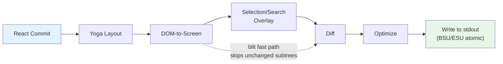
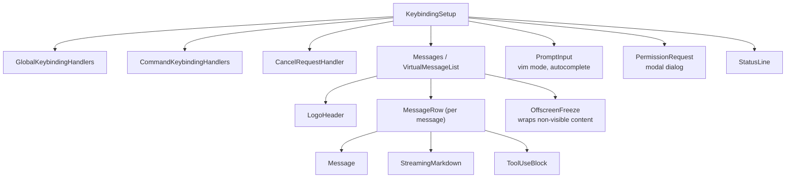

# الفصل 13: الـ Terminal UI

## ليه نبني Renderer مخصوص؟

الـ terminal مش browser. مفيش DOM، ولا CSS engine، ولا compositor، ولا retained-mode graphics pipeline. اللي موجود هو stream من الـ bytes رايح للـ stdout، و stream من الـ bytes جاي من الـ stdin. وكل حاجة بين المسارين دول لازم تتعمل من الصفر: الـ layout، والـ styling، والـ diffing، والـ hit-testing، والـ scrolling، والتحديد.

محتاج Claude Code لـ UI من نوع reactive. عنده prompt input، و streaming markdown output، و permission dialogs، و progress spinners، وقوايم رسائل بتتعمل لها scroll، وتظليل نتائج البحث، و editor بـ vim mode. React هو الاختيار الطبيعي عشان تعرّف component tree من النوع ده. لكن React محتاج host environment يعمل render فيها، والـ terminals مش بتوفر واحدة.

Ink هو الجواب المعتاد: React renderer للـ terminals، مبني على Yoga للـ flexbox layout. بدأ Claude Code بـ Ink، وبعدين عمل له fork وغيّره لدرجة إنه ماعادش شبه الأصل. النسخة الأصلية بتخصص object واحد في JavaScript لكل cell في كل frame. على terminal مقاسه 200x120، ده معناه 24,000 object بيتعملوا وبيتجمعوا بالـ garbage collector كل 16ms. وبتعمل diff على مستوى الـ string، يعني بتقارن صفوف كاملة من النص المشفّر بـ ANSI. ومفيهاش أي مفهوم لـ blit optimization، ولا double buffering، ولا cell-level dirty tracking. لو الكلام عن CLI dashboard بسيط بيتحدث مرة كل ثانية، ده كفاية. لكن لو الكلام عن LLM agent بيعمل stream للـ tokens بسرعة 60fps والمستخدم في نفس الوقت بيتحرك في محادثة فيها مئات الرسائل، ده مش هينفع من الأساس.

اللي باقي في Claude Code هو rendering engine مخصوص بيشترك مع Ink في نفس الـ DNA الفكري (React reconciler، و Yoga layout، و ANSI output)، لكنه بيعيد كتابة الـ critical path: packed typed arrays بدل object لكل cell، و pool-based string interning بدل string لكل frame، و double-buffered rendering مع cell-level diffing، و optimizer بيدمج الكتابات المتجاورة على الـ terminal في أقل عدد ممكن من الـ escape sequences.

النتيجة بتشتغل بسرعة 60fps على terminal عرضه 200 عمود، وفي نفس الوقت بتعمل stream للـ tokens الجاية من Claude. وعشان نفهم إزاي، محتاجين نبص على 4 طبقات: الـ custom DOM اللي React بيعمل عليه reconcile، والـ rendering pipeline اللي بيحوّل الـ DOM ده لـ output على الـ terminal، وإدارة الذاكرة المبنية على الـ pools اللي بتخلّي النظام عايش في sessions بتطول لساعات من غير ما يغرق في الـ garbage collection، والـ component architecture اللي بتربط كل ده ببعض.

---

## الـ Custom DOM

الـ reconciler الخاص بـ React (الجزء من React اللي بيحسب إيه اللي اتغير) محتاج حاجة يعمل عليها reconcile. في الـ browser، الحاجة دي هي الـ DOM. وفي الـ terminal الخاص بـ Claude Code، هي tree مخصوص في الذاكرة فيه 7 element types و text node type واحد.

الـ element types بتتطابق مباشرة مع مفاهيم الـ rendering في الـ terminal:

- **`ink-root`** -- جذر الـ document، واحد لكل Ink instance
- **`ink-box`** -- flexbox container، وهو المقابل في الـ terminal لـ `<div>`
- **`ink-text`** -- text node معاه measure function من Yoga لعمل word wrapping
- **`ink-virtual-text`** -- نص منسّق داخل text node تاني (بيترقّى تلقائيًا من `ink-text` لما يكون داخل text context)
- **`ink-link`** -- hyperlink، بيتعمل له render عن طريق OSC 8 escape sequences
- **`ink-progress`** -- مؤشر تقدم
- **`ink-raw-ansi`** -- محتوى ANSI معمول له render مسبقًا وأبعاده معروفة، وبيستخدم للـ code blocks اللي فيها syntax highlighting

كل `DOMElement` شايل الـ state اللي الـ rendering pipeline محتاجه:

```typescript
// Illustrative — actual interface extends this significantly
interface DOMElement {
  yogaNode: YogaNode;           // Flexbox layout node
  style: Styles;                // CSS-like properties mapped to Yoga
  attributes: Map<string, DOMNodeAttribute>;
  childNodes: (DOMElement | TextNode)[];
  dirty: boolean;               // Needs re-rendering
  _eventHandlers: EventHandlerMap; // Separated from attributes
  scrollTop: number;            // Imperative scroll state
  pendingScrollDelta: number;
  stickyScroll: boolean;
  debugOwnerChain?: string;     // React component stack for debug
}
```

فصل `_eventHandlers` عن `attributes` مقصود. في React، هوية الـ handler بتتغير مع كل render (إلا لو عملت لها memoize بنفسك). لو الـ handlers كانت متخزنة كـ attributes، كل render كان هيعلّم الـ node إنه dirty ويسبب repaint كامل. لكن لما بتتخزن لوحدها، الـ function `commitUpdate` في الـ reconciler تقدر تحدّث الـ handlers من غير ما تخلّي الـ node dirty.

الـ function `markDirty()` هي الجسر بين تعديلات الـ DOM والـ rendering pipeline. لما محتوى أي node يتغير، `markDirty()` بتمشي لفوق في كل الـ ancestors، وبتحط `dirty = true` على كل element، وبتستدعي `yogaNode.markDirty()` على الـ text nodes اللي في الأطراف. وده اللي بيخلّي تغيير حرف واحد في text node متداخل بعمق يجدول re-render للمسار كله لحد الـ root، لكن المسار ده بس. الـ sibling subtrees بتفضل clean وينفع تتنسخ بالـ blit من الـ frame اللي قبله.

الـ element type `ink-raw-ansi` يستاهل وقفة خاصة. لما code block يكون اتعمل له syntax highlighting فعلًا (وده بينتج ANSI escape sequences)، إعادة parse للـ sequences دي عشان نستخرج منها الحروف والـ styles هيبقى إهدار. بدل كده، المحتوى المظلّل مسبقًا بيتغلّف في node من نوع `ink-raw-ansi` معاه attributes اسمها `rawWidth` و `rawHeight` بتقول لـ Yoga الأبعاد بالضبط. والـ rendering pipeline بيكتب محتوى الـ ANSI الخام مباشرة في الـ output buffer من غير ما يفككه لحروف منفردة كل واحد بـ style. وده بيخلّي الـ code blocks اللي فيها syntax highlighting تكلفتها تقريبًا صفر بعد أول مرة تتظلّل: أغلى عنصر بصري في الـ UI هو كمان الأرخص في الـ render.

الـ measure function الخاصة بـ node الـ `ink-text` تستاهل نفهمها، لأنها بتشتغل داخل الـ layout pass الخاص بـ Yoga، وده synchronous وبيوقّف كل حاجة لحد ما يخلص. الـ function بتستقبل العرض المتاح ولازم ترجّع أبعاد النص. بتعمل word wrapping (مع احترام الـ style prop `wrap`: `wrap`، `truncate`، `truncate-start`، `truncate-middle`)، وبتحسب حدود الـ grapheme clusters (عشان ماتقسمش emoji مكوّن من كذا codepoint على سطرين)، وبتقيس حروف CJK اللي عرضها مزدوج بشكل صحيح (كل حرف بيتحسب عمودين)، وبتشيل الـ ANSI escape codes من حساب العرض (الـ escape sequences عرضها البصري صفر). كل ده لازم يخلص في microseconds لكل node، لأن محادثة فيها 50 text node ظاهرين معناها 50 استدعاء للـ measure function في كل layout pass.

---

## الـ React Fiber Container

الـ reconciler bridge بيستخدم `react-reconciler` عشان يعمل host config مخصوص. ودي نفس الـ API اللي React DOM و React Native بيستخدموها. الفرق الأساسي: بيشتغل Claude Code في الـ mode `ConcurrentRoot`.

```typescript
createContainer(rootNode, ConcurrentRoot, ...)
```

الـ ConcurrentRoot mode بيفعّل الميزات الـ concurrent في React: Suspense للـ syntax highlighting اللي بيتحمّل بشكل lazy، و transitions لتحديثات الـ state اللي مش بتوقّف حاجة أثناء الـ streaming. البديل، وهو `LegacyRoot`، كان هيفرض rendering من نوع synchronous ويوقّف الـ event loop أثناء إعادة parse تقيلة للـ markdown.

الـ methods الخاصة بالـ host config بتترجم عمليات React لعمليات على الـ custom DOM:

- **`createInstance(type, props)`** بتنشئ `DOMElement` عن طريق `createNode()`، وبتطبّق الـ styles والـ attributes الأولية، وبتربط الـ event handlers، وبتسجّل الـ owner chain الخاصة بالـ React component عشان نعرف ننسب أي مشكلة لصاحبها وقت الـ debug. الـ owner chain بتتخزن في `debugOwnerChain`، وبيستخدمها الـ mode `CLAUDE_CODE_DEBUG_REPAINTS` عشان ينسب أي reset للشاشة كلها لـ component معين
- **`createTextInstance(text)`** بتنشئ `TextNode`، لكن بس لو إحنا داخل text context. الـ reconciler بيفرض إن أي string خام لازم يكون متغلّف في `<Text>`. ومحاولة إنشاء text node خارج text context بترمي exception، وده بيمسك فئة كاملة من الـ bugs وقت الـ reconciliation بدل وقت الـ render
- **`commitUpdate(node, type, oldProps, newProps)`** بتعمل diff بين الـ props القديمة والجديدة بمقارنة سطحية (shallow)، وبعدين بتطبّق اللي اتغير بس. الـ styles والـ attributes والـ event handlers لكل واحد منهم مسار تحديث خاص بيه. والـ diff function بترجّع `undefined` لو مفيش حاجة اتغيرت، فبتتجنب أي تعديل على الـ DOM من الأساس
- **`removeChild(parent, child)`** بتشيل الـ node من الـ tree، وبتحرّر الـ Yoga nodes بشكل recursive (وبتستدعي `unsetMeasureFunc()` قبل `free()` عشان ماتلمسش ذاكرة WASM اتحرّرت)، وبتبلّغ الـ focus manager
- **`hideInstance(node)` / `unhideInstance(node)`** بتبدّل قيمة `isHidden` وبتنقل الـ Yoga node بين `Display.None` و `Display.Flex`. ودي آلية React لعرض الـ Suspense fallback والرجوع منه
- **`resetAfterCommit(container)`** هي الـ hook الأهم: بتستدعي `rootNode.onComputeLayout()` عشان تشغّل Yoga، وبعدين `rootNode.onRender()` عشان تجدول الـ paint على الـ terminal

الـ reconciler بيتابع عدادين للأداء في كل commit cycle: وقت الـ Yoga layout (`lastYogaMs`) والوقت الكلي للـ commit (`lastCommitMs`). الاتنين بيتجمعوا في الـ `FrameEvent` اللي الـ Ink class بيبلّغ عنه، وده بيسمح بمراقبة الأداء في الـ production.

الـ event system بيحاكي نموذج الـ capture/bubble في الـ browser. فيه class اسمه `Dispatcher` بيعمل implement لانتشار الـ events بالكامل على 3 مراحل: capture (من الـ root للـ target)، و at-target، و bubble (من الـ target للـ root). وأنواع الـ events بتتربط بأولويات الجدولة في React: discrete للكيبورد والـ click (أعلى أولوية، بتتعالج فورًا)، و continuous للـ scroll والـ resize (ممكن تتأجل). والـ dispatcher بيغلّف كل معالجة للـ events داخل `reconciler.discreteUpdates()` عشان React يعمل batching صحيح.

لما تضغط زرار في الـ terminal، الـ `KeyboardEvent` الناتج بيتعمل له dispatch عبر الـ custom DOM tree، وبيعمل bubble من الـ element اللي عليه الـ focus لحد الـ root، بالضبط زي ما keyboard event بيعمل bubble بين عناصر الـ DOM في الـ browser. وأي handler على المسار يقدر يستدعي `stopPropagation()` أو `preventDefault()`، والمعنى مطابق تمامًا لمواصفات الـ browser.

---

## الـ Rendering Pipeline

كل frame بيعدّي على 7 مراحل، وكل مرحلة بيتقاس وقتها لوحدها:



كل مرحلة بيتقاس وقتها لوحدها وبيتبلّغ عنه في `FrameEvent.phases`. القياس ده على مستوى كل مرحلة ضروري لتشخيص مشاكل الأداء: لما frame ياخد 30ms، لازم تعرف هل الـ bottleneck (عنق زجاجة) هو Yoga وهو بيعيد قياس النص (المرحلة 2)، ولا الـ renderer وهو بيمشي على dirty subtree كبير (المرحلة 3)، ولا backpressure من الـ stdout بسبب terminal بطيء (المرحلة 7). والجواب هو اللي بيحدد الحل.

**المرحلة 1: الـ React commit والـ Yoga layout.** الـ reconciler بيعالج تحديثات الـ state وبيستدعي `resetAfterCommit`. ودي بتحدد عرض الـ root node بـ `terminalColumns` وبتشغّل `yogaNode.calculateLayout()`. Yoga بيحسب الـ flexbox tree كله في pass واحد حسب مواصفات CSS flexbox: بيحل الـ flex-grow، والـ flex-shrink، والـ padding، والـ margin، والـ gap، والمحاذاة، والـ wrapping على كل الـ nodes. والنتائج (`getComputedWidth()`، `getComputedHeight()`، `getComputedLeft()`، `getComputedTop()`) بتتعمل لها cache لكل node. وبالنسبة لـ nodes الـ `ink-text`، Yoga بيستدعي الـ measure function المخصوصة (`measureTextNode`) أثناء الـ layout، ودي بتحسب أبعاد النص عن طريق الـ word wrapping وقياس الـ graphemes. ودي أغلى عملية على مستوى الـ node الواحد: لازم تتعامل مع الـ Unicode grapheme clusters، وحروف CJK مزدوجة العرض، وسلاسل الـ emoji، والـ ANSI escape codes المدفونة داخل النص.

**المرحلة 2: من الـ DOM للشاشة.** الـ renderer بيمشي على الـ DOM tree بعمق أولًا (depth-first)، وبيكتب الحروف والـ styles في buffer اسمه `Screen`. كل حرف بيتحوّل لـ packed cell. والـ output هو frame كامل: كل cell على الـ terminal ليها حرف و style وعرض محددين.

**المرحلة 3: الـ Overlay.** تحديد النص وتظليل نتائج البحث بيعدّلوا على الـ screen buffer في مكانه (in-place)، وبيقلبوا الـ style IDs على الـ cells المطابقة. التحديد بيطبّق inverse video عشان يطلّع شكل "النص المظلّل" المعروف. أما تظليل البحث فبيستخدم معالجة بصرية أقوى: inverse + foreground أصفر + bold + underline للنتيجة الحالية، و inverse بس لباقي النتائج. وده بيلوّث الـ buffer، وبيتتابع بـ flag اسمه `prevFrameContaminated` عشان الـ frame اللي بعده يعرف إنه يتخطى الـ blit fast-path. التلويث ده trade-off مقصود: التعديل في المكان بيوفّر تخصيص overlay buffer منفصل (يعني توفير 48KB على terminal مقاسه 200x120)، والثمن هو frame واحد بـ full damage بعد ما الـ overlay يتشال.

**المرحلة 4: الـ Diff.** الشاشة الجديدة بتتقارن cell بـ cell مع شاشة الـ front frame. والـ cells اللي اتغيرت هي بس اللي بتنتج output. المقارنة عبارة عن مقارنتين بين أرقام صحيحة لكل cell (الـ 2 packed `Int32` words)، والـ diff بيمشي على الـ damage rectangle بس مش الشاشة كلها. في frame مستقر (spinner بس هو اللي بيتحرك)، ده ممكن ينتج patches لـ 3 cells من أصل 24,000. وكل patch عبارة عن object على شكل `{ type: 'stdout', content: string }` فيه sequence تحريك الـ cursor ومحتوى الـ cell مشفّر بـ ANSI.

**المرحلة 5: الـ Optimize.** الـ patches المتجاورة في نفس الصف بتتدمج في كتابة واحدة. وتحريكات الـ cursor الزيادة بتتشال: لو الـ patch رقم N بينتهي عند العمود 10 والـ patch رقم N+1 بيبدأ عند العمود 11، الـ cursor أصلًا في المكان الصح ومفيش داعي لـ sequence تحريك. وانتقالات الـ style بتتعمل لها serialize مسبقًا عن طريق الـ cache في `StylePool.transition()`، فالتغيير من "bold red" لـ "dim green" عبارة عن lookup واحد لـ string متخزن، مش عملية diff و serialize. والـ optimizer عادةً بيقلل عدد الـ bytes بنسبة 30-50% مقارنة بالـ output الساذج cell بـ cell.

**المرحلة 6: الكتابة.** الـ patches بعد التحسين بتتحوّل لـ ANSI escape sequences وبتتكتب على الـ stdout في استدعاء `write()` واحد، ومتغلّفة بعلامات الـ synchronized update (BSU/ESU) على الـ terminals اللي بتدعمها. الـ BSU (Begin Synchronized Update، `ESC [ ? 2026 h`) بيقول للـ terminal يخزّن كل الـ output اللي جاي في buffer، والـ ESU (`ESC [ ? 2026 l`) بيقول له يعمل flush. وده بيشيل الـ tearing الظاهر على الـ terminals اللي بتدعم البروتوكول: الـ frame كله بيظهر مرة واحدة (atomic).

كل frame بيبلّغ عن تفاصيل توقيته عن طريق object من نوع `FrameEvent`:

```typescript
interface FrameEvent {
  durationMs: number;
  phases: {
    renderer: number;    // DOM-to-screen
    diff: number;        // Screen comparison
    optimize: number;    // Patch merging
    write: number;       // stdout write
    yoga: number;        // Layout computation
  };
  yogaVisited: number;   // Nodes traversed
  yogaMeasured: number;  // Nodes that ran measure()
  yogaCacheHits: number; // Nodes with cached layout
  flickers: FlickerEvent[];  // Full-reset attributions
}
```

لما `CLAUDE_CODE_DEBUG_REPAINTS` يكون مفعّل، أي reset للشاشة كلها بيتنسب للـ React component اللي سببه عن طريق `findOwnerChainAtRow()`. وده المقابل في الـ terminal لخيار "Highlight Updates" في React DevTools: بيوريك أي component خلّى الشاشة كلها تتعمل لها repaint، وده أغلى حاجة ممكن تحصل في الـ rendering pipeline.

الـ blit optimization يستاهل اهتمام خاص. لما node يكون مش dirty ومكانه ماتغيرش من الـ frame السابق (وده بيتفحص عن طريق node cache)، الـ renderer بينسخ الـ cells مباشرة من `prevScreen` للشاشة الحالية بدل ما يعيد render للـ subtree. وده بيخلّي الـ frames المستقرة رخيصة جدًا: في frame عادي مفيهوش غير spinner بيتحرك، الـ blit بيغطي 99% من الشاشة، والـ 3-4 cells الخاصة بالـ spinner هي بس اللي بتتعمل لها render من الصفر.

الـ blit بيتعطّل في 3 حالات:

1. **لما `prevFrameContaminated` تكون true** -- الـ selection overlay أو تظليل البحث عدّل على الـ screen buffer الخاص بالـ front frame في مكانه، فالـ cells دي ماينفعش نثق فيها كـ state سابق "صحيح"
2. **لما node بـ absolute positioning يتشال** -- الـ absolute positioning معناه إن الـ node كان ممكن يرسم فوق cells تابعة لـ nodes مش من الـ siblings الخاصين بيه، والـ cells دي محتاجة تتعمل لها render تاني من الـ elements اللي بتملكها فعليًا
3. **لما الـ layout يتحرك** -- أي node مكانه المتخزن في الـ cache مختلف عن مكانه المحسوب حاليًا، وده معناه إن الـ blit هينسخ الـ cells لإحداثيات غلط

الـ damage rectangle (`screen.damage`) بيتابع الـ bounding box لكل الـ cells اللي اتكتبت أثناء الـ rendering. والـ diff بيفحص الصفوف اللي داخل المستطيل ده بس، وبيتخطى المناطق اللي ماتغيرتش بالكامل. على terminal فيه 120 صف ورسالة بتعمل streaming بتحتل الصفوف من 80 لـ 100، الـ diff بيفحص 20 صف بدل 120: يعني شغل المقارنة قل 6 مرات.

---

## الـ Double-Buffer Rendering وجدولة الـ Frames

الـ Ink class بيحتفظ بـ 2 frame buffers:

```typescript
private frontFrame: Frame;  // Currently displayed on terminal
private backFrame: Frame;   // Being rendered into
```

كل `Frame` فيه:

- `screen: Screen` -- الـ cell buffer (عبارة عن `Int32Array` مضغوط)
- `viewport: Size` -- أبعاد الـ terminal وقت الـ render
- `cursor: { x, y, visible }` -- المكان اللي الـ cursor الخاص بالـ terminal هيتوقف فيه
- `scrollHint` -- تلميح تحسين خاص بـ DECSTBM (منطقة الـ scroll) للـ alt-screen mode
- `scrollDrainPending` -- هل فيه ScrollBox ما زال عنده scroll delta محتاج معالجة

بعد كل render، الـ frames بتتبدّل: `backFrame = frontFrame; frontFrame = newFrame`. الـ front frame القديم بيبقى هو الـ back frame الجاي، وده اللي بيوفّر الـ `prevScreen` للـ blit optimization والأساس اللي بيتعمل عليه الـ cell-level diffing.

تصميم الـ double-buffer ده (بيرسم في buffer خلفي وبعدين يبدّل) بيلغي التخصيص (allocation) من الأساس. بدل إنشاء `Screen` جديد في كل frame، الـ renderer بيعيد استخدام الـ buffer الخاص بالـ back frame. والتبديل عبارة عن إسناد pointer. الـ pattern ده مستعار من برمجة الجرافيكس، اللي فيها الـ double buffering بيمنع الـ tearing عن طريق ضمان إن الشاشة بتقرأ من frame كامل بينما الـ renderer بيكتب في التاني. في سياق الـ terminal، الـ tearing مش هو القلق (بروتوكول BSU/ESU بيتكفّل بيه). القلق هو الضغط على الـ GC بسبب تخصيص ورمي objects من نوع `Screen` فيها 48KB+ من الـ typed arrays كل 16ms.

جدولة الـ render بتستخدم `throttle` من lodash على 16ms (تقريبًا 60fps)، مع تفعيل الـ leading والـ trailing edges:

```typescript
const deferredRender = () => queueMicrotask(this.onRender);
this.scheduleRender = throttle(deferredRender, FRAME_INTERVAL_MS, {
  leading: true,
  trailing: true,
});
```

التأجيل عن طريق microtask مش صدفة. الـ function `resetAfterCommit` بتشتغل قبل مرحلة الـ layout effects في React. لو الـ renderer اشتغل بشكل synchronous هنا، كان هيفوّت إعلانات الـ cursor اللي بتتحدد في `useLayoutEffect`. الـ microtask بيشتغل بعد الـ layout effects لكن داخل نفس الـ tick في الـ event loop، فالـ terminal بيشوف frame واحد متسق.

بالنسبة لعمليات الـ scroll، فيه `setTimeout` منفصل على 4ms (يعني FRAME_INTERVAL_MS >> 2) بيوفّر scroll frames أسرع من غير ما يتعارض مع الـ throttle. وتعديلات الـ scroll بتتخطى React بالكامل: `ScrollBox.scrollBy()` بتعدّل خصائص الـ DOM node مباشرة، وبتستدعي `markDirty()`، وبتجدول render عن طريق microtask. مفيش تحديث لـ React state، ولا overhead للـ reconciliation، ولا re-render لقائمة الرسائل كلها بسبب حركة واحدة من عجلة الماوس.

**التعامل مع الـ resize** بيحصل بشكل synchronous، من غير debounce. لما الـ terminal يتغير حجمه، `handleResize` بتحدّث الأبعاد فورًا عشان الـ layout يفضل متسق. وفي الـ alt-screen mode، بتعمل reset للـ frame buffers وبتأجّل الـ `ERASE_SCREEN` لداخل الـ BSU/ESU paint block الـ atomic اللي بعده، بدل ما تكتبه فورًا. كتابة المسح بشكل synchronous كانت هتسيب الشاشة فاضية طول الـ ~80ms اللي الـ render بياخدها. أما تأجيله لداخل الـ block الـ atomic فمعناه إن المحتوى القديم بيفضل ظاهر لحد ما الـ frame الجديد يجهز بالكامل.

**إدارة الـ alt-screen** بتضيف طبقة تانية. الـ component `AlternateScreen` بيدخل على الـ alternate screen buffer الخاص بـ DEC 1049 وقت الـ mount، وبيقيّد الارتفاع بعدد صفوف الـ terminal. وبيستخدم `useInsertionEffect`، مش `useLayoutEffect`، عشان يضمن إن الـ escape sequence `ENTER_ALT_SCREEN` توصل للـ terminal قبل أول render frame. استخدام `useLayoutEffect` كان هيبقى متأخر: أول frame كان هيتعمل له render على الـ main screen buffer، وده هيطلّع flash ظاهر قبل التبديل. أما `useInsertionEffect` فبيشتغل قبل الـ layout effects وقبل ما الـ browser (أو الـ terminal) يرسم، وده بيخلّي الانتقال سلس.

---

## الـ Pool-Based Memory: ليه الـ Interning مهم

الـ terminal اللي عرضه 200 عمود وارتفاعه 120 صف فيه 24,000 cell. لو كل cell كانت JavaScript object فيه string للـ `char`، و string للـ `style`، و string للـ `hyperlink`، ده معناه 72,000 تخصيص لـ strings في كل frame، زائد 24,000 تخصيص لـ objects للـ cells نفسها. وعلى 60fps، ده 5.76 مليون تخصيص في الثانية. الـ garbage collector في V8 يقدر يتحمّل ده، لكن مش من غير توقفات بتظهر على شكل frames ساقطة. توقفات الـ GC عادةً من 1 لـ 5ms، لكنها غير متوقعة: ممكن تيجي في نص تحديث لـ token بيتعمل له streaming، فتسبب تقطيع ظاهر بالضبط في اللحظة اللي المستخدم بيتفرج فيها على الـ output.

بيلغي Claude Code ده بالكامل بـ packed typed arrays و 3 interning pools (يعني تخزين كل string مرة واحدة وإعادة استخدامها بالـ index). النتيجة: صفر تخصيص لـ objects في كل frame للـ cell buffer. التخصيصات الوحيدة هي داخل الـ pools نفسها (وتكلفتها بتتوزع مع الوقت، لأن أغلب الحروف والـ styles بتتعمل لها intern في أول frame وبتتعاد استخدامها بعد كده) وفي الـ patch strings اللي الـ diff بينتجها (ودي مفيش منها مفر، لأن stdout.write محتاج string أو Buffer كـ argument).

**تخطيط الـ cell** بيستخدم 2 `Int32` words لكل cell، متخزنة في `Int32Array` واحد متجاور:

```
word0: charId        (32 bits, index into CharPool)
word1: styleId[31:17] | hyperlinkId[16:2] | width[1:0]
```

وفيه view موازي من نوع `BigInt64Array` على نفس الـ buffer بيسمح بعمليات جماعية: مسح صف كامل عبارة عن استدعاء `fill()` واحد على words بحجم 64-bit بدل تصفير كل field لوحده.

**CharPool** بيعمل intern للـ character strings لـ integer IDs. وعنده fast path للـ ASCII: `Int32Array` فيه 128 خانة بيربط أكواد الحروف مباشرة بالـ indexes في الـ pool، وبيتجنب البحث في الـ `Map` تمامًا. أما الحروف متعددة الـ bytes (الـ emoji، ورموز CJK) فبتروح لـ `Map<string, number>`. الـ index 0 دائمًا المسافة، والـ index 1 دائمًا الـ string الفاضي.

```typescript
export class CharPool {
  private strings: string[] = [' ', '']
  private ascii: Int32Array = initCharAscii()

  intern(char: string): number {
    if (char.length === 1) {
      const code = char.charCodeAt(0)
      if (code < 128) {
        const cached = this.ascii[code]!
        if (cached !== -1) return cached
        const index = this.strings.length
        this.strings.push(char)
        this.ascii[code] = index
        return index
      }
    }
    // Map fallback for multi-byte characters
    ...
  }
}
```

**StylePool** بيعمل intern لـ arrays من أكواد الـ ANSI styles لـ integer IDs. والجزء الذكي: الـ bit رقم 0 في كل ID بيشفّر هل الـ style ليه تأثير ظاهر على حروف المسافة (لون خلفية، أو inverse، أو underline) ولا لأ. الـ styles اللي بتأثر على الـ foreground بس بتاخد IDs زوجية، والـ styles اللي بتبان على المسافات بتاخد IDs فردية. وده بيسمح للـ renderer يتخطى المسافات غير الظاهرة بفحص bitmask واحد، وهو `if (!(styleId & 1) && charId === 0) continue`، من غير ما يبحث عن تعريف الـ style. والـ pool كمان بيعمل cache لـ strings انتقالات ANSI معمولة serialize مسبقًا بين أي 2 style IDs، فالانتقال من "bold red" لـ "dim green" عبارة عن string متخزن جاهز بيتضاف للـ output، مش عملية diff و serialize.

**HyperlinkPool** بيعمل intern لعناوين الـ OSC 8 hyperlinks. الـ index 0 معناه مفيش hyperlink.

الـ 3 pools مشتركة بين الـ front والـ back frames. وده قرار تصميم حاسم. لأن الـ pools مشتركة، الـ IDs اللي اتعمل لها intern صالحة عبر الـ frames: الـ blit optimization يقدر ينسخ الـ packed cell words مباشرة من `prevScreen` للشاشة الحالية من غير إعادة intern. والـ diff يقدر يقارن الـ IDs كأرقام صحيحة من غير بحث في strings. لو كل frame كان له pools خاصة بيه، الـ blit كان هيحتاج يعيد intern لكل cell بينسخها (يجيب الـ string بالـ ID القديم، وبعدين يعمل له intern في الـ pool الجديد)، وده كان هيضيّع أغلب فايدة الـ blit في الأداء.

الـ pools بتتعمل لها reset بشكل دوري (كل 5 دقايق) عشان ماتكبرش من غير حدود في الـ sessions الطويلة. وفيه migration pass بيعيد intern للـ cells الحية في الـ front frame داخل الـ pools الجديدة.

**CellWidth** بيتعامل مع الحروف مزدوجة العرض بتصنيف من 2 bits:

| القيمة | المعنى |
|-------|---------|
| 0 (Narrow) | حرف عادي بعرض عمود واحد |
| 1 (Wide) | الـ head cell لحرف CJK/emoji، بيحتل عمودين |
| 2 (SpacerTail) | العمود التاني من حرف عريض |
| 3 (SpacerHead) | علامة استمرار الـ soft-wrap |

وده متخزن في أقل 2 bits من `word1`، وده بيخلّي فحص العرض على الـ packed cells ببلاش: مفيش داعي لاستخراج field في الحالة الشائعة.

الـ metadata الإضافية لكل cell عايشة في arrays موازية بدل الـ packed cells:

- **`noSelect: Uint8Array`** -- flag لكل cell بيستثني المحتوى من تحديد النص. بيستخدم لعناصر الـ UI الثابتة (الحدود، والمؤشرات) اللي مش المفروض تظهر في النص المنسوخ
- **`softWrap: Int32Array`** -- علامة لكل صف بتوضح إنه استمرار لـ word-wrap. لما المستخدم يحدد نص عابر لسطر اتعمل له soft-wrap، منطق التحديد بيعرف إنه مايحطش newline عند نقطة الـ wrap
- **`damage: Rectangle`** -- الـ bounding box لكل الـ cells اللي اتكتبت في الـ frame الحالي. الـ diff بيفحص الصفوف اللي داخل المستطيل ده بس، وبيتخطى المناطق اللي ماتغيرتش بالكامل

الـ arrays الموازية دي بتتجنب توسيع صيغة الـ packed cell (وده كان هيزوّد الضغط على الـ cache في الـ inner loop الخاص بالـ diff)، وفي نفس الوقت بتوفّر الـ metadata اللي التحديد والنسخ والتحسين محتاجينها.

الـ `Screen` كمان بيوفّر factory اسمها `createScreen()` بتاخد الأبعاد و references للـ pools. إنشاء الشاشة بيصفّر الـ `Int32Array` عن طريق `fill(0n)` على الـ view من نوع `BigInt64Array`: استدعاء native واحد بيمسح الـ buffer كله في microseconds. وده بيستخدم أثناء الـ resize (لما نحتاج frame buffers جديدة) وأثناء migration الـ pools (لما الـ cells في الشاشة القديمة بتتعمل لها intern تاني في pools جديدة).

---

## الـ REPL Component

الـ REPL (`REPL.tsx`) حجمه تقريبًا 5,000 سطر. وهو أكبر component منفرد في الـ codebase، ولسبب مقنع: هو الـ orchestrator للتجربة التفاعلية كلها. كل حاجة بتعدّي من خلاله.

الـ component منظّم في حوالي 9 أقسام:

1. **الـ Imports** (~100 سطر) -- بتجيب الـ bootstrap state، والأوامر، والـ history، والـ hooks، والـ components، والـ keybindings، وتتبّع التكلفة، والإشعارات، ودعم الـ swarm/team، وتكامل الصوت
2. **الـ imports المعتمدة على feature flags** -- تحميل شرطي لتكامل الصوت، والـ proactive mode، والـ brief tool، والـ coordinator agent عن طريق شروط `feature()` مع `require()`
3. **إدارة الـ state** -- استدعاءات `useState` كثيرة بتغطي الرسائل، والـ input mode، والصلاحيات المعلّقة، والـ dialogs، وحدود التكلفة، والـ session state، والـ tool state، والـ agent state
4. **الـ QueryGuard** -- بيدير دورة حياة الـ API call النشط، وبيمنع الـ requests المتزامنة إنها تتداخل مع بعض
5. **معالجة الرسائل** -- بيعالج الرسائل الجاية من الـ query loop، وبيوحّد ترتيبها، وبيدير الـ streaming state
6. **الـ tool permission flow** -- بينسّق طلبات الصلاحيات بين الـ tool use blocks والـ dialog الخاص بـ PermissionRequest
7. **إدارة الـ session** -- استكمال المحادثات، والتبديل بينها، وتصديرها
8. **إعداد الـ keybindings** -- بيوصّل الـ keybinding providers: `KeybindingSetup`، و `GlobalKeybindingHandlers`، و `CommandKeybindingHandlers`
9. **الـ render tree** -- بيجمّع الـ UI النهائي من كل اللي فوق

والـ render tree الخاص بيه بيجمّع الـ interface كاملة في الـ fullscreen mode:



الـ component `OffscreenFreeze` عبارة عن تحسين للأداء خاص بالـ rendering في الـ terminal. لما رسالة تتحرك لفوق خارج الـ viewport، الـ React element الخاص بيها بيتعمل له cache والـ subtree الخاص بيها بيتجمّد. وده بيمنع التحديثات المعتمدة على timers (الـ spinners، وعدادات الوقت المنقضي) في الرسائل اللي خارج الشاشة من إنها تسبب resets للـ terminal. من غير ده، مؤشر بيلف في الرسالة رقم 3 كان هيسبب repaint كامل رغم إن المستخدم بيبص على الرسالة رقم 47.

الـ component كله بيتعمل له compile بالـ React Compiler. بدل `useMemo` و `useCallback` اليدويين، الـ compiler بيحقن memoization على مستوى كل expression باستخدام slot arrays:

```typescript
const $ = _c(14);  // 14 memoization slots
let t0;
if ($[0] !== dep1 || $[1] !== dep2) {
  t0 = expensiveComputation(dep1, dep2);
  $[0] = dep1; $[1] = dep2; $[2] = t0;
} else {
  t0 = $[2];
}
```

الـ pattern ده موجود في كل component في الـ codebase. وبيوفّر دقة أعلى من `useMemo` (اللي بيعمل memoize على مستوى الـ hook): كل expression لوحده داخل الـ render function بياخد تتبّع اعتماديات و cache خاصين بيه. وفي component من 5,000 سطر زي الـ REPL، ده بيلغي مئات العمليات الحسابية المتكررة اللي كانت ممكن تحصل بلا داعي في كل render.

---

## التحديد وتظليل نتائج البحث

تحديد النص وتظليل نتائج البحث بيشتغلوا كـ overlays على الـ screen buffer، بيتطبّقوا بعد الـ render الأساسي وقبل الـ diff.

**تحديد النص** شغال في الـ alt-screen بس. الـ Ink instance بيحتفظ بـ `SelectionState` بيتابع نقطتي الـ anchor والـ focus، والـ drag mode (حرف/كلمة/سطر)، والصفوف المحفوظة اللي اتحركت خارج الشاشة. لما المستخدم يضغط ويسحب، الـ selection handler بيحدّث الإحداثيات دي. وأثناء `onRender`، الـ function `applySelectionOverlay` بتمشي على الصفوف المتأثرة وبتعدّل الـ style IDs الخاصة بالـ cells في مكانها باستخدام `StylePool.withSelectionBg()`، اللي بترجّع style ID جديد مضاف له inverse video. التعديل المباشر ده على الـ screen buffer هو سبب وجود الـ flag `prevFrameContaminated`: الـ buffer الخاص بالـ front frame اتعدّل بالـ overlay، فالـ frame اللي بعده ماينفعش يثق فيه للـ blit optimization ولازم يعمل diff بـ full damage.

تتبّع الماوس بيستخدم الـ mode SGR 1003، اللي بيبلّغ عن الضغطات والسحب والحركة بإحداثيات عمود/صف. والـ component `App` بيعمل implement لاكتشاف الضغطات المتعددة: الضغط المزدوج بيحدد كلمة، والضغط الثلاثي بيحدد سطر. الاكتشاف بيستخدم timeout قيمته 500ms وتسامح في الموقع بمقدار cell واحدة (الماوس يقدر يتحرك cell واحدة بين الضغطتين من غير ما يتصفّر عداد الضغطات المتعددة). والضغط على الـ hyperlinks بيتأجل عمدًا بنفس الـ timeout ده: الضغط المزدوج على link بيحدد الكلمة بدل ما يفتح الـ browser، وده مطابق للسلوك اللي المستخدمين متعودين عليه من محررات النصوص.

وفيه آلية استرداد لحالة "الإفلات الضايع" بتتعامل مع الحالة اللي المستخدم فيها بيبدأ سحب داخل الـ terminal، ويحرّك الماوس خارج النافذة، ويسيب الزرار هناك. الـ terminal بيبلّغ عن الضغط وعن السحب، لكن مش عن الإفلات (لأنه حصل خارج نافذته). من غير استرداد، التحديد كان هيفضل عالق في الـ drag mode للأبد. الاسترداد بيشتغل عن طريق اكتشاف events حركة الماوس من غير أي زرار مضغوط: لو إحنا في حالة سحب واستقبلنا event حركة من غير زرار، بنستنتج إن الزرار اتساب خارج النافذة وبننهي التحديد.

**تظليل نتائج البحث** ليه آليتين شغالين بالتوازي. المسار المعتمد على المسح (`applySearchHighlight`) بيمشي على الـ cells الظاهرة وبيدوّر على نص البحث، وبيطبّق SGR inverse styling. والمسار المعتمد على المواقع بيستخدم `MatchPosition[]` محسوبة مسبقًا من `scanElementSubtree()`، ومتخزنة بالنسبة للرسالة، وبيطبّقها عند offsets معروفة مع تظليل أصفر لـ "النتيجة الحالية" باستخدام أكواد ANSI متراكبة (inverse + foreground أصفر + bold + underline). الـ foreground الأصفر مع الـ inverse بيتحوّل لخلفية صفرا، لأن الـ terminal بيبدّل الـ fg/bg لما الـ inverse يكون مفعّل. والـ underline هو علامة الظهور الاحتياطية للـ themes اللي الأصفر فيها بيتعارض مع ألوان الخلفية الموجودة.

**إعلان الـ cursor** بيحل مشكلة دقيقة. محاكيات الـ terminal بتعرض نص الـ preedit الخاص بالـ IME (Input Method Editor) عند موقع الـ cursor الفعلي. ومستخدمي CJK وهم بيكتبوا الحروف محتاجين الـ cursor يكون عند موضع الكتابة في الـ text input، مش في آخر الشاشة اللي الـ terminal كان هيحطه فيها بشكل طبيعي. الـ hook `useDeclaredCursor` بيسمح لأي component يعلن الـ cursor المفروض يكون فين بعد كل frame. والـ Ink class بيقرأ موقع الـ node اللي اتعلن عنه من `nodeCache`، وبيحوّله لإحداثيات على الشاشة، وبيطلّع sequences تحريك الـ cursor بعد الـ diff. وقارئات الشاشة والمكبّرات كمان بتتابع الـ cursor الفعلي، فالآلية دي بتفيد إمكانية الوصول (accessibility) زي ما بتفيد إدخال CJK.

في الـ main-screen mode، موقع الـ cursor اللي اتعلن عنه بيتتابع بشكل منفصل عن `frame.cursor`. وده لازم يفضل في آخر المحتوى عشان الـ invariants الخاصة بالحركة النسبية في الـ log-update. وفي الـ alt-screen mode، المشكلة أبسط: كل frame بيبدأ بـ `CSI H` (رجوع الـ cursor للبداية)، فالـ cursor اللي اتعلن عنه مجرد موقع مطلق بيتطلّع في آخر الـ frame.

---

## الـ Streaming Markdown

عمل render لـ output الـ LLM هو أصعب مهمة بتواجه الـ terminal UI. الـ tokens بتوصل واحد واحد، من 10 لـ 50 في الثانية، وكل واحد بيغيّر محتوى رسالة ممكن تكون فيها code blocks وقوايم ونص bold و inline code. الطريقة الساذجة، يعني إعادة parse للرسالة كلها مع كل token، كانت هتبقى كارثية لما الرسالة تكبر.

بيستخدم Claude Code 3 تحسينات:

**الـ Token caching.** فيه LRU cache على مستوى الـ module (500 خانة) بيخزّن نتائج `marked.lexer()` بمفتاح هو hash المحتوى. والـ cache بيعيش بعد دورات الـ unmount/remount في React أثناء الـ virtual scrolling (بيرسم بس الجزء الظاهر على الشاشة). لما المستخدم يرجع بالـ scroll لرسالة كانت ظاهرة قبل كده، الـ markdown tokens بتتقدّم من الـ cache بدل إعادة الـ parse.

**اكتشاف الـ fast path.** الـ function `hasMarkdownSyntax()` بتفحص أول 500 حرف بحثًا عن علامات markdown عن طريق regex واحد. لو مالقتش أي syntax، بتبني token واحد من نوع paragraph مباشرة، وبتتخطى الـ GFM parser الكامل. وده بيوفّر تقريبًا 3ms في كل render للرسائل النصية العادية، وده فرق مهم لما تكون بترسم 60 frame في الثانية.

**الـ syntax highlighting بشكل lazy.** تظليل الـ code blocks بيتحمّل عن طريق `Suspense` في React. الـ component `MarkdownBody` بيعمل render فورًا بـ `highlight={null}` كـ fallback، وبعدين بيعمل resolve بشكل asynchronous مع الـ instance الخاص بـ cli-highlight. المستخدم بيشوف الكود فورًا (من غير تنسيق)، وبعدين بيتلوّن بعد frame أو اتنين.

حالة الـ streaming بتضيف تعقيد صغير. لما الـ tokens توصل من الـ model، محتوى الـ markdown بيكبر تدريجيًا. إعادة parse للمحتوى كله مع كل token كانت هتبقى O(n^2) على مدار الرسالة. اكتشاف الـ fast path بيساعد (أغلب محتوى الـ streaming عبارة عن paragraphs نصية عادية بتتخطى الـ parser تمامًا)، لكن للرسائل اللي فيها code blocks وقوايم، الـ LRU cache هو اللي بيقدّم التحسين الحقيقي. مفتاح الـ cache هو hash المحتوى، فلما 10 tokens توصل وآخر paragraph بس هو اللي اتغير، نتيجة الـ parse المتخزنة للـ prefix اللي ماتغيرش بتتعاد استخدامها. والـ markdown renderer بيعيد parse للجزء الأخير اللي اتغير بس.

الـ component `StreamingMarkdown` مختلف عن الـ component الثابت `Markdown`. هو بيتعامل مع الحالة اللي المحتوى فيها ما زال بيتولّد: code fences ناقصة (` ``` ` من غير fence يقفلها)، وعلامات bold ناقصة، وعناصر قوايم مقطوعة. النسخة الـ streaming أكثر تسامحًا في الـ parsing: مش بتطلّع خطأ على syntax مش مقفول، لأن الـ syntax اللي بيقفله ماوصلش بعد. لما الرسالة تخلّص streaming، الـ component بينتقل للـ renderer الثابت `Markdown`، اللي بيطبّق GFM parsing كامل مع فحص صارم للـ syntax.

الـ syntax highlighting للـ code blocks هو أغلى عملية على مستوى العنصر الواحد في الـ rendering pipeline. الـ code block اللي فيه 100 سطر ممكن ياخد من 50 لـ 100ms عشان يتظلّل بـ cli-highlight. وتحميل مكتبة التظليل نفسها بياخد من 200 لـ 300ms (لأنها بتشمل تعريفات grammar لعشرات اللغات). والتكلفتين مخبيين ورا `Suspense` في React: الـ code block بيتعمل له render فورًا كنص عادي، ومكتبة التظليل بتتحمّل بشكل asynchronous، ولما تجهز، الـ code block بيتعمل له re-render بالألوان. المستخدم بيشوف الكود فورًا والألوان بعدها بلحظة، ودي تجربة أحسن بكثير من frame فاضي لمدة 300ms أثناء تحميل المكتبة.

---

## طبّق ده: عمل Render للـ Streaming Output بكفاءة

الـ rendering pipeline الخاص بالـ terminal دراسة حالة في إلغاء الشغل. فيه 3 مبادئ بتقود التصميم:

**اعمل intern لكل حاجة.** لو عندك قيمة بتتكرر في آلاف الـ cells (style، أو حرف، أو URL)، خزّنها مرة واحدة وأشّر لها بـ integer ID. مقارنة الـ integers عبارة عن تعليمة CPU واحدة. أما مقارنة الـ strings فعبارة عن loop. لما الـ inner loop عندك بيشتغل 24,000 مرة في كل frame على 60fps، الفرق بين `===` على integers و `===` على strings هو الفرق بين scroll سلس و lag ظاهر.

**اعمل diff على المستوى الصح.** الـ cell-level diffing شكله مكلّف: 24,000 مقارنة في كل frame. لكنه في الحقيقة مقارنتين بين integers لكل cell (الـ packed words)، وفي frame مستقر، الـ diff بيخرج من أغلب الصفوف بعد فحص أول cell. البديل، وهو إعادة render للشاشة كلها وكتابتها على الـ stdout، كان هينتج 100KB+ من الـ ANSI escape sequences في كل frame. الـ diff عادةً بينتج أقل من 1KB.

**افصل الـ hot path عن React.** الـ scroll events بتوصل بتردد إدخال الماوس (ممكن توصل لمئات في الثانية). تمرير كل واحد منها عبر الـ reconciler الخاص بـ React (تحديث state، و reconciliation، و commit، و layout، و render) بيضيف من 5 لـ 10ms من الـ latency (زمن الاستجابة) لكل event. وبتعديل الـ DOM nodes مباشرة وجدولة الـ renders عن طريق microtask، مسار الـ scroll بيفضل تحت 1ms. و React مش بيتدخل غير في الـ paint النهائي، اللي كان هيشتغل فيه على أي حال.

المبادئ دي بتنطبق على أي نظام streaming output، مش الـ terminals بس. لو بتبني web application بتعرض بيانات في الوقت الحقيقي (log viewer، أو chat client، أو monitoring dashboard)، نفس الـ trade-offs بتنطبق. اعمل intern للقيم المتكررة. اعمل diff مع الـ frame السابق. وخلّي الـ hot path بعيد عن الـ reactive framework الخاص بيك.

وفيه مبدأ رابع خاص بالـ sessions الطويلة: **نظّف بشكل دوري.** الـ pools في Claude Code بتكبر بشكل مستمر مع كل حرف أو style جديد بيتعمل له intern. وعلى مدار session بتطول لساعات، الـ pools ممكن تجمّع آلاف الخانات اللي مابقى فيه أي cell حية بتشير لها. دورة الـ reset كل 5 دقايق بتحد النمو ده: كل 5 دقايق، بتتعمل pools جديدة، والـ cells الخاصة بالـ front frame بتتنقل (بيتعمل لها intern تاني في الـ pools الجديدة)، والـ pools القديمة بتبقى garbage. ودي استراتيجية generational collection، لكن مطبّقة على مستوى التطبيق، لأن الـ GC الخاص بـ JavaScript ماعندوش طريقة يعرف بيها إذا كانت خانة في الـ pool ما زالت مستخدمة فعليًا ولا لأ.

قرار استخدام `Int32Array` بدل الـ objects العادية ليه فايدة أدق من مجرد تقليل الضغط على الـ GC: الـ memory locality. لما الـ diff يقارن 24,000 cell، هو بيمشي على typed array متجاور في الذاكرة. والمعالجات الحديثة بتعمل prefetch للوصول المتتابع للذاكرة، فمقارنة الشاشة كلها بتتم داخل الـ L1/L2 cache. أما تخطيط object لكل cell فكان هيبعتر الـ cells في الـ heap، ويحوّل كل مقارنة لـ cache miss. وفرق الأداء قابل للقياس: على شاشة 200x120، الـ diff بالـ typed array بيخلص في أقل من 0.5ms، بينما diff مكافئ بالـ objects بياخد من 3 لـ 5ms، وده كفاية إنه يتجاوز ميزانية الـ frame اللي هي 16ms لما يتجمع مع باقي مراحل الـ pipeline.

وفيه مبدأ خامس بينطبق على أي نظام بيرسم في grid ثابتة الحجم: **تابع حدود الـ damage.** الـ damage rectangle على كل شاشة بيسجّل الـ bounding box للـ cells اللي اتكتبت أثناء الـ rendering. والـ diff بيرجع للمستطيل ده وبيتخطى الصفوف اللي خارجه تمامًا. لما رسالة بتعمل streaming بتحتل آخر 20 صف من terminal فيه 120 صف، الـ diff بيفحص 20 صف، مش 120. ومع الـ blit optimization (اللي بيملي الـ damage rectangle بالمناطق اللي اتعمل لها render تاني بس، مش اللي اتنسخت بالـ blit)، ده معناه إن الحالة الشائعة، يعني رسالة واحدة بتعمل streaming وباقي المحادثة ثابت، بتلمس جزء صغير من الـ screen buffer.

الدرس الأكبر: الأداء في نظام rendering مش موضوعه إنك تخلّي عملية معينة سريعة. موضوعه إنك تلغي عمليات بالكامل. الـ blit بيلغي إعادة الـ render. والـ damage rectangle بيلغي الـ diffing. ومشاركة الـ pools بتلغي إعادة الـ interning. والـ packed cells بتلغي الـ allocation. كل تحسين بيشيل فئة كاملة من الشغل، والتحسينات دي بتتراكب فوق بعض بشكل تضاعفي.

وبالأرقام: أسوأ frame ممكن (كل حاجة dirty، ومفيش blit، و damage للشاشة كلها) على terminal مقاسه 200x120 بياخد تقريبًا 12ms. وأحسن frame ممكن (node واحد dirty، و blit لكل حاجة تانية، و damage rectangle من 3 صفوف) بياخد أقل من 1ms. والنظام بيقضي أغلب وقته في الحالة الأحسن. وصول token في الـ streaming بيخلّي text node واحد dirty، وده بيخلّي الـ ancestors الخاصين بيه dirty لحد الـ message container، اللي عادةً بيحتل من 10 لـ 30 صف من الشاشة. والـ blit بيتكفّل بالـ 90-110 صف الباقيين. والـ damage rectangle بيقيّد الـ diff على المنطقة الـ dirty. وعمليات البحث في الـ pools عبارة عن عمليات على integers. والتكلفة المستقرة لعمل streaming لـ token واحد بيغلب عليها الـ Yoga layout (اللي بيعيد قياس الـ text node الـ dirty والـ ancestors الخاصين بيه) وإعادة parse للـ markdown، مش الـ rendering pipeline نفسه.


---


