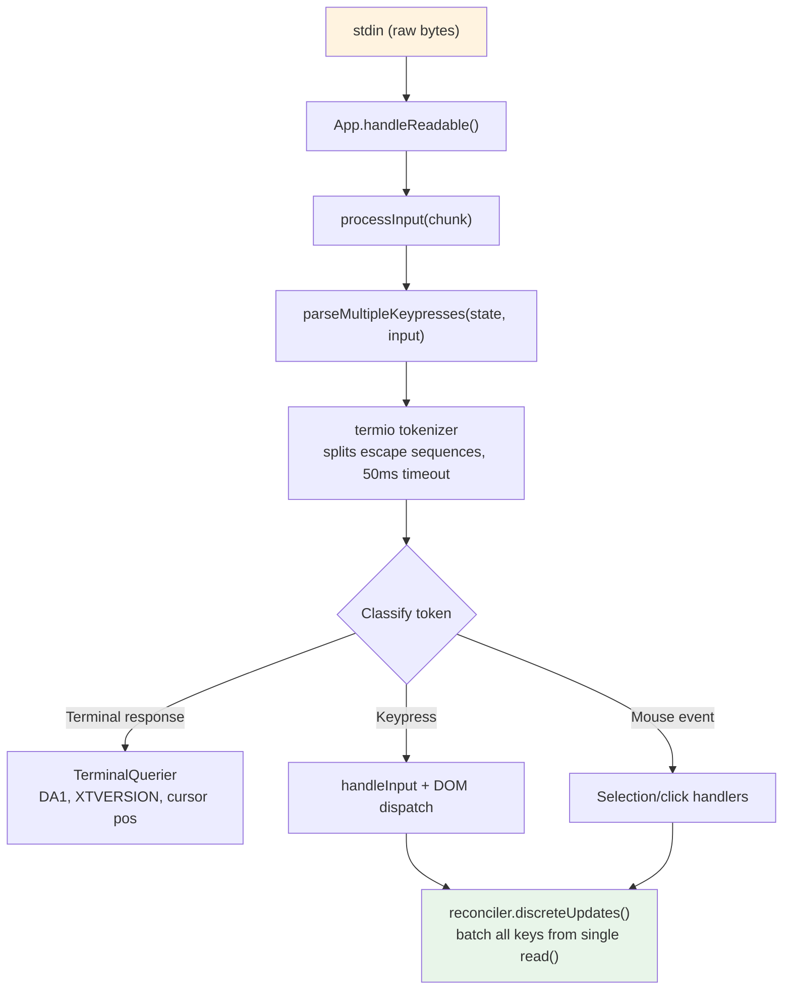
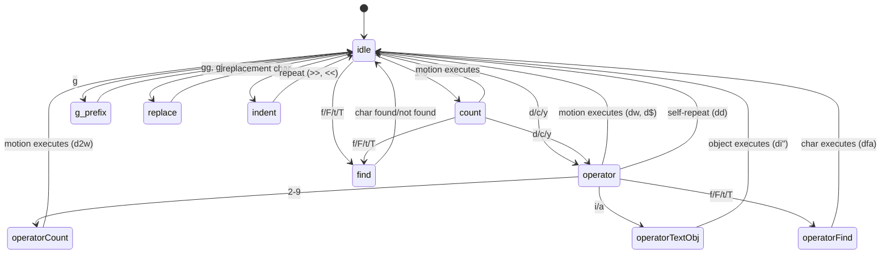

# الفصل 14: الـ Input والتفاعل

## bytes خام، وأفعال ليها معنى

لما تضغط Ctrl+X وبعدها Ctrl+K في Claude Code، الـ terminal بيبعت سلسلتين من الـ bytes بينهم حوالي 200 ملي ثانية. الأولى هي `0x18` (ASCII CAN). والتانية هي `0x0B` (ASCII VT). ولا واحد من الـ bytes دول شايل أي معنى في نفسه غير إنه "control character". نظام الـ input لازم يفهم إن البايتين دول، لما يوصلوا ورا بعض في فترة زمنية محددة، بيكوّنوا الـ chord `ctrl+x ctrl+k`. والـ chord ده بيتربط بالـ action `chat:killAgents`، واللي بتوقف كل الـ sub-agents الشغالة.

بين الـ bytes الخام والـ agents اللي اتوقفت، فيه 6 أنظمة بتشتغل: tokenizer بيفصل الـ escape sequences، و parser بيصنّفها على 5 terminal protocols، و keybinding resolver بيطابق السلسلة مع الـ bindings الخاصة بالـ context الحالي، و chord state machine بيدير السلسلة متعددة المفاتيح، و handler بينفذ الـ action، وفي الآخر React بيجمّع تحديثات الـ state الناتجة في render واحد.

الصعوبة مش في أي نظام من دول لوحده. الصعوبة في الانفجار التوافقي لتنوّع الـ terminals. iTerm2 بيبعت sequences بـ Kitty keyboard protocol. الـ Terminal الخاص بـ macOS بيبعت VT220 sequences قديمة. و Ghostty عبر SSH بيبعت xterm modifyOtherKeys. و tmux ممكن يبلع أي واحدة من دول أو يحوّلها أو يعدّيها زي ما هي حسب إعداداته. و Windows Terminal ليه غرائبه الخاصة مع الـ VT mode. نظام الـ input لازم ينتج objects صحيحة من الـ type `ParsedKey` من كل دول، لأن المستخدم مش المفروض يعرف الـ terminal الخاص بيه بيستخدم أي keyboard protocol.

الفصل ده بيتتبع المسار من الـ bytes الخام لحد الأفعال اللي ليها معنى عبر كل التنوّع ده.

فلسفة التصميم هي progressive enhancement مع graceful degradation. على terminal حديث بيدعم Kitty keyboard protocol، Claude Code بياخد اكتشاف كامل للـ modifiers (يعني Ctrl+Shift+A مختلف عن Ctrl+A)، وإبلاغ عن الـ super key (اختصارات Cmd)، وتحديد للمفاتيح من غير أي التباس. وعلى terminal قديم عبر SSH، بيرجع لأحسن protocol متاح، فبيخسر بعض التمييز بين الـ modifiers لكن الوظائف الأساسية بتفضل شغالة. المستخدم عمره ما بيشوف رسالة خطأ بتقول إن الـ terminal الخاص بيه مش مدعوم. ممكن ما يقدرش يستخدم `ctrl+shift+f` للبحث الشامل، لكن `ctrl+r` للبحث في الـ history شغال في كل مكان.

---

## الـ Key Parsing Pipeline

الـ input بيوصل على شكل chunks من الـ bytes على الـ stdin. والـ pipeline بيعالجها على مراحل:



الـ tokenizer هو الأساس. الـ input الجاي من الـ terminal عبارة عن stream من الـ bytes بيخلط بين حروف قابلة للطباعة، و control codes، و escape sequences متعددة الـ bytes، من غير أي framing واضح. الـ `read()` الواحد من الـ stdin ممكن يرجّع `\x1b[1;5A` (يعني Ctrl+Up)، أو ممكن يرجّع `\x1b` في قراءة و `[1;5A` في القراءة اللي بعدها، حسب سرعة وصول الـ bytes من الـ PTY. الـ tokenizer بيحتفظ بـ state machine بتخزّن الـ escape sequences الناقصة في buffer وبتطلّع tokens كاملة بس.

مشكلة الـ sequence الناقصة مشكلة جوهرية. لما الـ tokenizer يشوف `\x1b` لوحده، مش بيقدر يعرف هو ده زرار Escape ولا بداية CSI sequence. فبيحفظ الـ byte في الـ buffer ويشغّل timer مدته 50ms. لو ماوصلش أي تكملة، الـ buffer بيتفضّى والـ `\x1b` بيتحوّل لضغطة Escape. لكن قبل ما يفضّي الـ buffer، الـ tokenizer بيفحص `stdin.readableLength`: لو فيه bytes مستنية في الـ kernel buffer، الـ timer بيتعاد تشغيله بدل ما الـ buffer يتفضّى. وده بيعالج حالة إن الـ event loop كان متوقف لأكثر من 50ms والـ bytes المكمّلة موجودة فعلًا في الـ buffer لكن ماتقرتش لحد الآن.

في عمليات الـ paste، الـ timeout بيزيد لـ 500ms. لأن النص اللي بيتعمل له paste ممكن يكون كبير ويوصل في أكثر من chunk.

كل المفاتيح اللي اتعمل لها parse من `read()` واحد بتتعالج في استدعاء واحد لـ `reconciler.discreteUpdates()`. وده بيجمّع تحديثات الـ state في React، فعمل paste لـ 100 حرف بينتج re-render واحد، مش 100. التجميع ده ضروري: من غيره، كل حرف في الـ paste كان هيسبب دورة reconciliation كاملة: تحديث state، و reconciliation، و commit، و Yoga layout، و render، و diff، وكتابة. وبحساب 5ms لكل دورة، paste لـ 100 حرف كان هياخد 500ms. مع التجميع، نفس الـ paste بياخد دورة واحدة مدتها 5ms.

### إدارة الـ stdin

الـ component `App` بيدير الـ raw mode عن طريق reference counting. لما أي component يحتاج raw input (الـ prompt، أو dialog، أو الـ vim mode)، بيستدعي `setRawMode(true)` فالعداد بيزيد. ولما ما يبقاش محتاجه، بيستدعي `setRawMode(false)` فالعداد بينقص. الـ raw mode بيتقفل بس لما العداد يوصل صفر. وده بيمنع bug شايع في تطبيقات الـ terminal: الـ component A بيفعّل الـ raw mode، والـ component B بيفعّله كمان، وبعدين A بيقفله، وفجأة الـ input الخاص بـ B بيبوظ لأن الـ raw mode اتقفل على مستوى البرنامج كله.

لما الـ raw mode بيتفعّل لأول مرة، الـ App:

1. بيوقف الـ early input capture (آلية مرحلة الـ bootstrap اللي بتجمع ضغطات المفاتيح قبل ما React يعمل mount)
2. بيحوّل الـ stdin للـ raw mode (من غير line buffering، ولا echo، ولا معالجة للـ signals)
3. بيربط listener على الـ event `readable` لمعالجة الـ input بشكل asynchronous
4. بيفعّل الـ bracketed paste (عشان النص اللي اتعمل له paste يبقى ممكن التعرف عليه)
5. بيفعّل الـ focus reporting (عشان البرنامج يعرف إمتى نافذة الـ terminal بتاخد الـ focus أو تفقده)
6. بيفعّل الـ extended key reporting (يعني Kitty keyboard protocol + xterm modifyOtherKeys)

وعند القفل، كل الخطوات دي بتتعكس بالترتيب المعاكس. الترتيب الدقيق ده بيمنع تسريب الـ escape sequences: قفل الـ extended key reporting قبل قفل الـ raw mode بيضمن إن الـ terminal مش هيكمّل يبعت sequences مشفّرة بـ Kitty بعد ما البرنامج بطّل يعمل لها parse.

الـ signal handler `onExit` (عن طريق الـ package `signal-exit`) بيضمن إن التنظيف بيحصل حتى لو البرنامج اتوقف بشكل غير متوقع. لو الـ process استقبلت SIGTERM أو SIGINT، الـ handler بيقفل الـ raw mode، ويرجّع حالة الـ terminal، ويخرج من الـ alternate screen لو كان مفعّل، ويظهّر الـ cursor تاني قبل ما الـ process تخرج. من غير التنظيف ده، أي session من Claude Code تعمل crash كانت هتسيب الـ terminal في raw mode من غير cursor ومن غير echo، والمستخدم كان هيحتاج يكتب `reset` من غير ما يشوف اللي بيكتبه عشان يرجّع الـ terminal الخاص بيه.

---

## دعم أكثر من Protocol

الـ terminals مش متفقة على طريقة تشفير الـ keyboard input. الـ terminal emulator الحديث زي Kitty بيبعت sequences منظمة فيها معلومات كاملة عن الـ modifiers. أما الـ terminal القديم عبر SSH فبيبعت سلاسل bytes ملتبسة محتاجة context عشان تتفهم. الـ parser في Claude Code بيتعامل مع 5 protocols مختلفة في نفس الوقت، لأن الـ terminal الخاص بالمستخدم ممكن يكون أي واحد منها.

**الـ CSI u (Kitty keyboard protocol)** هو المعيار الحديث. الصيغة: `ESC [ codepoint [; modifier] u`. مثال: `ESC[13;2u` هي Shift+Enter، و `ESC[27u` هي Escape من غير modifiers. الـ codepoint بيحدد المفتاح بشكل قاطع: مفيش التباس بين Escape كزرار و Escape كبداية sequence. وكلمة الـ modifier بتشفّر shift و alt و ctrl و super (يعني Cmd) كـ bits منفصلة. بيفعّل Claude Code الـ protocol ده على الـ terminals اللي بتدعمه عن طريق الـ escape sequence `ENABLE_KITTY_KEYBOARD` عند بدء التشغيل، وبيقفله عند الخروج بـ `DISABLE_KITTY_KEYBOARD`. واكتشاف الـ protocol بيحصل بـ handshake من سؤال ورد: البرنامج بيبعت `CSI ? u` والـ terminal بيرد بـ `CSI ? flags u`، والـ `flags` بتحدد مستوى الـ protocol المدعوم.

**الـ xterm modifyOtherKeys** هو الـ fallback للـ terminals زي Ghostty عبر SSH، لما التفاوض على الـ Kitty protocol ما يحصلش. الصيغة: `ESC [ 27 ; modifier ; keycode ~`. خد بالك إن ترتيب الـ parameters معكوس عن الـ CSI u: الـ modifier بييجي قبل الـ keycode، وبعدين الـ keycode. وده مصدر شايع لـ bugs في الـ parsers. الـ protocol بيتفعّل بـ `CSI > 4 ; 2 m`، وبيطلع من Ghostty و tmux و xterm لما هوية الـ TERM الخاصة بالـ terminal ما تتكتشفش (وده شايع عبر SSH لأن `TERM_PROGRAM` مش بيتبعت).

**الـ legacy terminal sequences** بتغطي كل حاجة تانية: مفاتيح الـ function عن طريق sequences بتبدأ بـ `ESC O` و `ESC [`، ومفاتيح الأسهم، والـ numpad، و Home/End/Insert/Delete، وكل الخليط الفوضوي من أشكال VT100/VT220/xterm اللي اتراكم على مدار 40 سنة من تطوّر الـ terminals. الـ parser بيستخدم تعبيرين نمطيين (2 Regular Expressions) عشان يطابقها: `FN_KEY_RE` للـ pattern اللي بيبدأ بـ `ESC O/N/[/[[` (وده بيطابق مفاتيح الـ function ومفاتيح الأسهم ونسخها اللي معاها modifiers)، و `META_KEY_CODE_RE` للـ meta-key codes (يعني `ESC` وبعده حرف أو رقم واحد، وده التشفير التقليدي لـ Alt+مفتاح).

التحدي في الـ legacy sequences هو الالتباس. `ESC [ 1 ; 2 R` ممكن تكون Shift+F3 أو ممكن تكون cursor position report، حسب الـ context. الـ parser بيحل ده بفحص الـ private marker: تقارير موضع الـ cursor بتستخدم `CSI ? row ; col R` (بالـ marker الخاص `?`)، أما مفاتيح الـ function اللي معاها modifiers فبتستخدم `CSI params R` (من غيره). وفكّ الالتباس ده هو سبب إن Claude Code بيطلب DECXCPR (يعني extended cursor position reports) بدل الـ CPR العادي: الصيغة الممتدة مفيهاش التباس.

تحديد هوية الـ terminal بيضيف طبقة تعقيد تانية. عند بدء التشغيل، بيبعت Claude Code query من نوع `XTVERSION` (`CSI > 0 q`) عشان يعرف اسم الـ terminal وإصداره. والرد (`DCS > | name ST`) بيعدّي من اتصالات SSH، على عكس `TERM_PROGRAM` اللي هو environment variable مش بيتنقل عبر SSH. ومعرفة هوية الـ terminal بتخلّي الـ parser يتعامل مع غرائب كل terminal. مثلًا، xterm.js (اللي بيستخدمه الـ integrated terminal في VS Code) سلوكه في الـ escape sequences مختلف عن xterm الأصلي، و string التعريف (`xterm.js(X.Y.Z)`) بيخلّي الـ parser ياخد الفروق دي في الحسبان.

**الـ SGR mouse events** بتستخدم الصيغة `ESC [ < button ; col ; row M/m`، و `M` معناها ضغط و `m` معناها إفلات. أكواد الزراير بتشفّر الفعل: 0/1/2 للضغط بالزرار الشمال/الأوسط/اليمين، و 64/65 للـ wheel لفوق/لتحت (يعني 0x40 معمول له OR مع bit الـ wheel)، و 32 وأكثر للـ drag (يعني 0x20 معمول له OR مع bit الحركة). أحداث الـ wheel بتتحوّل لـ objects من الـ type `ParsedKey` عشان تعدّي من الـ keybinding system، أما أحداث الضغط والـ drag فبتتحوّل لـ objects من الـ type `ParsedMouse` وبتتوجّه لـ handler التحديد.

**الـ bracketed paste** بيحصر المحتوى اللي اتعمل له paste بين العلامتين `ESC [200~` و `ESC [201~`. وكل اللي بين العلامتين بيتحوّل لـ `ParsedKey` واحد معاه `isPasted: true`، بصرف النظر عن أي escape sequences ممكن يكون النص شايلها. وده بيمنع إن الكود اللي اتعمل له paste يتفهم كأوامر، ودي ميزة أمان حرجة لما المستخدم يعمل paste لقطعة كود فيها `\x03` (وده Ctrl+C كـ byte خام).

الـ output types الخاصة بالـ parser بتكوّن discriminated union نظيف:

```typescript
type ParsedKey = {
  kind: 'key';
  name: string;        // 'return', 'escape', 'a', 'f1', etc.
  ctrl: boolean; meta: boolean; shift: boolean;
  option: boolean; super: boolean;
  sequence: string;    // Raw escape sequence for debugging
  isPasted: boolean;   // Inside bracketed paste
}

type ParsedMouse = {
  kind: 'mouse';
  button: number;      // SGR button code
  action: 'press' | 'release';
  col: number; row: number;  // 1-indexed terminal coordinates
}

type ParsedResponse = {
  kind: 'response';
  response: TerminalResponse;  // Routed to TerminalQuerier
}
```

الـ discriminant `kind` بيضمن إن الكود اللي بعد كده بيتعامل مع كل نوع input بشكل صريح. المفتاح ما يقدرش يتعالج بالغلط كـ mouse event، والرد الجاي من الـ terminal ما يقدرش يتفهم بالغلط كضغطة مفتاح. والـ type `ParsedKey` شايل كمان الـ string الخام `sequence` عشان الـ debugging: لما مستخدم يبلّغ إن "pressing Ctrl+Shift+A does nothing" (الضغط على Ctrl+Shift+A مش بيعمل حاجة)، الـ debug log يقدر يوضّح بالضبط الـ terminal بعت أي byte sequence، وده بيخلّي ممكن نشخّص المشكلة: هي في تشفير الـ terminal، ولا في تعرّف الـ parser، ولا في إعدادات الـ keybinding.

الـ flag `isPasted` في `ParsedKey` حرج للأمان. لما الـ bracketed paste مفعّل، الـ terminal بيحصر المحتوى اللي اتعمل له paste بين sequences علامات. الـ parser بيحدد `isPasted: true` على الـ key event الناتج، والـ keybinding resolver بيتخطى مطابقة الـ keybindings للمفاتيح اللي جاية من paste. من غير ده، عمل paste لنص فيه `\x03` (يعني Ctrl+C كـ byte خام) أو فيه escape sequences كان هيشغّل أوامر في البرنامج. ومع ده، المحتوى اللي اتعمل له paste بيتعامل معاه كنص حرفي بصرف النظر عن الـ bytes اللي فيه.

الـ parser بيتعرّف كمان على ردود الـ terminal، يعني الـ sequences اللي الـ terminal نفسه بيبعتها ردًا على الـ queries. ودي بتشمل device attributes (يعني DA1 و DA2)، وتقارير موضع الـ cursor، وردود الـ Kitty keyboard flags، و XTVERSION (تحديد هوية الـ terminal)، و DECRPM (حالة الـ mode). ودي بتتوجّه لـ `TerminalQuerier` بدل الـ input handler:

```typescript
type TerminalResponse =
  | { type: 'decrpm'; mode: number; status: number }
  | { type: 'da1'; params: number[] }
  | { type: 'da2'; params: number[] }
  | { type: 'kittyKeyboard'; flags: number }
  | { type: 'cursorPosition'; row: number; col: number }
  | { type: 'osc'; code: number; data: string }
  | { type: 'xtversion'; version: string }
```

**فكّ تشفير الـ modifiers** بيمشي على اتفاقية XTerm: كلمة الـ modifier هي `1 + (shift ? 1 : 0) + (alt ? 2 : 0) + (ctrl ? 4 : 0) + (super ? 8 : 0)`. الـ field `meta` في `ParsedKey` بيقابل Alt/Option (الـ bit رقم 2). والـ field `super` مختلف عنه (الـ bit رقم 8، وهو Cmd على macOS). والفرق ده مهم لأن اختصارات Cmd محجوزة لنظام التشغيل ومش ممكن تطبيقات الـ terminal تلتقطها، إلا لو الـ terminal بيستخدم الـ Kitty protocol، اللي بيبلّغ عن المفاتيح اللي معاها super في حين إن باقي الـ protocols بتبلعها في صمت.

وفيه stdin-gap detector بيشغّل إعادة تأكيد للـ terminal mode لما ما يوصلش أي input لمدة 5 ثواني بعد فترة انقطاع. وده بيعالج حالات إعادة الاتصال بـ tmux وصحيان اللابتوب من النوم، اللي فيها الـ keyboard mode الخاص بالـ terminal ممكن يكون الـ multiplexer أو نظام التشغيل رجّعه لحالته الأصلية. لما إعادة التأكيد تشتغل، بتعيد إرسال sequences الـ `ENABLE_KITTY_KEYBOARD` و `ENABLE_MODIFY_OTHER_KEYS` والـ bracketed paste والـ focus reporting. من غير ده، الانفصال عن session في tmux والرجوع لها كان هينزّل الـ keyboard protocol في صمت للـ legacy mode، وده هيبوظ اكتشاف الـ modifiers لباقي الـ session.

### طبقة الـ Terminal I/O

تحت الـ parser فيه subsystem منظم للـ terminal I/O في `ink/termio/`:

- **csi.ts** -- الـ CSI (Control Sequence Introducer) sequences: تحريك الـ cursor، والمسح، والـ scroll regions، وتفعيل/قفل الـ bracketed paste، وتفعيل/قفل الـ focus events، وتفعيل/قفل الـ Kitty keyboard protocol
- **dec.ts** -- الـ DEC private mode sequences: الـ alternate screen buffer (1049)، و modes تتبّع الـ mouse (1000/1002/1003)، وإظهار الـ cursor، والـ bracketed paste (2004)، والـ focus events (1004)
- **osc.ts** -- الـ Operating System Commands: الوصول للـ clipboard (OSC 52)، وحالة الـ tab، ومؤشرات التقدم في iTerm2، وتغليف الـ multiplexer الخاص بـ tmux/screen (يعني DCS passthrough للـ sequences اللي محتاجة تعدّي من حدود multiplexer)
- **sgr.ts** -- الـ Select Graphic Rendition: نظام أكواد التنسيق في ANSI (الألوان، والـ bold، والـ italic، والـ underline، والـ inverse)
- **tokenize.ts** -- الـ tokenizer اللي بيحتفظ بـ state عشان يكتشف حدود الـ escape sequences

تغليف الـ multiplexer يستاهل ملاحظة. لما Claude Code يشتغل داخل tmux، فيه escape sequences معينة (زي التفاوض على الـ Kitty keyboard protocol) لازم تعدّي للـ terminal الخارجي. و tmux بيستخدم DCS passthrough (`ESC P ... ST`) عشان يمرّر الـ sequences اللي مش فاهمها. الـ function `wrapForMultiplexer` في `osc.ts` بتكتشف بيئة الـ multiplexer وبتغلّف الـ sequences بالشكل المناسب. من غير ده، الـ Kitty keyboard mode كان هيفشل في صمت داخل tmux، والمستخدم عمره ما كان هيعرف ليه الـ bindings الخاصة بـ Ctrl+Shift بطّلت تشتغل.

### الـ Event System

مجلد `ink/events/` بيعمل implement لـ event system متوافق مع الـ browser فيه 7 event types: `KeyboardEvent`، و `ClickEvent`، و `FocusEvent`، و `InputEvent`، و `TerminalFocusEvent`، والأساس `TerminalEvent`. كل واحد منها شايل `target` و `currentTarget` و `eventPhase`، وبيدعم `stopPropagation()` و `stopImmediatePropagation()` و `preventDefault()`.

الـ `InputEvent` اللي بيغلّف `ParsedKey` موجود عشان التوافق مع المسار القديم اللي بيعتمد على `EventEmitter`، واللي الـ components الأقدم ممكن تكون ما زالت بتستخدمه. الـ components الجديدة بتستخدم الـ keyboard event dispatch على طريقة الـ DOM بمرحلتي capture و bubble. والمسارين بيشتغلوا من نفس المفتاح اللي اتعمل له parse، فهم متطابقين دائمًا: المفتاح اللي بيوصل على الـ stdin بينتج `ParsedKey` واحد بالضبط، وده بيطلّع `InputEvent` (للـ listeners القديمة) و `KeyboardEvent` (للـ dispatch على طريقة الـ DOM). التصميم ده بمسارين بيسمح بالانتقال التدريجي من الـ EventEmitter pattern للـ DOM event pattern من غير ما يبوظ الـ components الموجودة.

---

## الـ Keybinding System

الـ keybinding system بيفصل بين 3 اهتمامات كثير ما بتتلخبط مع بعض: أي مفتاح بيشغّل أي action (الـ bindings)، وإيه اللي بيحصل لما الـ action يشتغل (الـ handlers)، وأي bindings مفعّلة في اللحظة الحالية (الـ contexts).

### الـ Bindings: Declarative Configuration

الـ bindings الافتراضية معرّفة في `defaultBindings.ts` كـ array من objects من الـ type `KeybindingBlock`، وكل واحد منها محدود بـ context:

```typescript
export const DEFAULT_BINDINGS: KeybindingBlock[] = [
  {
    context: 'Global',
    bindings: {
      'ctrl+c': 'app:interrupt',
      'ctrl+d': 'app:exit',
      'ctrl+l': 'app:redraw',
      'ctrl+r': 'history:search',
    },
  },
  {
    context: 'Chat',
    bindings: {
      'escape': 'chat:cancel',
      'ctrl+x ctrl+k': 'chat:killAgents',
      'enter': 'chat:submit',
      'up': 'history:previous',
      'ctrl+x ctrl+e': 'chat:externalEditor',
    },
  },
  // ... 14 more contexts
]
```

الـ bindings الخاصة بكل platform بتتحدد وقت التعريف. عمل paste لصورة هو `ctrl+v` على macOS/Linux لكنه `alt+v` على Windows (لأن `ctrl+v` هناك هو الـ paste الخاص بالنظام). والتنقل بين الـ modes هو `shift+tab` على الـ terminals اللي بتدعم الـ VT mode لكنه `meta+m` على Windows Terminal من غيره. والـ bindings اللي وراها feature flags زي الـ quick search والـ voice mode والـ terminal panel بتتضاف بشكل شرطي.

المستخدم يقدر يغيّر أي binding عن طريق `~/.claude/keybindings.json`. الـ parser بيقبل أسماء بديلة للـ modifiers (`ctrl`/`control`، و `alt`/`opt`/`option`، و `cmd`/`command`/`super`/`win`)، وأسماء بديلة للمفاتيح (`esc` -> `escape`، و `return` -> `enter`)، وكتابة الـ chords (خطوات مفصولة بمسافة زي `ctrl+k ctrl+s`)، و actions بقيمة null عشان تفكّ ربط المفاتيح الافتراضية. والـ null action مش زي إنك ما تعرّفش binding أصلًا: هو بيمنع الـ binding الافتراضي صراحةً من إنه يشتغل، وده مهم للمستخدمين اللي محتاجين يرجّعوا مفتاح معين لاستخدام الـ terminal نفسه.

### الـ Contexts: 16 Scopes من النشاط

كل context بيمثّل نمط تفاعل بتنطبق فيه مجموعة معينة من الـ bindings:

| الـ Context | إمتى يكون مفعّل |
|---------|------------|
| Global | دائمًا |
| Chat | الـ prompt input عليه الـ focus |
| Autocomplete | قائمة الـ completion ظاهرة |
| Confirmation | الـ permission dialog ظاهر |
| Scroll | الـ alt-screen ومحتواه قابل للـ scroll |
| Transcript | عارض الـ transcript للقراءة فقط |
| HistorySearch | البحث العكسي في الـ history (ctrl+r) |
| Task | فيه background task شغالة |
| Help | الـ help overlay ظاهر |
| MessageSelector | الـ rewind dialog |
| MessageActions | التنقل بين الرسائل بالـ cursor |
| DiffDialog | عارض الـ diff |
| Select | قائمة اختيار عامة |
| Settings | لوحة الإعدادات |
| Tabs | التنقل بين الـ tabs |
| Footer | مؤشرات الـ footer |

لما مفتاح يوصل، الـ resolver بيبني قائمة contexts من الـ contexts المفعّلة حاليًا (اللي بتتحدد من الـ state الخاص بالـ React components)، وبيشيل المكرر منها مع الحفاظ على ترتيب الأولوية، وبيدوّر على binding مطابق. وآخر binding مطابق هو اللي بيكسب، وده اللي بيخلّي تعديلات المستخدم تتقدّم على الافتراضيات. قائمة الـ contexts بتتبنى من جديد مع كل ضغطة مفتاح (ودي عملية رخيصة: دمج arrays وإزالة المكرر من 16 string بالكثير)، فتغييرات الـ context بتسري فورًا من غير أي آلية subscription أو listener.

تصميم الـ contexts بيتعامل مع pattern تفاعل صعب: الـ modals المتداخلة. لما permission dialog يظهر أثناء ما فيه task شغالة، ممكن يكون الـ context `Confirmation` والـ context `Task` مفعّلين في نفس الوقت. الـ context `Confirmation` بياخد الأولوية (لأنه متسجّل بعد التاني في الـ component tree)، فالمفتاح `y` بيشغّل "approve" (الموافقة) مش أي binding على مستوى الـ task. ولما الـ dialog يقفل، الـ context `Confirmation` بيتعطّل والـ bindings الخاصة بـ `Task` بترجع تشتغل. سلوك التراكم ده بيظهر بشكل طبيعي من ترتيب الأولوية في قائمة الـ contexts، من غير أي كود خاص للتعامل مع الـ modals.

### الاختصارات المحجوزة

مش كل حاجة ينفع تتعاد ربطها. النظام بيفرض 3 مستويات من الحجز:

**مش قابل لإعادة الربط** (سلوك ثابت في الكود): `ctrl+c` (مقاطعة/خروج)، و `ctrl+d` (خروج)، و `ctrl+m` (مطابق لـ Enter في كل الـ terminals، وإعادة ربطه كانت هتبوظ Enter).

**محجوز للـ terminal** (تحذيرات): `ctrl+z` (SIGTSTP)، و `ctrl+\` (SIGQUIT). دول ممكن تقنيًا يتربطوا، لكن الـ terminal في أغلب الإعدادات هيلتقطهم قبل ما البرنامج يشوفهم.

**محجوز لـ macOS** (أخطاء): `cmd+c`، و `cmd+v`، و `cmd+x`، و `cmd+q`، و `cmd+w`، و `cmd+tab`، و `cmd+space`. نظام التشغيل بيلتقطهم قبل ما يوصلوا للـ terminal. وربطهم كان هيعمل اختصار عمره ما هيشتغل.

### الـ Resolution Flow

لما مفتاح يوصل، مسار الـ resolution هو:

1. بناء قائمة الـ contexts: الـ contexts المفعّلة المسجّلة من الـ component زائد Global، مع إزالة المكرر والحفاظ على الأولوية
2. استدعاء `resolveKeyWithChordState(input, key, contexts)` على جدول الـ bindings المدموج
3. في حالة `match`: مسح أي chord معلّق، واستدعاء الـ handler، وتنفيذ `stopImmediatePropagation()` على الـ event
4. في حالة `chord_started`: حفظ ضغطات المفاتيح المعلّقة، وإيقاف الـ propagation، وتشغيل الـ chord timeout
5. في حالة `chord_cancelled`: مسح الـ chord المعلّق، وترك الـ event يعدّي
6. في حالة `unbound`: مسح الـ chord. ده فكّ ربط صريح (المستخدم حدد الـ action بـ `null`)، فالـ propagation بيتوقف لكن مفيش handler بيشتغل
7. في حالة `none`: تمرير الـ event للـ handlers التانية

استراتيجية "آخر واحد يكسب" في الـ resolution معناها إن لو الـ bindings الافتراضية و bindings المستخدم الاثنين عرّفوا `ctrl+k` في الـ context `Chat`، الـ binding الخاص بالمستخدم هو اللي بيتقدّم. وده بيتقيّم وقت المطابقة عن طريق المرور على الـ bindings بترتيب تعريفها والاحتفاظ بآخر مطابقة، بدل بناء override map وقت التحميل. والميزة: التعديلات الخاصة بكل context بتتركّب مع بعض بشكل طبيعي. المستخدم يقدر يغيّر `enter` في `Chat` من غير ما يأثر على `enter` في `Confirmation`.

---

## دعم الـ Chords

الـ binding `ctrl+x ctrl+k` عبارة عن chord: ضغطتين بيكوّنوا مع بعض action واحد. والـ resolver بيدير ده بـ state machine.

لما مفتاح يوصل:

1. الـ resolver بيضيفه لأي chord prefix معلّق
2. بيفحص لو فيه أي binding الـ chord الخاص بيه بيبدأ بالـ prefix ده. لو فيه، بيرجّع `chord_started` وبيحفظ ضغطات المفاتيح المعلّقة
3. لو الـ chord الكامل طابق binding بالضبط، بيرجّع `match` وبيمسح الـ state المعلّق
4. لو الـ chord prefix ما طابقش أي حاجة، بيرجّع `chord_cancelled`

فيه component اسمه `ChordInterceptor` بيلتقط كل الـ input أثناء حالة انتظار الـ chord. وليه timeout مدته 1000ms: لو الضغطة التانية ماوصلتش خلال ثانية، الـ chord بيتلغى والضغطة الأولى بتتشال. والـ `KeybindingContext` بيوفّر `pendingChordRef` للوصول المتزامن (synchronous) للـ state المعلّق، وده بيتجنب تأخير تحديثات الـ state في React اللي كان ممكن يخلّي الضغطة التانية تتعالج قبل ما تحديث الـ state الخاص بالأولى يكتمل.

تصميم الـ chords بيتجنب حجب مفاتيح التحرير الخاصة بـ readline. من غير chords، الـ keybinding الخاص بـ "kill agents" (إيقاف الـ agents) كان ممكن يكون `ctrl+k`، لكن ده في readline معناه "kill to end of line" (مسح لآخر السطر)، والمستخدمين متوقعينه في أي text input في الـ terminal. وباستخدام `ctrl+x` كـ prefix (وده نفس اتفاقية الـ chord prefix في readline نفسه)، النظام بياخد namespace من الـ bindings مش بتتعارض مع اختصارات التحرير اللي من مفتاح واحد.

الـ implementation بيتعامل مع edge case أغلب أنظمة الـ chords بتفوّتها: إيه اللي بيحصل لما المستخدم يضغط `ctrl+x` وبعدين يكتب حرف مش جزء من أي chord؟ من غير تعامل دقيق، الحرف ده كان هيتبلع: الـ chord interceptor استهلك الـ input، والـ chord اتلغى، والحرف ضاع. الـ `ChordInterceptor` في Claude Code بيرجّع `chord_cancelled` في الحالة دي، وده بيخلّي الـ input المعلّق يتشال لكن بيسمح للحرف اللي ما طابقش إنه يعدّي لمعالجة الـ input العادية. الحرف مش بيضيع، اللي بيتشال هو الـ chord prefix بس. وده مطابق للسلوك اللي المستخدمين متوقعينه من الـ chord prefixes على طريقة Emacs.

---

## الـ Vim Mode

### الـ State Machine

الـ implementation الخاص بـ vim عبارة عن state machine من نوع pure مع فحص شامل للـ types. والـ types هي التوثيق نفسه:

```typescript
export type VimState =
  | { mode: 'INSERT'; insertedText: string }
  | { mode: 'NORMAL'; command: CommandState }

export type CommandState =
  | { type: 'idle' }
  | { type: 'count'; digits: string }
  | { type: 'operator'; op: Operator; count: number }
  | { type: 'operatorCount'; op: Operator; count: number; digits: string }
  | { type: 'operatorFind'; op: Operator; count: number; find: FindType }
  | { type: 'operatorTextObj'; op: Operator; count: number; scope: TextObjScope }
  | { type: 'find'; find: FindType; count: number }
  | { type: 'g'; count: number }
  | { type: 'operatorG'; op: Operator; count: number }
  | { type: 'replace'; count: number }
  | { type: 'indent'; dir: '>' | '<'; count: number }
```

ده discriminated union من 12 حالة. والفحص الشامل في TypeScript بيضمن إن كل `switch` على `CommandState.type` بيتعامل مع الـ 12 حالة كلها. إضافة حالة جديدة للـ union بتخلّي كل switch ناقص يطلّع compile error. الـ state machine ما يقدرش يكون فيه حالات ميتة أو transitions ناقصة: الـ type system بيمنع ده.

لاحظ إزاي كل حالة شايلة بالضبط البيانات اللي الـ transition اللي بعدها محتاجها. الحالة `operator` عارفة الـ operator (`op`) والعدد اللي قبله. والحالة `operatorCount` بتضيف مجمّع الأرقام (`digits`). والحالة `operatorTextObj` بتضيف الـ scope (`inner` أو `around`). مفيش حالة شايلة بيانات مش محتاجاها. وده مش مجرد ذوق كويس، ده بيمنع فئة كاملة من الـ bugs اللي فيها handler بيقرأ بيانات قديمة من أمر سابق. لو إنت في الحالة `find`، عندك `FindType` و `count`. مفيش عندك operator، لأن مفيش operator معلّق. الـ type بيخلّي الحالة المستحيلة مش ممكن تتمثّل أصلًا.

والـ state diagram بيحكي القصة:



من `idle`، الضغط على `d` بيدخّلك الحالة `operator`. ومن `operator`، الضغط على `w` بينفذ `delete` بالـ motion `w`. والضغط على `d` تاني (`dd`) بيمسح سطر كامل. والضغط على `2` بيدخّلك `operatorCount`، فـ `d2w` معناها "delete the next 2 words" (امسح الكلمتين اللي بعد كده). والضغط على `i` بيدخّلك `operatorTextObj`، فـ `di"` معناها "delete inside quotes" (امسح اللي جوه علامات التنصيص). كل حالة وسيطة شايلة بالضبط الـ context اللي الـ transition اللي بعدها محتاجه، لا أكثر ولا أقل.

### الـ Transitions كـ Pure Functions

الـ function `transition()` بتوزّع حسب الـ type الخاص بالحالة الحالية على واحدة من 10 handler functions. وكل واحدة بترجّع `TransitionResult`:

```typescript
type TransitionResult = {
  next?: CommandState;    // New state (omitted = stay in current)
  execute?: () => void;   // Side effect (omitted = no action yet)
}
```

الـ side effects بتترجّع، مش بتتنفذ. الـ function `transition` هي pure function: لو ادّيتها حالة ومفتاح، بترجّع الحالة اللي بعدها واختياريًا closure بينفذ الفعل. واللي استدعاها هو اللي بيقرر إمتى يشغّل الـ effect. وده بيخلّي اختبار الـ state machine سهل جدًا: ادّيها حالات ومفاتيح، واعمل assert على الحالات اللي رجعت، وتجاهل الـ closures. ومعناه كمان إن الـ function `transition` مش معتمدة على الـ state الخاص بالـ editor، ولا موضع الـ cursor، ولا محتوى الـ buffer. التفاصيل دي الـ closure بيلتقطها لحظة إنشائه، مش الـ state machine بيستهلكها لحظة الـ transition.

الـ handler `fromIdle` هو نقطة الدخول وبيغطي مفردات vim كاملة:

- **الـ Count prefix**: `1-9` بتدخّلك الحالة `count` وبتجمّع الأرقام. و `0` حالة خاصة: هو الـ motion "start of line" (بداية السطر)، مش رقم في العدد، إلا لو فيه أرقام اتجمّعت قبله
- **الـ Operators**: `d` و `c` و `y` بتدخّلك الحالة `operator`، وبتستنى motion أو text object يحدد النطاق
- **الـ Find**: `f` و `F` و `t` و `T` بتدخّلك الحالة `find`، وبتستنى الحرف اللي هتدوّر عليه
- **الـ G-prefix**: `g` بيدخّلك الحالة `g` للأوامر المركّبة (`gg` و `gj` و `gk`)
- **الـ Replace**: `r` بيدخّلك الحالة `replace`، وبيستنى الحرف البديل
- **الـ Indent**: `>` و `<` بيدخّلوك الحالة `indent` (لـ `>>` و `<<`)
- **الـ Simple motions**: `h/j/k/l/w/b/e/W/B/E/0/^/$` بتتنفذ فورًا وبتحرّك الـ cursor
- **الأوامر الفورية**: `x` (مسح حرف)، و `~` (تبديل حالة الحرف)، و `J` (ضم السطور)، و `p/P` (لصق)، و `D/C/Y` (اختصارات للـ operators)، و `G` (الذهاب للنهاية)، و `.` (الـ dot-repeat)، و `;/,` (تكرار الـ find)، و `u` (تراجع)، و `i/I/a/A/o/O` (الدخول في الـ insert mode)

### الـ Motions والـ Operators والـ Text Objects

**الـ Motions** عبارة عن pure functions بتحوّل مفتاح لموضع cursor. الـ function `resolveMotion(key, cursor, count)` بتطبّق الـ motion عدد `count` من المرات، وبتوقف بدري لو الـ cursor بطّل يتحرك (ما تقدرش تتحرك شمال أبعد من العمود 0). والإيقاف البدري ده مهم لـ `3w` في آخر السطر: بيوقف عند آخر كلمة بدل ما يلف أو يطلّع خطأ.

الـ motions بتتصنّف حسب طريقة تفاعلها مع الـ operators:

- **الـ Exclusive** (الافتراضي) -- الحرف اللي في الوجهة مش بيدخل في النطاق. `dw` بتمسح لحد أول حرف في الكلمة اللي بعدها من غير ما تمسحه
- **الـ Inclusive** (`e` و `E` و `$`) -- الحرف اللي في الوجهة بيدخل في النطاق. `de` بتمسح لحد آخر حرف في الكلمة الحالية وبتمسحه معاها
- **الـ Linewise** (`j` و `k` و `G` و `gg` و `gj` و `gk`) -- لما تتستخدم مع operators، النطاق بيتمدد عشان يغطي سطور كاملة. `dj` بتمسح السطر الحالي واللي تحته، مش بس الحروف اللي بين موضعي الـ cursor

**الـ Operators** بتشتغل على نطاق. `delete` بيشيل النص وبيحفظه في الـ register. و `change` بيشيل النص وبيدخل في الـ insert mode. و `yank` بينسخ للـ register من غير تعديل. والحالة الخاصة `cw`/`cW` بتمشي على اتفاقية vim: تغيير الكلمة بيروح لآخر الكلمة الحالية، مش لبداية الكلمة اللي بعدها (على عكس `dw`).

فيه edge case مثيرة للاهتمام: الالتصاق بـ chip الـ `[Image #N]`. لما word motion يقع داخل chip لمرجع صورة (وده بيتعمل له render كوحدة بصرية واحدة في الـ terminal)، النطاق بيتمدد عشان يغطي الـ chip كله. وده بيمنع المسح الجزئي لحاجة المستخدم شايفها عنصر واحد متكامل: ما تقدرش تمسح نص `[Image #3]` لأن نظام الـ motions بيتعامل مع الـ chip كله ككلمة واحدة.

وأوامر إضافية بتغطي مفردات vim المتوقعة كاملة: `x` (مسح حرف)، و `r` (استبدال حرف)، و `~` (تبديل حالة الحرف)، و `J` (ضم السطور)، و `p`/`P` (لصق مع إدراك الـ linewise/characterwise)، و `>>` / `<<` (زيادة/تقليل الـ indent بمسافتين لكل خطوة)، و `o`/`O` (فتح سطر تحت/فوق والدخول في الـ insert mode).

**الـ Text objects** (وحدات نص زي كلمة أو سطر أو اللي جوه القوسين) بتلاقي الحدود حوالين الـ cursor. وبتجاوب على السؤال: "what is the 'thing' the cursor is inside?" (إيه "الحاجة" اللي الـ cursor جواها؟)

الـ word objects (`iw` و `aw` و `iW` و `aW`) بتقسّم النص لـ graphemes، وبتصنّف كل واحد كحرف كلمة أو مسافة أو علامة ترقيم، وبتوسّع التحديد لحد حدود الكلمة. النسخة `i` (inner) بتحدد الكلمة بس. والنسخة `a` (around) بتضم المسافات المحيطة: بتفضّل المسافة اللي بعد الكلمة، وبترجع للي قبلها لو الكلمة في آخر السطر. والنسخ بالحروف الكبيرة (`W` و `aW`) بتتعامل مع أي سلسلة من غير مسافات ككلمة، وبتتجاهل حدود علامات الترقيم.

الـ quote objects (`i"` و `a"` و `i'` و `a'` و `` i` `` و `` a` ``) بتلاقي أزواج علامات التنصيص في السطر الحالي. والأزواج بتتطابق بالترتيب (العلامة الأولى والتانية بيكوّنوا زوج، والتالتة والرابعة بيكوّنوا الزوج اللي بعده، وهكذا). لو الـ cursor بين العلامة الأولى والتانية، فده هو التطابق. النسخة `a` بتضم علامات التنصيص نفسها، والنسخة `i` بتستبعدها.

الـ bracket objects (`ib`/`i(` و `ab`/`a(` و `i[`/`a[` و `iB`/`i{`/`aB`/`a{` و `i<`/`a<`) بتعمل بحث بتتبّع العمق عن الأقواس المتطابقة. بتدوّر للخارج بدايةً من الـ cursor، وبتحتفظ بعداد للتداخل، لحد ما تلاقي الزوج المتطابق عند العمق صفر. وده بيتعامل صح مع الأقواس المتداخلة: `d i (` داخل `foo((bar))` بتمسح `bar`، مش `(bar)`.

### الـ State الدائم والـ Dot-Repeat

الـ vim mode بيحتفظ بـ `PersistentState` بيعيش بين الأوامر، وهو "الذاكرة" اللي بتخلّي vim يحسّسك إنه vim:

```typescript
interface PersistentState {
  lastChange: RecordedChange;   // For dot-repeat
  lastFind: { type: FindType; char: string };  // For ; and ,
  register: string;             // Yank buffer
  registerIsLinewise: boolean;  // Paste behavior flag
}
```

كل أمر بيعدّل النص بيسجّل نفسه كـ `RecordedChange`، وده discriminated union بيغطي insert، و operator+motion، و operator+textObj، و operator+find، و replace، و delete-char، و toggle-case، و indent، و open-line، و join. والأمر `.` (الـ dot-repeat: تكرار آخر تعديل بزرار `.`) بيعيد تشغيل `lastChange` من الـ state الدائم، وبيستخدم الـ count والـ operator والـ motion المسجّلين عشان يعيد نفس التعديل بالضبط عند موضع الـ cursor الحالي.

تكرار الـ find (`;` و `,`) بيستخدم `lastFind`. الأمر `;` بيكرر آخر find في نفس الاتجاه. والأمر `,` بيعكس الاتجاه: `f` بتتحوّل لـ `F`، و `t` بتتحوّل لـ `T`، والعكس. يعني بعد `fa` (دوّر على الـ 'a' اللي بعد كده)، `;` بتلاقي الـ 'a' اللي بعدها للأمام و `,` بتلاقي الـ 'a' اللي قبلها للخلف، من غير ما المستخدم يحتاج يفتكر كان بيدوّر في أي اتجاه.

الـ register بيتابع النص اللي اتعمل له yank أو مسح. لما محتوى الـ register ينتهي بـ `\n`، بيتعلّم إنه linewise، وده بيغيّر سلوك اللصق: `p` بتلصق تحت السطر الحالي (مش بعد الـ cursor)، و `P` بتلصق فوقه. الفرق ده المستخدم مش بيحسه، لكنه حرج لسير عمل "امسح سطر، والصقه في مكان تاني" اللي مستخدمي vim بيعتمدوا عليه طول الوقت.

---

## الـ Virtual Scrolling

الـ sessions الطويلة في Claude Code بتنتج محادثات طويلة. جلسة debugging تقيلة ممكن تولّد أكثر من 200 رسالة، وكل واحدة فيها markdown، و code blocks، ونتائج tool use، وسجلات صلاحيات. من غير virtualization، React كان هيحتفظ في الذاكرة بأكثر من 200 component subtree، وكل واحد منها ليه الـ state الخاص بيه والـ effects والـ memoization caches. والـ DOM tree كان هيبقى فيه آلاف الـ nodes. و Yoga layout كان هيزورها كلها في كل frame. والـ terminal كان هيبقى مستحيل يتستخدم.

الـ component `VirtualMessageList` بيحل ده بإنه بيعمل render بس للرسائل الظاهرة في الـ viewport زائد buffer صغير فوقها وتحتها. في محادثة فيها مئات الرسائل، ده الفرق بين إنك تعمل mount لـ 500 React subtree (كل واحد فيه markdown parsing، و syntax highlighting، و tool use blocks) وإنك تعمل mount لـ 15.

الـ component بيحتفظ بـ:

- **Height cache** لكل رسالة، بيتلغى لما عدد أعمدة الـ terminal يتغير
- **Jump handle** للتنقل في بحث الـ transcript (القفز لـ index معين، أو للنتيجة اللي بعدها/اللي قبلها)
- **Search text extraction** مع دعم لتسخين الـ cache (تحويل كل الرسائل لحروف صغيرة مسبقًا لما المستخدم يكتب `/`)
- **Sticky prompt tracking** -- لما المستخدم يعمل scroll بعيد عن الـ input، نص آخر prompt كتبه بيظهر في الأعلى كـ context
- **Message actions navigation** -- اختيار الرسائل بالـ cursor لميزة الـ rewind

الـ hook `useVirtualScroll` بيحسب أي رسائل يعمل لها mount بناءً على `scrollTop` و `viewportHeight` والارتفاعات المتراكمة للرسائل. وبيحتفظ بحدود clamp للـ scroll على الـ `ScrollBox` عشان يمنع الشاشات الفاضية لما دفعة من استدعاءات `scrollTo` تسبق الـ re-render الـ asynchronous الخاص بـ React، ودي مشكلة كلاسيكية في الـ virtualized lists: موضع الـ scroll ممكن يسبق تحديث الـ DOM.

التفاعل بين الـ virtual scrolling (بيرسم بس الجزء الظاهر على الشاشة) والـ markdown token cache يستاهل الملاحظة. لما رسالة تخرج من الـ viewport بالـ scroll، الـ React subtree الخاص بيها بيتعمل له unmount. ولما المستخدم يرجع لها، الـ subtree بيتعمل له mount تاني. من غير caching، ده كان معناه إعادة parse للـ markdown لكل رسالة المستخدم بيعدّي عليها. الـ LRU cache على مستوى الـ module (500 عنصر، مفتاحه hash المحتوى) بيضمن إن الاستدعاء المكلّف `marked.lexer()` بيحصل مرة واحدة بالكثير لكل محتوى رسالة فريد، بصرف النظر عن عدد المرات اللي الـ component بيتعمل له فيها mount و unmount.

الـ component `ScrollBox` نفسه بيوفّر imperative API عن طريق `useImperativeHandle`:

- `scrollTo(y)` -- scroll مطلق، وبيكسر الـ sticky-scroll mode
- `scrollBy(dy)` -- بيتراكم في `pendingScrollDelta`، والـ renderer بيستهلكه بمعدل محدود
- `scrollToElement(el, offset)` -- بيأجّل قراءة الموضع لوقت الـ render عن طريق `scrollAnchor`
- `scrollToBottom()` -- بيعيد تفعيل الـ sticky-scroll mode
- `setClampBounds(min, max)` -- بيقيّد نافذة الـ virtual scroll

كل تعديلات الـ scroll بتروح مباشرة لخصائص الـ DOM node وبتجدول الـ renders عن طريق microtask، متخطية الـ React reconciler (الجزء من React اللي بيحسب إيه اللي اتغير). والاستدعاء `markScrollActivity()` بيبلّغ الـ background intervals (الـ spinners والـ timers) إنها تتخطى الـ tick اللي بعدها، وده بيقلل التزاحم على الـ event loop أثناء الـ scroll النشط. وده pattern من نوع cooperative scheduling: مسار الـ scroll بيقول للشغل اللي في الخلفية "I am in a latency-sensitive operation, please yield" (أنا في عملية حساسة لزمن الاستجابة، من فضلك افسح لي). والـ background intervals بتفحص الـ flag ده قبل ما تجدول الـ tick اللي بعدها، وبتتأخر frame واحد لو الـ scroll شغال. والنتيجة scroll سلس بشكل ثابت حتى لو فيه كذا spinner و timer شغالين في الخلفية.

---

## طبّق ده: بناء Keybinding System واعي بالـ Context

الـ keybinding architecture في Claude Code بتقدّم نموذج لأي تطبيق فيه modal input: الـ editors، والـ IDEs، وأدوات الرسم، والـ terminal multiplexers. الأفكار الأساسية:

**افصل الـ bindings عن الـ handlers.** الـ bindings بيانات (أي مفتاح بيتربط بأي اسم action). والـ handlers كود (إيه اللي بيحصل لما الـ action يشتغل). فصلهم عن بعض معناه إن الـ bindings ممكن تتحوّل لـ JSON عشان المستخدم يعدّلها، في حين إن الـ handlers بتفضل في الـ components اللي بتملك الـ state المعني. المستخدم يقدر يربط `ctrl+k` بـ `chat:submit` من غير ما يلمس أي كود في الـ components.

**الـ context كمفهوم أصيل.** بدل keymap واحد مسطّح، عرّف contexts بتتفعّل وتتعطّل حسب الـ state الخاص بالتطبيق. لما dialog يفتح، الـ context `Confirmation` بيتفعّل والـ bindings الخاصة بيه بتتقدّم على bindings الـ `Chat`. ولما الـ dialog يقفل، bindings الـ `Chat` بترجع تشتغل. وده بيخلّصك من فوضى الشروط زي `if (dialogOpen && key === 'y')` المتناثرة في الـ event handlers.

**الـ chord state كـ machine صريح.** السلاسل متعددة المفاتيح (الـ chords) مش حالة خاصة من الـ single-key bindings، دي نوع مختلف من الـ bindings محتاج state machine فيه timeout وإلغاء. وجعل ده صريحًا (بـ component مخصوص `ChordInterceptor` و `pendingChordRef`) بيمنع bugs خفية فيها الضغطة التانية من الـ chord بيستهلكها handler مختلف لأن تحديث الـ state في React ما كانش وصل لحد الآن.

**احجز بدري، وحذّر بوضوح.** حدد المفاتيح اللي ماينفعش تتعاد ربطها (اختصارات النظام، و control characters الخاصة بالـ terminal) وقت التعريف، مش وقت الـ resolution. لما مستخدم يحاول يربط `ctrl+c`، اعرض خطأ أثناء تحميل الإعدادات بدل ما تقبل في صمت binding عمره ما هيشتغل. وده الفرق بين keybinding system شغال وواحد بينتج تقارير bugs غامضة.

**صمّم لتنوّع الـ terminals.** الـ keybinding system في Claude Code بيعرّف البدائل الخاصة بكل platform على مستوى الـ binding، مش على مستوى الـ handler. عمل paste لصورة هو `ctrl+v` أو `alt+v` حسب نظام التشغيل. والتنقل بين الـ modes هو `shift+tab` أو `meta+m` حسب دعم الـ VT mode. والـ handler الخاص بكل action هو نفسه بصرف النظر عن المفتاح اللي شغّله. وده معناه إن الاختبار بيغطي مسار كود واحد لكل action، مش مسار لكل تركيبة platform ومفتاح. ولما terminal معين يطلع فيه سلوك غريب جديد (زي إن Windows Terminal ماكانش فيه VT mode قبل Node 24.2.0، مثلًا)، الإصلاح شرط واحد في تعريف الـ binding، مش مجموعة متناثرة من فحوصات `if (platform === 'windows')` في كود الـ handlers.

**وفّر escape hatches.** آلية فكّ الربط بالـ null action صغيرة لكنها مهمة. المستخدم اللي بيشغّل Claude Code داخل terminal multiplexer ممكن يلاقي إن `ctrl+t` (إظهار/إخفاء الـ todos) بيتعارض مع اختصار التنقل بين الـ tabs في الـ multiplexer الخاص بيه. وبإضافة `{ "ctrl+t": null }` لملف keybindings.json الخاص بيه، بيعطّل الـ binding تمامًا. وضغطة المفتاح بتعدّي للـ multiplexer. من غير فكّ الربط بالـ null، الخيار الوحيد قدام المستخدم كان إنه يربط `ctrl+t` بـ action تاني مش محتاجه، أو يعيد إعداد الـ multiplexer الخاص بيه، ولا واحد منهم تجربة كويسة.

الـ implementation الخاص بالـ vim mode بيضيف درس زيادة: **خلّي الـ type system يفرض الـ state machine الخاص بيك**. الـ union `CommandState` بحالاته الـ 12 بيخلّي نسيان حالة في `switch` مستحيل. والـ type `TransitionResult` بيفصل تغييرات الـ state عن الـ side effects، فالـ machine بيبقى قابل للاختبار كـ pure function. لو تطبيقك فيه modal input، عبّر عن الـ modes كـ discriminated union وسيب الـ compiler يتحقق من الشمولية. الوقت اللي بتقضيه في تعريف الـ types بيرجع لك في الـ runtime bugs اللي اختفت.

فكّر في البديل: implementation لـ vim بـ mutable state وشروط imperative. الـ handler `fromOperator` كان هيبقى عش من فحوصات زي `if (mode === 'operator' && pendingCount !== null && isDigit(key))`، وكل فرع فيها بيعدّل متغيرات مشتركة. وإضافة حالة جديدة (مثلًا mode لتسجيل الـ macros) كانت هتحتاج مراجعة كل فرع عشان تتأكد إن الحالة الجديدة متعامل معاها. مع الـ discriminated union، الـ compiler هو اللي بيراجع: الـ PR اللي بيضيف الحالة الجديدة مش هيتبني لحد ما كل switch يتعامل معاها.

وده الدرس الأعمق في نظام الـ input الخاص بـ Claude Code: في كل طبقة (الـ tokenizer، والـ parser، والـ keybinding resolver، والـ vim state machine) الـ architecture بتحوّل الـ input غير المنظم لبُنى typed ومتعامل معاها بشكل شامل، في أبكر وقت ممكن. الـ bytes الخام بتتحوّل لـ `ParsedKey` عند حدود الـ parser. والـ `ParsedKey` بيتحوّل لاسم action عند حدود الـ keybinding. واسم الـ action بيتحوّل لـ handler من type محدد عند حدود الـ component. كل تحويل بيضيّق مساحة الحالات الممكنة، وكل تضييق بيفرضه الـ type system الخاص بـ TypeScript. ولما ضغطة المفتاح توصل لمنطق التطبيق، الالتباس بيكون اختفى. مفيش "what if the key is undefined?" (وإيه لو المفتاح undefined؟). ومفيش "what if the modifier combination is impossible?" (وإيه لو تركيبة الـ modifiers مستحيلة؟). الـ types منعت الحالات دي من الوجود أصلًا.

الفصلين مع بعض بيحكوا قصة واحدة. الفصل 13 وضّح إزاي نظام الـ rendering بيتخلص من الشغل غير الضروري: عمل blit للمناطق اللي ما اتغيرتش، و interning للقيم المتكررة، و diff على مستوى الـ cell، وتتبّع حدود الـ damage. والفصل 14 وضّح إزاي نظام الـ input بيتخلص من الالتباس: parse لـ 5 protocols في type واحد، و resolution للمفاتيح على bindings حسب الـ context، والتعبير عن الـ modal state كـ unions شاملة. نظام الـ rendering بيجاوب على "how do you paint 24,000 cells 60 times per second?" (إزاي ترسم 24,000 cell 60 مرة في الثانية؟). ونظام الـ input بيجاوب على "how do you turn a byte stream into meaningful actions across a fragmented ecosystem?" (إزاي تحوّل stream من الـ bytes لأفعال ليها معنى عبر منظومة مفتّتة؟). والإجابتين بيمشوا على نفس المبدأ: ادفع التعقيد للحدود، اللي فيها ممكن تتعامل معاه مرة واحدة وبشكل صحيح، عشان كل حاجة بعد كده تشتغل على بيانات نظيفة و typed ومحدودة كويس. الـ terminal فوضى. والتطبيق نظام. وكود الحدود هو اللي بيعمل الشغل الصعب في تحويل الأولى للتاني.

---

## الملخص: نظامين، وفلسفة تصميم واحدة

الفصلين 13 و 14 غطّوا نصفي الـ terminal interface: الـ output والـ input. ورغم اختلاف اهتماماتهم، النظامين بيمشوا على نفس مبادئ الـ architecture.

**الـ Interning والـ indirection.** نظام الـ rendering بيعمل intern للحروف والأنماط والـ hyperlinks في pools، وبيستبدل مقارنات الـ strings بمقارنات أعداد صحيحة في كل الـ hot path. ونظام الـ input بيعمل intern للـ escape sequences في objects منظمة من الـ type `ParsedKey` عند حدود الـ parser، وبيستبدل مطابقة الـ patterns على مستوى الـ bytes بالوصول لـ fields من type محدد في كل مسار الـ handlers.

**التخلص من الشغل على طبقات.** نظام الـ rendering بيرصّ 5 تحسينات (الـ dirty flags، والـ blit، والـ damage rectangles، والـ diff على مستوى الـ cell، وتحسين الـ patches) كل واحد منها بيتخلص من فئة من الحسابات غير الضرورية. ونظام الـ input بيرصّ 3 (الـ tokenizer، والـ protocol parser، والـ keybinding resolver) كل واحد منها بيتخلص من فئة من الالتباس.

**الـ pure functions والـ state machines من نوع typed.** الـ vim mode عبارة عن state machine من نوع pure بـ transitions من نوع typed. والـ keybinding resolver عبارة عن pure function من (المفتاح، والـ contexts، وحالة الـ chord) لنتيجة الـ resolution. والـ rendering pipeline عبارة عن pure function من (الـ DOM tree، والشاشة السابقة) لـ (الشاشة الجديدة، والـ patches). والـ side effects بتحصل عند الحدود، يعني الكتابة على الـ stdout والـ dispatch لـ React، مش في المنطق الأساسي.

**الـ graceful degradation عبر البيئات.** نظام الـ rendering بيتكيّف مع حجم الـ terminal، ودعم الـ alt-screen، وتوفر الـ synchronized-update protocol. ونظام الـ input بيتكيّف مع Kitty keyboard protocol، و xterm modifyOtherKeys، والـ VT sequences القديمة، ومتطلبات الـ passthrough في الـ multiplexers. ولا واحد من النظامين محتاج terminal معين عشان يشتغل، والاتنين بيبقوا أحسن على الـ terminals الأقدر.

المبادئ دي مش خاصة بتطبيقات الـ terminal. هي بتنطبق على أي نظام لازم يعالج input بتردد عالي وينتج output بـ latency منخفض عبر مجموعة متنوعة من بيئات التشغيل. الـ terminal بس صادف إنه بيئة القيود فيها حادة لدرجة إن مخالفة المبادئ دي بتنتج تدهور ظاهر فورًا: frame ضايع، أو ضغطة مفتاح مبلوعة، أو flicker. والحدّة دي هي اللي بتخلّيه معلّم ممتاز.

الفصل الجاي بينتقل من طبقة الـ UI لطبقة البروتوكول: إزاي Claude Code بيعمل implement لـ MCP، البروتوكول الموحّد للـ tools اللي بيخلّي أي خدمة خارجية تتحوّل لـ tool أصيلة. الـ terminal UI بيتعامل مع الميل الأخير في تجربة المستخدم: تحويل بُنى البيانات لـ pixels على الشاشة وضغطات المفاتيح لأفعال في التطبيق. و MCP بيتعامل مع الميل الأول في قابلية التوسعة: اكتشاف وتوصيل وتنفيذ tools عايشة خارج الـ codebase الخاصة بالـ agent نفسه. وبينهم، نظام الـ memory (الفصل 11) ونظام الـ skills/hooks (الفصل 12) بيعرّفوا طبقتي الذكاء والتحكم. وسقف الجودة للنظام كله بيعتمد على الأربعة: مفيش قدر من ذكاء الـ model بيعوّض UI بطيء، ومفيش قدر من أداء الـ rendering بيعوّض model مش قادر يوصل للـ tools اللي محتاجها.
