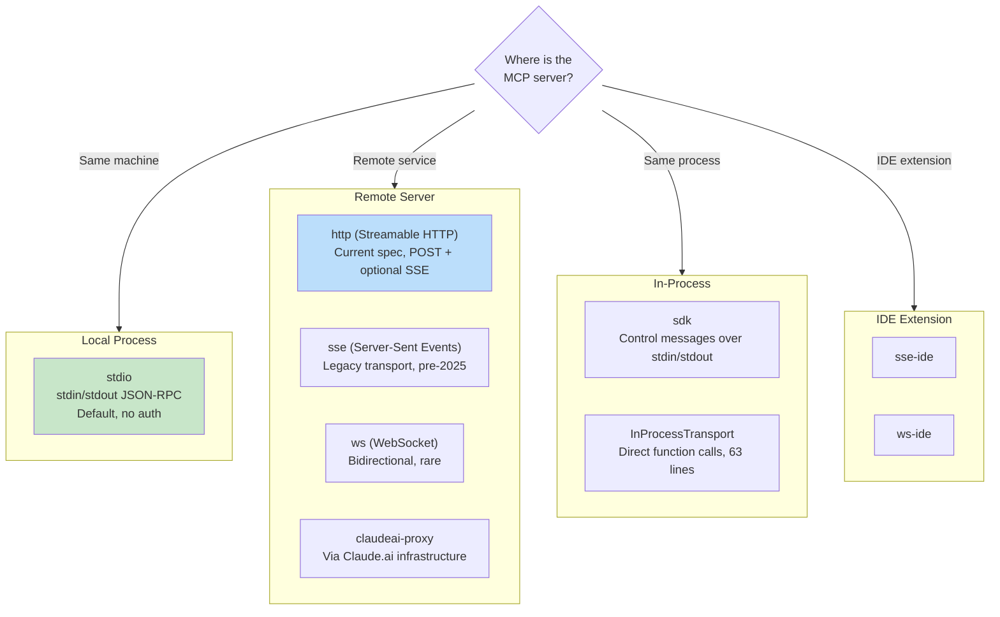
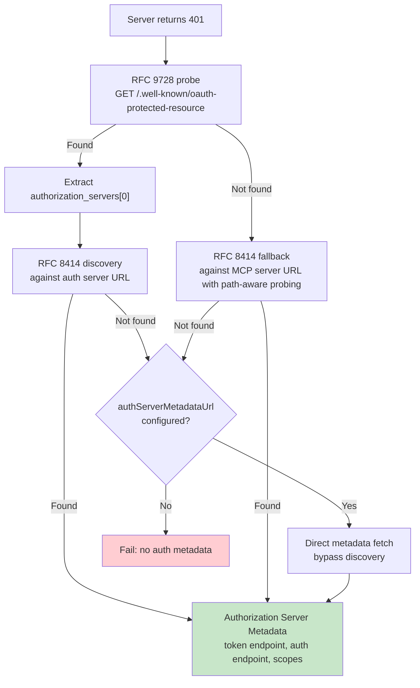

# الفصل 15: MCP -- البروتوكول الموحّد للـ Tools

## ليه MCP مهم خارج Claude Code؟

كل فصل تاني في الكتاب ده بيتكلم عن Claude Code من الداخل؛ لكن الفصل ده مختلف ومهم لأي مطور في عالم الذكاء الاصطناعي. بروتوكول **Model Context Protocol (MCP)** عبارة عن مواصفات قياسية مفتوحة المصدر (Open Specification) يقدر أي وكيل ذكي (Agent) يطبقها ويتعامل معاها. ومنظومة MCP داخل Claude Code بتعتبر واحدة من أكمل وأقوى الـ Production Clients الموجودة في الساحة حالياً. فلو بتبني أي AI Agent محتاج يستدعي أدوات وخدمات خارجية — بأي لغة برمجة، ومع أي نموذج — فالأنماط الهندسية (Patterns) اللي في الفصل ده هتنفعك مباشرة في مشاريعك.

الفكرة الأساسية في غاية البساطة والذكاء: MCP بيعرّف بروتوكول تواصل مبني على JSON-RPC 2.0 لاكتشاف الأدوات (Tools Discovery) واستدعائها بين العميل (الـ Agent Client) والخادم (الـ MCP Server اللي بيقدم الأدوات وقواعد البيانات). العميل بيبعت طلب `tools/list` عشان يكتشف الخادم بيقدم إيه، وبعدين يبعت `tools/call` لتنفيذ الأداة المطلوبة. والخادم بيوصف كل أداة باسمها وشرحها وبنية المدخلات بتاعتها عبر JSON Schema. ده العقد البرمجي (The Contract) كله ببساطة! وكل حاجة تانية — من اختيار وسيلة النقل والاتصال (Transport)، وإدارة المصادقة (Auth)، وتحميل الإعدادات، وتوحيد أسماء الأدوات — هي شغل هندسة البرمجيات العملي اللي بيحول مواصفة نظرية بسيطة إلى نظام متين يصمد في بيئات الإنتاج الحقيقية.

تطبيق بروتوكول MCP في Claude Code بيتوزع على 4 ملفات أساسية: `types.ts` و `client.ts` و `auth.ts` و `InProcessTransport.ts`. الملفات دي مع بعض بتدعم 8 أنواع من الـ Transports، و 7 مستويات لإعدادات النطاق (Scopes)، ومصادقة OAuth، وطبقة تغليف للأدوات (Tool Wrapping) بتخلي أدوات MCP تبان للنموذج وكأنها أدوات داخلية مدمجة بالظبط بنفس الـ Interface اللي اتكلمنا عنها في الفصل 6.

---

## أنواع الـ Transports الـ 8

أول قرار تصميمي عند التكامل مع MCP هو: كيف سيتواصل العميل مع الخادم؟ Claude Code بيدعم 8 أنواع وتكوينات من الـ Transports:



فيه 3 قرارات تصميمية مهمة جداً هنا:
1. **الـ Transport الافتراضي هو `stdio`:** لو حقل `type` مش محدد في الإعدادات، النظام بيفترض فوراً إنه Subprocess محلي شغال عبر `stdin/stdout`، وده بيضمن التوافق العكسي (Backwards Compatibility) مع أقدم إعدادات MCP وبدون تعقيدات شبكة.
2. **تركيب أغلفة الـ Fetch (Layered Fetch Wrappers):** مراقبة الـ Timeout بتغلف كشف الـ Step-up Auth من الخارج، ودي بتغلف استدعاء الـ Fetch الأساسي؛ فكل Wrapper مسؤول عن وظيفة واحدة فقط بدقة.
3. **التكيف مع الـ Runtime:** في اتصال `ws-ide`، الكود بيتفرع بين محرك Bun ومحرك Node وقت التشغيل؛ لأن Bun بيدعم اتصالات WebSocket والـ Proxy والـ TLS داخلياً، بينما Node بيحتاج مكتبة `ws` الخارجية.

**متى تستخدم كل نوع؟**
- **للأدوات المحلية (ملفات، قواعد بيانات، سكربتات خاصة):** استخدم `stdio`؛ مفيش مشاكل شبكة ولا شهادات أمان، مجرد Pipes سريعة ومباشرة.
- **للخدمات السحابية البعيدة:** بروتوكول `http` (Streamable HTTP) هو المعيار الحديث الموصى به رسمياً في المواصفات. بينما `sse` يعتبر Legacy ولكنه منتشر في الخوادم القديمة.

---

## تحميل الإعدادات وتحديد النطاقات (Scoping)

إعدادات خوادم MCP بتتحمّل من 7 مستويات ونطاقات (Scopes) مختلفة، وبتتدمج مع بعضها مع إزالة أي تكرار:

| الـ Scope | المصدر | مستوى الثقة |
|---|---|---|
| `local` | ملف `.mcp.json` في مجلد المشروع الحالي | يتطلب موافقة المستخدم الصريحة |
| `user` | حقل mcpServers في ملف `~/.claude.json` | يديره المستخدم شخصياً |
| `project` | إعدادات على مستوى المشروع المشترك | إعدادات مشتركة لفريق العمل |
| `enterprise` | إعدادات مؤسسية تديرها الشركة | معتمدة مسبقاً من مسؤولي الأمان |
| `managed` | خوادم توفرها الـ Plugins المضافة | تُكتشف تلقائياً عند تفعيل الإضافة |
| `claudeai` | واجهة الويب الخاصة بـ Claude.ai | مصرح بها مسبقاً عبر حساب الويب |
| `dynamic` | حقن وقت التشغيل عبر الـ SDK | تُضاف برمجياً في الكود |

**إزالة التكرار تعتمد على المحتوى لا على الاسم فقط:**
لو فيه خادمان مختلفان في الاسم ولكن لهما نفس الأمر أو نفس الرابط (URL)، النظام بيعتبرهما خادماً واحداً لتفادي الازدواجية؛ حيث تحسب الدالة `getMcpServerSignature()` مفتاحاً موحداً (Canonical Key) مثل: `stdio:["command","arg1"]` أو `url:https://example.com/mcp`.

---

## تغليف الأدوات (Tool Wrapping: من MCP إلى Claude Code)

بمجرد نجاح الاتصال بالخادم، العميل بيستدعي `tools/list`، وكل أداة راجعة بتتحول إلى الـ Interface الداخلية الموحدة `Tool` داخل Claude Code؛ فبالنسبة للنموذج (Model)، تصبح أدوات MCP متطابقة تماماً ولا يمكن تمييزها عن الأدوات المدمجة في النظام!

عملية التغليف بتمر بـ 4 خطوات دقيقة:
1. **توحيد الأسماء (Name Normalization):** الدالة `normalizeNameForMCP()` بتستبدل أي حروف غير صالحة بشرطات سفلية `_`، وتصيغ الاسم الكامل بنمط: `mcp__{serverName}__{toolName}` لتفادي تضارب الأسماء.
2. **اقتطاع الوصف الطويل (Description Truncation):** يتم تقييد طول وصف الأداة بـ 2,048 حرفاً فقط؛ لأن بعض الخوادم المولدة تلقائياً من مواصفات OpenAPI تضع أوصافاً ضخمة تصل لـ 60KB، وده كان بيستهلك 15,000 توكن من السياق في كل لفة لأداة واحدة!
3. **تمرير الـ Schema مباشرة (Schema Passthrough):** حقل `inputSchema` بيمر كما هو للنموذج بدون تعديل أو فحص وقت التسجيل؛ وأي خطأ في المدخلات يظهر وقت الاستدعاء الفعلي.
4. **تحويل التلميحات لأعلام سلوكية (Annotation Mapping):** تلميحات الـ MCP تتحول لإشارات برمجية: فتلميح `readOnlyHint` يعلم الأداة بأنها آمنة للتشغيل المتوازي (Concurrent Execution كما شرحنا في الفصل 7)، بينما تلميح `destructiveHint` يفعل فحص صلاحيات إضافي وتحذيراً للمستخدم.

---

## دعم مصادقة OAuth لخوادم MCP

الكثير من خوادم MCP السحابية تتطلب مصادقة وتسجيل دخول، ولذلك يطبق Claude Code مساراً متكاملاً لمصادقة OAuth 2.0 + PKCE:



- **سلسلة الاكتشاف التلقائي (Discovery Chain):** عند تلقي خطأ 401، يبحث العميل تلقائياً عن مسار `/.well-known/oauth-protected-resource` وفقاً للمواصفة القياسية RFC 9728 ثم RFC 8414 لتحديد خادم المصادقة وعنوان الحصول على الـ Tokens.
- **معالجة شذوذ الاستجابات (Error Body Normalization):** خوادم مثل Slack ترجع رمز HTTP 200 حتى في حالات الخطأ، ويكون الخطأ مدفوناً داخل الـ JSON؛ دالة المعالجة تفحص الردود وتعيد تصنيفها كـ HTTP 400 وتترجم رموز الأخطاء الخاصة بالشركات لرموز OAuth القياسية زي `invalid_grant`.

---

## النقل الداخلي في نفس الـ Process (In-Process Transport)

مش كل خادم MCP محتاج يشتغل كـ Subprocess منفصل ومستقل. الكلاس `InProcessTransport` بيسمح بتشغيل خادم MCP والعميل داخل نفس الـ Node.js Process وبأعلى أداء ممكن:

```typescript
class InProcessTransport implements Transport {
  async send(message: JSONRPCMessage): Promise<void> {
    if (this.closed) throw new Error('Transport is closed')
    queueMicrotask(() => { this.peer?.onmessage?.(message) })
  }
  async close(): Promise<void> {
    if (this.closed) return
    this.closed = true
    this.onclose?.()
    if (this.peer && !this.peer.closed) {
      this.peer.closed = true
      this.peer.onclose?.()
    }
  }
}
```

الملف بالكامل 63 سطراً فقط، ويحتوي على فكرتين تصميميتين ممتازتين:
- استخدام `queueMicrotask()` لتوصيل الرسائل لتفادي تجاوز عمق الـ Call Stack في دورات الطلب والرد المتتالية.
- إغلاق الطرف الآخر (Peer) تلقائياً عند إغلاق النقل لمنع حالات الاتصال المفتوح من طرف واحد (Half-open Connections). خوادم مثل Chrome MCP و Computer Use بتعتمد على هذا النمط الداخلي.

---

## معمارية المهلات الزمنية (Timeout Architecture)

المهلات الزمنية في منظومة MCP متعددة المستويات لحماية النظام من حالات وأشكال فشل مختلفة (Failure Modes):

| الطبقة | المدة | ماذا تحمي؟ |
|---|---|---|
| مهلة الاتصال (Connection Timeout) | 30s | الخوادم غير المتاحة أو البطيئة جداً في بدء التشغيل. |
| مهلة الطلب الواحد (Per-request Timeout) | 60s (تتجدد مع كل طلب) | تضمن عدم تعليق استدعاء فردي بسبب شبكة بطيئة. |
| مهلة استدعاء الأداة (Tool Call Timeout) | ~27.8 ساعة | العمليات الطويلة بطبيعتها كبناء المشاريع والترجمة. |
| مهلة المصادقة (Auth Timeout) | 30s لكل طلب OAuth | خوادم تسجيل الدخول المتعطلة أو المعلقة. |

النقطة الذكية هنا: دالة `wrapFetchWithTimeout()` تنشئ `AbortSignal` جديداً ومستقلاً مع كل استدعاء، وده بيحل مشكلة Bug شهير كان بيحصل لما يتم إنشاء Signal واحد مشترك يظل يعد تنازلياً حتى تنتهي مهلته أثناء خمول النظام فيتسبب في إلغاء كل الطلبات اللاحقة فوراً!

---

## دروس مستفادة لتطبيق MCP في مشروعك (Takeaways)

**1. ابدأ بـ stdio وأجّل التعقيد لوقت لاحق:**
كلاس `StdioClientTransport` يتولى تشغيل الـ Process، والربط بالـ Pipes، والإغلاق النظيف. سطر إعدادات واحد كفيل بربط أدواتك المحلية بسلاسة.

**2. وحّد أسماء الأدوات واقتطع الأوصاف الضخمة:**
التزم بنمط تسمية واضح يمنع التضارب (`mcp__server__tool`)، واحرص على اقتصار وصف الأداة على 2,048 حرفاً حتى لا تهدر نافذة السياق الخاصة بالنموذج في أوصاف مطولة.

**3. تعامل مع المصادقة بأسلوب Lazy:**
لا تحاول تشغيل مسارات OAuth إلا عندما يرجع الخادم خطأ 401؛ فأغلب الخوادم المحلية لا تتطلب أي تسجيل دخول.

**4. استخدم In-Process Transport للأدوات المدمجة:**
إذا كنت تبني خادم MCP داخلياً في نفس تطبيقك، استخدم النقل البرمجي الداخلي لتتخلص تماماً من عبء إنشاء Subprocesses جديدة في نظام التشغيل.

**5. احترم التلميحات الأمنية ونظف المخرجات:**
استفد من تلميح `readOnlyHint` لتشغيل الأدوات الآمنة بالتوازي، ونظف النصوص المرتجعة من أي محارف Unicode خبيثة (مثل علامات قلب اتجاه الكتابة Bidi Overrides) التي قد تحاول تضليل النموذج والتلاعب بأوامره.
