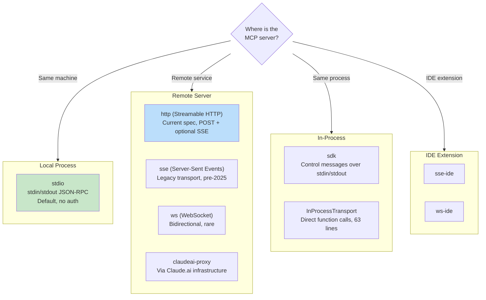
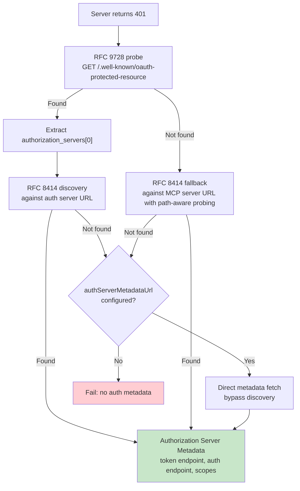

# الفصل 15: MCP -- البروتوكول الموحّد للـ Tools

## ليه MCP مهم خارج Claude Code

كل فصل تاني في الكتاب ده بيتكلم عن Claude Code من الداخل. الفصل ده مختلف. الـ Model Context Protocol عبارة عن specification مفتوح أي agent يقدر يعمله implement، والـ MCP subsystem في Claude Code واحد من أكمل الـ production clients الموجودة حاليًا. لو بتبني agent محتاج يستدعي tools خارجية، أي agent، بأي لغة، على أي model، فالـ patterns اللي في الفصل ده بتنفع عندك مباشرة.

الفكرة الأساسية بسيطة: MCP بيعرّف بروتوكول JSON-RPC 2.0 لاكتشاف الـ tools واستدعائها بين client (وهو الـ agent) و server (وهو اللي بيقدّم الـ tools). الـ client بيبعت `tools/list` عشان يكتشف الـ server بيقدّم إيه، وبعدين `tools/call` عشان ينفذ. والـ server بيوصف كل tool باسم، ووصف، و JSON Schema للـ inputs الخاصة بيها. ده الـ contract كله. وكل حاجة تانية، من اختيار الـ transport (طريقة نقل الرسائل بين الـ client والـ server) للـ authentication لتحميل الإعدادات لـ tool name normalization، هي شغل الـ implementation اللي بيحوّل spec نظيف لحاجة بتصمد لما تقابل الواقع.

الـ MCP implementation في Claude Code بيتوزع على 4 ملفات أساسية: `types.ts` و `client.ts` و `auth.ts` و `InProcessTransport.ts`. الملفات دي مع بعض بتدعم 8 transport types، و 7 configuration scopes، و OAuth discovery على 2 RFCs، وطبقة tool wrapping بتخلّي الـ MCP tools مش ممكن تتفرق عن الـ built-in tools، وهي نفس الـ interface `Tool` اللي اتكلمنا عنها في الفصل 6. الفصل ده بيمشي على الطبقات دي واحدة واحدة.

---

## الـ 8 Transport Types

أول قرار تصميم في أي MCP integration هو إزاي الـ client هيكلم الـ server. بيدعم Claude Code 8 transport configurations:



فيه 3 اختيارات تصميم تستاهل الملاحظة. أولًا، الـ transport `stdio` هو الافتراضي: لو الـ field `type` مش موجود، النظام بيفترض إنه subprocess محلي. وده backwards-compatible مع أقدم إعدادات MCP. ثانيًا، الـ fetch wrappers بتتركب فوق بعض: الـ timeout wrapping بيغلّف الـ step-up detection من الخارج، وده بدوره بيغلّف الـ base fetch. وكل wrapper مسؤول عن حاجة واحدة بس. ثالثًا، الـ branch الخاص بـ `ws-ide` فيه تفريعة بين Bun و Node وقت التشغيل: الـ class `WebSocket` في Bun بيقبل إعدادات الـ proxy والـ TLS بشكل مدمج، أما Node فمحتاج الـ package `ws`.

**تستخدم إيه وإمتى.** للـ tools المحلية (filesystem، قاعدة بيانات، scripts خاصة بك)، استخدم `stdio`: من غير شبكة، ولا auth، مجرد pipes. للخدمات البعيدة، الـ transport `http` (Streamable HTTP) هو اللي الـ spec الحالي بيوصي بيه. أما `sse` فهو legacy لكنه منتشر على نطاق واسع. والأنواع `sdk` و IDE و `claudeai-proxy` داخلية، كل واحد منها خاص بالـ ecosystem الخاص بيه.

---

## تحميل الإعدادات والـ Scoping

إعدادات الـ MCP servers بتتحمّل من 7 scopes، وبتتدمج مع بعض وبتتشال منها التكرارات:

| الـ Scope | المصدر | الثقة |
|-------|--------|-------|
| `local` | ملف `.mcp.json` في الـ working directory | محتاج موافقة المستخدم |
| `user` | الـ field mcpServers في `~/.claude.json` | بيديره المستخدم |
| `project` | إعدادات على مستوى المشروع | إعدادات مشتركة للمشروع |
| `enterprise` | إعدادات enterprise بتديرها المؤسسة | معتمدة مسبقًا من المؤسسة |
| `managed` | servers بتوفرها الـ plugins | بتتكتشف تلقائيًا |
| `claudeai` | الـ web interface الخاصة بـ Claude.ai | مصرّح بها مسبقًا عن طريق الـ web |
| `dynamic` | حقن وقت التشغيل (SDK) | بتتضاف برمجيًا |

**إزالة التكرار بتعتمد على المحتوى، مش على الاسم.** لو فيه 2 servers مختلفة في الاسم لكن بنفس الأمر أو نفس الـ URL، النظام بيعتبرها نفس الـ server. الـ function `getMcpServerSignature()` بتحسب canonical key (مفتاح موحّد): `stdio:["command","arg1"]` للـ servers المحلية، و `url:https://example.com/mcp` للبعيدة. والـ servers اللي جاية من plugins ولها نفس signature إعداد يدوي بتتستبعد.

---

## الـ Tool Wrapping: من MCP لـ Claude Code

لما الاتصال ينجح، الـ client بيستدعي `tools/list`. وكل تعريف tool بيتحوّل للـ interface الداخلية `Tool` في Claude Code، وهي نفس الـ interface اللي الـ built-in tools بتستخدمها. بعد الـ wrapping، الـ model مش بيقدر يفرّق بين built-in tool و MCP tool.

عملية الـ wrapping ليها 4 مراحل:

**1. الـ name normalization.** الـ function `normalizeNameForMCP()` بتستبدل الحروف غير الصالحة بـ underscores. والـ fully qualified name بيمشي على الشكل `mcp__{serverName}__{toolName}`.

**2. الـ description truncation.** الوصف محدود بـ 2,048 حرف. اتلاحظ إن الـ servers المولّدة من OpenAPI بتحط 15-60KB في `tool.description`، يعني حوالي 15,000 tokens في كل turn لـ tool واحدة.

**3. الـ schema passthrough.** الـ field `inputSchema` الخاص بالـ tool بيتمرر للـ API زي ما هو. من غير أي تحويل، ومن غير أي validation وقت الـ wrapping. أخطاء الـ schema بتظهر وقت الاستدعاء، مش وقت التسجيل.

**4. الـ annotation mapping.** الـ MCP annotations بتتحوّل لـ behavior flags: الـ annotation `readOnlyHint` بيعلّم الـ tools إنها آمنة للتنفيذ الـ concurrent (زي ما اتكلمنا عن الـ streaming executor في الفصل 7)، والـ annotation `destructiveHint` بيفعّل فحص صلاحيات إضافي. الـ annotations دي جاية من الـ MCP server نفسه، يعني server خبيث ممكن يعلّم tool مدمّرة إنها read-only. ده trust boundary مقبول، لكنه يستاهل تفهمه: المستخدم هو اللي اختار يضيف الـ server، و server خبيث بيعلّم tools مدمّرة إنها read-only هو attack vector حقيقي. النظام قابل بالـ trade-off ده (مفاضلة: بتكسب حاجة وبتدفع ثمنها في حاجة تانية)، لأن البديل، وهو تجاهل الـ annotations تمامًا، كان هيمنع الـ servers السليمة من إنها تحسّن تجربة المستخدم.

---

## الـ OAuth للـ MCP Servers

كثير من الـ MCP servers البعيدة بتطلب authentication. وبينفّذ Claude Code الـ flow الكامل لـ OAuth 2.0 + PKCE، مع discovery مبني على الـ RFCs، و Cross-App Access، و error body normalization.

### الـ Discovery Chain



الـ option `authServerMetadataUrl` موجود كـ escape hatch (مخرج استثنائي من القاعدة)، لأن بعض الـ OAuth servers مش بتطبّق ولا واحد من الـ 2 RFCs.

### الـ Cross-App Access (XAA)

لما إعدادات MCP server فيها `oauth.xaa: true`، النظام بيعمل federated token exchange عن طريق Identity Provider: تسجيل دخول واحد على الـ IdP بيفتح أكثر من MCP server.

### الـ Error Body Normalization

الـ function `normalizeOAuthErrorBody()` بتتعامل مع الـ OAuth servers اللي بتخالف الـ spec. Slack بيرجّع HTTP 200 لردود الأخطاء، والخطأ نفسه مدفون داخل الـ JSON body. الـ function بتبص على الـ bodies الخاصة بردود الـ POST من نوع 2xx، ولو الـ body مطابق لـ `OAuthErrorResponseSchema` ومش مطابق لـ `OAuthTokensSchema`، بتعيد كتابة الرد على إنه HTTP 400. وكمان بتحوّل أكواد الأخطاء الخاصة بـ Slack (`invalid_refresh_token` و `expired_refresh_token` و `token_expired`) للكود القياسي `invalid_grant`.

---

## الـ In-Process Transport

مش كل MCP server لازم يكون process منفصلة. الـ class `InProcessTransport` بيسمح بتشغيل MCP server و client في نفس الـ process:

```typescript
class InProcessTransport implements Transport {
  async send(message: JSONRPCMessage): Promise<void> {
    if (this.closed) throw new Error('Transport is closed')
    queueMicrotask(() => { this.peer?.onmessage?.(message) })
  }
  async close(): Promise<void> {
    if (this.closed) return
    this.closed = true
    this.onclose?.()
    if (this.peer && !this.peer.closed) {
      this.peer.closed = true
      this.peer.onclose?.()
    }
  }
}
```

الملف كله 63 سطر. وفيه قرارين تصميم يستاهلوا الانتباه. أولًا، الـ method `send()` بتوصّل الرسالة عن طريق `queueMicrotask()` عشان تتجنب مشاكل عمق الـ stack في دورات request/response المتزامنة (synchronous). ثانيًا، الـ method `close()` بتنتشر للـ peer كمان، وده بيمنع حالات الـ half-open. الـ Chrome MCP server والـ Computer Use MCP server الاتنين بيستخدموا الـ pattern ده.

---

## إدارة الـ Connection

### حالات الـ Connection

كل connection لـ MCP server بيكون في واحدة من 5 حالات: `connected` أو `failed` أو `needs-auth` (ودي معاها cache بـ TTL 15 دقيقة، عشان 30 servers ما تروحش كل واحدة لوحدها تكتشف نفس الـ token المنتهي) أو `pending` أو `disabled`.

### اكتشاف الـ Session Expiry

الـ Streamable HTTP transport في MCP بيستخدم session IDs. لما الـ server يعمل restart، الـ requests بترجع HTTP 404 ومعاه JSON-RPC error code -32001. الـ function `isMcpSessionExpiredError()` بتفحص الإشارتين. وخد بالك إنها بتعتمد على وجود string داخل رسالة الخطأ عشان تكتشف الـ error code، وده حل عملي لكنه هشّ:

```typescript
export function isMcpSessionExpiredError(error: Error): boolean {
  const httpStatus = 'code' in error ? (error as any).code : undefined
  if (httpStatus !== 404) return false
  return error.message.includes('"code":-32001') ||
    error.message.includes('"code": -32001')
}
```

لما الخطأ يتكتشف، الـ connection cache بيتمسح والاستدعاء بيتكرر مرة واحدة.

### الـ Batched Connections

الـ servers المحلية بتتوصل في batches من 3 (لأن عمل spawn لـ processes ممكن يستهلك كل الـ file descriptors)، والـ servers البعيدة في batches من 20. والـ React context provider في ملف `MCPConnectionManager.tsx` هو اللي بيدير الـ lifecycle، وبيعمل diff بين الـ connections الحالية والإعدادات الجديدة.

---

## الـ Claude.ai Proxy Transport

الـ transport `claudeai-proxy` بيوضح pattern شائع في تكامل الـ agents: الاتصال عن طريق وسيط. مشتركين Claude.ai بيضيفوا "connectors" (موصّلات) لـ MCP من الـ web interface، والـ CLI بيمرّر الاتصال عن طريق الـ infrastructure الخاصة بـ Claude.ai، وهي اللي بتتعامل مع الـ OAuth من ناحية الـ vendor.

الـ function `createClaudeAiProxyFetch()` بتلتقط قيمة `sentToken` وقت الـ request، ومش بتعيد قراءتها بعد الـ 401. لو حصلت أخطاء 401 متزامنة من أكثر من connector، ممكن يكون retry من connector تاني عمل refresh للـ token أصلًا. والـ function كمان بتفحص وجود refreshes متزامنة حتى لو الـ refresh handler رجّع false، ودي حالة "ELOCKED contention" اللي فيها connector تاني كسب سباق الـ lockfile.

---

## الـ Timeout Architecture

الـ MCP timeouts متعددة الطبقات، وكل طبقة بتحمي من failure mode (شكل من أشكال الفشل المحتملة) مختلف:

| الطبقة | المدة | بتحمي من |
|-------|----------|------------------|
| الـ Connection | 30s | servers مش ممكن الوصول لها أو بطيئة في البدء |
| لكل request | 60s (جديد لكل request) | الـ bug الخاص بالـ timeout signal القديم |
| الـ Tool call | ~27.8 ساعة | عمليات طويلة بطبيعتها |
| الـ Auth | 30s لكل OAuth request | OAuth servers مش ممكن الوصول لها |

الـ per-request timeout يستاهل التركيز عليه. الـ implementations الأولى كانت بتنشئ `AbortSignal.timeout(60000)` واحد وقت الاتصال. وبعد 60 ثانية من الخمول (idle)، الـ request اللي بعده كان بيتعمل له abort فورًا: الـ signal كان منتهي أصلًا. الحل: الـ function `wrapFetchWithTimeout()` بتنشئ timeout signal جديد لكل request. وكمان بتوحّد الـ header `Accept` كخط دفاع أخير ضد الـ runtimes والـ proxies اللي بتشيله.

---

## طبّق ده: دمج MCP في الـ Agent الخاص بك

**ابدأ بـ stdio، وضيف التعقيد بعدين.** الـ class `StdioClientTransport` بيتعامل مع كل حاجة: spawn، و pipe، و kill. سطر إعدادات واحد، و transport class واحد، وتبقى عندك MCP tools.

**اعمل normalize للأسماء و truncate للوصف.** الأسماء لازم تطابق `^[a-zA-Z0-9_-]{1,64}$`. ضيف بادئة `mcp__{serverName}__` عشان تتجنب التعارض. وحدّد الوصف بـ 2,048 حرف، وإلا الـ servers المولّدة من OpenAPI هتضيّع context tokens.

**تعامل مع الـ auth بشكل lazy.** ماتحاولش تعمل OAuth غير لما server يرجّع 401. أغلب الـ stdio servers مش محتاجة auth.

**استخدم in-process transport للـ built-in servers.** الـ function `createLinkedTransportPair()` بتلغي overhead الـ subprocess للـ servers اللي إنت متحكم فيها.

**احترم الـ tool annotations ونظّف الـ output.** الـ annotation `readOnlyHint` بيفعّل التنفيذ الـ concurrent. نظّف الردود من الـ Unicode الخبيث (زي الـ bidirectional overrides والـ zero-width joiners) اللي ممكن يضلّل الـ model.

بروتوكول MCP بسيط عن قصد: 2 JSON-RPC methods بس. وكل اللي بين الـ 2 methods دي والـ production deployment هو هندسة: 8 transports، و 7 config scopes، و 2 OAuth RFCs، وطبقات الـ timeout. والـ implementation في Claude Code بيوضح الهندسة دي شكلها إيه على نطاق واسع.

الفصل الجاي بيبص على اللي بيحصل لما الـ agent يطلع خارج localhost: بروتوكولات التنفيذ عن بُعد اللي بتخلّي Claude Code يشتغل في cloud containers، ويستقبل تعليمات من browsers، ويمرّر traffic الـ API عن طريق proxies بتحقن الـ credentials.
