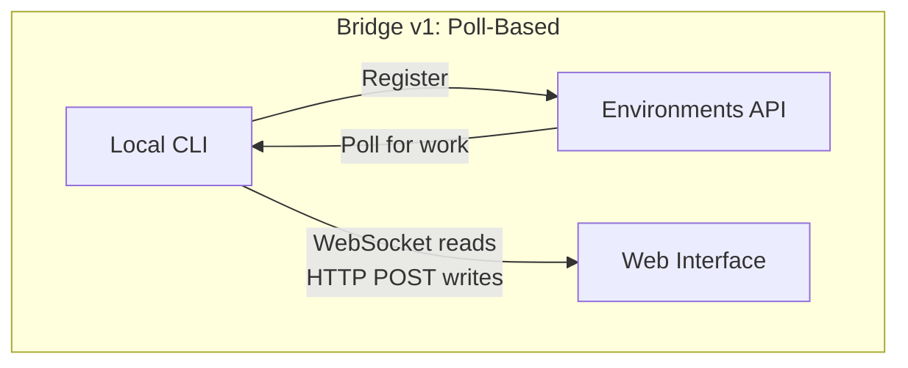
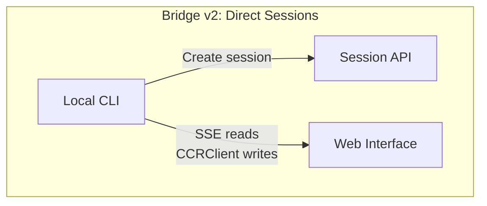
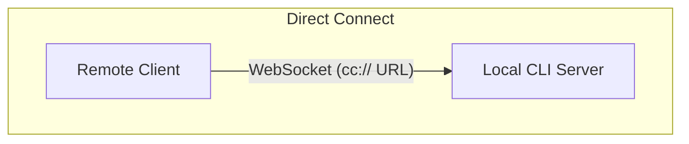
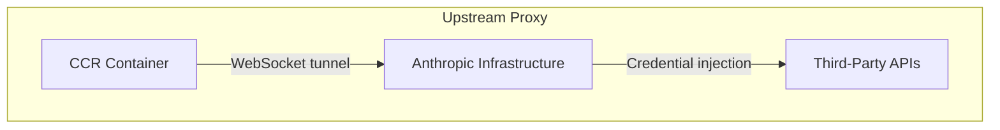

# الفصل 16: التحكم عن بُعد والتنفيذ على الـ Cloud

## الـ Agent بيتعدّى حدود localhost

كل فصل لحد الآن كان بيفترض إن Claude Code شغال على نفس الجهاز اللي فيه الكود. الـ terminal محلي. الـ filesystem محلي. وردود الـ model بترجع stream لـ process واحدة هي اللي ماسكة الـ keyboard والـ working directory مع بعض.

الافتراض ده بيتكسر أول ما تحب تتحكم في Claude Code من browser، أو تشغّله داخل container على الـ cloud، أو تعرضه كـ service على الـ LAN عندك. الـ agent محتاج طريقة يستقبل بيها التعليمات من web browser أو mobile app أو pipeline آلي. ومحتاج يمرّر الـ permission prompts لحد مش قاعد قدام الـ terminal. ومحتاج يعدّي الـ API traffic الخاص بيه في tunnel عبر infrastructure ممكن تحقن credentials أو تنهي الـ TLS نيابة عن الـ agent.

بيحل Claude Code المشكلة دي بـ 4 أنظمة، كل واحد منها بيتعامل مع topology مختلفة:

<div class="diagram-grid">









</div>

الأنظمة دي بتشترك في فلسفة تصميم واحدة: القراءة والكتابة مش متماثلين، وإعادة الاتصال بتحصل تلقائيًا، والفشل بيحصل بشكل متدرّج من غير ما يوقّع النظام كله.

---

## Bridge v1: الـ Poll والـ Dispatch والـ Spawn

الـ v1 bridge هو نظام الـ remote control المبني على الـ environments. لما المطوّر يشغّل `claude remote-control`، الـ CLI بيسجّل نفسه في الـ Environments API، وبيعمل poll عشان يجيب شغل، وبيعمل spawn لـ child process لكل session.

قبل التسجيل، بتتنفذ سلسلة من الـ pre-flight checks: runtime feature gate، والتحقق من الـ OAuth token، وفحص سياسة الـ organization، واكتشاف الـ dead tokens (وده backoff مشترك بين الـ processes بعد 3 محاولات فاشلة متتالية بنفس الـ token المنتهي)، و proactive token refresh بيمنع فشل حوالي 9% من التسجيلات اللي كانت هتفشل من أول محاولة لولاه.

بعد التسجيل، الـ bridge (جسر بيوصل الـ CLI المحلي بالـ web interface) بيدخل في long-poll loop. عناصر الشغل بتوصل إما كـ sessions (ومعاها field اسمه `secret` فيه الـ session tokens والـ API base URL وإعدادات الـ MCP والـ environment variables) أو كـ healthchecks. والـ bridge بيقلل رسائل الـ log من نوع "no work" (مفيش شغل) لرسالة واحدة كل 100 poll فاضي.

كل session بتعمل spawn لـ child process من Claude Code، بتتواصل عن طريق NDJSON على stdin/stdout. طلبات الصلاحيات بتعدّي من الـ bridge transport (طريقة نقل الرسائل بين الـ client والـ server) للـ web interface، وهناك المستخدم بيوافق أو يرفض. والـ round-trip لازم يخلص في حدود 10-14 ثانية تقريبًا.

---

## Bridge v2: الـ Direct Sessions والـ SSE

الـ v2 bridge بيلغي طبقة الـ Environments API بالكامل: مفيش تسجيل، ولا polling، ولا acknowledgment، ولا heartbeat، ولا deregistration. والدافع: في v1 كان الـ server محتاج يعرف إمكانيات الجهاز قبل ما يبعت له شغل. أما v2 فبيختصر الـ lifecycle في 3 خطوات:

1. **إنشاء session**: `POST /v1/code/sessions` بالـ OAuth credentials.
2. **توصيل الـ bridge**: `POST /v1/code/sessions/{id}/bridge`. بيرجّع `worker_jwt` و `api_base_url` و `worker_epoch`. كل استدعاء لـ `/bridge` بيزوّد الـ epoch. والاستدعاء ده هو نفسه التسجيل.
3. **فتح الـ transport**: SSE للقراءة، و `CCRClient` للكتابة.

الـ transport abstraction (`ReplBridgeTransport`) بيوحّد v1 و v2 ورا interface مشتركة، فمعالجة الرسائل مش محتاجة تعرف هي بتكلم أي جيل منهم.

لما الـ SSE connection يقع بسبب 401، الـ transport بيتبني من جديد بـ credentials جديدة من استدعاء `/bridge` جديد، مع الاحتفاظ بالـ sequence number cursor. فمفيش رسائل بتضيع. أما مسار الكتابة فبيستخدم closures من `getAuthToken` خاصة بكل instance بدل الـ environment variables على مستوى الـ process كله، وده بيمنع تسرّب الـ JWT بين الـ sessions اللي شغالة مع بعض.

### الـ FlushGate

فيه مشكلة ترتيب دقيقة: الـ bridge محتاج يبعت سجل المحادثة وفي نفس الوقت يستقبل كتابات حية من الـ web interface. لو كتابة حية وصلت أثناء ما الـ history بيتبعت، الرسائل ممكن توصل بترتيب غلط. الـ class `FlushGate` بيحط الكتابات الحية في queue أثناء الـ flush POST، وبيفرّغها بالترتيب لما يخلص.

### الـ Token Refresh وإدارة الـ Epoch

الـ v2 bridge بيجدّد الـ worker JWTs بشكل استباقي قبل ما تنتهي صلاحيتها. والـ epoch الجديد بيقول للـ server إن ده نفس الـ worker لكن بـ credentials جديدة. أما عدم تطابق الـ epoch (ردود 409) فبيتعامل معاه النظام بحزم: الاتصالين بيتقفلوا، و exception بيطلع للـ caller، وده بيمنع سيناريوهات الـ split-brain (إن نسختين يشتغلوا في نفس الوقت وكل واحدة فاكرة إنها الأصل).

---

## توجيه الرسائل والـ Echo Deduplication

جيلا الـ Bridge الاثنين بيشتركوا في `handleIngressMessage()` كـ router مركزي:

1. يعمل parse للـ JSON، ويوحّد شكل مفاتيح رسائل الـ control.
2. يوجّه `control_response` للـ permission handler، و `control_request` للـ request handler.
3. يدوّر على الـ UUID في `recentPostedUUIDs` (الـ echo dedup) و `recentInboundUUIDs` (الـ re-delivery dedup).
4. يمرّر رسائل المستخدم اللي عدّت التحقق.

### BoundedUUIDSet: بحث O(1) وذاكرة O(capacity)

الـ bridge عنده مشكلة echo (إن الرسالة ترجع من الـ server وتتعرض مرتين): الرسائل ممكن ترجع تاني على الـ read stream، أو تتسلّم مرتين أثناء التبديل بين الـ transports. الـ class `BoundedUUIDSet` عبارة عن set محدود الحجم بنظام FIFO، ومبني على circular buffer:

```typescript
class BoundedUUIDSet {
  private buffer: string[]
  private set: Set<string>
  private head = 0

  add(uuid: string): void {
    if (this.set.size >= this.capacity) {
      this.set.delete(this.buffer[this.head])
    }
    this.buffer[this.head] = uuid
    this.set.add(uuid)
    this.head = (this.head + 1) % this.capacity
  }

  has(uuid: string): boolean { return this.set.has(uuid) }
}
```

بيشتغل منه نسختين (Two Instances) بالتوازي، سعة كل واحد 2000. البحث O(1) عن طريق الـ Set، والذاكرة O(capacity) عن طريق إزالة الأقدم من الـ circular buffer، ومن غير timers ولا TTLs. والـ control requests اللي الـ subtype الخاص بيها مش معروف بتاخد error response مش صمت، وده بيمنع الـ server إنه يفضل مستني رد مش هيوصل أبدًا.

---

## التصميم غير المتماثل: قراءة عبر اتصال دائم، وكتابة عبر HTTP POST

بروتوكول CCR بيستخدم transport غير متماثل: القراءة بتمشي عبر اتصال دائم (WebSocket أو SSE)، والكتابة بتمشي عبر HTTP POST. وده بيعكس عدم تماثل جوهري في نمط الاتصال نفسه.

القراءة عالية التكرار، وقليلة الـ latency (زمن الاستجابة)، والـ server هو اللي بيبدأها: مئات الرسائل الصغيرة في الثانية أثناء الـ token streaming. فالاتصال الدائم هو الاختيار المنطقي الوحيد. أما الكتابة فقليلة التكرار، والـ client هو اللي بيبدأها، ومحتاجة acknowledgment: رسائل في الدقيقة، مش في الثانية. و HTTP POST بيدّي توصيل موثوق، و idempotency (تكرار الطلب بيدّي نفس النتيجة) عن طريق الـ UUIDs، وتكامل طبيعي مع الـ load balancers.

لو حاولت توحّدهم على WebSocket واحد، هتخلق coupling: لو الـ WebSocket وقع أثناء كتابة، هتحتاج retry logic، ولازم تفرّق بين "not sent" (ماتبعتش) و "sent but acknowledgment lost" (اتبعت لكن الـ acknowledgment ضاع). أما فصل القناتين فبيخلّي كل واحدة تتحسّن بشكل مستقل.

---

## إدارة الـ Remote Sessions

الـ class `SessionsWebSocket` بيدير جانب الـ client في اتصال WebSocket الخاص بـ CCR. واستراتيجية إعادة الاتصال الخاصة بيه بتفرّق بين أنواع الفشل:

| الفشل | الاستراتيجية |
|---------|----------|
| 4003 (unauthorized) | يوقف فورًا، من غير أي retries |
| 4001 (session not found) | 3 retries كحد أقصى، مع linear backoff (فشل مؤقت أثناء الـ compaction) |
| أي فشل مؤقت تاني | exponential backoff، 5 محاولات كحد أقصى |

الـ type guard `isSessionsMessage()` بيقبل أي object فيه field اسمه `type` من نوع string، وده تساهل مقصود. لأن allowlist ثابتة في الكود كانت هترمي أنواع الرسائل الجديدة في صمت قبل ما الـ client يتحدّث.

---

## Direct Connect: الـ Local Server

الـ Direct Connect هو أبسط topology: بيشتغل Claude Code كـ server، والـ clients بتتوصل بيه عبر WebSocket. من غير وسيط على الـ cloud، ومن غير OAuth tokens.

الـ sessions ليها 5 حالات: `starting` و `running` و `detached` و `stopping` و `stopped`. والـ metadata بتتحفظ في `~/.claude/server-sessions.json` عشان تقدر تعمل resume للـ session بعد ما الـ server يتعاد تشغيله. أما الـ URL scheme `cc://` فبيوفّر طريقة عنونة نظيفة للاتصالات المحلية.

---

## الـ Upstream Proxy: حقن الـ Credentials داخل الـ Containers

الـ upstream proxy بيشتغل داخل الـ CCR containers، وبيحل مشكلة محددة: حقن credentials الـ organization في الـ HTTPS traffic الخارج من container ممكن الـ agent ينفّذ فيه أوامر مش موثوقة.

تسلسل الإعداد مرتّب بعناية:

1. يقرأ الـ session token من `/run/ccr/session_token`.
2. يضبط `prctl(PR_SET_DUMPABLE, 0)` عن طريق Bun FFI، وده بيمنع أي process بنفس الـ UID من عمل ptrace على الـ heap الخاص بالـ process. من غير الخطوة دي، أمر زي `gdb -p $PPID` جاي من prompt injection كان ممكن يسحب الـ token من الذاكرة.
3. ينزّل شهادة الـ CA الخاصة بالـ upstream proxy ويضمّها للـ system CA bundle.
4. يشغّل relay محلي من CONNECT لـ WebSocket على ephemeral port.
5. يعمل unlink لملف الـ token، فالـ token بقى موجود على الـ heap بس.
6. يصدّر الـ environment variables لكل الـ subprocesses.

كل خطوة من دول fail open، يعني أي خطأ بيعطّل الـ proxy بدل ما يقتل الـ session. وده الـ trade-off الصحيح: فشل الـ proxy معناه إن بعض الـ integrations مش هتشتغل، لكن الوظائف الأساسية هتفضل متاحة.

### الـ Protobuf Hand-Encoding

الـ bytes اللي بتعدّي في الـ tunnel بتتغلّف في رسائل protobuf من نوع `UpstreamProxyChunk`. والـ schema بسيطة جدًا (`message UpstreamProxyChunk { bytes data = 1; }`)، و Claude Code بيعمل لها encode يدويًا في 10 سطور بدل ما يجيب protobuf runtime كامل:

```typescript
export function encodeChunk(data: Uint8Array): Uint8Array {
  const varint: number[] = []
  let n = data.length
  while (n > 0x7f) { varint.push((n & 0x7f) | 0x80); n >>>= 7 }
  varint.push(n)
  const out = new Uint8Array(1 + varint.length + data.length)
  out[0] = 0x0a  // field 1, wire type 2
  out.set(varint, 1)
  out.set(data, 1 + varint.length)
  return out
}
```

10 سطور بتغني عن protobuf runtime كامل. رسالة من field واحد مش بتبرر إضافة dependency: عبء صيانة الـ bit manipulation أقل بكثير من مخاطر الـ supply chain.

---

## طبّق ده: تصميم تنفيذ الـ Agent عن بُعد

**افصل قناة القراءة عن قناة الكتابة.** لما القراءة تكون streams عالية التكرار والكتابة تكون RPCs قليلة التكرار، توحيدهم بيخلق coupling مالوش لزوم. خلّي كل قناة تفشل وتتعافى بشكل مستقل.

**حط حد لذاكرة الـ deduplication.** الـ BoundedUUIDSet pattern بيدّي deduplication بذاكرة ثابتة. أي نظام توصيل من نوع at-least-once محتاج dedup buffer محدود، مش Set بلا حدود.

**خلّي استراتيجية إعادة الاتصال متناسبة مع إشارة الفشل.** الفشل الدائم مفيش داعي تعيد المحاولة بعده. الفشل المؤقت تعيد المحاولة بعده مع backoff. والفشل الغامض تعيد المحاولة بعده بسقف منخفض.

**خلّي الأسرار على الـ heap بس في البيئات العدائية.** قراءة الـ token من ملف، وتعطيل الـ ptrace، ومسح الملف، كل ده بيقفل مسارين للهجوم: الـ filesystem وفحص الذاكرة.

**خلّي الأنظمة المساعدة fail open.** الـ upstream proxy بيعمل fail open لأنه بيقدّم وظيفة إضافية (حقن الـ credentials)، مش وظيفة أساسية (الـ model inference).

أنظمة التنفيذ عن بُعد بتجسّد مبدأ أعمق: الـ core loop الخاص بالـ agent (الفصل 5) المفروض ما يفرقش معاه التعليمات جاية منين ولا النتائج رايحة فين. الـ bridge والـ Direct Connect والـ upstream proxy كلهم transport layers. أما معالجة الرسائل وتنفيذ الـ tools والـ permission flows اللي فوقهم فمتطابقة، سواء المستخدم قاعد قدام الـ terminal أو على الطرف التاني من WebSocket.

الفصل الجاي بيتناول الجانب التشغيلي التاني: الأداء، يعني إزاي Claude Code بيخلّي كل ملي ثانية وكل token يفرقوا، في بدء التشغيل والـ rendering والبحث وتكاليف الـ API.
