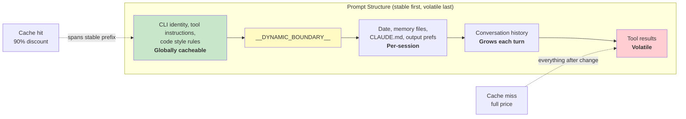

# الفصل 17: الأداء -- كل ملي ثانية وكل Token بيفرقوا

## دليل المهندس الـ senior

تحسين الأداء في نظام agentic (يعني الـ model هو اللي بيقرر الخطوات وقت التشغيل) مش مشكلة واحدة. هو 5 مشاكل:

1. **الـ Startup latency** -- الوقت من ضغطة المفتاح لحد أول output مفيد. المستخدمين بيسيبوا الأدوات اللي بيحسوا إنها بطيئة في التشغيل.
2. **كفاءة الـ tokens** -- نسبة الـ context window اللي بيستهلكها محتوى مفيد مقابل الـ overhead. والـ context window هو أضيق مورد عندك.
3. **تكلفة الـ API** -- المبلغ بالدولار لكل turn. الـ prompt caching ممكن يقلله بنسبة 90%، لكن بس لو النظام حافظ على استقرار الـ cache من turn للتاني.
4. **الـ Rendering throughput** -- عدد الـ frames في الثانية أثناء الـ streaming output. الفصل 13 غطّى الـ rendering architecture، والفصل ده بيغطي قياسات الأداء والتحسينات اللي بتخليه سريع.
5. **سرعة البحث** -- الوقت اللي بياخده إيجاد ملف في codebase فيها 270,000 مسار مع كل ضغطة مفتاح.

بيهاجم Claude Code الـ 5 مشاكل دي بتقنيات بتتراوح من البديهي (الـ memoization) للدقيق (bitmaps من 26-bit لعمل pre-filter للـ fuzzy search). ملاحظة عن المنهجية: التحسينات دي مش نظرية. النسخة اللي بتوصل للمستخدمين من Claude Code فيها 50+ startup profiling checkpoints، بتتجمع عيّناتها من 100% من المستخدمين الداخليين و 0.5% من المستخدمين الخارجيين. كل تحسين هتقراه تحت كان دافعه بيانات من الـ instrumentation ده، مش الحدس.

---

## توفير الملي ثانية عند بدء التشغيل

### الـ I/O Parallelism على مستوى الـ Module

الـ entry point `main.tsx` بيكسر عمدًا قاعدة "no side effects at module scope" (ممنوع الـ side effects على مستوى الـ module):

```typescript
profileCheckpoint('main_tsx_entry');
startMdmRawRead();       // fires plutil/reg-query subprocesses
startKeychainPrefetch();  // fires both macOS keychain reads in parallel
```

لولا كده، قراءة الـ 2 keychain entries على macOS كانت هتكلف ~65ms من spawns متتابعة و synchronous. لكن لما الاتنين بيتشغّلوا كـ promises من نوع fire-and-forget على مستوى الـ module، بيتنفذوا بالتوازي مع ~135ms من تحميل الـ modules، وده وقت كان الـ CPU هيفضل فيه فاضي.

### الـ API Preconnection

ملف `apiPreconnect.ts` بيبعت request من نوع `HEAD` لـ Anthropic API أثناء التهيئة، عشان الـ TCP+TLS handshake (من 100 لـ 200ms) يتداخل مع شغل التجهيز. في الـ interactive mode، التداخل ده ملوش حد: الاتصال بيسخن (بيتملي ويبقى جاهز) أثناء ما المستخدم بيكتب. الـ request بيتبعت بعد `applyExtraCACertsFromConfig()` و `configureGlobalAgents()` عشان الاتصال اللي سخن يستخدم إعدادات الـ transport الصحيحة.

### الـ Fast-Path Dispatch والـ Deferred Imports

الـ CLI entry point فيه مسارات early-return للـ subcommands المتخصصة: الأمر `claude mcp` عمره ما بيحمّل الـ React REPL، والأمر `claude daemon` عمره ما بيحمّل الـ tool system. الـ modules التقيلة بتتحمّل عن طريق dynamic `import()` وبس لما تكون مطلوبة فعلًا: OpenTelemetry (~400KB + ~700KB gRPC)، والـ event logging، والـ error dialogs، والـ upstream proxy. والـ class `LazySchema` بتأجّل بناء الـ Zod schema لحد أول validation، وده بينقل التكلفة لبعد بدء التشغيل.

---

## توفير الـ Tokens في الـ Context Window

### حجز الـ Slot: 8K افتراضي، وتصعيد لـ 64K

التحسين المنفرد الأكبر أثرًا:

الحجز الافتراضي للـ output slot هو 8,000 tokens، وبيتصعّد لـ 64,000 لو حصل truncation. الـ API بيحجز سعة قدرها `max_output_tokens` لرد الـ model. القيمة الافتراضية في الـ SDK من 32K لـ 64K، لكن بيانات الـ production بتبيّن إن طول الـ output عند p99 هو 4,911 tokens. يعني الافتراضي بيحجز أكثر من اللازم بـ 8-16x، وبيهدر من 24,000 لـ 59,000 tokens في كل turn. بيحدد Claude Code السقف عند 8K وبيعيد المحاولة عند 64K في حالة الـ truncation النادرة (<1% من الـ requests). بالنسبة لـ window حجمه 200K، ده تحسين من 12% لـ 28% في الـ context القابل للاستخدام، وببلاش.

### الـ Tool Result Budgeting

| الحد | القيمة | الغرض |
|-------|-------|---------|
| عدد الحروف لكل tool | 50,000 | النتائج بتتحفظ على الـ disk لما تتعدى الحد |
| عدد الـ tokens لكل tool | 100,000 | حد أقصى ~400KB من النص |
| الإجمالي لكل رسالة | 200,000 حرف | بيمنع N tools شغالة بالتوازي من إنها تستهلك الميزانية كلها في turn واحد |

الإجمالي لكل رسالة هو الفكرة الأساسية. من غيره، طلب زي "read all files in src/" (اقرأ كل الملفات في src/) ممكن ينتج 10 عمليات قراءة بالتوازي، كل واحدة بترجّع 40K حرف.

### الـ Context Window Sizing

الـ window الافتراضي حجمه 200K tokens، وممكن يتوسع لـ 1M عن طريق اللاحقة `[1m]` في اسم الـ model أو عن طريق experiment treatment. لما الاستهلاك يقرّب من الحد، نظام compaction (ضغط المحادثة عشان تفضل داخل الـ context window) من 4 طبقات بيبدأ يلخّص المحتوى الأقدم بالتدريج. وعدّ الـ tokens بيعتمد على الـ field `usage` الفعلي اللي بيرجّعه الـ API، مش على تقدير من جهة الـ client. وده بيحسب حساب الـ prompt caching credits، والـ thinking tokens، والتحويلات اللي بتحصل على الـ server.

---

## توفير المال في الـ API Calls

### الـ Prompt Cache Architecture



الـ prompt cache الخاص بـ Anthropic بيشتغل بمطابقة الـ prefix بالضبط. لو token واحد اتغير في نص الـ prefix، كل اللي بعده بيبقى cache miss. عشان كده Claude Code بيرتّب الـ prompt كله بحيث الأجزاء الثابتة تيجي الأول والأجزاء المتغيرة تيجي الآخر.

لما `shouldUseGlobalCacheScope()` بترجّع true، الـ system prompt entries اللي قبل الـ dynamic boundary بتاخد `scope: 'global'`: يعني مستخدمين اتنين شغالين بنفس إصدار Claude Code بيتشاركوا نفس الـ prefix cache. الـ global scope بيتقفل لما يكون فيه MCP tools، لأن الـ MCP schemas بتختلف من مستخدم للتاني.

### الـ Sticky Latch Fields

فيه 5 boolean fields بتستخدم pattern اسمه "sticky-on": أول ما تبقى true، بتفضل true لآخر الـ session:

| الـ Latch Field | بيمنع إيه |
|-------------|-----------------|
| `promptCache1hEligible` | إن تغيّر حالة الـ overage في نص الـ session يغيّر الـ TTL الخاص بالـ cache |
| `afkModeHeaderLatched` | إن ضغطات Shift+Tab تكسر الـ cache |
| `fastModeHeaderLatched` | إن الدخول والخروج من الـ cooldown يكسر الـ cache مرتين |
| `cacheEditingHeaderLatched` | إن تغيير الإعدادات في نص الـ session يكسر الـ cache |
| `thinkingClearLatched` | إن الـ thinking mode يتغيّر بعد ما cache miss اتأكد |

كل field منها بيقابله header أو parameter، لو اتغيّر في نص الـ session هيكسر الـ cache (cache bust) لحوالي 50,000-70,000 tokens من الـ prompt المحفوظ. الـ latches بتضحي بإمكانية التبديل في نص الـ session عشان تحافظ على الـ cache.

### الـ Memoized Session Date

```typescript
const getSessionStartDate = memoize(getLocalISODate)
```

من غير السطر ده، التاريخ كان هيتغيّر عند منتصف الليل ويكسر الـ prefix المحفوظ كله. تاريخ قديم مشكلة شكلية. أما كسر الـ cache فمعناه إعادة معالجة المحادثة كلها.

### الـ Section Memoization

أقسام الـ system prompt بتستخدم cache من مستويين. أغلب المحتوى بيستخدم `systemPromptSection(name, compute)`، وبيفضل محفوظ لحد `/clear` أو `/compact`. أما الخيار الأخطر `DANGEROUS_uncachedSystemPromptSection(name, compute, reason)` فبيعيد الحساب في كل turn. وطريقة التسمية دي بتجبر المطوّرين يوثّقوا "ليه" كسر الـ cache ضروري.

---

## توفير الـ CPU في الـ Rendering

الفصل 13 غطّى الـ rendering architecture بالتفصيل: الـ packed typed arrays، والـ interning المبني على pool، والـ double buffering، والـ cell-level diffing. هنا هنركز على قياسات الأداء والسلوكيات التكيفية اللي بتخليه سريع.

الـ terminal renderer بيعمل throttle للـ rendering عند 60fps عن طريق `throttle(deferredRender, FRAME_INTERVAL_MS)`. لما الـ terminal يفقد الـ focus، الفاصل بيتضاعف وتبقى السرعة 30fps. أما الـ frames الخاصة بتفريغ الـ scroll فبتشتغل بربع الفاصل عشان أقصى سرعة scroll. الـ throttling التكيفي ده بيضمن إن الـ rendering عمره ما يستهلك CPU أكثر من اللازم.

الـ React Compiler (`react/compiler-runtime`) بيعمل memoize تلقائيًا لعمليات render الـ components في الـ codebase كلها. الاستخدام اليدوي لـ `useMemo` و `useCallback` سهل تغلط فيه، أما الـ compiler فبيعملها صح من الأساس. والـ objects المجمّدة والمحجوزة مسبقًا (`Object.freeze()`) بتلغي الـ allocations للقيم الشائعة في مسار الـ render. توفير allocation واحد في كل frame في الـ alt-screen mode بيتراكم على مدار آلاف الـ frames.

عشان تفاصيل الـ rendering pipeline كاملة (نظام الـ interning `CharPool`/`StylePool`/`HyperlinkPool`، وتحسين الـ blit، وتتبع الـ damage rectangles، والـ component `OffscreenFreeze`) ارجع للفصل 13.

---

## توفير الذاكرة والوقت في البحث

الـ fuzzy file search بيشتغل مع كل ضغطة مفتاح، وبيبحث في 270,000+ مسار. فيه 3 طبقات تحسين بتخليه يخلص في ملي ثانية معدودة.

### الـ Bitmap Pre-Filter

كل مسار في الـ index بياخد bitmap من 26-bit بيوضّح أي حروف lowercase موجودة فيه:

```typescript
// Pseudocode — illustrates the 26-bit bitmap concept
function buildCharBitmap(filepath: string): number {
  let mask = 0
  for (const ch of filepath.toLowerCase()) {
    const code = ch.charCodeAt(0)
    if (code >= 97 && code <= 122) mask |= 1 << (code - 97)
  }
  return mask  // Each bit represents presence of a-z
}
```

وقت البحث: `if ((charBits[i] & needleBitmap) !== needleBitmap) continue`. أي مسار ناقصه حرف من حروف الـ query بيسقط فورًا: مقارنة integer واحدة، من غير أي عمليات على strings. نسبة الاستبعاد: ~10% للـ queries العامة زي "test"، و 90%+ للـ queries اللي فيها حروف نادرة. التكلفة: 4 bytes لكل مسار، يعني ~1MB لـ 270,000 مسار.

### الـ Score-Bound Rejection والـ Fused indexOf Scan

المسارات اللي بتعدّي من الـ bitmap بتواجه فحص لسقف الـ score قبل الحساب المكلف للـ boundary/camelCase scoring. لو أحسن score ممكن يحققه المسار مش هيتفوق على الـ top-K threshold الحالي، المسار بيتتخطى.

المطابقة الفعلية بتدمج إيجاد المواضع مع حساب الـ gap/consecutive bonus باستخدام `String.indexOf()`، وهي function بتستفيد من تسريع الـ SIMD في JSC (Bun) وفي V8 (Node) على حد سواء. البحث المحسّن الخاص بالـ engine أسرع بكثير من الـ loops اليدوية على الحروف.

### الـ Async Indexing مع الـ Partial Queryability

في الـ codebases الكبيرة، الـ function `loadFromFileListAsync()` بتعمل yield للـ event loop كل ~4ms من الشغل (بالوقت، مش بالعدد، عشان تتكيف مع سرعة الجهاز). وبترجّع 2 promises: `queryable` (بيعمل resolve مع أول chunk، وده بيسمح بنتائج جزئية فورية) و `done` (الـ index كامل). المستخدم يقدر يبدأ يبحث خلال 5-10ms من لحظة ما قائمة الملفات تبقى متاحة.

فحص الـ yield بيستخدم `(i & 0xff) === 0xff`، وده modulo-256 من غير branch، عشان يوزّع تكلفة `performance.now()` على عدد كبير من الدورات.

---

## الـ Memory Relevance Side-Query

فيه تحسين واحد واقف عند نقطة التقاء كفاءة الـ tokens مع تكلفة الـ API. زي ما شرحنا في الفصل 11، نظام الـ memory بيستخدم call خفيف لـ model من نوع Sonnet، مش الـ model الأساسي Opus، عشان يختار أي memory files هتتضاف. التكلفة (256 max output tokens على model سريع) مش محسوسة مقارنة بالـ tokens اللي بتتوفر لما الـ memory files اللي ملهاش علاقة ما تتضافش. memory واحد ملهوش علاقة حجمه 2,000 token بيكلف في الـ context المهدر أكثر مما بيكلفه الـ side-query (API call جانبي لـ model أصغر) في الـ API calls.

---

## الـ Speculative Tool Execution

الـ class `StreamingToolExecutor` بيبدأ ينفّذ الـ tools أول ما تظهر في الـ stream، قبل ما الـ response كله يكتمل. الـ tools اللي بتقرأ بس (Glob و Grep و Read) تقدر تتنفذ بالتوازي، أما الـ tools اللي بتكتب فمحتاجة وصول حصري. الـ function `partitionToolCalls()` بتجمّع الـ tools الآمنة المتتالية في batches: القائمة [Read, Read, Grep, Edit, Read, Read] بتبقى 3 batches: [Read, Read, Grep] بشكل concurrent، و [Edit] بالتتابع، و [Read, Read] بشكل concurrent.

النتائج دائمًا بتتعمل لها yield بنفس ترتيب الـ tools الأصلي عشان الـ reasoning الخاص بالـ model يفضل deterministic (نفس المدخلات بتدّي نفس المخرجات كل مرة). وفيه sibling abort controller بيوقف الـ subprocesses اللي شغالة بالتوازي لما tool من نوع Bash تفشل، وده بيمنع إهدار الموارد.

---

## الـ Streaming والـ Raw API

بيستخدم Claude Code الـ raw streaming API بدل الـ helper `BetaMessageStream` الخاص بالـ SDK. الـ helper ده بيستدعي `partialParse()` مع كل `input_json_delta`، وده O(n^2) بالنسبة لطول الـ tool input. أما Claude Code فبيجمّع الـ strings الخام وبيعمل parse مرة واحدة لما الـ block يكتمل.

وفيه streaming watchdog (مؤقّت بيراقب الـ stream ويقطعه لو وقف) بيتحكم فيه الـ env var `CLAUDE_STREAM_IDLE_TIMEOUT_MS`، والافتراضي 90 ثانية. بيعمل abort ويعيد المحاولة لو مفيش chunks بتوصل. ولو الـ proxy فشل، فيه fallback (خطة بديلة لما الأساسية تفشل) لاستدعاء `messages.create()` من غير streaming.

---

## طبّق ده: الأداء في الأنظمة الـ Agentic

**راجع ميزانية الـ context window عندك.** الفرق بين اللي بتحجزه في `max_output_tokens` وطول الـ output الفعلي عند p99 هو context مهدر. حط قيمة افتراضية ضيقة وصعّد لما يحصل truncation.

**صمّم عشان استقرار الـ cache.** كل field في الـ prompt عندك إما ثابت أو متغير. حط الثابت الأول والمتغير الآخر. واعتبر أي تغيير في الـ prefix الثابت في نص المحادثة bug ليه تكلفة بالدولار.

**شغّل الـ I/O الخاص ببدء التشغيل بالتوازي.** تحميل الـ modules عملية CPU-bound. أما قراءات الـ keychain والـ network handshakes فعمليات I/O-bound. ابدأ الـ I/O قبل الـ imports.

**استخدم bitmap pre-filters في البحث.** pre-filter رخيص بيستبعد من 10% لـ 90% من المرشحين قبل الـ scoring المكلف هو مكسب كبير مقابل 4 bytes لكل عنصر.

**قيس في الأماكن اللي بتفرق.** Claude Code عنده 50+ startup checkpoints، عيّناتها من 100% داخليًا و 0.5% خارجيًا. شغل الأداء من غير قياس مجرد تخمين.

---

ملاحظة أخيرة: أغلب التحسينات دي مش معقدة من ناحية الـ algorithms. الـ bitmap pre-filters، والـ circular buffers، والـ memoization، والـ interning، كلها أساسيات علوم الحاسب. التعقيد الحقيقي في إنك تعرف تطبقها فين. الـ startup profiler بيقولك الملي ثانية راحت فين. والـ field `usage` الخاص بالـ API بيقولك الـ tokens راحت فين. ونسبة الـ cache hit بتقولك المال راح فين. القياس الأول، والتحسين بعده، دائمًا.
